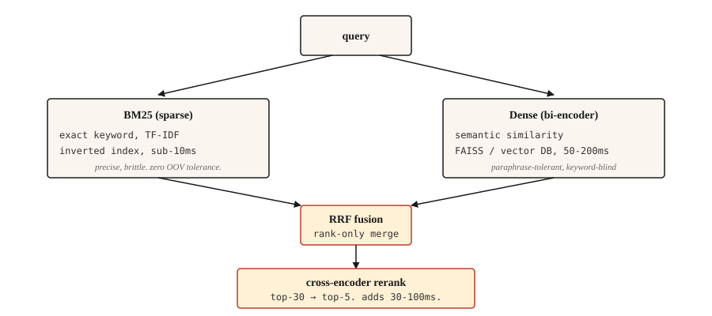

# 信息检索与搜索

> BM25 精确但脆弱。Dense 撒网更宽，但会漏掉关键词。Hybrid 是 2026 年默认方案。其余都是调参。

**Type:** Build
**Languages:** Python
**Prerequisites:** Phase 5 · 02（BoW + TF-IDF），Phase 5 · 04（GloVe, FastText, Subword）
**Time:** ~75 minutes

## 问题

用户输入 “what happens if someone lies to get money”，期待找到真正覆盖这个问题的法条：“Section 420 IPC”。关键词搜索会完全错过它（没有共享词汇）。如果 embedding 没有在法律文本上训练，语义搜索也会错过它。真正的搜索必须同时处理两种情况。

IR 是每个 RAG 系统、每个搜索框、每个文档站点模糊查找背后的流水线。2026 年能在生产中工作的架构不是单一方法，而是一串互补方法，每一层都捕获上一层会漏掉的失败。

这一课会构建每个部件，并说明每个部件负责捕获哪类失败。

## 概念



四层。按需要选择。

1. **Sparse retrieval（BM25）。** 快，对精确匹配很准，对语义很差。运行在 inverted index 上。百万级文档上每次 query 可以低于 10ms。法规引用、产品代码、错误消息、命名实体这类东西，它能找准。
2. **Dense retrieval。** 把 query 和 documents 编码成向量。做 nearest neighbor search。能捕获 paraphrase 和语义相似。会漏掉只差一个字符的精确关键词匹配。用 FAISS 或 vector DB，每次 query 通常 50-200ms。
3. **Fusion。** 合并 sparse 和 dense 的排序列表。Reciprocal Rank Fusion（RRF）是简单默认方案，因为它忽略原始分数（它们位于不同尺度），只使用排名位置。当你知道某个信号在领域内占主导时，也可以用 weighted fusion。
4. **Cross-encoder rerank。** 取 fusion 的 top-30。运行 cross-encoder（query + document 放在一起，对每个 pair 打分）。保留 top-5。Cross-encoder 对每个 pair 比 bi-encoder 慢，但准确得多。你只在 top-30 上跑它，以此摊薄成本。

三路检索（BM25 + dense + SPLADE 这类 learned-sparse）在 2026 年 benchmark 上优于两路检索，但需要 learned-sparse index 的基础设施。对多数团队来说，两路检索加 cross-encoder rerank 是最合适的平衡点。

## Build It

### Step 1：从零实现 BM25

```python
import math
import re
from collections import Counter

TOKEN_RE = re.compile(r"[a-z0-9]+")


def tokenize(text):
    return TOKEN_RE.findall(text.lower())


class BM25:
    def __init__(self, corpus, k1=1.5, b=0.75):
        if not corpus:
            raise ValueError("corpus must not be empty")
        self.corpus = [tokenize(d) for d in corpus]
        self.k1 = k1
        self.b = b
        self.n_docs = len(self.corpus)
        self.avg_dl = sum(len(d) for d in self.corpus) / self.n_docs
        self.df = Counter()
        for doc in self.corpus:
            for term in set(doc):
                self.df[term] += 1

    def idf(self, term):
        n = self.df.get(term, 0)
        return math.log(1 + (self.n_docs - n + 0.5) / (n + 0.5))

    def score(self, query, doc_idx):
        q_tokens = tokenize(query)
        doc = self.corpus[doc_idx]
        dl = len(doc)
        freq = Counter(doc)
        score = 0.0
        for term in q_tokens:
            f = freq.get(term, 0)
            if f == 0:
                continue
            numerator = f * (self.k1 + 1)
            denominator = f + self.k1 * (1 - self.b + self.b * dl / self.avg_dl)
            score += self.idf(term) * numerator / denominator
        return score

    def rank(self, query, top_k=10):
        scored = [(self.score(query, i), i) for i in range(self.n_docs)]
        scored.sort(reverse=True)
        return scored[:top_k]
```

两个参数值得认识。`k1=1.5` 控制 term-frequency saturation；越高，重复词的权重越大。`b=0.75` 控制 length normalization；0 会忽略文档长度，1 会完全归一化。默认值来自 Robertson 在原始论文中的建议，很少需要调整。

### Step 2：用 bi-encoder 做 dense retrieval

```python
from sentence_transformers import SentenceTransformer
import numpy as np


def build_dense_index(corpus, model_id="sentence-transformers/all-MiniLM-L6-v2"):
    encoder = SentenceTransformer(model_id)
    embeddings = encoder.encode(corpus, normalize_embeddings=True)
    return encoder, embeddings


def dense_search(encoder, embeddings, query, top_k=10):
    q_emb = encoder.encode([query], normalize_embeddings=True)
    sims = (embeddings @ q_emb.T).flatten()
    order = np.argsort(-sims)[:top_k]
    return [(float(sims[i]), int(i)) for i in order]
```

对 embedding 做 L2 归一化，这样点积就等于 cosine。`all-MiniLM-L6-v2` 是 384 维，速度快，对多数英文检索足够强。多语言场景使用 `paraphrase-multilingual-MiniLM-L12-v2`。追求最高准确率时，用 `bge-large-en-v1.5` 或 `e5-large-v2`。

### Step 3：Reciprocal Rank Fusion

```python
def reciprocal_rank_fusion(rankings, k=60):
    scores = {}
    for ranking in rankings:
        for rank, (_, doc_idx) in enumerate(ranking):
            scores[doc_idx] = scores.get(doc_idx, 0.0) + 1.0 / (k + rank + 1)
    fused = sorted(scores.items(), key=lambda x: x[1], reverse=True)
    return [(score, doc_idx) for doc_idx, score in fused]
```

`k=60` 常量来自原始 RRF 论文。更高的 `k` 会压平不同排名之间的贡献差异；更低的 `k` 会让靠前排名占主导。60 是论文默认值，很少需要调整。

### Step 4：hybrid search + rerank

```python
from sentence_transformers import CrossEncoder

reranker = CrossEncoder("cross-encoder/ms-marco-MiniLM-L-6-v2")


def hybrid_search(query, bm25, encoder, dense_embeddings, corpus, top_k=5, pool_size=30, reranker=reranker):
    sparse_ranking = bm25.rank(query, top_k=pool_size)
    dense_ranking = dense_search(encoder, dense_embeddings, query, top_k=pool_size)
    fused = reciprocal_rank_fusion([sparse_ranking, dense_ranking])[:pool_size]

    pairs = [(query, corpus[doc_idx]) for _, doc_idx in fused]
    scores = reranker.predict(pairs)
    reranked = sorted(zip(scores, [doc_idx for _, doc_idx in fused]), reverse=True)
    return reranked[:top_k]
```

三个阶段组合在一起。BM25 找 lexical matches。Dense 找 semantic matches。RRF 合并两个 ranking，而且不需要 score calibration。Cross-encoder 用 query-document pairs 一起重新打分 top-30，捕获 bi-encoder 漏掉的细粒度相关性。最后保留 top-5。

### Step 5：评估

| Metric | Meaning |
|--------|---------|
| Recall@k | 在正确文档存在的 query 中，它有多少次出现在 top-k 里？ |
| MRR（Mean Reciprocal Rank） | 第一个相关文档排名倒数的平均值。 |
| nDCG@k | 不只看二元相关/不相关，也考虑相关程度。 |

对 RAG 来说，retriever 的 **Recall@k** 是最重要的数字。如果正确 passage 不在检索结果里，reader 就无法回答。

调试技巧：对失败 query，diff sparse 和 dense 的 ranking。如果其中一个找到了正确文档而另一个没有，你要么遇到了词汇不匹配（修复：补上缺失的那一半），要么遇到了语义歧义（修复：更好的 embedding 或 reranker）。

## Use It

2026 年的技术栈：

| Scale | Stack |
|-------|-------|
| 1k-100k docs | 内存 BM25 + `all-MiniLM-L6-v2` embeddings + RRF。不需要单独 DB。 |
| 100k-10M docs | FAISS 或 pgvector 做 dense + Elasticsearch / OpenSearch 做 BM25。并行运行。 |
| 10M+ docs | Qdrant / Weaviate / Vespa / Milvus，使用 hybrid support。在 top-30 上做 cross-encoder rerank。 |
| Best-quality frontier | 三路检索（BM25 + dense + SPLADE）+ ColBERT late-interaction reranking |

无论选什么，都要给评估留预算。先 benchmark retrieval recall，再 benchmark 端到端 RAG accuracy。Reader 修不好 retriever 漏掉的东西。

### 2026 年生产 RAG 的硬经验

- **80% 的 RAG 失败源于 ingestion 和 chunking，而不是模型。** 团队花几周换 LLM、调 prompt，同时 retrieval 每三次 query 就悄悄返回一次错误 context。先修 chunking。
- **Chunking strategy 比 chunk size 更重要。** 固定大小切分会打碎表格、代码和嵌套标题。Sentence-aware 是默认选择；对技术文档和产品手册，semantic 或 LLM-based chunking 值得付出成本。
- **Parent-doc pattern。** 检索小的 “child” chunks 以获得精度。当同一 parent section 下的多个 child 出现时，换入 parent block 来保留上下文。这通常能稳定提升答案质量，而且不需要重新训练。
- **k_rerank=3 通常最优。** 超过这个数量的每个额外 chunk 都会增加 token 成本和生成延迟，却不提升答案质量。如果你的 k=8 仍然优于 k=3，说明 reranker 表现不够好。
- **HyDE / query expansion。** 根据 query 生成一个 hypothetical answer，对它做 embedding，再检索。这能弥合短问题和长文档之间的措辞差异。不训练也能免费提升 precision。
- **Context budget 控制在 8K tokens 以下。** 如果经常打满这个限制，说明 reranker threshold 太松。
- **版本化一切。** Prompts、chunking rules、embedding model、reranker。任何 drift 都会悄悄破坏答案质量。CI 应该用 faithfulness、context precision 和 unanswered-question rate 作为 gate，在用户看到之前拦住回归。
- **三路检索（BM25 + dense + SPLADE 这类 learned-sparse）在 2026 benchmark 上优于两路检索**，尤其适合 proper nouns 和语义混合的 query。当基础设施支持 SPLADE index 时，就可以上线。

根据 2026 年行业测量，合理的 retrieval design 可以把 hallucination 减少 70-90%。多数 RAG 性能收益来自更好的 retrieval，而不是模型 fine-tuning。

## Ship It

保存为 `outputs/skill-retrieval-picker.md`：

```markdown
---
name: retrieval-picker
description: Pick a retrieval stack for a given corpus and query pattern.
version: 1.0.0
phase: 5
lesson: 14
tags: [nlp, retrieval, rag, search]
---

Given requirements (corpus size, query pattern, latency budget, quality bar, infra constraints), output:

1. Stack. BM25 only, dense only, hybrid (BM25 + dense + RRF), hybrid + cross-encoder rerank, or three-way (BM25 + dense + learned-sparse).
2. Dense encoder. Name the specific model (`all-MiniLM-L6-v2`, `bge-large-en-v1.5`, `e5-large-v2`, `paraphrase-multilingual-MiniLM-L12-v2`). Match to language, domain, context length.
3. Reranker. Name the cross-encoder model if used (`cross-encoder/ms-marco-MiniLM-L-6-v2`, `BAAI/bge-reranker-large`). Flag ~30-100ms added latency on top-30.
4. Evaluation plan. Recall@10 is the primary retriever metric. MRR for multi-answer. Baseline first, incremental improvements measured against it.

Refuse to recommend dense-only for corpora with named entities, error codes, or product SKUs unless the user has evidence dense handles exact matches. Refuse to skip reranking for high-stakes retrieval (legal, medical) where the final top-5 decides the user's answer.
```

## 练习

1. **（Easy）** 在一个 500-document corpus 上实现上面的 `hybrid_search`。测试 20 个 query。比较 BM25-only、dense-only 和 hybrid 的 recall at 5。
2. **（Medium）** 添加 MRR 计算。对每个有已知正确文档的测试 query，找到正确 doc 在 BM25、dense 和 hybrid ranking 中的排名。报告每种方法的 MRR。
3. **（Hard）** 使用 MultipleNegativesRankingLoss（Sentence Transformers）在你的领域上 fine-tune 一个 dense encoder。用 500 对 query-document 构建训练集。比较 fine-tune 前后的 recall。

## 关键术语

| 术语 | 常见说法 | 实际含义 |
|------|----------|----------|
| BM25 | 关键词搜索 | Okapi BM25。根据 term frequency、IDF 和长度给文档打分。 |
| Dense retrieval | 向量搜索 | 把 query 和 doc 编码成向量，寻找 nearest neighbors。 |
| Bi-encoder | Embedding model | 独立编码 query 和 doc。查询时速度快。 |
| Cross-encoder | Reranker model | 把 query 和 doc 放在一起编码。慢，但准确。 |
| RRF | Rank fusion | 通过求和 `1/(k + rank)` 合并两个 ranking。 |
| Recall@k | 检索指标 | top-k 中包含相关 doc 的 query 比例。 |

## 延伸阅读

- [Robertson and Zaragoza (2009). The Probabilistic Relevance Framework: BM25 and Beyond](https://www.staff.city.ac.uk/~sbrp622/papers/foundations_bm25_review.pdf)：BM25 的权威处理。
- [Karpukhin et al. (2020). Dense Passage Retrieval for Open-Domain QA](https://arxiv.org/abs/2004.04906)：DPR，规范 bi-encoder。
- [Formal et al. (2021). SPLADE: Sparse Lexical and Expansion Model](https://arxiv.org/abs/2107.05720)：缩小与 dense 差距的 learned-sparse retriever。
- [Cormack, Clarke, Büttcher (2009). Reciprocal Rank Fusion outperforms Condorcet and individual Rank Learning Methods](https://plg.uwaterloo.ca/~gvcormac/cormacksigir09-rrf.pdf)：RRF 论文。
- [Khattab and Zaharia (2020). ColBERT: Efficient and Effective Passage Search](https://arxiv.org/abs/2004.12832)：late-interaction retrieval。
