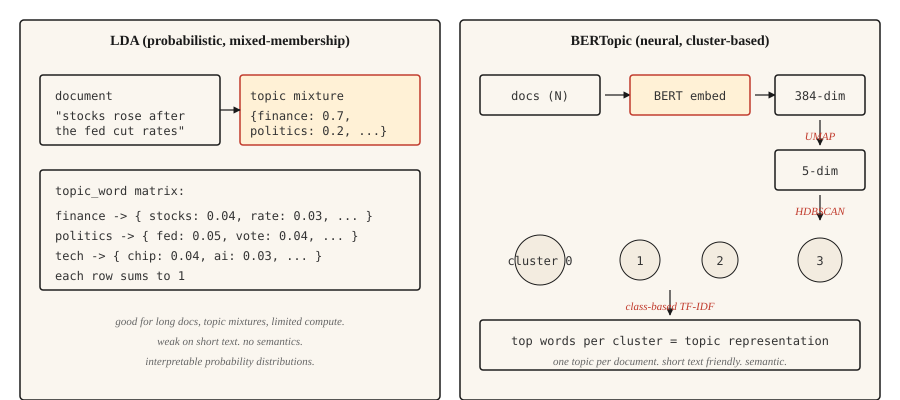

# 主题建模 — LDA 和 BERTopic

> LDA：documents 是 topics 的混合，topics 是 words 上的分布。BERTopic：documents 在 embedding space 中聚类，clusters 就是 topics。同一个目标，不同的分解方式。

**Type:** Learn
**Languages:** Python
**Prerequisites:** Phase 5 · 02 (BoW + TF-IDF), Phase 5 · 03 (Word2Vec)
**Time:** ~45 minutes

## 问题

你有 10,000 张客户支持 tickets、50,000 篇新闻文章，或者 200,000 条 tweets。你需要知道整个集合在讲什么，但不可能逐条阅读。你没有标注好的 categories。你甚至不知道到底有多少 categories。

Topic modeling 用无监督方式回答这个问题。给它一个 corpus，它会返回一小组 coherent topics，并为每个 document 给出这些 topics 上的分布。

两个算法家族占主导。LDA（2003）把每个 document 看成 latent topics 的混合，把每个 topic 看成 words 上的分布。Inference 是 Bayesian 的。当你需要 mixed-membership topic assignments 和可解释的 word-level probability distributions 时，它今天仍然在生产中使用。

BERTopic（2020）用 BERT 编码 documents，用 UMAP 降维，用 HDBSCAN 聚类，再通过 class-based TF-IDF 抽取 topic words。它在短文本、社交媒体，以及任何语义相似性比词重叠更重要的场景中表现更好。一个 document 得到一个 topic，这是它面对长内容时的限制。

这一课会为两者建立直觉，并说明给定 corpus 时应该选哪一个。

## 概念



**LDA generative story。** 每个 topic 是 words 上的分布。每个 document 是 topics 的混合。要生成 document 中的一个 word，先从 document 的 topic mixture 中采样一个 topic，再从这个 topic 的 word distribution 中采样一个 word。Inference 会反过来做：给定观察到的 words，推断每个 document 的 topic distribution，以及每个 topic 的 word distribution。Collapsed Gibbs sampling 或 variational Bayes 负责数学部分。

LDA 的关键输出：

- `doc_topic`：矩阵 `(n_docs, n_topics)`，每行加起来为 1（document 的 topic mixture）。
- `topic_word`：矩阵 `(n_topics, vocab_size)`，每行加起来为 1（topic 的 word distribution）。

**BERTopic pipeline。**

1. 用 sentence transformer（例如 `all-MiniLM-L6-v2`）编码每个 document。得到 384 维向量。
2. 用 UMAP 把维度降到大约 5 维。BERT embeddings 对 clustering 来说维度太高。
3. 用 HDBSCAN 聚类。它是 density-based 的，会产生大小可变的 clusters 和一个 “outlier” label。
4. 对每个 cluster，在 cluster documents 上计算 class-based TF-IDF，抽取 top words。

输出是每个 document 一个 topic（再加上 `-1` outlier label）。可选地，也可以通过 HDBSCAN 的 probability vector 得到 soft membership。

## 动手构建

### Step 1：用 scikit-learn 跑 LDA

```python
from sklearn.feature_extraction.text import CountVectorizer
from sklearn.decomposition import LatentDirichletAllocation
import numpy as np


def fit_lda(documents, n_topics=5, max_features=1000):
    cv = CountVectorizer(
        max_features=max_features,
        stop_words="english",
        min_df=2,
        max_df=0.9,
    )
    X = cv.fit_transform(documents)
    lda = LatentDirichletAllocation(
        n_components=n_topics,
        random_state=42,
        max_iter=50,
        learning_method="online",
    )
    doc_topic = lda.fit_transform(X)
    feature_names = cv.get_feature_names_out()
    return lda, cv, doc_topic, feature_names


def print_top_words(lda, feature_names, n_top=10):
    for idx, topic in enumerate(lda.components_):
        top_idx = np.argsort(-topic)[:n_top]
        words = [feature_names[i] for i in top_idx]
        print(f"topic {idx}: {' '.join(words)}")
```

注意：移除了 stopwords，`min_df` 和 `max_df` 会过滤过少出现和过于常见的 terms；使用 `CountVectorizer`（不是 `TfidfVectorizer`），因为 LDA 期望 raw counts。

### Step 2：BERTopic（生产版本）

```python
from bertopic import BERTopic

topic_model = BERTopic(
    embedding_model="sentence-transformers/all-MiniLM-L6-v2",
    min_topic_size=15,
    verbose=True,
)

topics, probs = topic_model.fit_transform(documents)
info = topic_model.get_topic_info()
print(info.head(20))
valid_topics = info[info["Topic"] != -1]["Topic"].tolist()
for topic_id in valid_topics[:5]:
    print(f"topic {topic_id}: {topic_model.get_topic(topic_id)[:10]}")
```

`Topic != -1` 这个过滤会丢掉 BERTopic 的 outlier bucket（HDBSCAN 无法聚类的 documents）。`min_topic_size` 控制 HDBSCAN 的最小 cluster size；BERTopic 库默认值是 10。这个例子为了课程规模显式设置为 15。对超过 10,000 documents 的 corpus，把它提高到 50 或 100。

### Step 3：评估

两种方法都会输出 topic words。问题是这些 words 是否 coherent。

- **Topic coherence（c_v）。** 在 sliding-window contexts 上计算 top-word pairs 的 NPMI（normalized pointwise mutual information），把这些分数聚合成 topic vectors，再用 cosine similarity 比较这些 vectors。越高越好。使用 `gensim.models.CoherenceModel`，并设置 `coherence="c_v"`。
- **Topic diversity。** 所有 topics 的 top words 中，unique words 所占比例。越高越好（topics 不重叠）。
- **Qualitative inspection。** 阅读每个 topic 的 top words。它们是否能命名一个真实东西？Human judgment 仍然是最后一道防线。

## 什么时候选哪个

| Situation | Pick |
|-----------|------|
| 短文本（tweets、reviews、headlines） | BERTopic |
| 带 topic mixtures 的长文档 | LDA |
| 没有 GPU / 计算资源有限 | LDA 或 NMF |
| 需要 document-level multi-topic distributions | LDA |
| 用 LLM 集成 topic labeling | BERTopic（直接支持） |
| Resource-constrained edge deployment | LDA |
| 最大化 semantic coherence | BERTopic |

最大的实际考虑因素是 document length。BERT embeddings 会 truncate；LDA counts 可以处理任意长度。对于超过 embedding model context 的 documents，要么 chunk + aggregate，要么用 LDA。

## 使用它

2026 年的工具栈：

- **BERTopic。** 短文本和任何语义重要场景的默认选择。
- **`gensim.models.LdaModel`。** 经典生产 LDA，成熟，经受过实战。
- **`sklearn.decomposition.LatentDirichletAllocation`。** 适合实验的简单 LDA。
- **NMF。** Non-negative matrix factorization。LDA 的快速替代方案，在短文本上质量相近。
- **Top2Vec。** 设计上类似 BERTopic。社区更小，但在某些 benchmark 上表现很好。
- **FASTopic。** 更新，比 BERTopic 在超大 corpus 上更快。
- **LLM-based labeling。** 先运行任意 clustering，然后 prompt 一个模型为每个 cluster 命名。

## 交付它

保存为 `outputs/skill-topic-picker.md`：

```markdown
---
name: topic-picker
description: Pick LDA or BERTopic for a corpus. Specify library, knobs, evaluation.
version: 1.0.0
phase: 5
lesson: 15
tags: [nlp, topic-modeling]
---

Given a corpus description (document count, avg length, domain, language, compute budget), output:

1. Algorithm. LDA / NMF / BERTopic / Top2Vec / FASTopic. One-sentence reason.
2. Configuration. Number of topics: `recommended = max(5, round(sqrt(n_docs)))`, clamped to 200 for corpora under 40,000 docs; permit >200 only when the corpus is genuinely large (>40k) and note the increased compute cost. `min_df` / `max_df` filters and embedding model for neural approaches also belong here.
3. Evaluation. Topic coherence (c_v) via `gensim.models.CoherenceModel`, topic diversity, and a 20-sample human read.
4. Failure mode to probe. For LDA, "junk topics" absorbing stopwords and frequent terms. For BERTopic, the -1 outlier cluster swallowing ambiguous documents.

Refuse BERTopic on documents longer than the embedding model's context window without a chunking strategy. Refuse LDA on very short text (tweets, reviews under 10 tokens) as coherence collapses. Flag any n_topics choice below 5 as likely wrong; flag >200 on corpora under 40k docs as likely over-splitting.
```

## 练习

1. **Easy.** 在 20 Newsgroups dataset 上用 5 个 topics 拟合 LDA。打印每个 topic 的 top 10 words。手动给每个 topic 命名。算法找到了真实 categories 吗？
2. **Medium.** 在同一个 20 Newsgroups subset 上拟合 BERTopic。比较它和 LDA 找到的 topic 数量、top words、qualitative coherence。哪个更干净地浮现出真实 categories？
3. **Hard.** 在你的 corpus 上分别计算 LDA 和 BERTopic 的 c_v coherence。每个方法都跑 5、10、20、50 个 topics。画出 coherence vs topic count。报告哪个方法在不同 topic counts 上更稳定。

## 关键术语

| Term | What people say | What it actually means |
|------|-----------------|-----------------------|
| Topic | Corpus 在讲的一个东西 | 一组 words 上的 probability distribution（LDA），或一组相似 documents 的 cluster（BERTopic）。 |
| Mixed membership | 一个 doc 属于多个 topics | LDA 为每个 document 分配所有 topics 上的分布。 |
| UMAP | Dimensionality reduction | 保留局部结构的 manifold learning；BERTopic 中会用到。 |
| HDBSCAN | Density clustering | 找到大小可变的 clusters；为 outliers 产生 “noise” label（-1）。 |
| c_v coherence | Topic quality metric | 在 sliding windows 内，topic top words 的 average pointwise mutual information。 |

## 延伸阅读

- [Blei, Ng, Jordan (2003). Latent Dirichlet Allocation](https://www.jmlr.org/papers/volume3/blei03a/blei03a.pdf) — LDA 论文。
- [Grootendorst (2022). BERTopic: Neural topic modeling with a class-based TF-IDF procedure](https://arxiv.org/abs/2203.05794) — BERTopic 论文。
- [Röder, Both, Hinneburg (2015). Exploring the Space of Topic Coherence Measures](https://svn.aksw.org/papers/2015/WSDM_Topic_Evaluation/public.pdf) — 引入 c_v 等 coherence measures 的论文。
- [BERTopic documentation](https://maartengr.github.io/BERTopic/) — 生产参考。示例非常好。
