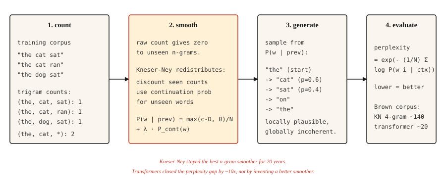

# Transformers 之前的文本生成：N-gram Language Models

> 如果一个 word 很 surprising，model 就不好。Perplexity 把 surprise 变成数字。Smoothing 让它保持有限。

**Type:** Build
**Languages:** Python
**Prerequisites:** Phase 5 · 01 (Text Processing), Phase 2 · 14 (Naive Bayes)
**Time:** ~45 minutes

## 问题

在 transformers 之前，在 RNNs 之前，在 word embeddings 之前，language model 通过统计某个 word 在前面 `n-1` 个 words 之后出现的频率，来预测 next word。Count "the cat" → "sat" 出现 47 次，"the cat" → "jumped" 出现 12 次，"the cat" → "refrigerator" 出现 0 次。Normalize 之后得到 probability distribution。

这就是 n-gram language model。从 1980 到 2015 年，每个 speech recognizer、每个 spell checker、每个 phrase-based machine translation system 都跑着它。当你需要便宜的 on-device language modeling 时，它现在仍然会被使用。

真正有趣的问题是如何处理 unseen n-grams。Raw count-based model 会给所有未见过的序列分配 zero probability；这很灾难，因为 sentences 很长，而几乎每个 long sentence 都至少包含一个 unseen sequence。五十年的 smoothing research 解决了这个问题。Kneser-Ney smoothing 是结果，而 modern deep learning 继承了这套经验传统。

## 概念



**N-gram probability:** `P(w_i | w_{i-n+1}, ..., w_{i-1})`。固定 `n`（trigrams 通常取 3，4-grams 取 4）。从 counts 计算：

```text
P(w | context) = count(context, w) / count(context)
```

**Zero-count problem.** 训练中没有出现过的任何 n-gram 都会得到 probability zero。2007 年一项 Brown corpus 研究发现，即便是 4-gram model，held-out 4-grams 中也有 30% 在 training 中没见过。没有 smoothing，你无法在任何真实文本上 evaluation。

**Smoothing approaches，按 sophistication 排序：**

1. **Laplace (add-one).** 给每个 count 加 1。简单，但在 rare events 上很糟。
2. **Good-Turing.** 基于 frequency-of-frequencies，把 probability mass 从 higher-frequency events 重新分配给 unseen ones。
3. **Interpolation.** 用可调 weights 组合 n-gram、(n-1)-gram 等 estimates。
4. **Backoff.** 如果 n-gram count 为 zero，就回退到 (n-1)-gram。Katz backoff 会对它做 normalization。
5. **Absolute discounting.** 从所有 counts 中减去固定 discount `D`，再把释放出的质量分配给 unseen。
6. **Kneser-Ney.** Absolute discounting 加上一个聪明的 lower-order model 选择：使用 *continuation probability*（一个 word 出现在多少个 contexts 中），而不是 raw frequency。

Kneser-Ney 的洞察很深。"San Francisco" 是一个常见 bigram。Unigram "Francisco" 主要出现在 "San" 之后。Naive absolute discounting 会给 "Francisco" 很高的 unigram probability（因为 count 很高）。Kneser-Ney 注意到 "Francisco" 只出现在一个 context 中，因此相应降低它的 continuation probability。结果：一个以 "Francisco" 结尾的 novel bigram 会得到合适的低 probability。

**Evaluation: perplexity.** Held-out test set 上，每个 word 的 average negative log-likelihood 的指数。越低越好。Perplexity 为 100 意味着 model 困惑程度相当于在 100 个 words 中 uniform choose。

```text
perplexity = exp(- (1/N) * Σ log P(w_i | context_i))
```

```figure
ngram-backoff
```

## Build It

### Step 1: trigram counts

```python
from collections import Counter, defaultdict


def train_ngram(corpus_tokens, n=3):
    ngrams = Counter()
    contexts = Counter()
    for sentence in corpus_tokens:
        padded = ["<s>"] * (n - 1) + sentence + ["</s>"]
        for i in range(len(padded) - n + 1):
            ctx = tuple(padded[i:i + n - 1])
            word = padded[i + n - 1]
            ngrams[ctx + (word,)] += 1
            contexts[ctx] += 1
    return ngrams, contexts


def raw_probability(ngrams, contexts, context, word):
    ctx = tuple(context)
    if contexts.get(ctx, 0) == 0:
        return 0.0
    return ngrams.get(ctx + (word,), 0) / contexts[ctx]
```

Input 是 tokenized sentences 的 list。Output 是 n-gram counts 和 context counts。`<s>` 和 `</s>` 是 sentence boundaries。

### Step 2: Laplace smoothing

```python
def laplace_probability(ngrams, contexts, vocab_size, context, word):
    ctx = tuple(context)
    numerator = ngrams.get(ctx + (word,), 0) + 1
    denominator = contexts.get(ctx, 0) + vocab_size
    return numerator / denominator
```

给每个 count 加 1。它确实会 smooth，但会给 unseen events 分配过多 mass，同时伤害 rare-known events。

### Step 3: Kneser-Ney（bigram, interpolated）

```python
def kneser_ney_bigram_model(corpus_tokens, discount=0.75):
    unigrams = Counter()
    bigrams = Counter()
    unigram_contexts = defaultdict(set)

    for sentence in corpus_tokens:
        padded = ["<s>"] + sentence + ["</s>"]
        for i, w in enumerate(padded):
            unigrams[w] += 1
            if i > 0:
                prev = padded[i - 1]
                bigrams[(prev, w)] += 1
                unigram_contexts[w].add(prev)

    total_unique_bigrams = sum(len(ctx_set) for ctx_set in unigram_contexts.values())
    continuation_prob = {
        w: len(ctx_set) / total_unique_bigrams for w, ctx_set in unigram_contexts.items()
    }

    context_totals = Counter()
    for (prev, w), count in bigrams.items():
        context_totals[prev] += count

    unique_follow = defaultdict(set)
    for (prev, w) in bigrams:
        unique_follow[prev].add(w)

    def prob(prev, w):
        count = bigrams.get((prev, w), 0)
        denom = context_totals.get(prev, 0)
        if denom == 0:
            return continuation_prob.get(w, 1e-9)
        first_term = max(count - discount, 0) / denom
        lambda_prev = discount * len(unique_follow[prev]) / denom
        return first_term + lambda_prev * continuation_prob.get(w, 1e-9)

    return prob
```

这里有三个 moving parts。`continuation_prob` 捕捉的是“这个 word 出现在多少个不同 contexts 中？”（Kneser-Ney 的创新）。`lambda_prev` 是 discount 释放出的 mass，用来给 backoff 加权。最终 probability 是 discounted main term 加上 weighted continuation term。

### Step 4: 用 sampling 生成文本

```python
import random


def generate(prob_fn, vocab, prefix, max_len=30, seed=0):
    rng = random.Random(seed)
    tokens = list(prefix)
    for _ in range(max_len):
        candidates = [(w, prob_fn(tokens[-1], w)) for w in vocab]
        total = sum(p for _, p in candidates)
        r = rng.random() * total
        acc = 0.0
        for w, p in candidates:
            acc += p
            if r <= acc:
                tokens.append(w)
                break
        if tokens[-1] == "</s>":
            break
    return tokens
```

按 probability 成比例 sampling。每个 seed 都会给出不同 output。如果想要类似 beam-search 的 output，可以在每一步取 argmax（greedy），再加一个小的 randomness knob（temperature）。

### Step 5: perplexity

```python
import math


def perplexity(prob_fn, sentences):
    total_log_prob = 0.0
    total_tokens = 0
    for sentence in sentences:
        padded = ["<s>"] + sentence + ["</s>"]
        for i in range(1, len(padded)):
            p = prob_fn(padded[i - 1], padded[i])
            total_log_prob += math.log(max(p, 1e-12))
            total_tokens += 1
    return math.exp(-total_log_prob / total_tokens)
```

越低越好。对于 Brown corpus，一个调得好的 4-gram KN model 的 perplexity 大约是 140。Transformer LM 在同一 test set 上可以达到 15-30。差距约 10 倍。这就是这个领域继续向前走的原因。

## Use It

- **Classical NLP teaching.** 这是接触 smoothing、MLE 和 perplexity 最清楚的方式。
- **KenLM.** Production n-gram library。在 low latency 很重要的 speech 和 MT systems 中，它会作为 rescorer 使用。
- **On-device autocomplete.** 键盘里的 trigram models。现在仍然如此。
- **Baselines.** 在宣布你的 neural LM 很好之前，永远先计算一个 n-gram LM perplexity。如果你的 transformer 没有大幅击败 KN，那一定有哪里不对。

## Ship It

保存为 `outputs/prompt-lm-baseline.md`：

```markdown
---
name: lm-baseline
description: Build a reproducible n-gram language model baseline before training a neural LM.
phase: 5
lesson: 16
---

Given a corpus and target use (next-word prediction, rescoring, perplexity baseline), output:

1. N-gram order. Trigram for general English, 4-gram if corpus is large, 5-gram for speech rescoring.
2. Smoothing. Modified Kneser-Ney is the default; Laplace only for teaching.
3. Library. `kenlm` for production, `nltk.lm` for teaching, roll your own only to learn.
4. Evaluation. Held-out perplexity with consistent tokenization between train and test sets.

Refuse to report perplexity computed with different tokenization between systems being compared — perplexity numbers are comparable only under identical tokenization. Flag OOV rate in test set; KN handles OOV poorly unless you reserve a special <UNK> token during training.
```

## 练习

1. **Easy.** 在 1,000-sentence Shakespeare corpus 上训练 trigram LM。生成 20 个 sentences。它们会局部可信，但整体 incoherent。这是 canonical demo。
2. **Medium.** 为你的 KN model 在 held-out Shakespeare split 上实现 perplexity。和 Laplace 比较。你应该看到 KN 的 perplexity 低 30-50%。
3. **Hard.** 构建一个 trigram spell corrector：给定 misspelled word 及其 context，生成 corrections，并按 LM 的 context probability 排序。在 Birkbeck spelling corpus（public）上 evaluation。

## 关键术语

| Term | 人们通常怎么说 | 它实际是什么意思 |
|------|----------------|------------------|
| N-gram | Word sequence | 连续 `n` 个 tokens 的 sequence。 |
| Smoothing | Avoiding zeros | 重新分配 probability mass，让 unseen events 得到 non-zero probability。 |
| Perplexity | LM quality metric | Held-out data 上的 `exp(-average log-prob)`。越低越好。 |
| Backoff | Fallback to shorter context | 如果 trigram count 为 zero，就使用 bigram。Katz backoff 会 formalize 这一点。 |
| Kneser-Ney | Best smoothing for n-grams | Absolute discounting + lower-order model 的 continuation probability。 |
| Continuation probability | KN-specific | `P(w)` 按 `w` 出现过的 contexts 数量加权，而不是按 raw count 加权。 |

## 延伸阅读

- [Jurafsky and Martin — Speech and Language Processing, Chapter 3 (2026 draft)](https://web.stanford.edu/~jurafsky/slp3/3.pdf) — n-gram LMs 和 smoothing 的 canonical treatment。
- [Chen and Goodman (1998). An Empirical Study of Smoothing Techniques for Language Modeling](https://dash.harvard.edu/handle/1/25104739) — 确立 Kneser-Ney 作为最佳 n-gram smoother 的 paper。
- [Kneser and Ney (1995). Improved Backing-off for M-gram Language Modeling](https://ieeexplore.ieee.org/document/479394) — 原始 KN paper。
- [KenLM](https://kheafield.com/code/kenlm/) — 快速 production n-gram LM，2026 年仍用于 latency-sensitive applications。
