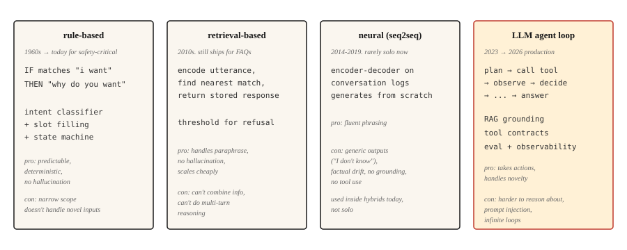

# 聊天机器人：从规则到神经网络再到 LLM Agent

> ELIZA 用模式匹配回复。DialogFlow 映射意图。GPT 从权重中回答。Claude 调用工具并验证。每个时代都解决了上一个时代最明显的失败。

**Type:** Learn
**Languages:** Python
**Prerequisites:** Phase 5 · 13 (Question Answering), Phase 5 · 14 (Information Retrieval)
**Time:** ~75 minutes

## 学习目标

- 区分规则式、检索式、神经生成式和 LLM agent 四类聊天机器人架构
- 实现一个 ELIZA 风格的规则匹配 responder
- 解释 FAQ 检索系统为什么需要相似度阈值和拒答路径
- 描述 LLM agent loop 中 plan、tool call、observe 和 final answer 的控制流
- 为生产 chatbot 设计混合路由，并识别 prompt injection、无限循环和上下文耗尽等失败模式

## 问题

用户说：“我想改签航班。”系统必须弄清用户想要什么、缺少哪些信息、如何获取这些信息，以及如何完成这个动作。然后用户又说：“等等，如果我改成取消呢？”系统必须记住上下文、切换任务，并保存状态。

对 ML 系统来说，对话很难。输入是开放式的。输出必须在多轮中保持连贯。系统可能还需要对真实世界采取行动（改签航班、扣款）。每一步错误都会被用户看见。

聊天机器人架构经历了四种范式循环，每一种都是因为上一种的失败太显眼才出现的。本课会按顺序走过它们。2026 年的生产格局是最后两种范式的混合体。

## 概念



**规则式（ELIZA、AIML、DialogFlow）。** 手写 pattern 匹配用户输入并生成回复。Intent classifier 把请求路由到预定义流程。Slot-filling 状态机会收集必需信息。在设计好的窄域内效果非常好。一旦超出范围，马上失败。在不能容忍幻觉的安全关键领域（银行认证、机票预订）仍然会上线。

**检索式。** FAQ 风格系统。编码每一对 `(utterance, response)`。运行时编码用户消息，检索最近的已存回复。可以把它理解成 Zendesk 经典的“similar articles”功能。比规则更能处理改写。没有生成，所以没有幻觉。

**神经生成式（seq2seq）。** 在对话日志上训练 encoder-decoder。从零生成回复。语言流畅，但容易输出泛泛之谈（“I don't know”）和事实漂移。始终难以可靠地保持话题。这就是 Google、Facebook 和 Microsoft 在 2016-2019 年的聊天机器人都让人失望的原因。

**LLM agents。** 把语言模型包在一个会规划、调用工具、验证结果的循环里。它不是一个带长 prompt 的聊天机器人，而是一个 agent loop：plan → call tool → observe result → decide next step。Retrieval-first grounding（RAG）让它不容易幻觉。Tool call 让它真的能做事。这就是 2026 年的架构。

这四种范式不是线性替代关系。一个 2026 年的生产 chatbot 会经过全部四类路由：规则式用于认证和破坏性操作，检索式用于 FAQ，神经生成用于自然表达，LLM agent 用于模糊的开放式查询。

## Build It

### Step 1：规则式模式匹配

```python
import re


class RulePattern:
    def __init__(self, pattern, response_template):
        self.regex = re.compile(pattern, re.IGNORECASE)
        self.template = response_template


PATTERNS = [
    RulePattern(r"my name is (\w+)", "Nice to meet you, {0}."),
    RulePattern(r"i (need|want) (.+)", "Why do you {0} {1}?"),
    RulePattern(r"i feel (.+)", "Why do you feel {0}?"),
    RulePattern(r"(.*)", "Tell me more about that."),
]


def rule_based_respond(user_input):
    for pattern in PATTERNS:
        m = pattern.regex.match(user_input.strip())
        if m:
            return pattern.template.format(*m.groups())
    return "I don't understand."
```

20 行里的 ELIZA。反射技巧（"I feel sad" → "Why do you feel sad"）是 Weizenbaum 1966 年心理治疗师 demo 的经典做法。现在仍然很有教学价值。

### Step 2：检索式（FAQ）

这个教学片段需要 `pip install sentence-transformers`（它会拉入 torch）。本课可运行的 `code/main.py` 改用 stdlib Jaccard similarity，所以 lesson 不依赖外部包也能跑。

```python
from sentence_transformers import SentenceTransformer
import numpy as np


FAQ = [
    ("how do i reset my password", "Go to Settings > Security > Reset Password."),
    ("how do i cancel my order", "Go to Orders, find the order, click Cancel."),
    ("what is your return policy", "30-day returns on unused items, original packaging."),
]


encoder = SentenceTransformer("sentence-transformers/all-MiniLM-L6-v2")
faq_questions = [q for q, _ in FAQ]
faq_embeddings = encoder.encode(faq_questions, normalize_embeddings=True)


def faq_respond(user_input, threshold=0.5):
    q_emb = encoder.encode([user_input], normalize_embeddings=True)[0]
    sims = faq_embeddings @ q_emb
    best = int(np.argmax(sims))
    if sims[best] < threshold:
        return None
    return FAQ[best][1]
```

基于阈值的拒答是关键设计选择。如果最佳匹配还不够接近，就返回 `None`，让系统升级到下一层。

### Step 3：神经生成（baseline）

使用一个小型 instruction-tuned encoder-decoder（FLAN-T5）或一个微调过的对话模型。到 2026 年，它单独用于生产已经不可靠（会矛盾、跑题、产生事实胡话），但仍然会作为混合系统的一部分，用来生成自然表达。DialoGPT 风格的 decoder-only 模型需要显式 turn separator 和 EOS 处理，才能产出连贯回复；FLAN-T5 的 text2text pipeline 在教学示例里开箱可用。

```python
from transformers import pipeline

chatbot = pipeline("text2text-generation", model="google/flan-t5-small")

response = chatbot("Respond politely to: Hi there!", max_new_tokens=40)
print(response[0]["generated_text"])
```

### Step 4：LLM agent loop

2026 年的生产形态：

```python
def agent_loop(user_message, tools, llm, max_steps=5):
    history = [{"role": "user", "content": user_message}]
    for _ in range(max_steps):
        response = llm(history, tools=tools)
        tool_call = response.get("tool_call")
        if tool_call:
            tool_name = tool_call.get("name")
            args = tool_call.get("arguments")
            if not isinstance(tool_name, str) or tool_name not in tools:
                history.append({"role": "assistant", "tool_call": tool_call})
                history.append({"role": "tool", "name": str(tool_name), "content": f"error: unknown tool {tool_name!r}"})
                continue
            if not isinstance(args, dict):
                history.append({"role": "assistant", "tool_call": tool_call})
                history.append({"role": "tool", "name": tool_name, "content": f"error: arguments must be a dict, got {type(args).__name__}"})
                continue
            fn = tools[tool_name]
            result = fn(**args)
            history.append({"role": "assistant", "tool_call": tool_call})
            history.append({"role": "tool", "name": tool_name, "content": result})
        else:
            return response["content"]
    return "I could not complete the task in the step budget."
```

有三点要说清。Tools 是 LLM 可以调用的函数。LLM 返回最终答案而不是 tool call 时，循环终止。Step budget 会防止模糊任务上的无限循环。

真实生产系统还会加入：retrieval-first grounding（每次 LLM 调用前注入相关文档）、guardrails（破坏性操作必须确认）、observability（记录每一步）和 evaluations（自动检查 agent 行为是否仍在规格内）。

### Step 5：混合路由

```python
def hybrid_chat(user_input):
    if is_destructive_action(user_input):
        return structured_flow(user_input)

    faq_answer = faq_respond(user_input, threshold=0.6)
    if faq_answer:
        return faq_answer

    return agent_loop(user_input, tools, llm)


def is_destructive_action(text):
    danger_words = ["delete", "cancel", "charge", "refund", "transfer"]
    return any(w in text.lower() for w in danger_words)
```

模式是：任何破坏性操作走确定性规则，固定 FAQ 走检索，其他请求走 LLM agent。这就是 2026 年客服系统真正上线的样子。

## Use It

2026 年技术栈：

| 用例 | 架构 |
|------|------|
| 预订、支付、认证 | 规则式状态机 + slot filling |
| 客服 FAQ | 在 curated answers 上做检索 |
| 开放式帮助聊天 | 带 RAG + tool calls 的 LLM agent |
| 内部工具 / IDE assistant | 带 tool calls 的 LLM agent（search、read、write） |
| 陪伴 / 角色聊天机器人 | 带 persona system prompt 的微调 LLM，对知识做检索 |

生产中始终使用混合路由。没有任何单一架构能很好处理每一种请求。路由层本身通常是一个小型 intent classifier。

## 仍然会上线的失败模式

- **自信编造。** LLM agent 声称它完成了某个动作，但其实没有。缓解：验证结果、记录 tool call，绝不允许 LLM 在没有成功 tool return 的情况下声称自己已经做完了某事。
- **Prompt injection。** 用户插入覆盖 system prompt 的文本。它在 OWASP Top 10 for LLM Applications 2025 中排名 LLM01。两种形式：direct injection（直接贴进聊天）和 indirect injection（藏在 agent 会读取的文档、邮件或工具输出中）。

  攻击率随场景而变。前沿模型在通用 tool-use 和 coding benchmark 上测得的成功率大约是 0.5-8.5%。某些高风险设置（针对 AI coding agent 的自适应攻击、脆弱编排）曾达到约 84%。生产 CVE 包括 EchoLeak（CVE-2025-32711，CVSS 9.3）：这是 Microsoft 365 Copilot 中一个由攻击者控制邮件触发的 zero-click 数据外泄漏洞。

  缓解：在整个循环中都把用户输入视为不可信；tool call 前做 sanitize；把工具输出与主 prompt 隔离；使用 Plan-Verify-Execute（PVE）模式，让 agent 先规划，再把每个动作与计划核对后执行（这能阻止工具结果注入新的计划外动作）；破坏性操作要求用户确认；对工具权限使用 least privilege。

  再多 prompt engineering 也不能完全消除这个风险。必须引入外部 runtime defense layer（LLM Guard、allowlist validation、semantic anomaly detection）。
- **范围蔓延。** Agent 因为某个 tool call 返回了相关但偏题的信息而跑偏。缓解：缩窄工具合约；保持 system prompt 聚焦；为 off-task rate 加 evaluation。
- **无限循环。** Agent 反复调用同一个工具。缓解：step budget、tool-call deduplication、用 LLM judge 判断“我们是否在取得进展”。
- **上下文窗口耗尽。** 长对话把最早的轮次挤出上下文。缓解：总结较早轮次、按相似度检索相关历史轮次，或使用长上下文模型。

## Ship It

保存为 `outputs/skill-chatbot-architect.md`：

```markdown
---
name: chatbot-architect
description: Design a chatbot stack for a given use case.
version: 1.0.0
phase: 5
lesson: 17
tags: [nlp, agents, chatbot]
---

Given a product context (user need, compliance constraints, available tools, data volume), output:

1. Architecture. Rule-based, retrieval, neural, LLM agent, or hybrid (specify which paths go where).
2. LLM choice if applicable. Name the model family (Claude, GPT-4, Llama-3.1, Mixtral). Match to tool-use quality and cost.
3. Grounding strategy. RAG sources, retrieval method (see lesson 14), tool contracts.
4. Evaluation plan. Task success rate, tool-call correctness, off-task rate, hallucination rate on held-out dialogs.

Refuse to recommend a pure-LLM agent for any destructive action (payments, account deletion, data modification) without a structured confirmation flow. Refuse to skip the prompt-injection audit if the agent has write access to anything.
```

## 练习

1. **Easy.** 用上面的 rule-based respond 为咖啡店点单机器人实现 10 个 pattern。测试边界情况：重复点单、修改、取消、不清楚的意图。
2. **Medium.** 构建一个 FAQ + LLM fallback 混合系统。为 SaaS 产品准备 50 条固定 FAQ，LLM fallback 对文档站点做 retrieval。用 100 个真实支持问题测量拒答率和准确率。
3. **Hard.** 用三个工具（search、read-user-data、send-email）实现上面的 agent loop。用 50 个测试场景做 evaluation，其中包含 prompt injection 尝试。报告 off-task rate、failed task rate 和所有 injection success。

## 关键术语

| 术语 | 常见说法 | 实际含义 |
|------|----------|----------|
| Intent | 用户想要什么 | 类别标签（book_flight、reset_password）。会被路由到 handler。 |
| Slot | 一片信息 | Bot 需要的参数（日期、目的地）。Slot filling 是逐步询问的过程。 |
| RAG | 检索加生成 | 检索相关文档，再让 LLM 基于它们回答。 |
| Tool call | 函数调用 | LLM 发出带 name + args 的结构化调用。Runtime 执行并返回结果。 |
| Agent loop | 规划、行动、验证 | 控制器交替运行 LLM call 与 tool call，直到任务完成。 |
| Prompt injection | 用户攻击 prompt | 试图覆盖 system prompt 的恶意输入。 |

## 延伸阅读

- [Weizenbaum (1966). ELIZA — A Computer Program For the Study of Natural Language Communication](https://web.stanford.edu/class/cs124/p36-weizenabaum.pdf) — 最早的规则式聊天机器人论文。
- [Thoppilan et al. (2022). LaMDA: Language Models for Dialog Applications](https://arxiv.org/abs/2201.08239) — Google 后期神经聊天机器人论文，刚好处在 LLM agent 接管之前。
- [Yao et al. (2022). ReAct: Synergizing Reasoning and Acting in Language Models](https://arxiv.org/abs/2210.03629) — 命名 agent loop 模式的论文。
- [Anthropic's guide on building effective agents](https://www.anthropic.com/research/building-effective-agents) — 2024 年生产指南，在 2026 年仍然成立。
- [Greshake et al. (2023). Not what you've signed up for: Compromising Real-World LLM-Integrated Applications with Indirect Prompt Injection](https://arxiv.org/abs/2302.12173) — prompt injection 论文。
- [OWASP Top 10 for LLM Applications 2025 — LLM01 Prompt Injection](https://genai.owasp.org/llmrisk/llm01-prompt-injection/) — 让 prompt injection 成为头号安全关注点的排名。
- [AWS — Securing Amazon Bedrock Agents against Indirect Prompt Injections](https://aws.amazon.com/blogs/machine-learning/securing-amazon-bedrock-agents-a-guide-to-safeguarding-against-indirect-prompt-injections/) — 实用的编排层防御，包括 Plan-Verify-Execute 和用户确认流程。
- [EchoLeak (CVE-2025-32711)](https://www.vectra.ai/topics/prompt-injection) — indirect prompt injection 导致 zero-click 数据外泄的代表性 CVE。它说明了为什么有写权限的 agent 需要 runtime defense。
