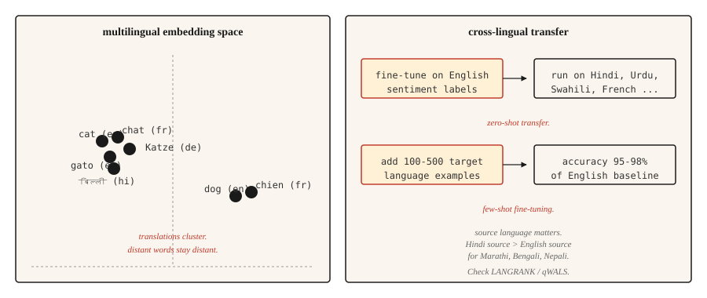

# 多语言 NLP

> 一个模型，100 多种语言，其中大多数没有训练数据。跨语言迁移是 2020 年代最实用的奇迹。

**Type:** Learn
**Languages:** Python
**Prerequisites:** Phase 5 · 04（GloVe, FastText, Subword），Phase 5 · 11（Machine Translation）
**Time:** ~45 minutes

## 问题

英语有数十亿个标注样本。乌尔都语有几千个。迈蒂利语几乎没有。任何服务全球用户的实用 NLP 系统，都必须覆盖那些没有任务专用训练数据的长尾语言。

多语言模型通过同时在多种语言上训练同一个模型来解决这个问题。共享表示让模型能把高资源语言中学到的能力迁移到低资源语言。用英语情感分析数据 fine-tune 模型，它开箱即用地就能在乌尔都语上给出相当不错的情感预测。这就是 zero-shot cross-lingual transfer，它已经重塑了 NLP 面向全球交付的方式。

这一课会点名这些取舍、经典模型，以及刚开始做多语言项目的团队最容易踩坑的一个决策：选择哪种 source language 来迁移。

## 概念



**共享词表。** 多语言模型使用 SentencePiece 或 WordPiece tokenizer，这些 tokenizer 在所有目标语言的文本上训练。词表是共享的：同一个 subword unit 可以表示相关语言中的同一个语素。英语和意大利语里的 `anti-` 会得到同一个 token。

**共享表示。** 一个在多种语言上用 masked language modeling 预训练的 transformer，会学到：不同语言中语义相近的句子会产生相似的 hidden states。mBERT、XLM-R 和 NLLB 都表现出这一点。英语里 “cat” 的 embedding 会聚在法语 “chat” 和西班牙语 “gato” 附近，完整句子的 embedding 也一样。

**Zero-shot transfer。** 在一种语言（通常是英语）的标注数据上 fine-tune 模型。推理时，在模型支持的任意其它语言上运行它。不需要目标语言标签。对类型学上接近的语言，结果很强；对距离较远的语言，结果会弱一些。

**Few-shot fine-tuning。** 在目标语言中加入 100-500 个标注样本。分类任务上的准确率通常会跳到英语 baseline 的 95-98%。这是多语言 NLP 中性价比最高的一根杠杆。

## 模型

| Model | Year | Coverage | Notes |
|-------|------|----------|-------|
| mBERT | 2018 | 104 languages | 在 Wikipedia 上训练。第一个实用多语言 LM。对低资源语言较弱。 |
| XLM-R | 2019 | 100 languages | 在 CommonCrawl 上训练（比 Wikipedia 大得多）。建立了 cross-lingual baseline。Base 270M，Large 550M。 |
| XLM-V | 2023 | 100 languages | 带 1M-token vocabulary 的 XLM-R（对比 250k）。低资源语言表现更好。 |
| mT5 | 2020 | 101 languages | 用于多语言生成的 T5 架构。 |
| NLLB-200 | 2022 | 200 languages | Meta 的翻译模型；包含 55 种低资源语言。 |
| BLOOM | 2022 | 46 languages + 13 programming | 开放的 176B 多语言训练 LLM。 |
| Aya-23 | 2024 | 23 languages | Cohere 的多语言 LLM。在阿拉伯语、印地语、斯瓦希里语上很强。 |

按用例选择。分类任务用 XLM-R-base 是理性的默认值。生成任务根据是翻译还是开放生成，选择 mT5 或 NLLB。LLM 风格任务可以使用 Aya-23 或 Claude，并配合明确的多语言 prompt。

## Source-language 决策（2026 研究）

多数团队默认把英语作为 fine-tuning source。近期研究（2026）显示，这经常是错的。

语言相似度比原始语料规模更能预测迁移质量。对斯拉夫语目标语言，德语或俄语经常胜过英语。对印度语族目标语言，印地语经常胜过英语。**qWALS** 相似度指标（2026，基于 World Atlas of Language Structures 特征）会量化这一点。**LANGRANK**（Lin et al., ACL 2019）是另一种更早的方法，它会结合语言相似度、语料规模和谱系关系来给候选 source languages 排名。

实用规则：如果你的目标语言有一个类型学上接近的高资源亲缘语言，先尝试在那个语言上 fine-tune，再和英语 fine-tune 做比较。

## Build It

### Step 1：zero-shot 跨语言分类

```python
from transformers import AutoTokenizer, AutoModelForSequenceClassification
import torch

tok = AutoTokenizer.from_pretrained("joeddav/xlm-roberta-large-xnli")
model = AutoModelForSequenceClassification.from_pretrained("joeddav/xlm-roberta-large-xnli")


def classify(text, candidate_labels, hypothesis_template="This text is about {}."):
    scores = {}
    for label in candidate_labels:
        hypothesis = hypothesis_template.format(label)
        inputs = tok(text, hypothesis, return_tensors="pt", truncation=True)
        with torch.no_grad():
            logits = model(**inputs).logits[0]
        entail_score = torch.softmax(logits, dim=-1)[2].item()
        scores[label] = entail_score
    return dict(sorted(scores.items(), key=lambda x: -x[1]))


print(classify("I love this product!", ["positive", "negative", "neutral"]))
print(classify("मुझे यह उत्पाद पसंद है!", ["positive", "negative", "neutral"]))
print(classify("J'adore ce produit !", ["positive", "negative", "neutral"]))
```

一个模型，三种语言，同一个 API。XLM-R 在 NLI 数据上训练后，可以通过 entailment trick 很好地迁移到分类任务。

### Step 2：多语言 embedding space

```python
from sentence_transformers import SentenceTransformer
import numpy as np

model = SentenceTransformer("sentence-transformers/paraphrase-multilingual-MiniLM-L12-v2")

pairs = [
    ("The cat is sleeping.", "Le chat dort."),
    ("The cat is sleeping.", "El gato está durmiendo."),
    ("The cat is sleeping.", "Die Katze schläft."),
    ("The cat is sleeping.", "The dog is barking."),
]

for eng, other in pairs:
    emb_eng = model.encode([eng], normalize_embeddings=True)[0]
    emb_other = model.encode([other], normalize_embeddings=True)[0]
    sim = float(np.dot(emb_eng, emb_other))
    print(f"  {eng!r} <-> {other!r}: cos={sim:.3f}")
```

翻译句会在 embedding space 中落得很近。另一个不同的英语句子会更远。这就是 cross-lingual retrieval、clustering 和 similarity 能工作的原因。

### Step 3：few-shot fine-tuning 策略

```python
from transformers import TrainingArguments, Trainer
from datasets import Dataset


def few_shot_finetune(base_model, base_tokenizer, examples):
    ds = Dataset.from_list(examples)

    def tokenize_fn(ex):
        out = base_tokenizer(ex["text"], truncation=True, max_length=128)
        out["labels"] = ex["label"]
        return out

    ds = ds.map(tokenize_fn)
    args = TrainingArguments(
        output_dir="out",
        per_device_train_batch_size=8,
        num_train_epochs=5,
        learning_rate=2e-5,
        save_strategy="no",
    )
    trainer = Trainer(model=base_model, args=args, train_dataset=ds)
    trainer.train()
    return base_model
```

对于 100-500 个目标语言样本，`num_train_epochs=5` 和 `learning_rate=2e-5` 是安全默认值。更高的 learning rate 会让多语言对齐崩塌，最后得到一个只会英语的模型。

## 真正有效的评估

- **在 held-out sets 上分别计算每种语言的准确率。** 不要聚合。聚合指标会隐藏长尾问题。
- **和 monolingual baseline 做 benchmark。** 对数据足够的语言，从零训练的单语言模型有时会打败多语言模型。要测试。
- **Entity-level tests。** 测目标语言中的命名实体。对远离拉丁脚本的文字，多语言模型的 tokenization 经常较弱。
- **Cross-lingual consistency。** 两种语言表达同一含义时，应该产生同一个预测。测量这个差距。

## Use It

2026 年的技术栈：

| Task | Recommended |
|-----|-------------|
| Classification, 100 languages | fine-tuned XLM-R-base（~270M） |
| Zero-shot text classification | `joeddav/xlm-roberta-large-xnli` |
| Multilingual sentence embeddings | `sentence-transformers/paraphrase-multilingual-MiniLM-L12-v2` |
| Translation, 200 languages | `facebook/nllb-200-distilled-600M`（见第 11 课） |
| Generative multilingual | Claude, GPT-4, Aya-23, mT5-XXL |
| Low-resource language NLP | XLM-V，或在相关高资源语言上做 domain-specific fine-tune |

只要性能重要，就要为目标语言 fine-tuning 预留预算。Zero-shot 是起点，不是最终答案。

### Tokenization tax（低资源语言会出什么问题）

多语言模型会在所有语言之间共享一个 tokenizer。这个词表是在以英语、法语、西班牙语、中文、德语为主的语料上训练出来的。对于主导集合之外的任何语言，三种代价会静悄悄地叠加：

- **Fertility tax。** 低资源语言文本每个词会被切成比英语多得多的 token。一个印地语句子可能需要等价英语句子 3-5 倍的 token。这个 3-5 倍会吃掉你的 context window、训练效率和延迟。
- **Variant recovery tax。** 每个拼写错误、变音符变体、Unicode 规范化不一致或大小写变化，都会在 embedding space 中变成一次冷启动的无关序列。模型学不到母语使用者觉得显而易见的正字法对应关系。
- **Capacity spillover tax。** 前两种税会消耗 context positions、layer depth 和 embedding dimensions。留给实际推理的容量，会系统性地少于同一模型给高资源语言的容量。

实际症状是：你的模型在印地语上正常训练，loss curve 看起来对，eval perplexity 看起来合理，生产输出却微妙地错。形态变化在句子中途塌掉。稀有屈折形式始终无法恢复。**你无法靠数据规模把坏 tokenizer 救回来。**

缓解方式：选择对目标语言覆盖好的 tokenizer（XLM-V 的 1M-token vocabulary 就是直接修复）；训练前在 held-out 目标文本上验证 tokenization fertility；对真正长尾的脚本，使用 byte-level fallback（SentencePiece `byte_fallback=True`，GPT-2 风格 byte-level BPE），确保永远不会 OOV。

## Ship It

保存为 `outputs/skill-multilingual-picker.md`：

```markdown
---
name: multilingual-picker
description: Pick source language, target model, and evaluation plan for a multilingual NLP task.
version: 1.0.0
phase: 5
lesson: 18
tags: [nlp, multilingual, cross-lingual]
---

Given requirements (target languages, task type, available labeled data per language), output:

1. Source language for fine-tuning. Default English; check LANGRANK or qWALS if target language has a typologically close high-resource language.
2. Base model. XLM-R (classification), mT5 (generation), NLLB (translation), Aya-23 (generative LLM).
3. Few-shot budget. Start with 100-500 target-language examples if available. Zero-shot only if labeling is infeasible.
4. Evaluation plan. Per-language accuracy (not aggregate), cross-lingual consistency, entity-level F1 on non-Latin scripts.

Refuse to ship a multilingual model without per-language evaluation — aggregate metrics hide long-tail failures. Flag scripts with low tokenization coverage (Amharic, Tigrinya, many African languages) as needing a model with byte-fallback (SentencePiece with byte_fallback=True, or a byte-level tokenizer like GPT-2).
```

## 练习

1. **（Easy）** 在英语、法语、印地语和阿拉伯语中，每种语言各取 10 个句子，运行 zero-shot classification pipeline。报告每种语言的准确率。你应该会看到法语很强、印地语不错、阿拉伯语波动较大。
2. **（Medium）** 使用 `paraphrase-multilingual-MiniLM-L12-v2` 在一个小型混合语言 corpus 上构建 cross-lingual retriever。用英语 query，检索任意语言的文档。测量 recall@5。
3. **（Hard）** 对一个印地语分类任务，比较英语源 fine-tuning 和印地语源 fine-tuning。两种方案都使用 500 个目标语言样本做 few-shot fine-tuning。报告哪种 source 产生了更好的印地语准确率，以及差距有多大。这是 LANGRANK 论点的迷你版。

## 关键术语

| 术语 | 常见说法 | 实际含义 |
|------|----------|----------|
| Multilingual model | 一个模型，多种语言 | 跨语言共享词表和参数。 |
| Cross-lingual transfer | 在一种语言上训练，在另一种语言上运行 | 在 source 上 fine-tune，在没有目标语言标签的情况下评估 target。 |
| Zero-shot | 没有目标语言标签 | 不在目标语言上 fine-tune 的迁移。 |
| Few-shot | 少量目标标签 | 用 100-500 个目标语言样本做 fine-tuning。 |
| mBERT | 第一个多语言 LM | 在 Wikipedia 上预训练的 104 语言 BERT。 |
| XLM-R | 标准 cross-lingual baseline | 在 CommonCrawl 上预训练的 100 语言 RoBERTa。 |
| NLLB | Meta 的 200 语言 MT | No Language Left Behind。包含 55 种低资源语言。 |

## 延伸阅读

- [Conneau et al. (2019). Unsupervised Cross-lingual Representation Learning at Scale](https://arxiv.org/abs/1911.02116)：XLM-R 论文。
- [Pires, Schlinger, Garrette (2019). How Multilingual is Multilingual BERT?](https://arxiv.org/abs/1906.01502)：开启 cross-lingual transfer 研究线的分析论文。
- [Costa-jussà et al. (2022). No Language Left Behind](https://arxiv.org/abs/2207.04672)：NLLB-200 论文。
- [Üstün et al. (2024). Aya Model: An Instruction Finetuned Open-Access Multilingual Language Model](https://arxiv.org/abs/2402.07827)：Aya，Cohere 的多语言 LLM。
- [Language Similarity Predicts Cross-Lingual Transfer Learning Performance (2026)](https://www.mdpi.com/2504-4990/8/3/65)：qWALS / LANGRANK source-language 论文。
