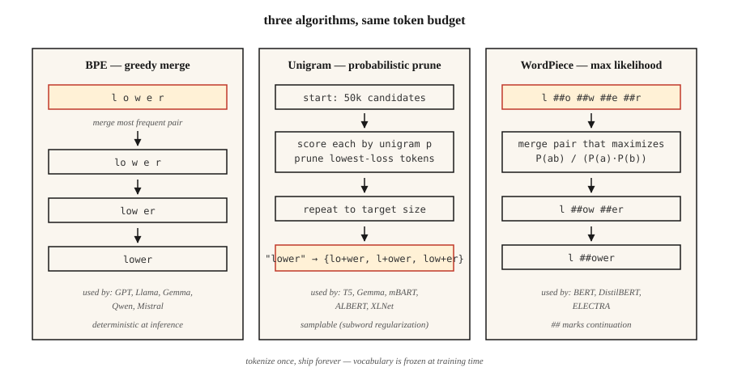

# 子词分词 — BPE、WordPiece、Unigram、SentencePiece

> Word tokenizers 会被未见过的词卡住。Character tokenizers 会让序列长度爆炸。Subword tokenizers 在两者之间折中。每个现代 LLM 都依赖它。

**Type:** Learn
**Languages:** Python
**Prerequisites:** Phase 5 · 01 (Text Processing), Phase 5 · 04 (GloVe / FastText / Subword)
**Time:** ~60 minutes

## 问题

你的 vocabulary 有 50,000 个 words。用户输入 “untokenizable”。你的 tokenizer 返回 `[UNK]`。模型现在对这个词没有任何信号。更糟的是，你 corpus 中第 90 百分位的 document 有 40 个 rare words，这意味着每个 document 会丢掉 40 位信息。

Subword tokenization 解决了这个问题。常见词保持单个 token。罕见词会被拆成有意义的片段：`untokenizable` → `un`、`token`、`izable`。训练数据可以覆盖一切，因为任何字符串最终都可以表示成 bytes 的序列。

2026 年，每个 frontier LLM 都使用三种算法之一（BPE、Unigram、WordPiece），并包在三种库之一里（tiktoken、SentencePiece、HF Tokenizers）。不选择 tokenizer，就无法交付语言模型。

## 概念



**BPE（Byte-Pair Encoding）。** 从 character-level vocabulary 开始。统计每个相邻 pair。把最频繁的 pair 合并成一个新 token。重复直到达到目标 vocabulary size。主流算法：GPT-2/3/4、Llama、Gemma、Qwen2、Mistral。

**Byte-level BPE。** 同样的算法，但基础单位是 raw bytes（256 个 base tokens），而不是 Unicode characters。它保证没有 `[UNK]` tokens，任何 byte sequence 都能编码。GPT-2 使用 50,257 个 tokens（256 bytes + 50,000 merges + 1 special）。

**Unigram。** 从一个巨大 vocabulary 开始。给每个 token 分配 unigram probability。迭代删除那些“移除后最少增加 corpus log-likelihood”的 tokens。Inference 时是 probabilistic 的：可以 sample tokenizations（用于 subword regularization 做 data augmentation 很有用）。T5、mBART、ALBERT、XLNet、Gemma 使用它。

**WordPiece。** 合并那些能最大化 training corpus likelihood 的 pairs，而不是 raw frequency。BERT、DistilBERT、ELECTRA 使用它。

**SentencePiece vs tiktoken。** SentencePiece 是直接在 raw Unicode text 上 *训练* vocabularies 的库（BPE 或 Unigram），并把 whitespace 编码为 `▁`。tiktoken 是 OpenAI 针对预构建 vocabularies 的快速 *encoder*；它不训练 tokenizer。

经验法则：

- **训练新 vocabulary：** SentencePiece（multilingual，无需 pre-tokenization）或 HF Tokenizers。
- **针对 GPT vocab 做快速 inference：** tiktoken（cl100k_base、o200k_base）。
- **两者都要：** HF Tokenizers，一个库同时覆盖 training + serving。

```figure
bpe-merge
```

## 动手构建

### Step 1：从零实现 BPE

见 `code/main.py`。核心循环：

```python
def train_bpe(corpus, num_merges):
    vocab = {tuple(word) + ("</w>",): count for word, count in corpus.items()}
    merges = []
    for _ in range(num_merges):
        pairs = Counter()
        for symbols, freq in vocab.items():
            for a, b in zip(symbols, symbols[1:]):
                pairs[(a, b)] += freq
        if not pairs:
            break
        best = pairs.most_common(1)[0][0]
        merges.append(best)
        vocab = apply_merge(vocab, best)
    return merges
```

这个算法编码了三个事实。`</w>` 标记 word end，所以 “low”（suffix）和 “lower”（prefix）会保持区分。Frequency weighting 让高频 pairs 更早胜出。Merge list 是有顺序的，inference 会按训练顺序应用 merges。

### Step 2：用学到的 merges 编码

```python
def encode_bpe(word, merges):
    symbols = list(word) + ["</w>"]
    for a, b in merges:
        i = 0
        while i < len(symbols) - 1:
            if symbols[i] == a and symbols[i + 1] == b:
                symbols = symbols[:i] + [a + b] + symbols[i + 2:]
            else:
                i += 1
    return symbols
```

这是 naive O(n·|merges|)。生产实现（tiktoken、HF Tokenizers）会使用带 priority queues 的 merge-rank lookup，运行时间接近线性。

### Step 3：实践中的 SentencePiece

```python
import sentencepiece as spm

spm.SentencePieceTrainer.train(
    input="corpus.txt",
    model_prefix="my_tokenizer",
    vocab_size=8000,
    model_type="bpe",          # or "unigram"
    character_coverage=0.9995, # lower for CJK (e.g. 0.9995 for English, 0.995 for Japanese)
    normalization_rule_name="nmt_nfkc",
)

sp = spm.SentencePieceProcessor(model_file="my_tokenizer.model")
print(sp.encode("untokenizable", out_type=str))
# ['▁un', 'token', 'izable']
```

注意：不需要 pre-tokenization；space 会编码成 `▁`；`character_coverage` 控制 rare characters 是被尽量保留，还是映射成 `<unk>`。

### Step 4：用 tiktoken 处理 OpenAI-compatible vocabs

```python
import tiktoken
enc = tiktoken.get_encoding("o200k_base")
print(enc.encode("untokenizable"))        # [127340, 101028]
print(len(enc.encode("Hello, world!")))   # 4
```

它只负责 encoding。速度快（Rust backend）。对于 byte counting、cost estimation、context-window budgeting，它和 GPT-4/5 tokenization 精确匹配。

## 2026 年仍然会被带上线的坑

- **Tokenizer drift。** 用 vocab A 训练，却用 vocab B 部署。Token IDs 不同；模型输出垃圾。在 CI 中检查 `tokenizer.json` hash。
- **Whitespace ambiguity。** BPE 中 “hello” 和 “ hello” 会产生不同 tokens。总是显式指定 `add_special_tokens` 和 `add_prefix_space`。
- **Multilingual undertraining。** 英语占比过高的 corpora 会产生让非拉丁文字切成 5-10 倍 token 数的 vocabularies。同一个 prompt 在 GPT-3.5 上用日语/阿拉伯语可能贵 5-10 倍。o200k_base 部分修复了这个问题。
- **Emoji splits。** 一个 emoji 可能占 5 个 tokens。做 context budgeting 时要单独检查 emoji handling。

## 使用它

2026 年的工具栈：

| Situation | Pick |
|-----------|------|
| 从零训练 monolingual model | HF Tokenizers（BPE） |
| 训练 multilingual model | SentencePiece（Unigram，`character_coverage=0.9995`） |
| Serving OpenAI-compatible API | tiktoken（GPT-4+ 使用 `o200k_base`） |
| Domain-specific vocab（code、math、protein） | 在 domain corpus 上训练 custom BPE，并和 base vocab 合并 |
| Edge inference、小模型 | Unigram（smaller vocabularies 表现更好） |

Vocabulary size 是 scaling decision，不是常量。粗略启发式：<1B 参数用 32k；1-10B 用 50-100k；multilingual/frontier 用 200k+。

## 交付它

保存为 `outputs/skill-bpe-vs-wordpiece.md`：

```markdown
---
name: tokenizer-picker
description: Pick tokenizer algorithm, vocab size, library for a given corpus and deployment target.
version: 1.0.0
phase: 5
lesson: 19
tags: [nlp, tokenization]
---

Given a corpus (size, languages, domain) and deployment target (training from scratch / fine-tuning / API-compatible inference), output:

1. Algorithm. BPE, Unigram, or WordPiece. One-sentence reason.
2. Library. SentencePiece, HF Tokenizers, or tiktoken. Reason.
3. Vocab size. Rounded to nearest 1k. Reason tied to model size and language coverage.
4. Coverage settings. `character_coverage`, `byte_fallback`, special-token list.
5. Validation plan. Average tokens-per-word on held-out set, OOV rate, compression ratio, round-trip decode equality.

Refuse to train a character-coverage <0.995 tokenizer on corpora with rare-script content. Refuse to ship a vocab without a frozen `tokenizer.json` hash check in CI. Flag any monolingual tokenizer under 16k vocab as likely under-spec.
```

## 练习

1. **Easy.** 在 `code/main.py` 的 tiny corpus 上训练一个 500-merge BPE。编码三个 held-out words。有多少正好产生 1 个 token，又有多少产生 >1 个 token？
2. **Medium.** 在 100 个 English Wikipedia sentences 上比较 `cl100k_base`、`o200k_base`，以及你用 vocab=32k 训练的 SentencePiece BPE 的 token counts。报告每一种的 compression ratio。
3. **Hard.** 用同一 corpus 分别训练 BPE、Unigram 和 WordPiece。把它们用于一个小型 sentiment classifier，并测量 downstream accuracy。这个选择会让 F1 变化超过 1 个点吗？

## 关键术语

| Term | What people say | What it actually means |
|------|-----------------|-----------------------|
| BPE | Byte-Pair Encoding | 贪心合并最频繁的 character pairs，直到达到目标 vocab size。 |
| Byte-level BPE | 永远没有 unknown tokens | 在 raw 256 bytes 上做 BPE；GPT-2 / Llama 使用它。 |
| Unigram | Probabilistic tokenizer | 从大候选集合中按 log-likelihood 剪枝；T5、Gemma 使用它。 |
| SentencePiece | 处理 whitespace 的那个 | 在 raw text 上训练 BPE/Unigram 的库；space 编码为 `▁`。 |
| tiktoken | 快的那个 | OpenAI 的 Rust-backed BPE encoder，用于预构建 vocabs。不训练。 |
| Merge list | 神秘数字 | 有序的 `(a, b) → ab` merges；inference 按顺序应用。 |
| Character coverage | 多罕见才算太罕见？ | Tokenizer 必须覆盖 training corpus 中字符的比例；典型值约 0.9995。 |

## 延伸阅读

- [Sennrich, Haddow, Birch (2015). Neural Machine Translation of Rare Words with Subword Units](https://arxiv.org/abs/1508.07909) — BPE 论文。
- [Kudo (2018). Subword Regularization with Unigram Language Model](https://arxiv.org/abs/1804.10959) — Unigram 论文。
- [Kudo, Richardson (2018). SentencePiece: A simple and language independent subword tokenizer](https://arxiv.org/abs/1808.06226) — 这个库。
- [Hugging Face — Summary of the tokenizers](https://huggingface.co/docs/transformers/tokenizer_summary) — 简明参考。
- [OpenAI tiktoken repo](https://github.com/openai/tiktoken) — cookbook 和 encoding list。
