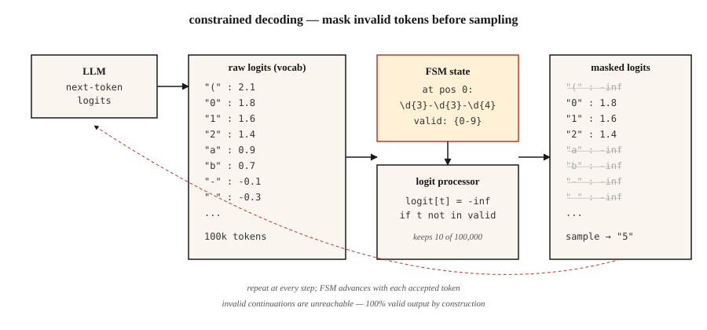

# Structured Outputs 与 Constrained Decoding

> 让 LLM 返回 JSON。大多数时候你会得到 JSON。在 production 中，"most" 正是问题所在。Constrained decoding 会在 sampling 前编辑 logits，把 "most" 变成 "always"。

**Type:** Build
**Languages:** Python
**Prerequisites:** Phase 5 · 17 (Chatbots), Phase 5 · 19 (Subword Tokenization)
**Time:** ~60 minutes

## 问题

一个 classifier prompt LLM："Return one of {positive, negative, neutral}." Model 返回："The sentiment is positive — this review is overwhelmingly favorable because the customer explicitly states that they ..."。你的 parser 崩了。你的 classifier F1 是 0.0。

Free-form generation 不是 contract。它只是 suggestion。Production system 需要 contract。

2026 年有三层方案。

1. **Prompting.** 好好请求。"Return only the JSON object." 在 frontier models 上大约 80% 有效，在更小模型上更低。
2. **Native structured output APIs.** OpenAI `response_format`、Anthropic tool use、Gemini JSON mode。对 supported schemas 可靠。Vendor-locked。
3. **Constrained decoding.** 在每个 generation step 修改 logits，让 model *无法* 发出 invalid tokens。按构造保证 100% valid。适用于任何 local model。

本课会为三者建立直觉，并说明什么时候该选哪个。

## 概念



**Constrained decoding 如何工作。** 在每个 generation step，LLM 会对完整 vocabulary（约 100k tokens）产生一个 logit vector。一个 *logit processor* 坐在 model 和 sampler 之间。它根据 target grammar 中当前位置（JSON Schema、regex、context-free grammar）计算哪些 tokens 有效，并把所有 invalid tokens 的 logits 设为 negative infinity。对剩余 logits 做 softmax 后，probability mass 只会落在 valid continuations 上。

2026 年的 implementations：

- **Outlines.** 把 JSON Schema 或 regex 编译成 finite-state machine。每个 token 都能做 O(1) valid-next-token lookup。基于 FSM，所以 recursive schemas 需要 flattening。
- **XGrammar / llguidance.** Context-free grammar engines。处理 recursive JSON Schema。Decoding overhead 接近 zero。OpenAI 在 2025 structured output implementation 中提到了 llguidance。
- **vLLM guided decoding.** 通过 Outlines、XGrammar 或 lm-format-enforcer backends，内置 `guided_json`、`guided_regex`、`guided_choice`、`guided_grammar`。
- **Instructor.** 基于 Pydantic 的任意 LLM wrapper。Validation failure 时 retry。Cross-provider，但不修改 logits；它依赖 retries + structured-output-aware prompts。

### 反直觉的结果

Constrained decoding 往往比 unconstrained generation *更快*。原因有两个。第一，它缩小了 next-token search space。第二，聪明的 implementations 会完全跳过 forced tokens 的 token generation（例如 `{"name": "` 这样的 scaffolding，每个 byte 都已经确定）。

### 会让你付出代价的陷阱

Field order 很重要。把 `answer` 放在 `reasoning` 前面，model 会在思考前先承诺一个 answer。JSON 是 valid 的。Answer 是错的。没有 validation 能抓住它。

```json
// BAD
{"answer": "yes", "reasoning": "because ..."}

// GOOD
{"reasoning": "... therefore ...", "answer": "yes"}
```

Schema field order 是 logic，不是 formatting。

## Build It

### Step 1: 从零实现 regex-constrained generation

查看 `code/main.py` 中的 standalone FSM implementation。核心思想 30 行：

```python
def mask_logits(logits, valid_token_ids):
    mask = [float("-inf")] * len(logits)
    for tid in valid_token_ids:
        mask[tid] = logits[tid]
    return mask


def generate_constrained(model, tokenizer, prompt, fsm):
    ids = tokenizer.encode(prompt)
    state = fsm.initial_state
    while not fsm.is_accept(state):
        logits = model.next_token_logits(ids)
        valid = fsm.valid_tokens(state, tokenizer)
        logits = mask_logits(logits, valid)
        tok = sample(logits)
        ids.append(tok)
        state = fsm.transition(state, tok)
    return tokenizer.decode(ids)
```

FSM 跟踪 grammar 中哪些部分已经被满足。`valid_tokens(state, tokenizer)` 会计算 vocabulary 中哪些 tokens 能推进 FSM，同时不离开 accepting path。

### Step 2: 用 Outlines 生成 JSON Schema

```python
from pydantic import BaseModel
from typing import Literal
import outlines


class Review(BaseModel):
    sentiment: Literal["positive", "negative", "neutral"]
    confidence: float
    evidence_span: str


model = outlines.models.transformers("meta-llama/Llama-3.2-3B-Instruct")
generator = outlines.generate.json(model, Review)

result = generator("Classify: 'The wait staff was attentive and the food arrived hot.'")
print(result)
# Review(sentiment='positive', confidence=0.93, evidence_span='attentive ... hot')
```

永远是 zero validation errors。FSM 会让 invalid output 变成 unreachable。

### Step 3: 用 Instructor 做 provider-agnostic Pydantic

```python
import instructor
from anthropic import Anthropic
from pydantic import BaseModel, Field


class Invoice(BaseModel):
    vendor: str
    total_usd: float = Field(ge=0)
    line_items: list[str]


client = instructor.from_anthropic(Anthropic())
invoice = client.messages.create(
    model="claude-opus-4-7",
    max_tokens=1024,
    response_model=Invoice,
    messages=[{"role": "user", "content": "Extract from: 'Acme Corp $420. Widget, Gizmo.'"}],
)
```

这是不同机制。Instructor 不碰 logits。它把 schema 格式化进 prompt，parse output，并在 validation failure 时 retry（默认 3 次）。适用于任何 provider。Retries 会增加 latency 和 cost。Cross-provider portability 是它的卖点。

### Step 4: native vendor APIs

```python
from openai import OpenAI

client = OpenAI()
response = client.responses.create(
    model="gpt-5",
    input=[{"role": "user", "content": "Classify: 'The food was cold.'"}],
    text={"format": {"type": "json_schema", "name": "sentiment",
          "schema": {"type": "object", "required": ["sentiment"],
                     "properties": {"sentiment": {"type": "string",
                                                  "enum": ["positive", "negative", "neutral"]}}}}},
)
print(response.output_parsed)
```

Server-side constrained decoding。对 supported schemas，可靠性与 Outlines 持平。不需要管理 local model。代价是锁定 vendor。

## 陷阱

- **Recursive schemas.** Outlines 会把 recursion flatten 到固定 depth。Tree-structured outputs（nested comments、AST）需要 XGrammar 或 llguidance（CFG-based）。
- **Huge enums.** 10,000-option enum 会 compile 很慢或 timeout。改用 retriever：先预测 top-k candidates，再 constrain 到这些 candidates。
- **Grammar too strict.** 强制 `date: "YYYY-MM-DD"` regex 时，如果 date missing，model 无法输出 `"unknown"`。Model 会通过编造一个 date 来补偿。允许 `null` 或 sentinel。
- **Premature commitment.** 见上面的 field-order pitfall。始终把 reasoning 放在前面。
- **Vendor JSON mode without schema.** 纯 JSON mode 只保证 valid JSON，不保证对 *你的 use case* valid。始终提供完整 schema。

## Use It

2026 年的 stack：

| Situation | Pick |
|-----------|------|
| OpenAI/Anthropic/Google model, simple schema | Native vendor structured output |
| Any provider, Pydantic workflow, can tolerate retries | Instructor |
| Local model, need 100% validity, flat schema | Outlines (FSM) |
| Local model, recursive schema | XGrammar or llguidance |
| Self-hosted inference server | vLLM guided decoding |
| Batch processing with retries acceptable | Instructor + cheapest model |

## Ship It

保存为 `outputs/skill-structured-output-picker.md`：

```markdown
---
name: structured-output-picker
description: Choose a structured output approach, schema design, and validation plan.
version: 1.0.0
phase: 5
lesson: 20
tags: [nlp, llm, structured-output]
---

Given a use case (provider, latency budget, schema complexity, failure tolerance), output:

1. Mechanism. Native vendor structured output, Instructor retries, Outlines FSM, or XGrammar CFG. One-sentence reason.
2. Schema design. Field order (reasoning first, answer last), nullable fields for "unknown", enum vs regex, required fields.
3. Failure strategy. Max retries, fallback model, graceful `null` handling, out-of-distribution refusal.
4. Validation plan. Schema compliance rate (target 100%), semantic validity (LLM-judge), field-coverage rate, latency p50/p99.

Refuse any design that puts `answer` or `decision` before reasoning fields. Refuse to use bare JSON mode without a schema. Flag recursive schemas behind an FSM-only library.
```

## 练习

1. **Easy.** 在没有 constrained decoding 的情况下，prompt 一个小型 open-weights model（例如 Llama-3.2-3B），让它输出 `Review(sentiment, confidence, evidence_span)`。在 100 条 reviews 上测量有多少比例能 parse 成 valid JSON。
2. **Medium.** 在同一 corpus 上使用 Outlines JSON mode。比较 compliance rate、latency 和 semantic accuracy。
3. **Hard.** 从零实现一个 phone numbers（`\d{3}-\d{3}-\d{4}`）的 regex-constrained decoder。在 1000 个 samples 上验证 0 invalid outputs。

## 关键术语

| Term | 人们通常怎么说 | 它实际是什么意思 |
|------|----------------|------------------|
| Constrained decoding | Force valid output | 在每个 generation step mask invalid-token logits。 |
| Logit processor | The thing that constrains | 函数：`(logits, state) -> masked_logits`。 |
| FSM | Finite-state machine | Compiled grammar representation；O(1) valid-next-token lookup。 |
| CFG | Context-free grammar | 可以处理 recursion 的 grammar；比 FSM 慢但更 expressive。 |
| Schema field order | Does it matter? | 是的。第一个 field 会先承诺；始终把 reasoning 放在 answer 前。 |
| Guided decoding | vLLM's name for it | 同一概念，集成进 inference server。 |
| JSON mode | OpenAI's early version | 保证 JSON syntax；不保证 schema match。 |

## 延伸阅读

- [Willard, Louf (2023). Efficient Guided Generation for LLMs](https://arxiv.org/abs/2307.09702) — Outlines paper。
- [XGrammar paper (2024)](https://arxiv.org/abs/2411.15100) — fast CFG-based constrained decoding。
- [vLLM — Structured Outputs](https://docs.vllm.ai/en/latest/features/structured_outputs.html) — inference server integration。
- [OpenAI — Structured Outputs guide](https://platform.openai.com/docs/guides/structured-outputs) — API reference + gotchas。
- [Instructor library](https://python.useinstructor.com/) — Pydantic + retries across providers。
- [JSONSchemaBench (2025)](https://arxiv.org/abs/2501.10868) — benchmarking 6 constrained decoding frameworks。
