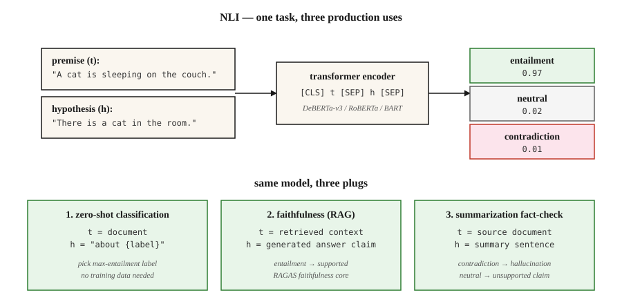

# 自然语言推理 — 文本蕴含

> "`t` entails `h`" 的意思是：人类读者看到 `t` 后，会得出 `h` 为真的结论。NLI 的任务是预测蕴含 / 矛盾 / 中立。表面无聊，生产里却很承重。

**Type:** Learn
**Languages:** Python
**Prerequisites:** Phase 5 · 05（Sentiment Analysis），Phase 5 · 13（Question Answering）
**Time:** ~60 minutes

## 问题

你构建了一个摘要器。它生成了一段摘要。你怎么知道这段摘要没有包含幻觉？

你构建了一个聊天机器人。它回答了 "yes."。你怎么知道这个答案确实被检索段落支持？

你需要按主题分类 10,000 篇新闻文章。你没有训练标签。能不能复用一个模型？

这三个问题都可以归约为自然语言推理。NLI 会问：给定一个前提 `t` 和一个假设 `h`，`h` 是被 `t` 蕴含、与 `t` 矛盾，还是中立（无关）？

- **幻觉检查：** `t` = 源文档，`h` = 摘要 claim。不是蕴含 = 幻觉。
- **有依据的 QA：** `t` = 检索段落，`h` = 生成答案。不是蕴含 = 编造。
- **零样本分类：** `t` = 文档，`h` = 语言化后的标签（"This is about sports"）。蕴含 = 预测标签。

一个任务，三种生产用途。这就是为什么每个 RAG 评估框架底层都会带一个 NLI 模型。

## 概念



**三个标签。**

- **蕴含。** `t` → `h`。"The cat is on the mat" 蕴含 "There is a cat."
- **矛盾。** `t` → ¬`h`。"The cat is on the mat" 矛盾于 "There is no cat."
- **中立。** 两个方向都无法推断。"The cat is on the mat" 对 "The cat is hungry." 是中立的。

**不是逻辑蕴含。** NLI 是*自然*语言推理，也就是普通人类读者会推断什么，而不是严格逻辑。"John walked his dog" 在 NLI 中蕴含 "John has a dog"，但严格的一阶逻辑只有在你把所有权公理化之后才会承认它。

**数据集。**

- **SNLI**（2015）。57 万个人工标注 pair，前提来自图像 caption。领域较窄。
- **MultiNLI**（2017）。43.3 万个 pair，覆盖 10 种体裁。2026 年的标准训练语料。
- **ANLI**（2019）。对抗式 NLI。人类专门编写样本来击败已有模型。更难。
- **DocNLI, ConTRoL**（2020-21）。文档长度前提。测试多跳和长距离推理。

**架构。** transformer encoder（BERT、RoBERTa、DeBERTa）读取 `[CLS] premise [SEP] hypothesis [SEP]`。`[CLS]` 表示送入一个三分类 softmax。在 MNLI 上训练，在 held-out benchmark 上评估，在同分布 pair 上可以达到 90%+ 准确率。

**通过 NLI 做零样本。** 给定一个文档和候选标签，把每个标签转成一个假设（"This text is about sports"）。计算每个假设的蕴含概率。选择最大值。这就是 Hugging Face 的 `zero-shot-classification` pipeline 背后的机制。

## Build It

### 第 1 步：运行预训练 NLI 模型

```python
from transformers import pipeline

nli = pipeline("text-classification",
               model="facebook/bart-large-mnli",
               top_k=None)  # return all labels; replaces deprecated return_all_scores=True

premise = "The cat is sleeping on the couch."
hypothesis = "There is a cat in the room."

result = nli({"text": premise, "text_pair": hypothesis})[0]
print(result)
# [{'label': 'entailment', 'score': 0.97},
#  {'label': 'neutral', 'score': 0.02},
#  {'label': 'contradiction', 'score': 0.01}]
```

生产级 NLI 中，`facebook/bart-large-mnli` 和 `microsoft/deberta-v3-large-mnli` 是开源默认选择。DeBERTa-v3 在 leaderboard 上表现最好。

### 第 2 步：零样本分类

```python
zs = pipeline("zero-shot-classification", model="facebook/bart-large-mnli")

text = "The stock market rallied after the central bank cut interest rates."
labels = ["finance", "sports", "politics", "technology"]

result = zs(text, candidate_labels=labels)
print(result)
# {'labels': ['finance', 'politics', 'technology', 'sports'],
#  'scores': [0.92, 0.05, 0.02, 0.01]}
```

默认模板是 "This example is about {label}."。可以用 `hypothesis_template` 自定义。不需要训练数据。不需要 fine-tuning。开箱即用。

### 第 3 步：RAG 的忠实度检查

```python
def is_faithful(answer, context, threshold=0.5):
    result = nli({"text": context, "text_pair": answer})[0]
    entail = next(s for s in result if s["label"] == "entailment")
    return entail["score"] > threshold
```

这就是 RAGAS faithfulness 的核心。把生成答案拆成原子 claim。逐条检查每个 claim 是否被检索上下文蕴含。报告被蕴含的比例。

### 第 4 步：手写 NLI 分类器（概念版）

查看 `code/main.py`，里面有一个只用标准库的 toy 版本：通过词汇重叠 + 否定检测比较前提和假设。它无法和 transformer 模型竞争，但能展示任务的形状：两个文本输入，三分类标签输出，loss = `{entail, contradict, neutral}` 上的交叉熵。

## 常见坑

- **Hypothesis-only 捷径。** 模型只看假设，也能在 SNLI 上以约 60% 准确率预测标签，因为 "not"、"nobody"、"never" 与 contradiction 相关。这是检测标签泄漏的强 baseline。
- **词汇重叠启发式。** 子序列启发式（“每个子序列都被蕴含”）可以通过 SNLI，却会在 HANS/ANLI 上失败。使用对抗 benchmark。
- **文档长度退化。** 单句 NLI 模型在文档长度前提上会掉 20+ F1。长上下文请使用 DocNLI 训练过的模型。
- **零样本模板敏感。** "This example is about {label}"、"{label}"、"The topic is {label}" 之间可以让准确率摆动 10+ 个点。需要调模板。
- **领域不匹配。** MNLI 在通用英语上训练。法律、医疗、科学文本需要领域特定 NLI 模型（例如 SciNLI、MedNLI）。

## Use It

2026 年的技术栈：

| 使用场景 | 模型 |
|---------|------|
| 通用 NLI | `microsoft/deberta-v3-large-mnli` |
| 快速 / 端侧 | `cross-encoder/nli-deberta-v3-base` |
| 零样本分类（轻量） | `facebook/bart-large-mnli` |
| 文档级 NLI | `MoritzLaurer/DeBERTa-v3-large-mnli-fever-anli-ling-wanli` |
| 多语言 | `MoritzLaurer/multilingual-MiniLMv2-L6-mnli-xnli` |
| RAG 中的幻觉检测 | RAGAS / DeepEval 内部的 NLI 层 |

2026 年的元模式：NLI 是文本理解里的胶带。只要你需要判断“A 是否支持 B？”或“A 是否矛盾于 B？”——先考虑 NLI，再考虑另一次 LLM 调用。

## Ship It

保存为 `outputs/skill-nli-picker.md`：

```markdown
---
name: nli-picker
description: Pick an NLI model, label template, and evaluation setup for a classification / faithfulness / zero-shot task.
version: 1.0.0
phase: 5
lesson: 21
tags: [nlp, nli, zero-shot]
---

Given a use case (faithfulness check, zero-shot classification, document-level inference), output:

1. Model. Named NLI checkpoint. Reason tied to domain, length, language.
2. Template (if zero-shot). Verbalization pattern. Example.
3. Threshold. Entailment cutoff for the decision rule. Reason based on calibration.
4. Evaluation. Accuracy on held-out labeled set, hypothesis-only baseline, adversarial subset.

Refuse to ship zero-shot classification without a 100-example labeled sanity check. Refuse to use a sentence-level NLI model on document-length premises. Flag any claim that NLI solves hallucination — it reduces it; it does not eliminate it.
```

## 练习

1. **Easy.** 在 20 个手写的（premise, hypothesis, label）三元组上运行 `facebook/bart-large-mnli`，覆盖三种类别。测量准确率。加入对抗性的“子序列启发式”陷阱（"I did not eat the cake" vs "I ate the cake"），看看它是否会失败。
2. **Medium.** 在 100 条 AG News 标题上，比较零样本模板 `"This text is about {label}"`、`"The topic is {label}"` 和 `"{label}"`。报告准确率摆动。
3. **Hard.** 构建一个 RAG 忠实度检查器：原子 claim 分解 + 每条 claim 做 NLI。在 50 个带 gold context 的 RAG 生成答案上评估。相对人工标签，测量 false-positive 和 false-negative rate。

## 关键术语

| 术语 | 人们常说 | 实际含义 |
|------|----------|----------|
| NLI | Natural Language Inference | 前提-假设关系的三分类。 |
| RTE | Recognizing Textual Entailment | NLI 的旧名称；同一个任务。 |
| 蕴含 | "`t` implies `h`" | 典型读者看到 `t` 后会得出 `h` 为真的结论。 |
| 矛盾 | "`t` rules out `h`" | 典型读者看到 `t` 后会得出 `h` 为假的结论。 |
| 中立 | “未决” | 从 `t` 到 `h` 任一方向都无法推断。 |
| 零样本分类 | 把 NLI 当分类器 | 把标签语言化为假设，选择蕴含概率最大者。 |
| 忠实度 | 答案是否被支持？ | 对（检索上下文，生成答案）做 NLI。 |

## 延伸阅读

- [Bowman et al. (2015). A large annotated corpus for learning natural language inference](https://arxiv.org/abs/1508.05326) — SNLI。
- [Williams, Nangia, Bowman (2017). A Broad-Coverage Challenge Corpus for Sentence Understanding through Inference](https://arxiv.org/abs/1704.05426) — MultiNLI。
- [Nie et al. (2019). Adversarial NLI](https://arxiv.org/abs/1910.14599) — ANLI benchmark。
- [Yin, Hay, Roth (2019). Benchmarking Zero-shot Text Classification](https://arxiv.org/abs/1909.00161) — NLI-as-classifier。
- [He et al. (2021). DeBERTa: Decoding-enhanced BERT with Disentangled Attention](https://arxiv.org/abs/2006.03654) — 2026 年的 NLI 主力模型。
