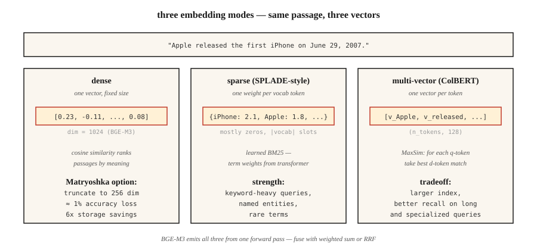

# Embedding Models：2026 深度解析

> Word2Vec 给你每个词一个向量。现代 embedding model 给你每个 passage 一个向量，支持跨语言，并提供 sparse、dense 和 multi-vector 多种视图，还能按索引预算裁剪尺寸。选错了，RAG 就会召回错误内容。

**Type:** Learn
**Languages:** Python
**Prerequisites:** Phase 5 · 03 (Word2Vec), Phase 5 · 14 (Information Retrieval)
**Time:** ~60 minutes

## 学习目标

- 区分 dense、sparse 和 multi-vector embedding 的索引形态与召回行为
- 解释语言覆盖、上下文长度、维度预算和托管方式如何影响 embedding 选型
- 使用 Sentence-BERT 风格 bi-encoder 构建基础 dense retrieval
- 说明 Matryoshka truncation 为什么能在少量精度损失下显著降低存储成本
- 为 RAG 场景设计 embedding model、retrieval mode 和 MTEB/领域评估方案

## 问题

你的 RAG 系统有 40% 的时候召回了错误 passage。罪魁祸首很少是 vector database 或 prompt。通常是 embedding model。

2026 年选择 embedding 意味着要在五条轴线上取舍：

1. **Dense vs sparse vs multi-vector。** 每个 passage 一个向量、每个 token 一个向量，还是一个 sparse weighted bag of words。
2. **语言覆盖。** 单语英文模型在纯英文任务上仍然胜出。语料混杂时，多语言模型胜出。
3. **上下文长度。** 512 tokens、8,192，还是 32,768；而真实有效容量往往只有标称上限的 60-70%。
4. **维度预算。** 3,072 个 full precision float = 每个向量 12 KB。1 亿个向量时，存储成本是每月 1,300 美元。Matryoshka truncation 可以把它降到四分之一。
5. **开放权重 vs 托管。** Open-weight 意味着你控制 stack 和数据。Hosted 意味着你用控制权换取始终最新的模型。

本课会把这些取舍讲清楚，让你基于证据选择，而不是基于上个季度流行什么。

## 概念



**Dense embeddings。** 每个 passage 一个向量（通常 384-3,072 维）。Cosine similarity 根据语义接近度排序 passage。OpenAI `text-embedding-3-large`、BGE-M3 dense mode、Voyage-3 都属于这一类。默认选择。

**Sparse embeddings。** SPLADE 风格。Transformer 为词表里的每个 token 预测一个权重，然后把大多数权重置零。结果是一个大小为 |vocab| 的 sparse vector。它能捕捉 lexical matching（类似 BM25），但 term weight 是学出来的。对关键词密集型查询很强。

**Multi-vector（late interaction）。** ColBERTv2、Jina-ColBERT。每个 token 一个向量。用 MaxSim 计分：对每个 query token，找到最相似的 document token，再把分数求和。存储和打分更贵，但在长查询和领域语料上更强。

**BGE-M3：一次输出三种表示。** 单个模型同时输出 dense、sparse 和 multi-vector representations。每种都可以独立查询；分数通过加权求和融合。当你想从一个 checkpoint 获得灵活性时，它是 2026 年的默认选择。

**Matryoshka Representation Learning。** 训练目标让向量前 N 维本身就是可用的 standalone embedding。把一个 1,536 维向量截断到 256 维，大约只损失 1% accuracy，却节省 6 倍存储。OpenAI text-3、Cohere v4、Voyage-4、Jina v5、Gemini Embedding 2、Nomic v1.5+ 都支持这种能力。

### MTEB leaderboard 只讲了一部分故事

Massive Text Embedding Benchmark 在发布时（2022）包含 8 类任务下的 56 个任务，MTEB v2 扩展到了 100+ 任务。2026 年初，Gemini Embedding 2 在 retrieval 上领先（67.71 MTEB-R）。Cohere embed-v4 在 general 上领先（65.2 MTEB）。BGE-M3 领先 open-weight multilingual（63.0）。Leaderboard 必要但不充分：永远要在你的领域上 benchmark。

### 三层模式

| 用例 | 模式 |
|------|------|
| 快速第一轮召回 | Dense bi-encoder（BGE-M3、text-3-small） |
| 提高 recall | Sparse（SPLADE、BGE-M3 sparse）+ RRF fuse |
| Top-50 上提高 precision | Multi-vector（ColBERTv2）或 cross-encoder reranker |

大多数生产 stack 会同时使用三者。

## Build It

### Step 1：baseline：用 Sentence-BERT 做 dense embeddings

```python
from sentence_transformers import SentenceTransformer
import numpy as np

encoder = SentenceTransformer("BAAI/bge-small-en-v1.5")
corpus = [
    "The first iPhone launched in 2007.",
    "Apple released the iPod in 2001.",
    "Android is an operating system from Google.",
]
emb = encoder.encode(corpus, normalize_embeddings=True)

query = "When was the iPhone released?"
q_emb = encoder.encode([query], normalize_embeddings=True)[0]
scores = emb @ q_emb
print(sorted(enumerate(scores), key=lambda x: -x[1]))
```

`normalize_embeddings=True` 会让 dot product 等于 cosine similarity。始终打开它。

### Step 2：Matryoshka truncation

```python
def truncate(vectors, dim):
    out = vectors[:, :dim]
    return out / np.linalg.norm(out, axis=1, keepdims=True)

emb_256 = truncate(emb, 256)
emb_128 = truncate(emb, 128)
```

截断后要重新 normalize。Nomic v1.5、OpenAI text-3 和 Voyage-4 的训练目标就是让前几档维度几乎无损。非 Matryoshka 模型（原始 Sentence-BERT）被截断后会明显退化。

### Step 3：BGE-M3 multi-functionality

```python
from FlagEmbedding import BGEM3FlagModel

model = BGEM3FlagModel("BAAI/bge-m3", use_fp16=True)

output = model.encode(
    corpus,
    return_dense=True,
    return_sparse=True,
    return_colbert_vecs=True,
)
# output["dense_vecs"]:    (n_docs, 1024)
# output["lexical_weights"]: list of dict {token_id: weight}
# output["colbert_vecs"]:  list of (n_tokens, 1024) arrays
```

一次推理调用，三个索引。分数融合：

```python
dense_score = ... # cosine over dense_vecs
sparse_score = model.compute_lexical_matching_score(q_lex, d_lex)
colbert_score = model.colbert_score(q_col, d_col)
final = 0.4 * dense_score + 0.2 * sparse_score + 0.4 * colbert_score
```

在你的领域上调这些权重。

### Step 4：在自定义任务上跑 MTEB eval

```python
from mteb import MTEB

tasks = ["ArguAna", "SciFact", "NFCorpus"]
evaluation = MTEB(tasks=tasks)
results = evaluation.run(encoder, output_folder="./mteb-results")
```

在一个有代表性的子集上运行候选模型。不要只相信 leaderboard 排名，你的领域会改变结果。

### Step 5：从零手写 cosine

见 `code/main.py`。它使用 Averaged Hashing Trick embeddings（只用 stdlib）。它无法和 transformer embeddings 竞争，但展示了基本形状：tokenize → vector → normalize → dot product。

## Pitfalls

- **Query 和 doc 用同一个模型。** 有些模型（Voyage、Jina-ColBERT）使用 asymmetric encoding，也就是 query 和 document 走不同路径。始终检查 model card。
- **缺少 prefix。** `bge-*` 模型需要在 query 前加 `"Represent this sentence for searching relevant passages: "`。忘掉它会造成 3-5 个点的 recall gap。
- **过度裁剪 Matryoshka。** 1,536 → 256 通常安全。1,536 → 64 不安全。必须在你的 eval set 上验证。
- **上下文截断。** 大多数模型会静默截断超过最大长度的输入。长文档需要 chunking（见第 23 课）。
- **忽略 latency tail。** MTEB 分数隐藏了 p99 latency。一个 600M 模型也许比 335M 模型高 2 分，但每次查询成本贵 3 倍。

## Use It

2026 年技术栈：

| 场景 | 选择 |
|------|------|
| 纯英文、快速、API | `text-embedding-3-large` 或 `voyage-3-large` |
| Open-weight、英文 | `BAAI/bge-large-en-v1.5` |
| Open-weight、多语言 | `BAAI/bge-m3` 或 `Qwen3-Embedding-8B` |
| 长上下文（32k+） | Voyage-3-large、Cohere embed-v4、Qwen3-Embedding-8B |
| CPU-only 部署 | Nomic Embed v2（137M params, MoE） |
| 存储受限 | Matryoshka-truncated + int8 quantization |
| 关键词密集查询 | 加 SPLADE sparse，用 RRF 与 dense 融合 |

2026 年模式：从 BGE-M3 或 text-3-large 开始，用 MTEB 在你的领域上评估；如果某个领域专用模型领先超过 3 分，再切换。

## Ship It

保存为 `outputs/skill-embedding-picker.md`：

```markdown
---
name: embedding-picker
description: Pick embedding model, dimension, and retrieval mode for a given corpus and deployment.
version: 1.0.0
phase: 5
lesson: 22
tags: [nlp, embeddings, retrieval]
---

Given a corpus (size, languages, domain, avg length), deployment target (cloud / edge / on-prem), latency budget, and storage budget, output:

1. Model. Named checkpoint or API. One-sentence reason.
2. Dimension. Full / Matryoshka-truncated / int8-quantized. Reason tied to storage budget.
3. Mode. Dense / sparse / multi-vector / hybrid. Reason.
4. Query prefix / template if required by the model card.
5. Evaluation plan. MTEB tasks relevant to domain + held-out domain eval with nDCG@10.

Refuse recommendations that truncate Matryoshka to <64 dims without domain validation. Refuse ColBERTv2 for corpora under 10k passages (overhead not justified). Flag long-document corpora (>8k tokens) routed to models with 512-token windows.
```

## 练习

1. **Easy.** 用 `bge-small-en-v1.5` 以 full dim（384）编码 100 个句子，再用 Matryoshka 128 编码。测量 10 个 query 上的 MRR drop。
2. **Medium.** 在你领域中的 500 个 passage 上比较 BGE-M3 dense、sparse 和 colbert。哪一种在 recall@10 上胜出？RRF fusion 是否超过了最佳单一模式？
3. **Hard.** 在你的 top-2 领域任务上，对三个候选模型运行 MTEB。报告 MTEB score、100-query batch 的 p99 latency，以及 $/1M queries。选择 Pareto-optimal 的那个。

## 关键术语

| 术语 | 常见说法 | 实际含义 |
|------|----------|----------|
| Dense embedding | 那个向量 | 每段文本一个固定大小向量。用 cosine similarity 排序。 |
| Sparse embedding | 学出来的 BM25 | 每个 vocab token 一个权重；大多为零；端到端训练。 |
| Multi-vector | ColBERT 风格 | 每个 token 一个向量；MaxSim scoring；索引更大，recall 更好。 |
| Matryoshka | 俄罗斯套娃技巧 | 前 N 维本身就是一个可用的小 embedding。 |
| MTEB | 那个 benchmark | Massive Text Embedding Benchmark，发布时 56 个任务，v2 有 100+。 |
| BEIR | retrieval benchmark | 18 个 zero-shot retrieval 任务；常用于衡量跨领域鲁棒性。 |
| Asymmetric encoding | Query ≠ doc path | 模型对 query 和 document 使用不同 projection。 |

## 延伸阅读

- [Reimers, Gurevych (2019). Sentence-BERT](https://arxiv.org/abs/1908.10084) — bi-encoder 论文。
- [Muennighoff et al. (2022). MTEB: Massive Text Embedding Benchmark](https://arxiv.org/abs/2210.07316) — leaderboard 论文。
- [Chen et al. (2024). BGE-M3: Multi-lingual, Multi-functionality, Multi-granularity](https://arxiv.org/abs/2402.03216) — 统一三模式模型。
- [Kusupati et al. (2022). Matryoshka Representation Learning](https://arxiv.org/abs/2205.13147) — 维度阶梯训练目标。
- [Santhanam et al. (2022). ColBERTv2: Effective and Efficient Retrieval via Lightweight Late Interaction](https://arxiv.org/abs/2112.01488) — 生产中的 late interaction。
- [MTEB leaderboard on Hugging Face](https://huggingface.co/spaces/mteb/leaderboard) — 实时排名。
