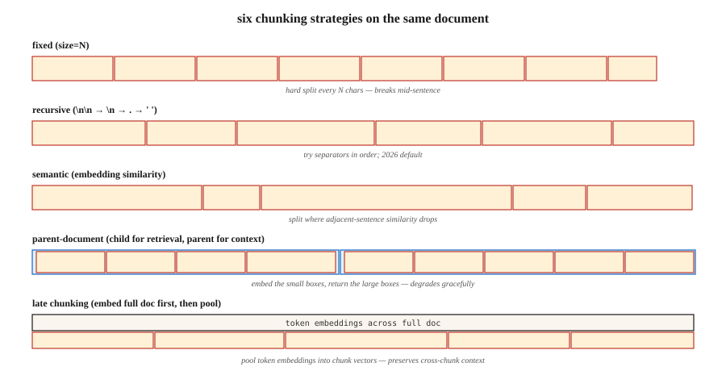

# RAG 的切块策略

> Chunking 配置对检索质量的影响，和 embedding model 的选择一样大（Vectara NAACL 2025）。Chunking 做错了，再多 reranking 也救不回来。

**Type:** Build
**Languages:** Python
**Prerequisites:** Phase 5 · 14 (Information Retrieval), Phase 5 · 22 (Embedding Models)
**Time:** ~60 minutes

## 问题

你把一份 50 页合同放进 RAG 系统。用户问：“termination clause 是什么？”Retriever 返回了封面页。为什么？因为模型是在 512-token chunks 上训练的，而 termination clause 在第 20 页，中间跨了分页，并且局部没有能把它和 query 绑定起来的 keywords。

修复方法不是“买一个更好的 embedding model”。修复方法是 chunking。多大？要不要 overlap？在哪里切？要不要带周围上下文？

2026 年 2 月的 benchmarks 显示了一些出人意料的结果：

- Vectara 的 2026 study：recursive 512-token chunking 击败 semantic chunking，准确率 69% → 54%。
- SPLADE + Mistral-8B 在 Natural Questions 上：overlap 没有提供可测量收益。
- Context cliff：context 大约到 2,500 tokens 时，response quality 会急剧下降。

“显而易见”的答案（semantic chunking、20% overlap、1000 tokens）经常是错的。这一课会为六种策略建立直觉，并说明什么时候该用哪一种。

## 概念



**Fixed chunking。** 每 N 个 characters 或 tokens 切一次。最简单的 baseline。会在句子中间切断。Compression 好，coherence 差。

**Recursive。** LangChain 的 `RecursiveCharacterTextSplitter`。先尝试按 `\n\n` 切，再按 `\n`，再按 `.`，最后按 space。Fallback 干净。2026 年的默认选择。

**Semantic。** Embed 每个 sentence。计算相邻 sentences 的 cosine similarity。当 similarity 低于 threshold 时切开。保留 topic coherence。更慢；有时会产生 40-token 的小碎片，伤害 retrieval。

**Sentence。** 按 sentence boundaries 切。每个 sentence 一个 chunk，或用 N sentences 的窗口。在约 5k tokens 以内，它能接近 semantic chunking 的效果，但成本低很多。

**Parent-document。** 存储小的 child chunks 用于 retrieval，同时存储更大的 parent chunk 用于 context。按 child 检索，返回 parent。它能优雅退化：即使 child chunks 切得不理想，仍然会返回合理的 parents。

**Late chunking（2024）。** 先在 token level 上 embed 整个 document，再把 token embeddings pooling 成 chunk embeddings。保留跨 chunk 上下文。适合 long-context embedders（BGE-M3、Jina v3）。计算成本更高。

**Contextual retrieval（Anthropic，2024）。** 给每个 chunk prepend 一个 LLM 生成的摘要，说明它在 document 中的位置（“This chunk is section 3.2 of the termination clauses...”）。在 Anthropic 自己的 benchmark 中，retrieval 提升 35-50%。Indexing 成本高。

### 击败所有默认值的规则

让 chunk size 匹配 query type：

| Query type | Chunk size |
|------------|-----------|
| Factoid（“CEO 的名字是什么？”） | 256-512 tokens |
| Analytical / multi-hop | 512-1024 tokens |
| Whole-section comprehension | 1024-2048 tokens |

这是 NVIDIA 的 2026 benchmark。Chunk 应该足够大，能包含答案和局部上下文；又要足够小，让 retriever 的 top-K 聚焦在答案上，而不是被上下文噪声淹没。

## 动手构建

### Step 1：fixed 和 recursive chunking

```python
def chunk_fixed(text, size=512, overlap=0):
    step = size - overlap
    return [text[i:i + size] for i in range(0, len(text), step)]


def chunk_recursive(text, size=512, seps=("\n\n", "\n", ". ", " ")):
    if len(text) <= size:
        return [text]
    for sep in seps:
        if sep not in text:
            continue
        parts = text.split(sep)
        chunks = []
        buf = ""
        for p in parts:
            if len(p) > size:
                if buf:
                    chunks.append(buf)
                    buf = ""
                chunks.extend(chunk_recursive(p, size=size, seps=seps[1:] or (" ",)))
                continue
            candidate = buf + sep + p if buf else p
            if len(candidate) <= size:
                buf = candidate
            else:
                if buf:
                    chunks.append(buf)
                buf = p
        if buf:
            chunks.append(buf)
        return [c for c in chunks if c.strip()]
    return chunk_fixed(text, size)
```

### Step 2：semantic chunking

```python
def chunk_semantic(text, encoder, threshold=0.6, min_chars=200, max_chars=2048):
    sentences = split_sentences(text)
    if not sentences:
        return []
    embs = encoder.encode(sentences, normalize_embeddings=True)
    chunks = [[sentences[0]]]
    for i in range(1, len(sentences)):
        sim = float(embs[i] @ embs[i - 1])
        current_len = sum(len(s) for s in chunks[-1])
        if sim < threshold and current_len >= min_chars:
            chunks.append([sentences[i]])
        else:
            chunks[-1].append(sentences[i])

    result = []
    for group in chunks:
        text_group = " ".join(group)
        if len(text_group) > max_chars:
            result.extend(chunk_recursive(text_group, size=max_chars))
        else:
            result.append(text_group)
    return result
```

在你的 domain 上调 `threshold`。太高 → 碎片化。太低 → 一个巨大 chunk。

### Step 3：parent-document

```python
def chunk_parent_child(text, parent_size=2048, child_size=256):
    parents = chunk_recursive(text, size=parent_size)
    mapping = []
    for p_idx, parent in enumerate(parents):
        children = chunk_recursive(parent, size=child_size)
        for child in children:
            mapping.append({"child": child, "parent_idx": p_idx, "parent": parent})
    return mapping


def retrieve_parent(child_query, mapping, encoder, top_k=3):
    child_embs = encoder.encode([m["child"] for m in mapping], normalize_embeddings=True)
    q_emb = encoder.encode([child_query], normalize_embeddings=True)[0]
    scores = child_embs @ q_emb
    top = np.argsort(-scores)[:top_k]
    seen, parents = set(), []
    for i in top:
        if mapping[i]["parent_idx"] not in seen:
            parents.append(mapping[i]["parent"])
            seen.add(mapping[i]["parent_idx"])
    return parents
```

关键洞察：要对 parents 去重。多个 children 可能映射到同一个 parent；全部返回会浪费 context。

### Step 4：contextual retrieval（Anthropic pattern）

```python
def contextualize_chunks(document, chunks, llm):
    context_prompts = [
        f"""<document>{document}</document>
Here is the chunk to situate: <chunk>{c}</chunk>
Write 50-100 words placing this chunk in the document's context."""
        for c in chunks
    ]
    contexts = llm.batch(context_prompts)
    return [f"{ctx}\n\n{c}" for ctx, c in zip(contexts, chunks)]
```

Index contextualized chunks。Query time 的 retrieval 会从额外的 surrounding signal 中获益。

### Step 5：评估

```python
def recall_at_k(queries, corpus_chunks, encoder, k=5):
    chunk_embs = encoder.encode(corpus_chunks, normalize_embeddings=True)
    hits = 0
    for q_text, gold_idxs in queries:
        q_emb = encoder.encode([q_text], normalize_embeddings=True)[0]
        top = np.argsort(-(chunk_embs @ q_emb))[:k]
        if any(i in gold_idxs for i in top):
            hits += 1
    return hits / len(queries)
```

永远 benchmark。对你的 corpus 来说，“最好”的策略未必和任何 blog post 一致。

## 坑点

- **只在 factoid queries 上评估 chunking。** Multi-hop queries 会暴露完全不同的赢家。使用按 query type 分层的 eval set。
- **Semantic chunking 没有 minimum size。** 会产生伤害 retrieval 的 40-token fragments。永远强制 `min_tokens`。
- **把 overlap 当作仪式。** 2026 studies 发现 overlap 经常没有收益，却会让 index cost 翻倍。测量，不要假设。
- **没有 min/max enforcement。** 5-token chunks 和 5000-token chunks 都会破坏 retrieval。要 clamp。
- **Cross-doc chunking。** 永远不要让一个 chunk 跨越两个 documents。始终 per-doc chunk，再 merge。

## 使用它

2026 年的工具栈：

| Situation | Strategy |
|-----------|----------|
| First build, unknown corpus | Recursive, 512 tokens, no overlap |
| Factoid QA | Recursive, 256-512 tokens |
| Analytical / multi-hop | Recursive, 512-1024 tokens + parent-document |
| Heavy cross-reference（contracts、papers） | Late chunking 或 contextual retrieval |
| Conversational / dialog corpus | Turn-level chunks + speaker metadata |
| Short utterances（tweets、reviews） | One document = one chunk |

从 recursive 512 开始。在 50-query eval set 上测 recall@5。再从那里调参。

## 交付它

保存为 `outputs/skill-chunker.md`：

```markdown
---
name: chunker
description: Pick a chunking strategy, size, and overlap for a given corpus and query distribution.
version: 1.0.0
phase: 5
lesson: 23
tags: [nlp, rag, chunking]
---

Given a corpus (document types, avg length, domain) and query distribution (factoid / analytical / multi-hop), output:

1. Strategy. Recursive / sentence / semantic / parent-document / late / contextual. Reason.
2. Chunk size. Token count. Reason tied to query type.
3. Overlap. Default 0; justify if >0.
4. Min/max enforcement. `min_tokens`, `max_tokens` guards.
5. Evaluation plan. Recall@5 on 50-query stratified eval set (factoid, analytical, multi-hop).

Refuse any chunking strategy without min/max chunk size enforcement. Refuse overlap above 20% without an ablation showing it helps. Flag semantic chunking recommendations without a min-token floor.
```

## 练习

1. **Easy.** 用 fixed(512, 0)、recursive(512, 0) 和 recursive(512, 100) 切一份 20 页 document。比较 chunk counts 和 boundary quality。
2. **Medium.** 基于 5 个 documents 构建一个 30-query eval set。测量 recursive、semantic 和 parent-document 的 recall@5。哪个赢了？结果和 blog posts 一致吗？
3. **Hard.** 实现 contextual retrieval。测量它相对 baseline recursive 的 MRR improvement。报告 index cost（LLM calls）和 accuracy gain 的权衡。

## 关键术语

| Term | What people say | What it actually means |
|------|-----------------|-----------------------|
| Chunk | Doc 的一块 | 会被 embed、index 和 retrieve 的 sub-document unit。 |
| Overlap | Safety margin | 相邻 chunks 之间共享的 N 个 tokens；在 2026 benchmarks 中经常没用。 |
| Semantic chunking | 智能切块 | 在相邻句子 embedding similarity 下降的地方切开。 |
| Parent-document | Two-level retrieval | 检索小 children，返回更大的 parents。 |
| Late chunking | Chunk after embedding | 先在 token level embed 整个 doc，再 pooling 成 chunk vectors。 |
| Contextual retrieval | Anthropic 的技巧 | 在 indexing 前给每个 chunk prepend LLM-generated summary。 |
| Context cliff | 2500-token 墙 | RAG 中观察到的约 2.5k context tokens 附近的质量下降（2026 年 1 月）。 |

## 延伸阅读

- [Yepes et al. / LangChain — Recursive Character Splitting docs](https://python.langchain.com/docs/how_to/recursive_text_splitter/) — 生产默认选择。
- [Vectara (2024, NAACL 2025). Chunking configurations analysis](https://arxiv.org/abs/2410.13070) — chunking 和 embedding choice 一样重要。
- [Jina AI — Late Chunking in Long-Context Embedding Models (2024)](https://jina.ai/news/late-chunking-in-long-context-embedding-models/) — late chunking 论文。
- [Anthropic — Contextual Retrieval](https://www.anthropic.com/news/contextual-retrieval) — 使用 LLM-generated context prefixes 带来 35-50% retrieval improvement。
- [NVIDIA 2026 chunk-size benchmark — Premai summary](https://blog.premai.io/rag-chunking-strategies-the-2026-benchmark-guide/) — 按 query type 选择 chunk size。
