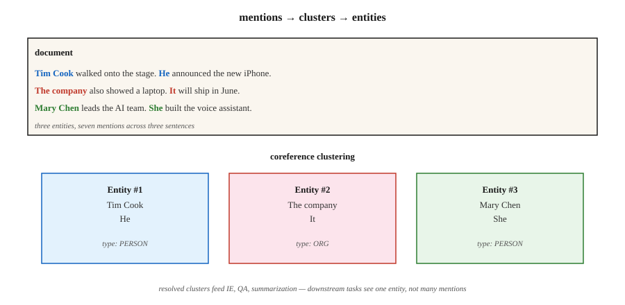

# 共指消解

> “She called him. He did not answer. The doctor was at lunch.” 三个指称、两个人，而且没人被点名。共指消解负责弄清谁是谁。

**Type:** Learn
**Languages:** Python
**Prerequisites:** Phase 5 · 06（NER），Phase 5 · 07（POS & Parsing）
**Time:** ~60 minutes

## 问题

从一篇 300 词文章中抽取 Apple Inc. 的每一次提及。文章写 “Apple” 时很简单。文章写 “the company”、“they”、“Cupertino's technology giant” 或 “Jobs's firm” 时就难了。如果不把这些 mention 解析到同一个 entity，你的 NER 流水线会漏掉 60-80% 的提及。

Coreference resolution 会把所有指向同一个真实世界实体的表达链接成一个 cluster。它是表层 NLP（NER、parsing）和下游语义任务（IE、QA、summarization、KG）之间的胶水。

为什么它在 2026 年仍然重要：

- Summarization：“The CEO announced...” vs “Tim Cook announced...” 摘要应该写出 CEO 的名字。
- Question answering：“Who did she call?” 需要解析 “she”。
- Information extraction：知识图谱里同时有 “PER1 founded Apple” 和 “Jobs founded Apple” 作为两条独立记录，是错的。
- Multi-document IE：合并多篇文章中关于同一事件的 mentions，就是 cross-document coreference。

## 概念



**任务。** 输入：一篇文档。输出：mentions（spans）的聚类，每个 cluster 指向一个 entity。

**Mention 类型。**

- **Named entity。** “Tim Cook”
- **Nominal。** “the CEO”, “the company”
- **Pronominal。** “he”, “she”, “they”, “it”
- **Appositive。** “Tim Cook, Apple's CEO,”

**架构。**

1. **Rule-based（Hobbs, 1978）。** 基于句法树的代词消解，使用语法规则。是不错的 baseline。在代词上意外地难以击败。
2. **Mention-pair classifier。** 对每一对 mentions（m_i, m_j）预测它们是否共指。通过传递闭包聚类。2016 年前的标准做法。
3. **Mention-ranking。** 对每个 mention，给候选 antecedents 排名（包含 “no antecedent”）。选择 top。
4. **Span-based end-to-end（Lee et al., 2017）。** Transformer encoder。枚举长度上限内的所有候选 spans。预测 mention scores。为每个 span 预测 antecedent probability。贪心聚类。现代默认方案。
5. **Generative（2024+）。** 提示 LLM：“列出这段文本中的每个代词及其 antecedent。” 简单案例表现很好，但在长文档和罕见 referents 上会吃力。

**评估指标。** 标准指标有五个（MUC、B³、CEAF、BLANC、LEA），因为没有单个指标能完整捕获聚类质量。通常报告前三个的平均值，称为 CoNLL F1。2026 年 CoNLL-2012 上的 state-of-the-art 约为 83 F1。

**已知难点。**

- 指向数页之前实体的 definite descriptions。
- Bridging anaphora（“the wheels” → 之前提到的一辆 car）。
- 中文、日语等语言里的 zero anaphora。
- Cataphora（代词先于 referent）：“When **she** walked in, Mary smiled.”

## Build It

### Step 1：预训练神经共指（AllenNLP / spaCy-experimental）

```python
import spacy
nlp = spacy.load("en_coreference_web_trf")   # experimental model
doc = nlp("Apple announced new products. The company said they would ship soon.")
for cluster in doc._.coref_clusters:
    print(cluster, "->", [m.text for m in cluster])
```

在更长的文档上，你会得到类似结果：

- Cluster 1: [Apple, The company, they]
- Cluster 2: [new products]

### Step 2：rule-based 代词消解器（教学用）

`code/main.py` 里有一个只用 stdlib 的实现：

1. 抽取 mentions：named entities（大写 spans）、pronouns（字典查找）、definite descriptions（“the X”）。
2. 对每个 pronoun，查看前 K 个 mentions，并按以下条件打分：
   - gender/number agreement（启发式）
   - recency（越近越好）
   - syntactic role（subjects 优先）
3. 链接最高分 antecedent。

它无法和神经模型竞争。但它展示了搜索空间，以及端到端模型必须做出的决策。

### Step 3：用 LLM 做共指

```python
prompt = f"""Text: {text}

List every pronoun and noun phrase that refers to a person or company.
Cluster them by what they refer to. Output JSON:
[{{"entity": "Apple", "mentions": ["Apple", "the company", "it"]}}, ...]
"""
```

要注意两个失败模式。第一，LLM 会过度合并（例如把指向两个不同人的 “him” 和 “her” 合并）。第二，LLM 会在长文档中悄悄漏掉 mentions。一定要用 span-offset checks 验证。

### Step 4：评估

标准 conll-2012 脚本会计算 MUC、B³、CEAF-φ4，并报告平均值。做内部 eval 时，先在你的标注测试集上从 span-level precision 和 recall 开始，再添加 mention-linking F1。

## 陷阱

- **Singleton explosion。** 有些系统会把每个 mention 都作为自己的 cluster 报告。B³ 对此比较宽容。MUC 会惩罚它。始终检查三个指标。
- **长上下文中的 pronouns。** 超过 2,000 tokens 的文档上，性能会下降约 15 F1。要小心 chunk。
- **Gender assumptions。** 硬编码 gender rules 会在非二元 referents、组织、动物上坏掉。使用学习模型或中性打分。
- **长文档上的 LLM drift。** 单次 API 调用无法可靠地聚类 50+ 段落中的 mentions。使用 sliding-window + merge。

## Use It

2026 年的技术栈：

| Situation | Pick |
|-----------|------|
| English, single document | `en_coreference_web_trf`（spaCy-experimental）或 AllenNLP neural coref |
| Multilingual | 在 OntoNotes 或 Multilingual CoNLL 上训练的 SpanBERT / XLM-R |
| Cross-document event coref | 专门的 end-to-end models（2025-26 SOTA） |
| Quick LLM baseline | 带 structured-output coref prompt 的 GPT-4o / Claude |
| Production dialog systems | Rule-based fallback + neural primary + critical slots 的人工 review |

2026 年能上线的集成模式：先跑 NER，再跑 coref，把 coref clusters 合并进 NER entities。下游任务看到的是每个 cluster 一个 entity，而不是每个 mention 一个 entity。

## Ship It

保存为 `outputs/skill-coref-picker.md`：

```markdown
---
name: coref-picker
description: Pick a coreference approach, evaluation plan, and integration strategy.
version: 1.0.0
phase: 5
lesson: 24
tags: [nlp, coref, information-extraction]
---

Given a use case (single-doc / multi-doc, domain, language), output:

1. Approach. Rule-based / neural span-based / LLM-prompted / hybrid. One-sentence reason.
2. Model. Named checkpoint if neural.
3. Integration. Order of operations: tokenize → NER → coref → downstream task.
4. Evaluation. CoNLL F1 (MUC + B³ + CEAF-φ4 average) on held-out set + manual cluster review on 20 documents.

Refuse LLM-only coref for documents over 2,000 tokens without sliding-window merge. Refuse any pipeline that runs coref without a mention-level precision-recall report. Flag gender-heuristic systems deployed in demographically diverse text.
```

## 练习

1. **（Easy）** 在 5 个手写段落上运行 `code/main.py` 中的 rule-based resolver。用 ground truth 测量 mention-link accuracy。
2. **（Medium）** 在一篇新闻文章上使用预训练 neural coref model。把 clusters 和你自己的人工标注比较。它在哪里失败了？
3. **（Hard）** 构建一个 coref-enhanced NER pipeline：先 NER，再通过 coref clusters 合并。对 100 篇文章，测量它相对 NER-only 的 entity-coverage improvement。

## 关键术语

| 术语 | 常见说法 | 实际含义 |
|------|----------|----------|
| Mention | 一个指称 | 指向某个 entity 的文本 span（名字、代词、名词短语）。 |
| Antecedent | “it” 指的东西 | 后续 mention 与之共指的更早 mention。 |
| Cluster | Entity 的 mentions | 全部指向同一个真实世界 entity 的 mention 集合。 |
| Anaphora | 向后指称 | 后面的 mention 指向前面的 mention（“he” → “John”）。 |
| Cataphora | 向前指称 | 前面的 mention 指向后面的 mention（“When he arrived, John...”）。 |
| Bridging | 隐式指称 | “I bought a car. The wheels were bad.”（那辆车的 wheels。） |
| CoNLL F1 | leaderboard 上的数字 | MUC、B³、CEAF-φ4 F1 分数的平均值。 |

## 延伸阅读

- [Jurafsky & Martin, SLP3 Ch. 26 — Coreference Resolution and Entity Linking](https://web.stanford.edu/~jurafsky/slp3/26.pdf)：标准教材章节。
- [Lee et al. (2017). End-to-end Neural Coreference Resolution](https://arxiv.org/abs/1707.07045)：span-based end-to-end。
- [Joshi et al. (2020). SpanBERT](https://arxiv.org/abs/1907.10529)：能提升 coref 的预训练方法。
- [Pradhan et al. (2012). CoNLL-2012 Shared Task](https://aclanthology.org/W12-4501/)：benchmark。
- [Hobbs (1978). Resolving Pronoun References](https://www.sciencedirect.com/science/article/pii/0024384178900064)：rule-based 经典论文。
