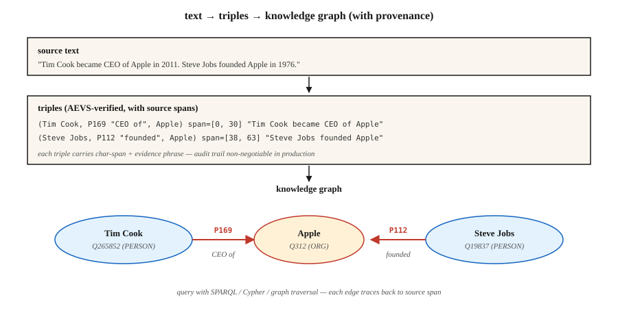

# 关系抽取与知识图谱构建

> NER 找到了实体。Entity linking 锚定了实体。Relation extraction 找出实体之间的边。知识图谱就是节点、边以及它们 provenance 的总和。

**Type:** Build
**Languages:** Python
**Prerequisites:** Phase 5 · 06 (NER), Phase 5 · 25 (Entity Linking)
**Time:** ~60 minutes

## 学习目标

- 将自由文本中的事实表示为 `(subject, relation, object)` 三元组
- 区分基于规则、监督分类器和生成式 LLM 三类关系抽取方法
- 解释为什么 LLM 关系抽取必须携带 source span 和 provenance
- 将开放关系短语 canonicalize 到封闭 ontology property id
- 设计从 NER、coreference、entity linking 到 graph load 的知识图谱构建流水线

## 问题

分析师读到一句话："Tim Cook became CEO of Apple in 2011." 里面有四个事实：

- `(Tim Cook, role, CEO)`
- `(Tim Cook, employer, Apple)`
- `(Tim Cook, start_date, 2011)`
- `(Apple, type, Organization)`

关系抽取（Relation Extraction, RE）把自由文本转换成结构化三元组 `(subject, relation, object)`。在整个语料上聚合这些三元组，你就有了知识图谱。继续聚合并查询它，你就有了可用于 RAG、分析或合规审计的推理底座。

2026 年的问题是：LLM 会非常热情地抽取关系。太热情了。它们会幻觉出源文本并不支持的三元组。没有 provenance，你无法区分真实三元组和看起来合理的虚构内容。2026 年的答案是 AEVS 风格的 anchor-and-verify pipeline。

## 概念



**三元组形式。** `(subject_entity, relation_type, object_entity)`。关系可以来自封闭 ontology（Wikidata properties、FIBO、UMLS），也可以来自开放集合（OpenIE 风格，什么都可以）。

**三种抽取方法。**

1. **基于规则 / pattern。** Hearst patterns："X such as Y" → `(Y, isA, X)`。再加上手写 regex。脆弱、精确、可解释。
2. **监督分类器。** 给定句子中的两个 entity mention，从固定集合中预测 relation。在 TACRED、ACE、KBP 上训练。2015-2022 年的标准方法。
3. **生成式 LLM。** Prompt 模型输出 triples。开箱即用。需要 provenance，否则会幻觉出看起来合理的垃圾。

**AEVS（Anchor-Extraction-Verification-Supplement, 2026）。** 当前的 hallucination-mitigation framework：

- **Anchor。** 用精确位置识别每个 entity span 和 relation-phrase span。
- **Extract。** 生成链接到 anchor spans 的 triples。
- **Verify。** 把每个 triple element 匹配回源文本；拒绝任何无支持内容。
- **Supplement。** 覆盖率检查，确保没有 anchored span 被漏掉。

幻觉会显著下降。它需要更多计算，但可审计。

**开放 vs 封闭的取舍。**

- **封闭 ontology。** 固定 property list（例如 Wikidata 的 11,000+ properties）。可预测。可查询。难以凭空发明。
- **Open IE。** 任意动词短语都可以成为 relation。高 recall。低 precision。查询起来混乱。

生产 KG 通常会混合两者：用 Open IE 做发现，再把 relation canonicalize 到封闭 ontology，之后才合并进主图。

## Build It

### Step 1：基于 pattern 的抽取

```python
PATTERNS = [
    (r"(?P<s>[A-Z]\w+) (?:is|was) (?:a|an|the) (?P<o>[A-Z]?\w+)", "isA"),
    (r"(?P<s>[A-Z]\w+) (?:is|was) born in (?P<o>\w+)", "bornIn"),
    (r"(?P<s>[A-Z]\w+) works? (?:at|for) (?P<o>[A-Z]\w+)", "worksAt"),
    (r"(?P<s>[A-Z]\w+) founded (?P<o>[A-Z]\w+)", "founded"),
]
```

完整 toy extractor 见 `code/main.py`。Hearst patterns 仍然会出现在领域专用流水线里，因为它们可调试。

### Step 2：监督式关系分类

```python
from transformers import AutoTokenizer, AutoModelForSequenceClassification

tok = AutoTokenizer.from_pretrained("Babelscape/rebel-large")
model = AutoModelForSequenceClassification.from_pretrained("Babelscape/rebel-large")

text = "Tim Cook was born in Alabama. He later became CEO of Apple."
encoded = tok(text, return_tensors="pt", truncation=True)
output = model.generate(**encoded, max_length=200)
triples = tok.batch_decode(output, skip_special_tokens=False)
```

REBEL 是一个 seq2seq relation extractor：输入文本，输出 triples，并且已经使用 Wikidata property ids。它在 distant-supervision 数据上 fine-tuned，是标准 open-weights baseline。

### Step 3：带 anchoring 的 LLM prompt extraction

```python
prompt = f"""Extract (subject, relation, object) triples from the text.
For each triple, include the exact character span in the source text.

Text: {text}

Output JSON:
[{{"subject": {{"text": "...", "span": [start, end]}},
   "relation": "...",
   "object": {{"text": "...", "span": [start, end]}}}}, ...]

Only include triples fully supported by the text. No inference beyond what is stated.
"""
```

验证每个返回 span 是否能对上源文本。拒绝所有 `text[start:end] != triple_entity` 的结果。这就是最小形式的 AEVS "verify" step。

### Step 4：canonicalize 到封闭 ontology

```python
RELATION_MAP = {
    "is the CEO of": "P169",       # "chief executive officer"
    "was born in":   "P19",         # "place of birth"
    "founded":        "P112",       # "founded by" (inverted subject/object)
    "works at":       "P108",       # "employer"
}


def canonicalize(relation):
    rel_low = relation.lower().strip()
    if rel_low in RELATION_MAP:
        return RELATION_MAP[rel_low]
    return None   # drop unmapped open relations or route to manual review
```

Canonicalization 往往占工程工作量的 60-80%。要为它预留预算。

### Step 5：构建小图并查询

```python
triples = extract(text)
graph = {}
for s, r, o in triples:
    graph.setdefault(s, []).append((r, o))


def neighbors(node, relation=None):
    return [(r, o) for r, o in graph.get(node, []) if relation is None or r == relation]


print(neighbors("Tim Cook", relation="P108"))    # -> [(P108, Apple)]
```

这是每个 RAG-over-KG 系统的原子。可以用 RDF triple stores（Blazegraph、Virtuoso）、property graphs（Neo4j）或 vector-augmented graph stores 扩展它。

## Pitfalls

- **RE 前先做 coreference。** "He founded Apple" 里，RE 需要知道 "he" 是谁。先跑 coref（第 24 课）。
- **实体 canonicalization。** "Apple Inc" 和 "Apple" 必须解析到同一个节点。先做 entity linking（第 25 课）。
- **幻觉三元组。** LLM 会输出文本不支持的 triples。强制 span verification。
- **Relation canonicalization drift。** Open IE relations 不一致（"was born in," "came from," "is a native of"）。要折叠成 canonical ids，否则图不可查询。
- **时间错误。** "Tim Cook is CEO of Apple" 现在为真，2005 年为假。许多关系都有时间边界。使用 qualifiers（Wikidata 中 `P580` start time、`P582` end time）。
- **领域不匹配。** REBEL 在 Wikipedia 上训练。法律、医疗和科学文本通常需要领域 fine-tuned RE models。

## Use It

2026 年技术栈：

| 场景 | 选择 |
|------|------|
| 快速生产、通用领域 | REBEL 或 LlamaPred + Wikidata canonicalization |
| 领域专用（生物医学、法律） | SciREX 风格领域 fine-tune + custom ontology |
| LLM prompt、可审计输出 | AEVS pipeline：anchor → extract → verify → supplement |
| 高吞吐新闻 IE | Pattern-based + supervised hybrid |
| 从零构建 KG | Open IE + manual canonicalization pass |
| Temporal KG | 带 qualifiers 抽取（start/end time、point in time） |

集成模式：NER → coref → entity linking → relation extraction → ontology mapping → graph load。每个阶段都可以成为质量门。

## Ship It

保存为 `outputs/skill-re-designer.md`：

```markdown
---
name: re-designer
description: Design a relation extraction pipeline with provenance and canonicalization.
version: 1.0.0
phase: 5
lesson: 26
tags: [nlp, relation-extraction, knowledge-graph]
---

Given a corpus (domain, language, volume) and downstream use (KG-RAG, analytics, compliance), output:

1. Extractor. Pattern-based / supervised / LLM / AEVS hybrid. Reason tied to precision vs recall target.
2. Ontology. Closed property list (Wikidata / domain) or open IE with canonicalization pass.
3. Provenance. Every triple carries source char-span + doc id. Non-negotiable for audit.
4. Merge strategy. Canonical entity id + relation id + temporal qualifiers; dedup policy.
5. Evaluation. Precision / recall on 200 hand-labelled triples + hallucination-rate on LLM-extracted sample.

Refuse any LLM-based RE pipeline without span verification (source provenance). Refuse open-IE output flowing into a production graph without canonicalization. Flag pipelines with no temporal qualifier on time-bounded relations (employer, spouse, position).
```

## 练习

1. **Easy.** 在 5 个新闻文章句子上运行 `code/main.py` 里的 pattern extractor。手工检查 precision。
2. **Medium.** 在同样的句子上使用 REBEL（或一个小型 LLM）。比较 triples。哪个 extractor precision 更高？哪个 recall 更高？
3. **Hard.** 构建 AEVS pipeline：用 LLM 抽取 + 根据源文本验证 spans。在 50 个 Wikipedia 风格句子上测量 verify step 前后的 hallucination rate。

## 关键术语

| 术语 | 常见说法 | 实际含义 |
|------|----------|----------|
| Triple | Subject-relation-object | `(s, r, o)` tuple，是 KG 的原子单位。 |
| Open IE | 什么都抽 | 开放词表 relation phrases；高 recall，低 precision。 |
| Closed ontology | 固定 schema | 有界 relation type 集合（Wikidata、UMLS、FIBO）。 |
| Canonicalization | 全部归一化 | 把 surface names / relations 映射到 canonical ids。 |
| AEVS | Grounded extraction | Anchor-Extraction-Verification-Supplement pipeline（2026）。 |
| Provenance | 真相来源链接 | 每个 triple 都携带 doc id + 指向源文本的 char-span。 |
| Distant supervision | 廉价标签 | 用现有 KG 对齐文本，创建训练数据。 |

## 延伸阅读

- [Mintz et al. (2009). Distant supervision for relation extraction without labeled data](https://www.aclweb.org/anthology/P09-1113.pdf) — distant-supervision 论文。
- [Huguet Cabot, Navigli (2021). REBEL: Relation Extraction By End-to-end Language generation](https://aclanthology.org/2021.findings-emnlp.204.pdf) — seq2seq RE 主力模型。
- [Wadden et al. (2019). Entity, Relation, and Event Extraction with Contextualized Span Representations (DyGIE++)](https://arxiv.org/abs/1909.03546) — joint IE。
- [AEVS — Anchor-Extraction-Verification-Supplement framework](https://www.mdpi.com/2073-431X/15/3/178) — 2026 hallucination-mitigation design。
- [Wikidata SPARQL tutorial](https://www.wikidata.org/wiki/Wikidata:SPARQL_tutorial) — canonical graph queries。
