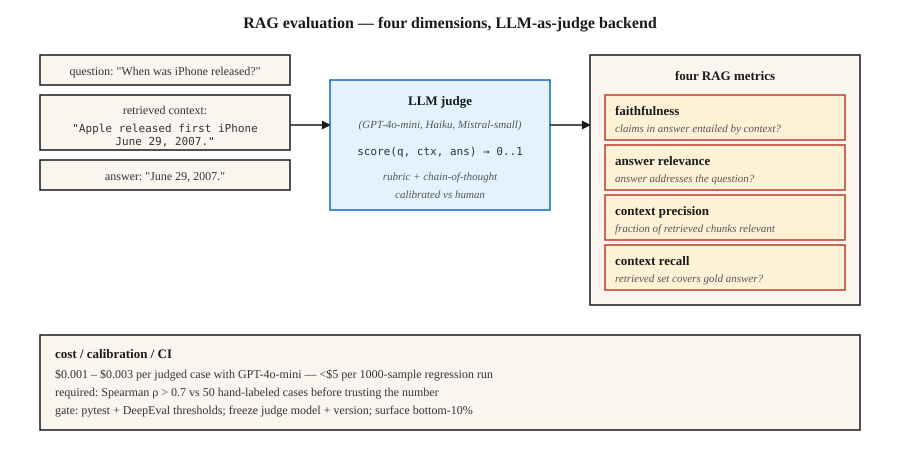

# LLM 评估 — RAGAS、DeepEval、G-Eval

> Exact Match 和 F1 会漏掉语义等价。人工 review 无法扩展。LLM-as-judge 是生产中的答案，但你需要足够的校准，才能相信那个数字。

**Type:** Build
**Languages:** Python
**Prerequisites:** Phase 5 · 13（Question Answering），Phase 5 · 14（Information Retrieval）
**Time:** ~75 minutes

## 问题

你的 RAG 系统回答："June 29th, 2007."
gold reference 是："June 29, 2007."
Exact Match 得 0。F1 大约 75%。人类会给 100%。

现在把这个问题乘以 10,000 个测试样本。再乘以每一次 retriever、chunking、prompt 或模型变更。你需要一个评估器：它理解含义，能低成本规模化运行，不会在回归上撒谎，并且能暴露正确的失败模式。

2026 年有三个框架主导这个问题。

- **RAGAS。** Retrieval-Augmented Generation ASsessment。四个 RAG 指标（faithfulness、answer-relevance、context-precision、context-recall），后端使用 NLI + LLM judge。有研究支撑，轻量。
- **DeepEval。** LLM 领域的 pytest。提供 G-Eval、task-completion、hallucination、bias 等指标。天然适配 CI/CD。
- **G-Eval。** 一种方法（也是 DeepEval 中的一个 metric）：带 chain-of-thought、自定义 criteria、0-1 分数的 LLM-as-judge。

三者都依赖 LLM-as-judge。本课会建立你对这种方法以及它周围信任层的直觉。

## 概念



**LLM-as-judge。** 用一个 LLM 按 rubric 给输出打分，替代静态指标。给定 `(query, context, answer)`，提示 judge LLM："Score 0-1 on faithfulness." 返回分数。

它为什么有效：LLM 可以以极低成本近似人类判断。GPT-4o-mini 每个被评分 case 约 ~$0.003，使得 1000 样本的回归评估可以低于 $5。

它为什么会静默失败：

1. **Judge bias。** Judge 偏好更长答案，偏好来自自己模型家族的答案，偏好匹配 prompt 风格的答案。
2. **JSON 解析失败。** 坏 JSON → NaN score → 被悄悄排除在 aggregate 之外。RAGAS 用户都知道这种痛。用 try/except + 显式失败模式做 gate。
3. **模型版本漂移。** 升级 judge 会改变每个指标。冻结 judge 模型和版本。

**RAG 四指标。**

| 指标 | 问题 | 后端 |
|------|------|------|
| Faithfulness | 答案里的每条 claim 是否来自检索上下文？ | 基于 NLI 的蕴含 |
| Answer relevance | 答案是否回应了问题？ | 从答案生成假想问题；与真实问题比较 |
| Context precision | 检索出的 chunks 里，有多少比例相关？ | LLM-judge |
| Context recall | 检索是否返回了所需的全部信息？ | LLM-judge 对照 gold answer |

**G-Eval。** 定义一个自定义 criterion："Did the answer cite the correct source?" 框架会自动展开成 chain-of-thought evaluation steps，然后打 0-1 分。它适合 RAGAS 没覆盖到的领域特定质量维度。

**校准。** 在你拿到与人工标签的相关性之前，永远不要相信原始 judge score。运行 100 个手工标注样本。画出 judge vs human。计算 Spearman rho。如果 rho < 0.7，你的 judge rubric 需要重写。

## Build It

### 第 1 步：用 NLI 做 faithfulness（RAGAS 风格）

```python
from typing import Callable
from transformers import pipeline

nli = pipeline("text-classification",
               model="MoritzLaurer/DeBERTa-v3-large-mnli-fever-anli-ling-wanli",
               top_k=None)

# `llm` is any callable: prompt str -> generated str.
# Example: llm = lambda p: client.messages.create(model="claude-haiku-4-5", ...).content[0].text
LLM = Callable[[str], str]


def atomic_claims(answer: str, llm: LLM) -> list[str]:
    prompt = f"""Break this answer into simple factual claims (one per line):
{answer}
"""
    return llm(prompt).splitlines()


def faithfulness(answer: str, context: str, llm: LLM) -> float:
    claims = atomic_claims(answer, llm)
    if not claims:
        return 0.0
    supported = 0
    for claim in claims:
        result = nli({"text": context, "text_pair": claim})[0]
        entail = next((s for s in result if s["label"] == "entailment"), None)
        if entail and entail["score"] > 0.5:
            supported += 1
    return supported / len(claims)
```

把答案分解成原子 claim。用 NLI 检查每条 claim 是否被检索上下文支持。Faithfulness = 被支持 claim 的比例。

### 第 2 步：answer relevance

```python
import numpy as np
from sentence_transformers import SentenceTransformer

# encoder: any model implementing .encode(texts, normalize_embeddings=True) -> ndarray
# e.g., encoder = SentenceTransformer("BAAI/bge-small-en-v1.5")

def answer_relevance(question: str, answer: str, encoder, llm: LLM, n: int = 3) -> float:
    prompt = f"Write {n} questions this answer could be the answer to:\n{answer}"
    generated = [line for line in llm(prompt).splitlines() if line.strip()][:n]
    if not generated:
        return 0.0
    q_emb = np.asarray(encoder.encode([question], normalize_embeddings=True)[0])
    g_embs = np.asarray(encoder.encode(generated, normalize_embeddings=True))
    sims = [float(q_emb @ g_emb) for g_emb in g_embs]
    return sum(sims) / len(sims)
```

如果答案暗示的问题和真实问题不同，relevance 就会下降。

### 第 3 步：G-Eval 自定义 metric

```python
from deepeval.metrics import GEval
from deepeval.test_case import LLMTestCaseParams, LLMTestCase

metric = GEval(
    name="Correctness",
    criteria="The answer should be factually accurate and match the expected output.",
    evaluation_steps=[
        "Read the expected output.",
        "Read the actual output.",
        "List factual claims in the actual output.",
        "For each claim, mark supported or unsupported by the expected output.",
        "Return score = fraction supported.",
    ],
    evaluation_params=[LLMTestCaseParams.INPUT, LLMTestCaseParams.ACTUAL_OUTPUT, LLMTestCaseParams.EXPECTED_OUTPUT],
)

test = LLMTestCase(input="When was the first iPhone released?",
                   actual_output="June 29th, 2007.",
                   expected_output="June 29, 2007.")
metric.measure(test)
print(metric.score, metric.reason)
```

evaluation steps 就是 rubric。显式步骤比隐式的 "score 0-1" prompt 更稳定。

### 第 4 步：CI gate

```python
import deepeval
from deepeval.metrics import FaithfulnessMetric, ContextualRelevancyMetric


def test_rag_system():
    cases = load_regression_cases()
    faith = FaithfulnessMetric(threshold=0.85)
    rel = ContextualRelevancyMetric(threshold=0.7)
    for case in cases:
        faith.measure(case)
        assert faith.score >= 0.85, f"faithfulness regression on {case.id}"
        rel.measure(case)
        assert rel.score >= 0.7, f"relevancy regression on {case.id}"
```

把它作为 pytest 文件发布。每个 PR 都运行。遇到回归就阻止 merge。

### 第 5 步：从零实现 toy eval

查看 `code/main.py`。里面有只用标准库实现的 faithfulness（答案 claim 与上下文的重叠）和 relevance（答案 token 与问题 token 的重叠）近似。不能用于生产，但能展示形状。

## 常见坑

- **没有校准。** 一个与人工标签只有 0.3 相关性的 judge，本质上是噪声。上线前必须做校准。
- **自评。** 用同一个 LLM 生成和评判，会把分数抬高 10-20%。Judge 要使用不同模型家族。
- **成对评判中的位置偏差。** Judge 偏好第一个选项。必须随机化顺序，并正反都跑。
- **原始 aggregate 掩盖失败。** 平均分 0.85 往往会藏住 5% 的灾难性失败。永远检查底部 quantile。
- **Golden dataset 腐烂。** 未版本化的 eval set 随时间漂移，会破坏纵向比较。每次变更都要给 dataset 打 tag。
- **LLM 成本。** 规模化时，judge 调用会主导成本。使用满足校准阈值的最便宜模型。GPT-4o-mini、Claude Haiku、Mistral-small。

## Use It

2026 年的技术栈：

| 使用场景 | 框架 |
|---------|------|
| RAG 质量监控 | RAGAS（4 个指标） |
| CI/CD 回归 gate | DeepEval + pytest |
| 自定义领域 criteria | DeepEval 中的 G-Eval |
| 在线真实流量监控 | RAGAS reference-free mode |
| Human-in-the-loop 抽查 | LangSmith 或 Phoenix annotation UI |
| Red-teaming / safety eval | Promptfoo + DeepEval |

典型栈：RAGAS 做监控，DeepEval 做 CI，G-Eval 做新质量维度。三个都跑；它们的分歧很有用。

## Ship It

保存为 `outputs/skill-eval-architect.md`：

```markdown
---
name: eval-architect
description: Design an LLM evaluation plan with calibrated judge and CI gates.
version: 1.0.0
phase: 5
lesson: 27
tags: [nlp, evaluation, rag]
---

Given a use case (RAG / agent / generative task), output:

1. Metrics. Faithfulness / relevance / context-precision / context-recall + any custom G-Eval metrics with criteria.
2. Judge model. Named model + version, rationale for cost vs accuracy.
3. Calibration. Hand-labeled set size, target Spearman rho vs human > 0.7.
4. Dataset versioning. Tag strategy, change log, stratification.
5. CI gate. Thresholds per metric, regression-window logic, bottom-quantile alert.

Refuse to rely on a judge untested against ≥50 human-labeled examples. Refuse self-evaluation (same model generates + judges). Refuse aggregate-only reporting without bottom-10% surfacing. Flag any pipeline where judge upgrade lands without parallel baseline eval.
```

## 练习

1. **Easy.** 在 10 个带已知幻觉的 RAG 示例上使用 RAGAS。验证 faithfulness metric 能抓住每一个幻觉。
2. **Medium.** 手工给 50 个 QA 答案按 correctness 标注 0-1。用 G-Eval 打分。测量 judge 与 human 之间的 Spearman rho。
3. **Hard.** 用 DeepEval 构建一个 pytest CI gate。故意让 retriever 回归。验证 gate 会失败。通过对最低 10% 做阈值检查，加入 bottom-quantile alerting。

## 关键术语

| 术语 | 人们常说 | 实际含义 |
|------|----------|----------|
| LLM-as-judge | 用 LLM 打分 | 给定 rubric，提示 judge 模型把输出评分为 0-1。 |
| RAGAS | RAG 指标库 | 开源 eval 框架，包含 4 个 reference-free RAG 指标。 |
| Faithfulness | 答案是否 grounded？ | 被检索上下文蕴含的答案 claim 比例。 |
| Context precision | 检索 chunks 是否相关？ | top-K chunks 中实际有用的比例。 |
| Context recall | 检索是否找全？ | gold-answer claims 中被检索 chunks 支持的比例。 |
| G-Eval | 自定义 LLM judge | rubric + chain-of-thought eval steps + 0-1 score。 |
| Calibration | 信任但要验证 | judge 分数与人工分数之间的 Spearman 相关性。 |

## 延伸阅读

- [Es et al. (2023). RAGAS: Automated Evaluation of Retrieval Augmented Generation](https://arxiv.org/abs/2309.15217) — RAGAS 论文。
- [Liu et al. (2023). G-Eval: NLG Evaluation using GPT-4 with Better Human Alignment](https://arxiv.org/abs/2303.16634) — G-Eval 论文。
- [DeepEval docs](https://deepeval.com/docs/metrics-introduction) — 开放生产栈。
- [Zheng et al. (2023). Judging LLM-as-a-Judge with MT-Bench and Chatbot Arena](https://arxiv.org/abs/2306.05685) — 偏差、校准、边界。
- [MLflow GenAI Scorer](https://mlflow.org/blog/third-party-scorers) — 集成 RAGAS、DeepEval、Phoenix 的统一框架。
