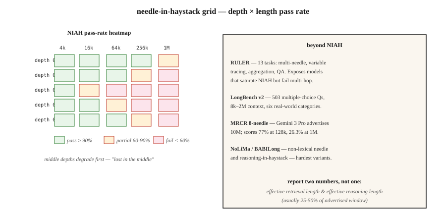

# 长上下文评估 — NIAH、RULER、LongBench、MRCR

> Gemini 3 Pro 宣称支持 10M tokens context。但在 1M tokens 下，8-needle MRCR 掉到 26.3%。宣传值不等于可用值。Long-context evaluation 会告诉你，正在交付的模型到底有多少真实容量。

**Type:** Learn
**Languages:** Python
**Prerequisites:** Phase 5 · 13 (Question Answering), Phase 5 · 23 (Chunking Strategies)
**Time:** ~60 minutes

## 问题

你有一份 200 页合同。模型宣称有 1M-token context。你把合同粘进去，问：“termination clause 是什么？”模型回答了，但它回答的是封面页上的内容，因为 termination clause 位于 120k tokens 深处，已经超过模型真正会 attend 的位置。

这就是 2026 年的 context-capacity gap。规格表写着 1M 或 10M。现实是其中 60-70% 才可用，而且“可用”取决于任务。

- **Retrieval（haystack 里的 single needle）：** frontier models 通常能接近宣传上限。
- **Multi-hop / aggregation：** 大多数模型超过约 128k 后会明显退化。
- **Reasoning over dispersed facts：** 最先失败的任务。

Long-context evaluation 会测量这些轴。这一课会说明各个 benchmark 的名字、它们真正测量什么，以及怎样为你的领域构建自定义 needle test。

## 概念



**Needle-in-a-Haystack（NIAH，2023）。** 把一个 fact（“the magic word is pineapple”）放在长 context 的受控深度。然后要求模型 retrieve 它。扫描 depth × length。它是最早的 long-context benchmark。Frontier models 现在基本能刷满它；它是必要 baseline，但不充分。

**RULER（Nvidia，2024）。** 13 种 task types，分属 4 类：retrieval（single / multi-key / multi-value）、multi-hop tracing（variable tracking）、aggregation（common word frequency）、QA。Context length 可配置（4k 到 128k+）。它能揭示那些刷满 NIAH 却在 multi-hop 上失败的模型。在 2024 release 中，17 个宣称 32k+ context 的模型里，只有一半能在 32k 保持质量。

**LongBench v2（2024）。** 503 个 multiple-choice questions，context 为 8k-2M words，覆盖六类任务：single-doc QA、multi-doc QA、long in-context learning、long dialogue、code repo、long structured data。它是评估真实世界 long-context behavior 的生产 benchmark。

**MRCR（Multi-Round Coreference Resolution）。** 大规模 multi-turn coreference。包含 8-needle、24-needle、100-needle variants。它暴露模型在 attention 退化前能同时 juggling 多少 facts。

**NoLiMa。** “Non-lexical needle。” Needle 和 query 没有字面重叠；retrieval 需要一步 semantic reasoning。比 NIAH 更难。

**HELMET。** 拼接许多 documents，然后从任意一个 document 中提问。测试 selective attention。

**BABILong。** 把 bAbI reasoning chains 埋进无关 haystacks 中。测试 reasoning-in-a-haystack，而不只是 retrieval。

### 实际应该报告什么

- **Advertised context window。** 规格表上的数字。
- **Effective retrieval length。** NIAH 在某个阈值下通过的长度（例如 90%）。
- **Effective reasoning length。** Multi-hop 或 aggregation 在同一阈值下通过的长度。
- **Degradation curve。** Accuracy vs context length，并按 task type 分开画。

你的规格表应该有两个数字：retrieval-effective 和 reasoning-effective。通常 reasoning-effective 只有 advertised window 的 25-50%。

## 动手构建

### Step 1：为你的领域构建自定义 NIAH

见 `code/main.py`。骨架：

```python
def build_haystack(filler_text, needle, depth_ratio, total_tokens):
    if not (0.0 <= depth_ratio <= 1.0):
        raise ValueError(f"depth_ratio must be in [0, 1], got {depth_ratio}")
    if total_tokens <= 0:
        raise ValueError(f"total_tokens must be positive, got {total_tokens}")

    filler_tokens = tokenize(filler_text)
    needle_tokens = tokenize(needle)
    if not filler_tokens:
        raise ValueError("filler_text produced no tokens")

    # Repeat filler until long enough to fill the haystack body.
    body_len = max(total_tokens - len(needle_tokens), 0)
    while len(filler_tokens) < body_len:
        filler_tokens = filler_tokens + filler_tokens
    filler_tokens = filler_tokens[:body_len]

    insert_at = min(int(body_len * depth_ratio), body_len)
    haystack = filler_tokens[:insert_at] + needle_tokens + filler_tokens[insert_at:]
    return " ".join(haystack)


def score_niah(model, haystack, question, expected):
    answer = model.complete(f"Context: {haystack}\nQ: {question}\nA:", max_tokens=50)
    return 1 if expected.lower() in answer.lower() else 0
```

扫描 `depth_ratio` ∈ {0, 0.25, 0.5, 0.75, 1.0} × `total_tokens` ∈ {1k, 4k, 16k, 64k}。画出 heatmap。这就是目标模型的 NIAH card。

### Step 2：multi-needle variant

```python
def build_multi_needle(filler, needles, total_tokens):
    depths = [0.1, 0.4, 0.7]
    chunks = [filler[:int(total_tokens * 0.1)]]
    for depth, needle in zip(depths, needles):
        chunks.append(needle)
        next_chunk = filler[int(total_tokens * depth): int(total_tokens * (depth + 0.3))]
        chunks.append(next_chunk)
    return " ".join(chunks)
```

像 “What are the three magic words?” 这样的 questions 要求 retrieve 全部三个。Single-needle success 不能预测 multi-needle success。

### Step 3：multi-hop variable tracing（RULER-style）

```python
haystack = """X1 = 42. ... (filler) ... X2 = X1 + 10. ... (filler) ... X3 = X2 * 2."""
question = "What is X3?"
```

答案需要串起三次 assignments。Frontier models 在 128k 上经常会掉到 50-70% accuracy。

### Step 4：在你的 stack 上跑 LongBench v2

```python
from datasets import load_dataset
longbench = load_dataset("THUDM/LongBench-v2")

def eval_model_on_longbench(model, subset="single-doc-qa"):
    tasks = [x for x in longbench["test"] if x["task"] == subset]
    correct = 0
    for x in tasks:
        answer = model.complete(x["context"] + "\n\nQ: " + x["question"], max_tokens=20)
        if normalize(answer) == normalize(x["answer"]):
            correct += 1
    return correct / len(tasks)
```

报告 per-category accuracy。Aggregate scores 会掩盖很大的 task-level differences。

## 坑点

- **只做 NIAH evaluation。** 在 1M tokens 通过 NIAH，并不能说明 multi-hop 能行。始终运行 RULER 或自定义 multi-hop test。
- **Uniform depth sampling。** 许多实现只测 depth=0.5。要测 depth=0、0.25、0.5、0.75、1.0。“lost in the middle” effect 是真实存在的。
- **Filler 和 needle 有 lexical overlap。** 如果 needle 和 filler 共享 keywords，retrieval 会变得太简单。使用 NoLiMa-style non-overlapping needles。
- **忽略 latency。** 1M-token prompts 的 prefill 可能需要 30-120 秒。把 time-to-first-token 和 accuracy 一起测。
- **Vendor-self-reported numbers。** OpenAI、Google、Anthropic 都会发布自己的分数。始终在你的 use case 上独立重跑。

## 使用它

2026 年的工具栈：

| Situation | Benchmark |
|-----------|-----------|
| Quick sanity check | Custom NIAH at 3 depths × 3 lengths |
| Model selection for production | RULER（13 tasks）at your target length |
| Real-world QA quality | LongBench v2 single-doc-QA subset |
| Multi-hop reasoning | BABILong 或 custom variable-tracing |
| Conversational / dialogue | MRCR 8-needle at your target length |
| Model upgrade regression | Fixed in-house NIAH + RULER harness，每次新模型都运行 |

生产经验法则：除非你已经在目标长度上跑过 NIAH + 1 个 reasoning task，否则不要相信 context window。

## 交付它

保存为 `outputs/skill-long-context-eval.md`：

```markdown
---
name: long-context-eval
description: Design a long-context evaluation battery for a given model and use case.
version: 1.0.0
phase: 5
lesson: 28
tags: [nlp, long-context, evaluation]
---

Given a target model, target context length, and use case, output:

1. Tests. NIAH depth × length grid; RULER multi-hop; custom domain task.
2. Sampling. Depths 0, 0.25, 0.5, 0.75, 1.0 at each length.
3. Metrics. Retrieval pass rate; reasoning pass rate; time-to-first-token; cost-per-query.
4. Cutoff. Effective retrieval length (90% pass) and effective reasoning length (70% pass). Report both.
5. Regression. Fixed harness, rerun on every model upgrade, surface deltas.

Refuse to trust a context window from the model card alone. Refuse NIAH-only evaluation for any multi-hop workload. Refuse vendor self-reported long-context scores as independent evidence.
```

## 练习

1. **Easy.** 构建一个 3 depths（0.25、0.5、0.75）× 3 lengths（1k、4k、16k）的 NIAH。用任意模型运行。把 pass rate 画成 3×3 heatmap。
2. **Medium.** 添加一个 3-needle variant。测量每个 length 下是否能 retrieve 全部 3 个。和同长度的 single-needle pass rate 比较。
3. **Hard.** 构建一个 variable-tracing task（X1 → X2 → X3，3 hops），埋入 64k filler。测量 3 个 frontier models 的 accuracy。报告每个模型的 effective reasoning length。

## 关键术语

| Term | What people say | What it actually means |
|------|-----------------|-----------------------|
| NIAH | Needle in haystack | 在 filler 中植入一个 fact，要求模型 retrieve 它。 |
| RULER | 加强版 NIAH | 13 种 task types，覆盖 retrieval / multi-hop / aggregation / QA。 |
| Effective context | 真实容量 | Accuracy 仍高于 threshold 的长度。 |
| Lost in the middle | Depth bias | 模型对长输入中间位置的内容 attention 不足。 |
| Multi-needle | 一次多个 facts | 多个植入点；测试 attention juggling，而不只是 retrieval。 |
| MRCR | Multi-round coref | 8、24 或 100-needle coreference；暴露 attention saturation。 |
| NoLiMa | Non-lexical needle | Needle 和 query 不共享字面 tokens；需要 reasoning。 |

## 延伸阅读

- [Kamradt (2023). Needle in a Haystack analysis](https://github.com/gkamradt/LLMTest_NeedleInAHaystack) — 原始 NIAH repo。
- [Hsieh et al. (2024). RULER: What's the Real Context Size of Your Long-Context LMs?](https://arxiv.org/abs/2404.06654) — multi-task benchmark。
- [Bai et al. (2024). LongBench v2](https://arxiv.org/abs/2412.15204) — 真实世界 long-context eval。
- [Modarressi et al. (2024). NoLiMa: Non-lexical needles](https://arxiv.org/abs/2404.06666) — 更难的 needles。
- [Kuratov et al. (2024). BABILong](https://arxiv.org/abs/2406.10149) — reasoning-in-haystack。
- [Liu et al. (2024). Lost in the Middle: How Language Models Use Long Contexts](https://arxiv.org/abs/2307.03172) — depth-bias 论文。
