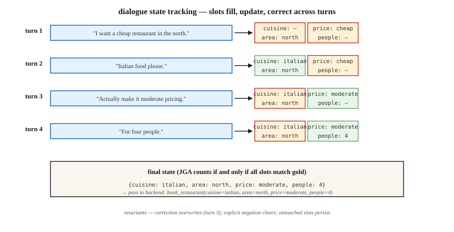

# Dialogue State Tracking

> "I want a cheap restaurant in the north... actually make it moderate... and add Italian." 三轮对话，三次 state update。DST 会让 slot-value dict 保持同步，这样 booking 才能正确执行。

**Type:** Build
**Languages:** Python
**Prerequisites:** Phase 5 · 17 (Chatbots), Phase 5 · 20 (Structured Outputs)
**Time:** ~75 minutes

## 问题

在 task-oriented dialogue system 中，用户目标会被编码成一组 slot-value pairs：`{cuisine: italian, area: north, price: moderate}`。每一轮 user turn 都可能添加、修改或移除一个 slot。System 必须读取整个 conversation，并正确输出当前 state。

只要一个 slot 错了，system 就会订错餐厅、安排错航班，或者刷错卡。DST 是用户说了什么与 backend 执行什么之间的铰链。

为什么即便有 LLMs，DST 在 2026 年仍然重要：

- Compliance-sensitive domains（banking、healthcare、airline booking）需要 deterministic slot values，而不是 free-form generation。
- Tool-use agents 在调用 APIs 之前仍然需要 slot resolution。
- Multi-turn correction 比看起来更难："actually no, make it Thursday."

Modern pipeline：classical DST concepts + LLM extractors + structured-output guardrails。

## 概念



**Task structure.** Schema 定义 domains（restaurant、hotel、taxi）及其 slots（cuisine、area、price、people）。每个 slot 可以为空，可以填入 closed set 中的 value（price: {cheap, moderate, expensive}），也可以填入 free-form value（name: "The Copper Kettle"）。

**两种 DST formulations。**

- **Classification.** 对每个 (slot, candidate_value) pair 预测 yes/no。适用于 closed-vocab slots。Pre-2020 的标准方式。
- **Generation.** 给定 dialogue，生成 free text slot values。适用于 open-vocab slots。现代默认方式。

**Metric.** Joint Goal Accuracy（JGA）——turns 中 *每个* slot 都正确的比例。All-or-nothing。MultiWOZ 2.4 leaderboard 在 2026 年最高约为 83%。

**Architectures。**

1. **Rule-based（slot regex + keyword）.** Narrow domains 的强 baseline。可 debug。
2. **TripPy / BERT-DST.** 基于 BERT encoding 的 copy-based generation。Pre-LLM 标准。
3. **LDST（LLaMA + LoRA）.** 使用 domain-slot prompting 的 instruction-tuned LLM。在 MultiWOZ 2.4 上达到 ChatGPT-level quality。
4. **Ontology-free（2024–26）.** 跳过 schema；直接生成 slot names 和 values。适合 open domains。
5. **Prompt + structured output（2024–26）.** LLM + Pydantic schema + constrained decoding。5 行代码，production-ready。

### 经典 failure modes

- **Co-reference across turns.** "Let's stay with the first option." 需要解析是哪一个 option。
- **Over-write vs append.** 用户说 "add Italian." 你是替换 cuisine，还是追加？
- **Implicit confirmations.** "OK cool" ——这是否接受了 system 给出的 booking？
- **Correction.** "Actually make it 7 pm." 必须更新 time，同时不清空其他 slots。
- **Coreference to previous system utterance.** "Yes, that one." 哪个 "that"？

## Build It

### Step 1: rule-based slot extractor

见 `code/main.py`。Regex + synonym dictionaries 可以覆盖 narrow domains 中 70% 的 canonical utterances：

```python
CUISINE_SYNONYMS = {
    "italian": ["italian", "pasta", "pizza", "italy"],
    "chinese": ["chinese", "chow mein", "noodles"],
}


def extract_cuisine(utterance):
    for canonical, synonyms in CUISINE_SYNONYMS.items():
        if any(syn in utterance.lower() for syn in synonyms):
            return canonical
    return None
```

一旦离开 canonical vocabulary 就很 brittle。但它适合 deterministic slot confirmations。

### Step 2: state update loop

```python
def update_state(state, utterance):
    new_state = dict(state)
    for slot, extractor in SLOT_EXTRACTORS.items():
        value = extractor(utterance)
        if value is not None:
            new_state[slot] = value
    for slot in NEGATION_CLEARS:
        if is_negated(utterance, slot):
            new_state[slot] = None
    return new_state
```

三个 invariants：

- 永远不要 reset 用户没有触碰的 slot。
- Explicit negation（"never mind the cuisine"）必须 clear。
- User correction（"actually..."）必须 overwrite，而不是 append。

### Step 3: 使用 structured output 的 LLM-driven DST

```python
from pydantic import BaseModel
from typing import Literal, Optional
import instructor

class RestaurantState(BaseModel):
    cuisine: Optional[Literal["italian", "chinese", "indian", "thai", "any"]] = None
    area: Optional[Literal["north", "south", "east", "west", "center"]] = None
    price: Optional[Literal["cheap", "moderate", "expensive"]] = None
    people: Optional[int] = None
    day: Optional[str] = None


def llm_dst(history, llm):
    prompt = f"""You track the slot values of a restaurant booking across turns.
Dialogue so far:
{render(history)}

Update the state based on the latest user turn. Output only the JSON state."""
    return llm(prompt, response_model=RestaurantState)
```

Instructor + Pydantic 保证返回 valid state object。没有 regex，没有 schema mismatches，也没有 hallucinated slots。

### Step 4: JGA evaluation

```python
def joint_goal_accuracy(predicted_states, gold_states):
    correct = sum(1 for p, g in zip(predicted_states, gold_states) if p == g)
    return correct / len(predicted_states)
```

Calibrate：system 有多少比例的 turns 能把 ALL slots 全部做对？对于 MultiWOZ 2.4，2026 年 top systems 约为 80-83%。你的 in-domain system 在 narrow vocabulary 上应该超过这个数字，否则 LLM baseline 会击败你。

### Step 5: handling correction

```python
CORRECTION_CUES = {"actually", "no wait", "on second thought", "change that to"}


def is_correction(utterance):
    return any(cue in utterance.lower() for cue in CORRECTION_CUES)
```

检测到 correction 时，overwrite last-updated slot，而不是 append。没有 LLM help 时这很难做对。现代 pattern：总是让 LLM 从 history 中 regenerate 整个 state，而不是 incremental update；这会自然处理 corrections。

## 陷阱

- **Full-history regeneration cost.** 让 LLM 每轮 regenerate state，总 token cost 是 O(n²)。限制 history，或 summarize older turns。
- **Schema drift.** 事后添加新 slots 会破坏旧 training data。给 schema 做 versioning。
- **Case sensitivity.** "Italian" vs "italian" vs "ITALIAN" ——处处 normalize。
- **Implicit inheritance.** 如果用户之前指定了 "for 4 people"，新 request 只是换时间，不应清空 people。始终传入 full history。
- **Free-form vs closed-set.** Names、times、addresses 需要 free-form slots；cuisines 和 areas 是 closed。Schema 中要混合使用。

## Use It

2026 年的 stack：

| Situation | Approach |
|-----------|----------|
| Narrow domain (one or two intents) | Rule-based + regex |
| Broad domain, labeled data available | LDST (LLaMA + LoRA on MultiWOZ-style data) |
| Broad domain, no labels, prod-ready | LLM + Instructor + Pydantic schema |
| Spoken / voice | ASR + normalizer + LLM-DST |
| Multi-domain booking flow | Schema-guided LLM with per-domain Pydantic models |
| Compliance-sensitive | Rule-based primary, LLM fallback with confirmation flow |

## Ship It

保存为 `outputs/skill-dst-designer.md`：

```markdown
---
name: dst-designer
description: Design a dialogue state tracker — schema, extractor, update policy, evaluation.
version: 1.0.0
phase: 5
lesson: 29
tags: [nlp, dialogue, task-oriented]
---

Given a use case (domain, languages, vocab openness, compliance needs), output:

1. Schema. Domain list, slots per domain, open vs closed vocabulary per slot.
2. Extractor. Rule-based / seq2seq / LLM-with-Pydantic. Reason.
3. Update policy. Regenerate-whole-state / incremental; correction handling; negation handling.
4. Evaluation. Joint Goal Accuracy on a held-out dialogue set, slot-level precision/recall, confusion on the hardest slot.
5. Confirmation flow. When to explicitly ask the user to confirm (destructive actions, low-confidence extractions).

Refuse LLM-only DST for compliance-sensitive slots without a rule-based secondary check. Refuse any DST that cannot roll back a slot on user correction. Flag schemas without version tags.
```

## 练习

1. **Easy.** 在 `code/main.py` 中为 3 个 slots（cuisine、area、price）构建 rule-based state tracker。在 10 个 hand-crafted dialogues 上测试。测量 JGA。
2. **Medium.** 在同一 dataset 上使用 Instructor + Pydantic + small LLM。比较 JGA。检查最难的 turns。
3. **Hard.** 同时实现二者并做 routing：rule-based primary，当 rule-based 以 confidence 发出 <2 slots 时用 LLM fallback。测量 combined JGA 和 per turn inference cost。

## 关键术语

| Term | 人们通常怎么说 | 它实际是什么意思 |
|------|----------------|------------------|
| DST | Dialogue state tracking | 跨 dialogue turns 维护 slot-value dict。 |
| Slot | Unit of user intent | Backend 需要的 named parameter（cuisine、date）。 |
| Domain | The task area | Restaurant、hotel、taxi —— slots 的集合。 |
| JGA | Joint Goal Accuracy | 每个 slot 都正确的 turns 比例。All-or-nothing。 |
| MultiWOZ | The benchmark | Multi-domain WOZ dataset；标准 DST evaluation。 |
| Ontology-free DST | No schema | 直接生成 slot names 和 values，不使用 fixed list。 |
| Correction | "Actually..." | 覆盖 previously-filled slot 的 turn。 |

## 延伸阅读

- [Budzianowski et al. (2018). MultiWOZ — A Large-Scale Multi-Domain Wizard-of-Oz](https://arxiv.org/abs/1810.00278) — canonical benchmark。
- [Feng et al. (2023). Towards LLM-driven Dialogue State Tracking (LDST)](https://arxiv.org/abs/2310.14970) — 用于 DST 的 LLaMA + LoRA instruction tuning。
- [Heck et al. (2020). TripPy — A Triple Copy Strategy for Value Independent Neural Dialog State Tracking](https://arxiv.org/abs/2005.02877) — copy-based DST workhorse。
- [King, Flanigan (2024). Unsupervised End-to-End Task-Oriented Dialogue with LLMs](https://arxiv.org/abs/2404.10753) — EM-based unsupervised TOD。
- [MultiWOZ leaderboard](https://github.com/budzianowski/multiwoz) — canonical DST results。
