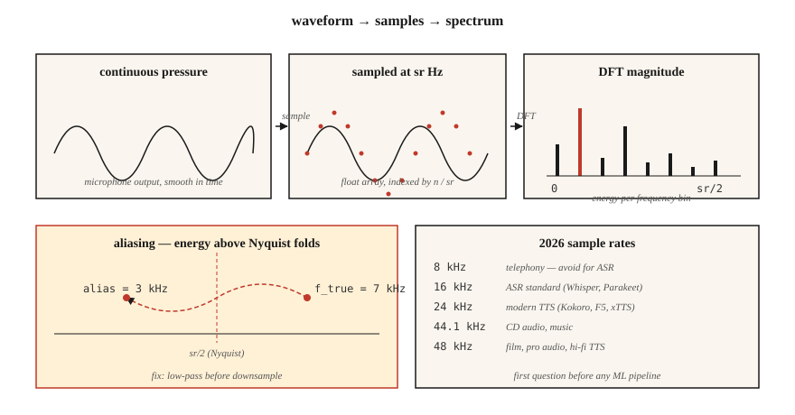

# 音频基础 — 波形、采样、傅里叶变换

> 波形是原始信号。频谱图是表示形式。Mel 特征是适合机器学习的形态。每条现代 ASR 和 TTS 流水线都会沿着这架梯子往上走，而第一阶就是理解采样和傅里叶。

**Type:** Learn
**Languages:** Python
**Prerequisites:** Phase 1 · 06 (Vectors & Matrices), Phase 1 · 14 (Probability Distributions)
**Time:** ~45 minutes

## 问题

麦克风产生的是压力随时间变化的信号。神经网络消费的是张量。在两者之间，有一整套约定。只要违反这些约定，就会出现安静但致命的 bug：模型看起来正常训练，但 WER 翻倍；TTS 发布后带着嘶声；或者语音克隆系统记住的是麦克风，而不是说话人。

语音系统里的每个 bug，最终都会追溯到三个问题之一：

1. 数据是用什么采样率录制的，而模型期望什么采样率？
2. 信号是否发生了混叠？
3. 你是在处理原始采样，还是频率表示？

这些问题答对了，Phase 6 后面的内容就都可处理。答错了，就算 Whisper-Large-v4 也会输出垃圾。

## 概念



**Waveform（波形）。** 一个位于 `[-1.0, 1.0]` 的一维浮点数组。按采样编号索引。要换算成秒，用采样编号除以采样率：`t = n / sr`。一段 16 kHz、10 秒的音频，就是一个包含 160,000 个浮点数的数组。

**Sampling rate（采样率，sr）。** 每秒采样多少次。2026 年常见采样率：

| Rate | Use |
|------|-----|
| 8 kHz | 电话、旧式 VOIP。Nyquist 频率只有 4 kHz，会损伤辅音。不推荐用于 ASR。 |
| 16 kHz | ASR 标准。Whisper、Parakeet、SeamlessM4T v2 都消费 16 kHz。 |
| 22.05 kHz | 旧模型的 TTS vocoder 训练。 |
| 24 kHz | 现代 TTS（Kokoro、F5-TTS、xTTS v2）。 |
| 44.1 kHz | CD 音频、音乐。 |
| 48 kHz | 电影、专业音频、高保真 TTS（VALL-E 2、NaturalSpeech 3）。 |

**Nyquist-Shannon。** 采样率为 `sr` 时，可以无歧义表示的最高频率是 `sr/2`。`sr/2` 这个边界叫作 *Nyquist frequency（奈奎斯特频率）*。高于 Nyquist 的能量会发生 *aliasing（混叠）*，也就是折叠到较低频率中，污染信号。下采样之前一定要先做低通滤波。

**Bit depth（位深）。** 16-bit PCM（有符号 int16，范围 ±32,767）是通用交换格式。音乐常用 24-bit，内部 DSP 常用 32-bit float。像 `soundfile` 这样的库会读取 int16，但暴露为 `[-1, 1]` 范围内的 float32 数组。

**Fourier Transform（傅里叶变换）。** 任何有限信号都可以表示为不同频率正弦波的和。Discrete Fourier Transform（DFT）会对 `N` 个采样计算 `N` 个复数系数，每个系数对应一个频率 bin。`bin k` 映射到频率 `k · sr / N` Hz。幅值是该频率上的振幅，角度是相位。

**FFT。** Fast Fourier Transform（快速傅里叶变换）：当 `N` 是 2 的幂时，用 `O(N log N)` 计算 DFT 的算法。每个音频库底层都在用 FFT。16 kHz 下，一个 1024-sample FFT 会得到 512 个可用频率 bin，覆盖 0-8 kHz，频率分辨率是 15.6 Hz。

**Framing + window（分帧 + 加窗）。** 我们不会对整段音频做一次 FFT。我们会把它切成重叠的 *frames（帧）*（通常 25 ms 一帧，10 ms hop），将每帧乘上一个 window function（Hann、Hamming）来消除边缘不连续，然后对每帧做 FFT。这就是 Short-Time Fourier Transform（STFT）。Lesson 02 会从这里继续。

```figure
mel-scale
```

## 动手构建

### Step 1：读取片段并绘制波形

`code/main.py` 只使用标准库 `wave` 模块，让 demo 保持零依赖。在生产环境中，你会使用 `soundfile` 或 `torchaudio.load`（两者都返回 `(waveform, sr)` 元组）：

```python
import soundfile as sf
waveform, sr = sf.read("clip.wav", dtype="float32")  # shape (T,), sr=int
```

### Step 2：从第一性原理合成正弦波

```python
import math

def sine(freq_hz, sr, seconds, amp=0.5):
    n = int(sr * seconds)
    return [amp * math.sin(2 * math.pi * freq_hz * i / sr) for i in range(n)]
```

一段 16 kHz、1 秒的 440 Hz 正弦波（标准音 A）包含 16,000 个浮点数。用 `wave.open(..., "wb")` 写入时，采用 16-bit PCM 编码。

### Step 3：手写 DFT

```python
def dft(x):
    N = len(x)
    out = []
    for k in range(N):
        re = sum(x[n] * math.cos(-2 * math.pi * k * n / N) for n in range(N))
        im = sum(x[n] * math.sin(-2 * math.pi * k * n / N) for n in range(N))
        out.append((re, im))
    return out
```

复杂度是 `O(N²)`。对于 `N=256`，它很适合用来确认正确性；对于真实音频，它完全不可用。真实代码会调用 `numpy.fft.rfft` 或 `torch.fft.rfft`。

### Step 4：找到主频

幅值峰值索引 `k_star` 会映射到频率 `k_star * sr / N`。在 440 Hz 正弦波上运行时，峰值应该出现在 bin `440 * N / sr`。

### Step 5：演示混叠

用 10 kHz 采样率采样一个 7 kHz 正弦波（Nyquist = 5 kHz）。7 kHz 音调高于 Nyquist，会折叠成 `10 − 7 = 3 kHz`。FFT 峰值会出现在 3 kHz。这是经典的 aliasing demo，也解释了为什么每个 DAC/ADC 都会配备砖墙式低通滤波器。

## 使用它

你在 2026 年实际会交付的栈：

| Task | Library | Why |
|------|---------|-----|
| 读写 WAV/FLAC/OGG | `soundfile`（libsndfile wrapper） | 最快、稳定、返回 float32。 |
| 重采样 | `torchaudio.transforms.Resample` 或 `librosa.resample` | 内置正确的抗混叠。 |
| STFT / Mel | `torchaudio` 或 `librosa` | GPU 友好；PyTorch 生态。 |
| 实时流式处理 | `sounddevice` 或 `pyaudio` | 跨平台 PortAudio 绑定。 |
| 检查文件 | `ffprobe` 或 `soxi` | CLI，速度快，报告 sr/channels/codec。 |

决策规则：**先匹配采样率，再匹配其它任何东西**。Whisper 期望 16 kHz 单声道 float32。给它传入 44.1 kHz 立体声，你会得到看起来像模型 bug 的垃圾结果。

## 交付它

保存为 `outputs/skill-audio-loader.md`。这个 skill 会帮你检查音频输入是否符合下游模型预期，并在不符合时正确重采样。

## 练习

1. **Easy.** 在 16 kHz 下合成一段 1 秒音频，混合 220 Hz + 440 Hz + 880 Hz。运行 DFT。确认三个峰值出现在预期 bin。
2. **Medium.** 录一段 48 kHz、3 秒的自己说话 WAV。用 `torchaudio.transforms.Resample`（带抗混叠）下采样到 16 kHz，再用 naive decimation（每三个采样取一个）下采样到 16 kHz。分别做 FFT。混叠出现在哪里？
3. **Hard.** 只用 `math` 和 Step 3 的 DFT，从零构建 STFT。帧长 400，hop 160，Hann window。用 `matplotlib.pyplot.imshow` 绘制幅值。这就是 Lesson 02 的频谱图。

## 关键术语

| Term | What people say | What it actually means |
|------|-----------------|-----------------------|
| Sample rate | 每秒多少个采样 | ADC 测量信号的频率，单位 Hz。 |
| Nyquist | 能表示的最高频率 | `sr/2`；高于它的能量会混叠回低频。 |
| Bit depth | 每个采样的分辨率 | `int16` = 65,536 个级别；`float32` = `[-1, 1]` 内的 24-bit 精度。 |
| DFT | 序列上的傅里叶变换 | `N` 个采样 → `N` 个复数频率系数。 |
| FFT | 快速 DFT | `O(N log N)` 算法，要求 `N` 是 2 的幂。 |
| Bin | 频率列 | `k · sr / N` Hz；分辨率 = `sr / N`。 |
| STFT | 频谱图的底层机制 | 沿时间做分帧 + 加窗 FFT。 |
| Aliasing | 奇怪的频率幽影 | 高于 Nyquist 的能量镜像到较低 bin。 |

## 延伸阅读

- [Shannon (1949). Communication in the Presence of Noise](https://people.math.harvard.edu/~ctm/home/text/others/shannon/entropy/entropy.pdf) — 采样定理背后的论文。
- [Smith — The Scientist and Engineer's Guide to Digital Signal Processing](https://www.dspguide.com/ch8.htm) — 免费、经典的 DSP 教材。
- [librosa docs — audio primer](https://librosa.org/doc/latest/tutorial.html) — 带代码的实践 walkthrough。
- [Heinrich Kuttruff — Room Acoustics (6th ed.)](https://www.routledge.com/Room-Acoustics/Kuttruff/p/book/9781482260434) — 解释为什么真实世界音频不是干净正弦波的参考书。
- [Steve Eddins — FFT Interpretation notebook](https://blogs.mathworks.com/steve/2020/03/30/fft-spectrum-and-spectral-densities/) — 用 10 分钟讲清频率 bin 直觉。
