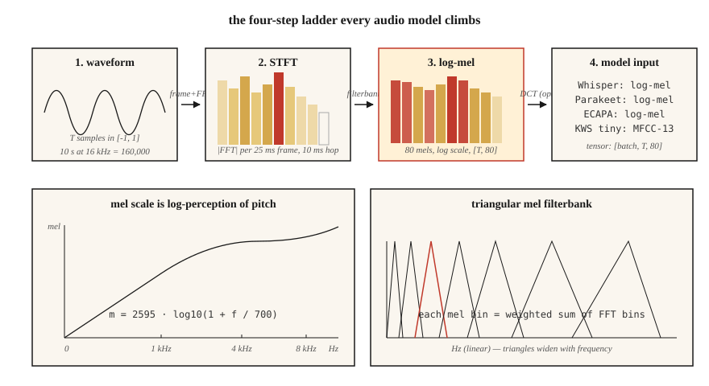

# 频谱图、梅尔尺度与音频特征

> 神经网络并不擅长直接消费原始波形。它们消费频谱图。消费梅尔频谱图时效果更好。2026 年的每个 ASR、TTS 和音频分类器，成败都取决于这个预处理选择。

**Type:** Build
**Languages:** Python
**Prerequisites:** Phase 6 · 01 (Audio Fundamentals)
**Time:** ~45 minutes

## 问题

拿一段 10 秒、16 kHz 的音频来说。它有 160,000 个 float，全都落在 `[-1, 1]`，却几乎无法直接对应到标签 "dog barking" 或 "the word cat"。原始波形里有信息，但形式并不利于模型提取。两个相同音素只要相隔 100 ms，原始采样值就会完全不同。

频谱图解决了这个问题。它会压缩人类感知并不关心的时间细节（微秒级 jitter），同时保留人类真正关注的结构（哪些频率有能量，以及这些能量如何在约 10-25 ms 的时间窗口中变化）。

梅尔频谱图再往前走一步。人类对 pitch 的感知近似是对数的：100 Hz 与 200 Hz 听起来的"距离"，和 1000 Hz 与 2000 Hz 类似。梅尔尺度会扭曲频率轴，使它贴近这种感知方式。从 2010 年到 2026 年，mel-scaled spectrogram 一直是 speech ML 中最重要的单一特征。

## 概念



**STFT（Short-Time Fourier Transform，短时傅里叶变换）。** 把波形切成重叠的 frames（典型设置：25 ms window、10 ms hop，也就是 16 kHz 下的 400 samples / 160 samples）。给每个 frame 乘上 window function（Hann 是默认选择；Hamming 的取舍略有不同）。对每个 frame 做 FFT。把 magnitude spectra 堆叠成形状为 `(n_frames, n_freq_bins)` 的矩阵。这就是你的频谱图。

**Log-magnitude。** 原始 magnitudes 会跨越 5-6 个数量级。取 `log(|X| + 1e-6)` 或 `20 * log10(|X|)` 可以压缩 dynamic range。每条 production pipeline 用的都是 log-magnitude，而不是 raw magnitude。

**梅尔尺度。** 频率 `f`（Hz）会按 `m = 2595 * log10(1 + f / 700)` 映射到 mel `m`。这个映射在 1 kHz 以下近似线性，在 1 kHz 以上近似对数。覆盖 0-8 kHz 的 80 个 mel bins 是标准 ASR 输入。

**Mel filterbank。** 一组在 mel scale 上等距排列的三角滤波器。每个滤波器都是相邻 FFT bins 的加权和。把 STFT magnitude 乘上 filterbank matrix，一次矩阵乘法就能得到 mel spectrogram。

**Log-mel spectrogram。** `log(mel_spec + 1e-10)`。Whisper 的输入。Parakeet 的输入。SeamlessM4T 的输入。也是 2026 年通用的音频前端。

**MFCCs。** 对 log-mel spectrogram 应用 DCT（type II），保留前 13 个 coefficients。这样会让特征 decorrelate，并进一步压缩。它一直是主流特征，直到约 2015 年，基于 raw log-mels 的 CNNs/Transformers 追上来。今天它仍用于 speaker recognition（x-vectors、ECAPA）。

**Resolution trade。** 更大的 FFT 会带来更好的 frequency resolution，但 time resolution 更差。25 ms / 10 ms 是 audio ML 默认值；音乐常用 50 ms / 12.5 ms；transient detection（鼓点、plosives）常用 5 ms / 2 ms。

```figure
spectrogram-window
```

## Build It

### Step 1：给波形分帧

```python
def frame(signal, frame_len, hop):
    n = 1 + (len(signal) - frame_len) // hop
    return [signal[i * hop : i * hop + frame_len] for i in range(n)]
```

一段 10 秒、16 kHz 的音频，在 `frame_len=400, hop=160` 时会产生 998 个 frames。

### Step 2：Hann window

```python
import math

def hann(N):
    return [0.5 * (1 - math.cos(2 * math.pi * n / (N - 1))) for n in range(N)]
```

在 FFT 前逐元素相乘。这样可以去掉 frame 在非零端点处被截断导致的 spectral leakage。

### Step 3：STFT magnitude

```python
def stft_magnitude(signal, frame_len=400, hop=160):
    win = hann(frame_len)
    frames = frame(signal, frame_len, hop)
    return [magnitudes(dft([w * s for w, s in zip(win, f)])) for f in frames]
```

Production 会使用 `torch.stft` 或 `librosa.stft`（基于 FFT、向量化）。这里的 loop 是教学用的；它可以在 `code/main.py` 的短音频上运行。

### Step 4：Mel filterbank

```python
def hz_to_mel(f):
    return 2595.0 * math.log10(1.0 + f / 700.0)

def mel_to_hz(m):
    return 700.0 * (10 ** (m / 2595.0) - 1)

def mel_filterbank(n_mels, n_fft, sr, fmin=0, fmax=None):
    fmax = fmax or sr / 2
    mels = [hz_to_mel(fmin) + (hz_to_mel(fmax) - hz_to_mel(fmin)) * i / (n_mels + 1)
            for i in range(n_mels + 2)]
    hzs = [mel_to_hz(m) for m in mels]
    bins = [int(h * n_fft / sr) for h in hzs]
    fb = [[0.0] * (n_fft // 2 + 1) for _ in range(n_mels)]
    for m in range(n_mels):
        for k in range(bins[m], bins[m + 1]):
            fb[m][k] = (k - bins[m]) / max(1, bins[m + 1] - bins[m])
        for k in range(bins[m + 1], bins[m + 2]):
            fb[m][k] = (bins[m + 2] - k) / max(1, bins[m + 2] - bins[m + 1])
    return fb
```

在 `n_fft=400` 时，用 80 个 mels 覆盖 0-8 kHz，会得到一个 `(80, 201)` 矩阵。把 `(n_frames, 201)` 的 STFT magnitude 乘以它的转置，就得到 `(n_frames, 80)` 的 mel spectrogram。

### Step 5：Log-mel

```python
def log_mel(mel_spec, eps=1e-10):
    return [[math.log(max(v, eps)) for v in frame] for frame in mel_spec]
```

常见替代方案：`librosa.power_to_db`（reference-normalized dB）、`10 * log10(power + eps)`。Whisper 使用更复杂的 clip + normalize routine（见 Whisper 的 `log_mel_spectrogram`）。

### Step 6：MFCCs

```python
def dct_ii(x, n_coeffs):
    N = len(x)
    return [
        sum(x[n] * math.cos(math.pi * k * (2 * n + 1) / (2 * N)) for n in range(N))
        for k in range(n_coeffs)
    ]
```

对每个 log-mel frame 应用 DCT，保留前 13 个 coefficients。这就是你的 MFCC matrix。第一个 coefficient 通常会被丢弃（它编码的是 overall energy）。

## Use It

2026 年的实际 stack：

| Task | Features |
|------|----------|
| ASR（Whisper、Parakeet、SeamlessM4T） | 80 log-mels，10 ms hop，25 ms window |
| TTS acoustic model（VITS、F5-TTS、Kokoro） | 80 mels，5-12 ms hop，用于精细 temporal control |
| Audio classification（AST、PANNs、BEATs） | 128 log-mels，10 ms hop |
| Speaker embedding（ECAPA-TDNN、WavLM） | 80 log-mels 或 raw-waveform SSL |
| Music（MusicGen、Stable Audio 2） | EnCodec discrete tokens（不是 mels） |
| Keyword spotting | 面向 tiny devices 的 40 MFCCs |

经验法则：**只要你做的不是音乐，就从 80 log-mels 开始。** 任何偏离这个默认值的选择，都需要拿出证据。

## 2026 年仍然会上线的坑

- **Mel count mismatch。** 训练用 80 mels，推理用 128 mels。静默失败。一定要在两端 log feature shape。
- **上游 sample-rate mismatch。** 在 22.05 kHz 上算出的 mels，和在 16 kHz 上算出的不同。先修正 SR，再做 featurization。
- **dB vs log。** Whisper 期待的是 log-mel，不是 dB-mel。有些 HF pipelines 会 autodetect；你的 custom code 不会。
- **Normalization drift。** 训练时做 per-utterance normalization，推理时做 global normalization。这个 production bug 会让 WER 翻倍。
- **Padding leakage。** 在音频末尾 zero-padding 会在 trailing frames 中产生平坦 spectrum。应当 symmetric pad 或 replicate。

## Ship It

保存为 `outputs/skill-feature-extractor.md`。这个 skill 会为给定 model target 选择 feature type、mel count、frame/hop 和 normalization。

## 练习

1. **Easy。** 运行 `code/main.py`。它会合成一个 chirp（频率从 200 Hz 扫到 4000 Hz），并打印每个 frame 的 argmax mel bin。可以选择画图，并确认它符合 sweep。
2. **Medium。** 用 `{40, 80, 128}` 中的 `n_mels` 和 `{200, 400, 800}` 中的 `frame_len` 重新运行。测量 time axis 上的 sharp-peak bandwidth。哪组配置最能解析这个 chirp？
3. **Hard。** 实现 `power_to_db`，并在 AudioMNIST 上比较 tiny CNN classifier 的 ASR accuracy：(a) raw log-mel，(b) `ref=max` 的 dB-mel，(c) MFCC-13 + delta + delta-delta。报告 top-1 accuracy。

## 关键术语

| Term | 大家常说 | 实际含义 |
|------|----------|----------|
| Frame | 一个切片 | 送进一次 FFT 的 25 ms 波形块。 |
| Hop | Stride | 相邻 frames 之间间隔的 samples；10 ms 是 ASR 默认值。 |
| Window | Hann/Hamming 那个东西 | 逐点 multiplier，把 frame 边缘 taper 到零。 |
| STFT | 频谱图生成器 | Framed + windowed FFT；产出 time × frequency matrix。 |
| Mel | 扭曲后的频率 | Log-perception scale；`m = 2595·log10(1 + f/700)`。 |
| Filterbank | 那个矩阵 | 把 STFT 投影到 mel bins 的三角滤波器。 |
| Log-mel | Whisper 的输入 | `log(mel_spec + eps)`；2026 年的标准化特征。 |
| MFCC | 旧派特征 | Log-mel 的 DCT；13 个 coefficients，已 decorrelate。 |

## 延伸阅读

- [Davis, Mermelstein (1980). Comparison of parametric representations for monosyllabic word recognition](https://ieeexplore.ieee.org/document/1163420) — MFCC 论文。
- [Stevens, Volkmann, Newman (1937). A Scale for the Measurement of the Psychological Magnitude Pitch](https://pubs.aip.org/asa/jasa/article-abstract/8/3/185/735757/) — 原始 mel scale。
- [OpenAI — Whisper source, log_mel_spectrogram](https://github.com/openai/whisper/blob/main/whisper/audio.py) — 阅读参考实现。
- [librosa feature extraction docs](https://librosa.org/doc/main/feature.html) — `mfcc`、`melspectrogram` 和 hop/window 的参考。
- [NVIDIA NeMo — audio preprocessing](https://docs.nvidia.com/deeplearning/nemo/user-guide/docs/en/main/asr/asr_all.html#featurizers) — Parakeet + Canary models 的 production-scale pipeline。
