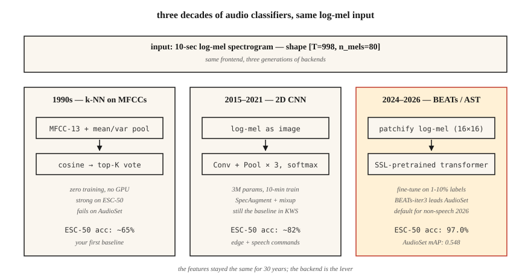

# 音频分类：从 MFCC 上的 k-NN 到 AST 与 BEATs

> 从“狗叫还是警笛”到“这是哪种语言”，本质上都是音频分类。特征是 mel，架构每十年换一轮，评估指标依然是 AUC、F1 和逐类召回率。

**Type:** Build
**Languages:** Python
**Prerequisites:** Phase 6 · 02（Spectrograms & Mel），Phase 3 · 06（CNNs），Phase 5 · 08（CNNs & RNNs for Text）
**Time:** ~75 minutes

## 学习目标

- 从 MFCC 摘要特征实现一个 k-NN 音频分类 baseline
- 解释为什么 log-mel spectrogram 能被 2D CNN 当作图像处理
- 比较 MFCC、CNN、AST、BEATs 和 frozen Whisper encoder 在数据规模上的取舍
- 为类别不平衡的音频任务选择 sampling、mixup、SpecAugment 与评估指标
- 为小数据、中等数据、边缘实时和多标签场景设计 2026 年音频分类技术栈

## 问题

你拿到一段 10 秒音频，希望知道：“它是什么？”可能是城市声音（警笛、钻孔、狗叫）、语音命令（yes/no/stop）、语言识别（en/es/ar）、说话人情绪（angry/neutral），也可能是环境声音（indoor/outdoor、babble）。这些都属于 *audio classification*。到 2026 年，baseline 架构已经成熟：log-mel -> CNN 或 Transformer -> softmax。

真正困难的不是网络，而是数据。音频数据集经常有严重类别不平衡、强 domain shift（干净录音 vs 嘈杂录音）和标签噪声（谁来判定“urban babble”和“restaurant noise”的边界？）。这个问题的 80% 是数据清洗、augmentation 和评估，而不是把 CNN 换成 Transformer。

## 概念



**MFCC 上的 k-NN（1990s baseline）。** 对每段 clip 展平 MFCC，计算它与有标签样本库的 cosine similarity，对 top K 做多数投票。在干净的小数据集上（Speech Commands、ESC-50）意外地强，而且不需要 GPU。

**log-mel 上的 2D CNN（2015-2019）。** 把 `(T, n_mels)` 的 log-mel 当成一张图像。套用 ResNet-18 或 VGG 风格网络，对时间轴做 global mean pooling，再对类别做 softmax。到 2026 年，它仍然是多数 Kaggle 音频分类比赛的 baseline。

**Audio Spectrogram Transformer，AST（2021-2024）。** 把 log-mel 切成 patch（比如 16x16 patches），加 position embeddings，再送入 ViT。在 supervised learning 下，它曾是 AudioSet 的 SOTA（mAP 0.485）。

**BEATs 与 WavLM-base（2024-2026）。** 在数百万小时音频上做 self-supervised pretraining。fine-tune 到你的任务时，只需要原本 1-10% 的标注数据。2026 年，非语音音频任务默认从这里开始。BEATs-iter3 在 AudioSet 上比 AST 高 1-2 mAP，同时只用约 1/4 compute。

**把 Whisper encoder 当作 frozen backbone（2024）。** 取 Whisper 的 encoder，丢掉 decoder，接一个 linear classifier。几乎不做音频 augmentation，就能在 language ID 和简单事件分类上接近 SOTA。这是“免费午餐”级 baseline。

### 类别不平衡才是真挑战

ESC-50：50 类，每类 40 段，平衡且容易。UrbanSound8K：10 类，类别比例可达 10:1。AudioSet：632 类，并且有 100,000:1 的长尾。有效技巧包括：

- 训练时做 balanced sampling（评估时不要）。
- Mixup：线性插值两段音频及其标签，作为 augmentation。
- SpecAugment：随机遮蔽 time bands 和 frequency bands。简单，但关键。

### 评估

- 多类互斥任务（Speech Commands）：top-1 accuracy、top-5 accuracy。
- 多类多标签任务（AudioSet、UrbanSound 风格）：mean average precision（mAP）。
- 严重不平衡任务：per-class recall + macro F1。

2026 年你应该记住的数字：

| Benchmark | Baseline | SOTA 2026 | Source |
|-----------|----------|-----------|--------|
| ESC-50 | 82% (AST) | 97.0% (BEATs-iter3) | BEATs paper (2024) |
| AudioSet mAP | 0.485 (AST) | 0.548 (BEATs-iter3) | HEAR leaderboard 2026 |
| Speech Commands v2 | 98% (CNN) | 99.0% (Audio-MAE) | HEAR v2 results |

## Build It

### Step 1：featurize

```python
def featurize_mfcc(signal, sr, n_mfcc=13, n_mels=40, frame_len=400, hop=160):
    mag = stft_magnitude(signal, frame_len, hop)
    fb = mel_filterbank(n_mels, frame_len, sr)
    mels = apply_filterbank(mag, fb)
    log = log_transform(mels)
    return [dct_ii(frame, n_mfcc) for frame in log]
```

### Step 2：固定长度摘要

```python
def summarize(mfcc_frames):
    n = len(mfcc_frames[0])
    mean = [sum(f[i] for f in mfcc_frames) / len(mfcc_frames) for i in range(n)]
    var = [
        sum((f[i] - mean[i]) ** 2 for f in mfcc_frames) / len(mfcc_frames) for i in range(n)
    ]
    return mean + var
```

简单但强：对时间维做 mean + variance，可以把 13 维 MFCC 变成一个 26 维 fixed embedding。运行几乎瞬间完成。直到 2017 年左右，它仍然能打败 ESC-50 上不少 state-of-the-art NN baselines。

### Step 3：k-NN

```python
def cosine(a, b):
    dot = sum(x * y for x, y in zip(a, b))
    na = math.sqrt(sum(x * x for x in a)) or 1e-12
    nb = math.sqrt(sum(x * x for x in b)) or 1e-12
    return dot / (na * nb)

def knn_classify(q, bank, labels, k=5):
    sims = sorted(range(len(bank)), key=lambda i: -cosine(q, bank[i]))[:k]
    votes = Counter(labels[i] for i in sims)
    return votes.most_common(1)[0][0]
```

### Step 4：升级到 log-mel 上的 CNN

使用 PyTorch：

```python
import torch.nn as nn

class AudioCNN(nn.Module):
    def __init__(self, n_mels=80, n_classes=50):
        super().__init__()
        self.body = nn.Sequential(
            nn.Conv2d(1, 32, 3, padding=1), nn.ReLU(), nn.MaxPool2d(2),
            nn.Conv2d(32, 64, 3, padding=1), nn.ReLU(), nn.MaxPool2d(2),
            nn.Conv2d(64, 128, 3, padding=1), nn.ReLU(),
            nn.AdaptiveAvgPool2d(1),
        )
        self.head = nn.Linear(128, n_classes)

    def forward(self, x):  # x: (B, 1, T, n_mels)
        return self.head(self.body(x).flatten(1))
```

约 3M 参数。在一张 RTX 4090 上，用 ESC-50 训练约 10 分钟，能达到 80%+ accuracy。

### Step 5：2026 年默认选择：fine-tune BEATs

```python
from transformers import ASTFeatureExtractor, ASTForAudioClassification

ext = ASTFeatureExtractor.from_pretrained("MIT/ast-finetuned-audioset-10-10-0.4593")
model = ASTForAudioClassification.from_pretrained(
    "MIT/ast-finetuned-audioset-10-10-0.4593",
    num_labels=50,
    ignore_mismatched_sizes=True,
)

inputs = ext(audio, sampling_rate=16000, return_tensors="pt")
logits = model(**inputs).logits
```

BEATs 可通过 `beats` library 使用 `microsoft/BEATs-base`；transformers API 的形状相同。

## Use It

2026 年技术栈：

| Situation | Start with |
|-----------|-----------|
| Tiny dataset (<1000 clips) | MFCC means 上的 k-NN（你的 baseline）+ audio augmentation |
| Medium dataset (1K-100K) | BEATs 或 AST fine-tune |
| Large dataset (>100K) | 从零训练，或 fine-tune Whisper encoder |
| Real-time, edge | 40-MFCC CNN，quantized to int8（KWS 风格） |
| Multi-label (AudioSet) | BEATs-iter3 + BCE loss + mixup + SpecAugment |
| Language ID | MMS-LID，SpeechBrain VoxLingua107 baseline |

决策规则：**从 frozen backbone 开始，而不是从全新模型开始**。fine-tune 一个 BEATs head 可以在几小时内拿到 SOTA 的 95%，而不是花几周。

## Ship It

保存为 `outputs/skill-classifier-designer.md`。它要能针对给定音频分类任务，选择 architecture、augmentations、class-balance strategy 和 eval metric。

## 练习

1. **Easy.** 运行 `code/main.py`。它会在一个 4 类 synthetic dataset（不同 pitch 的 pure tones）上训练 k-NN MFCC baseline。报告 confusion matrix。
2. **Medium.** 用 `[mean, var, skew, kurtosis]` 替换 `summarize`。在同一个 synthetic dataset 上，4-moment pooling 是否超过 mean+var？
3. **Hard.** 使用 `torchaudio`，在 ESC-50 fold 1 上训练一个 2D CNN。报告 5-fold cross-validation accuracy。加入 SpecAugment（time mask = 20，freq mask = 10）并报告 delta。

## 关键术语

| 术语 | 常见说法 | 实际含义 |
|------|----------|----------|
| AudioSet | 音频版 ImageNet | Google 的 2M clips、632 类 weakly-labeled YouTube 数据集。 |
| ESC-50 | 小型分类 benchmark | 50 类 x 40 段 environmental sounds。 |
| AST | Audio Spectrogram Transformer | log-mel patches 上的 ViT；2021 年 SOTA。 |
| BEATs | Self-supervised audio | Microsoft 模型；截至 2026 年，iter3 领先 AudioSet。 |
| Mixup | 成对 augmentation | `x = λ·x1 + (1-λ)·x2; y = λ·y1 + (1-λ)·y2`。 |
| SpecAugment | Mask-based augmentation | 把 spectrogram 中随机 time bands 和 frequency bands 置零。 |
| mAP | 主要多标签指标 | 跨类别和阈值计算的 mean average precision。 |

## 延伸阅读

- [Gong, Chung, Glass (2021). AST: Audio Spectrogram Transformer](https://arxiv.org/abs/2104.01778) — 2021-2024 年的标志性架构。
- [Chen et al. (2022, rev. 2024). BEATs: Audio Pre-Training with Acoustic Tokenizers](https://arxiv.org/abs/2212.09058) — 2024+ 默认起点。
- [Park et al. (2019). SpecAugment](https://arxiv.org/abs/1904.08779) — 主流音频 augmentation。
- [Piczak (2015). ESC-50 dataset](https://github.com/karolpiczak/ESC-50) — 仍然活跃的 50 类 benchmark。
- [Gemmeke et al. (2017). AudioSet](https://research.google.com/audioset/) — 632 类 YouTube taxonomy；仍是黄金标准。
