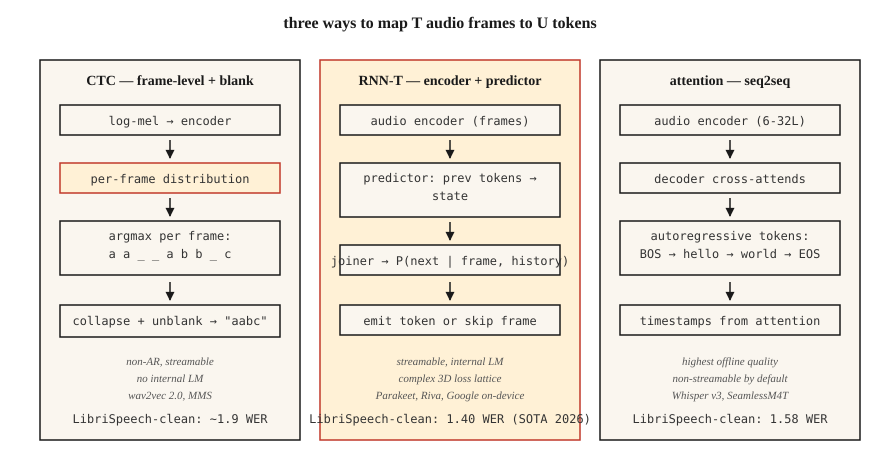

# 语音识别（ASR）：CTC、RNN-T、Attention

> 语音识别是在每个时间步做音频分类，再用一个理解语言和静音的序列模型把结果粘起来。CTC、RNN-T 和 attention 是三种实现方式。选一种，并理解为什么选它。

**Type:** Build
**Languages:** Python
**Prerequisites:** Phase 6 · 02 (Spectrograms & Mel), Phase 5 · 08 (CNNs & RNNs for Text), Phase 5 · 10 (Attention)
**Time:** ~45 minutes

## 问题

你有一段 10 秒、16 kHz 的音频。你想得到一个字符串："turn on the kitchen lights"。难点在结构上：音频帧不会和字符一一对齐。单词 "okay" 可能持续 200 ms，也可能持续 1200 ms。静音会把话语隔开。有些音素更长。输出 token 的数量也无法提前知道。

三种 formulation 解决这个问题：

1. **CTC（Connectionist Temporal Classification）。** 在每一帧输出 token 概率，并包含一个特殊的 *blank*。解码时折叠重复项和 blanks。非自回归，速度快。wav2vec 2.0、MMS 都用过它。
2. **RNN-T（Recurrent Neural Network Transducer）。** Joint network 会根据 encoder frame 和 previous tokens 预测下一个 token。可流式。Google on-device ASR、NVIDIA Parakeet 使用这类方法。
3. **Attention encoder-decoder。** Encoder 把音频压缩成 hidden states，decoder 通过 cross-attention 自回归生成 tokens。Whisper、SeamlessM4T 使用这类方法。

到 2026 年，LibriSpeech test-clean 上的 SOTA WER 是 1.4%（Parakeet-TDT-1.1B，NVIDIA）和 1.58%（Whisper-Large-v3-turbo）。差距很小；部署差异很大。

## 概念



**CTC intuition。** 让 encoder 输出 `T` 个 frame-level distributions，覆盖 `V+1` 个 tokens（V 个字符 + blank）。对于长度为 `U < T` 的目标字符串 `y`，任何折叠后等于 `y` 的 frame alignment 都算数。CTC loss 会对所有这样的 alignments 求和。推理时：逐帧 argmax，折叠重复项，移除 blanks。

优点：非自回归、可流式、零 lookahead。缺点：*conditional independence assumption*，也就是每一帧预测都和其他帧独立，因此内部没有语言模型。修复方式是通过 beam search 或 shallow fusion 加一个外部 LM。

**RNN-T intuition。** 增加一个 *predictor* network 来嵌入 token history，再用一个 *joiner* 把 predictor state 和 encoder frame 合并成 `V+1` 上的 joint distribution（这里的 `+1` 是 null / no-emit）。它显式建模了 CTC 忽略的 conditional dependence。因为每一步只依赖过去的 frames 和过去的 tokens，所以可以流式运行。

优点：可流式 + 内部 LM。缺点：训练更复杂、更耗内存（3D loss lattice）；RNN-T loss kernels 本身就是一个单独的库生态。

**Attention encoder-decoder。** Encoder（6-32 层 transformer）处理 log-mel frames。Decoder（6-32 层 transformer）cross-attends 到 encoder outputs，自回归生成 tokens。没有 alignment 约束，attention 可以看音频里的任何位置。除非限制 attention（如 2024 的 chunked Whisper-Streaming），否则不能流式。

优点：offline ASR 上质量最高，使用标准 seq2seq tooling 就容易训练。缺点：自回归 latency 和输出长度成正比；没有额外工程就无法 stream。

### WER：唯一那个数字

**Word Error Rate** = `(S + D + I) / N`，其中 S=substitutions，D=deletions，I=insertions，N=reference word count。它等价于 word level 的 Levenshtein edit distance。越低越好。WER 高于 20% 通常不可用；低于 5% 在朗读语音上通常达到 human-parity。标准 benchmark 上的 2026 数字：

| Model | LibriSpeech test-clean | LibriSpeech test-other | Size |
|-------|------------------------|------------------------|------|
| Parakeet-TDT-1.1B | 1.40% | 2.78% | 1.1B params |
| Whisper-Large-v3-turbo | 1.58% | 3.03% | 809M |
| Canary-1B Flash | 1.48% | 2.87% | 1B |
| Seamless M4T v2 | 1.7% | 3.5% | 2.3B |

这些模型都基于 encoder-decoder 或 RNN-T。纯 CTC 系统（wav2vec 2.0）在 test-clean 上大约是 1.8-2.1%。

## Build It

### Step 1：greedy CTC decode

```python
def ctc_greedy(frame_logits, blank=0, vocab=None):
    # frame_logits: 每一帧的概率向量列表
    preds = [max(range(len(p)), key=lambda i: p[i]) for p in frame_logits]
    out = []
    prev = -1
    for p in preds:
        if p != prev and p != blank:
            out.append(p)
        prev = p
    return "".join(vocab[i] for i in out) if vocab else out
```

两条规则：折叠连续重复项，丢掉 blanks。例子：`a a _ _ a b b _ c` → `a a b c`。

### Step 2：beam-search CTC

```python
def ctc_beam(frame_logits, beam=8, blank=0):
    import math
    beams = [([], 0.0)]  # (tokens, log_prob)
    for p in frame_logits:
        log_p = [math.log(max(pi, 1e-10)) for pi in p]
        candidates = []
        for seq, lp in beams:
            for t, lpt in enumerate(log_p):
                new = seq[:] if t == blank else (seq + [t] if not seq or seq[-1] != t else seq)
                candidates.append((new, lp + lpt))
        candidates.sort(key=lambda x: -x[1])
        beams = candidates[:beam]
    return beams[0][0]
```

Production 会使用带 LM fusion 的 prefix tree beam search；这里是概念骨架。

### Step 3：WER

```python
def wer(ref, hyp):
    r, h = ref.split(), hyp.split()
    dp = [[0] * (len(h) + 1) for _ in range(len(r) + 1)]
    for i in range(len(r) + 1):
        dp[i][0] = i
    for j in range(len(h) + 1):
        dp[0][j] = j
    for i in range(1, len(r) + 1):
        for j in range(1, len(h) + 1):
            cost = 0 if r[i - 1] == h[j - 1] else 1
            dp[i][j] = min(
                dp[i - 1][j] + 1,
                dp[i][j - 1] + 1,
                dp[i - 1][j - 1] + cost,
            )
    return dp[len(r)][len(h)] / max(1, len(r))
```

### Step 4：against Whisper 做 inference

```python
import whisper
model = whisper.load_model("large-v3-turbo")
result = model.transcribe("clip.wav")
print(result["text"])
```

这是 2026 年最强通用 ASR 的 one-liner。在 24 GB GPU 上能以约 20× realtime 运行。

### Step 5：用 Parakeet 或 wav2vec 2.0 做 streaming

```python
from transformers import pipeline
asr = pipeline("automatic-speech-recognition", model="nvidia/parakeet-tdt-1.1b")
for chunk in streaming_audio():
    print(asr(chunk, return_timestamps=True))
```

Streaming ASR 需要 chunked encoder attention 和 carryover state；请使用支持这些能力的库（Parakeet 用 NeMo，`transformers` pipeline 可用 `chunk_length_s`）。

## Use It

2026 stack：

| Situation | Pick |
|-----------|------|
| English, offline, max quality | Whisper-large-v3-turbo |
| Multilingual, robust | SeamlessM4T v2 |
| Streaming, low latency | Parakeet-TDT-1.1B or Riva |
| Edge, mobile, <500 ms latency | Whisper-Tiny quantized or Moonshine (2024) |
| Long-form | Whisper with VAD-based chunking (WhisperX) |
| Domain-specific (medical, legal) | Fine-tune wav2vec 2.0 + domain LM fusion |

## 2026 年仍然会上线的坑

- **No VAD。** 在静音上跑 Whisper 会产生幻觉（"Thanks for watching!"）。始终用 VAD gate。
- **Character vs word vs subword WER。** 报告 word-level WER，并且要在 normalization（lowercase、去标点）之后计算。
- **Language ID drift。** Whisper 的 auto LID 会把 noisy clips 错路由到 Japanese 或 Welsh；如果你知道语言，直接指定 `language="en"`。
- **Long clips without chunking。** Whisper 有 30 秒窗口。超过这个长度就使用 `chunk_length_s=30, stride=5`。

## Ship It

保存为 `outputs/skill-asr-picker.md`。为给定 deployment target 选择 model、decoding strategy、chunking 和 LM fusion。

## 练习

1. **Easy。** 运行 `code/main.py`。它会对 hand-crafted CTC output 做 greedy decode，并计算相对 reference 的 WER。
2. **Medium。** 正确实现 Step 2 中的 prefix-tree beam search（处理 blank merge rule）。在 10 个 synthetic examples 上和 greedy 比较。
3. **Hard。** 在 [LibriSpeech test-clean](https://www.openslr.org/12) 上使用 `whisper-large-v3-turbo`。计算前 100 条 utterances 的 WER。和公开数字比较。

## 关键术语

| Term | 人们通常怎么说 | 它实际是什么意思 |
|------|----------------|------------------|
| CTC | The blank-token loss | 对所有 frame-to-token alignments 求边缘化；非自回归。 |
| RNN-T | The streaming loss | CTC + next-token predictor；能处理词序。 |
| Attention enc-dec | Whisper-style | Encoder + cross-attending decoder；offline quality 最好。 |
| WER | The number you report | word level 的 `(S+D+I)/N`。 |
| Blank | The emptiness | CTC 中表示 "这一帧不发射 token" 的特殊 token。 |
| LM fusion | External language model | 在 beam search 中加入加权后的 LM log-probs。 |
| VAD | The silence gate | Voice activity detector；裁掉非语音片段。 |

## 延伸阅读

- [Graves et al. (2006). Connectionist Temporal Classification](https://www.cs.toronto.edu/~graves/icml_2006.pdf) — CTC paper。
- [Graves (2012). Sequence Transduction with RNNs](https://arxiv.org/abs/1211.3711) — RNN-T paper。
- [Radford et al. / OpenAI (2022). Whisper: Robust Speech Recognition via Large-Scale Weak Supervision](https://arxiv.org/abs/2212.04356) — 2022 年 canonical paper；v3-turbo extension 在 2024 年发布。
- [NVIDIA NeMo — Parakeet-TDT card](https://huggingface.co/nvidia/parakeet-tdt-1.1b) — 2026 Open ASR Leaderboard leader。
- [Hugging Face — Open ASR Leaderboard](https://huggingface.co/spaces/hf-audio/open_asr_leaderboard) — 覆盖 25+ models 的 live benchmark。
