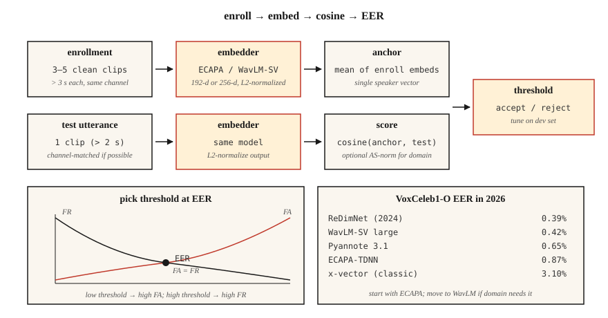

# 说话人识别与验证

> ASR 问的是"他们说了什么？"Speaker recognition 问的是"是谁说的？"数学形式看起来一样：embeddings 加 cosine。但每个 production 决策，最后都会落在一个 EER 数字上。

**Type:** Build
**Languages:** Python
**Prerequisites:** Phase 6 · 02 (Spectrograms & Mel), Phase 5 · 22 (Embedding Models)
**Time:** ~45 minutes

## 问题

用户说出一句 passphrase。你想知道：这是他们声称的那个人吗（*verification*，1:1）？或者它是不是 enrollment bank 里的第一个人（*identification*，1:N）？也可能两者都不是：这是一个未知说话人（*open-set*）吗？

2018 年以前：GMM-UBM + i-vectors。EER 还可以，但对 channel shift（手机 vs 笔记本）和情绪很脆弱。2018-2022 年：x-vectors（用 angular margin 训练的 TDNN backbone）。2022 年以后：ECAPA-TDNN 和 WavLM-large embeddings。到 2026 年，这个领域主要由三个模型和一个 metric 主导。

这个 metric 是 **EER**，也就是 Equal Error Rate。设置一个 decision threshold，使 False Accept Rate = False Reject Rate。二者交叉处就是 EER。每篇论文、每个 leaderboard、每次采购评估都会用它。

## 概念



**Pipeline。** Enrollment：录制目标说话人的 5-30 秒音频；计算 fixed-dimension embedding（ECAPA-TDNN 为 192-d，WavLM-large 为 256-d）。Verification：拿到测试 utterance 的 embedding；计算 cosine similarity；和 threshold 比较。

**ECAPA-TDNN（2020，2026 年仍然主导）。** Emphasized Channel Attention, Propagation and Aggregation - Time-Delay Neural Network。它使用带 squeeze-excitation 的 1D conv blocks、multi-head attention pooling，最后接一个 linear layer 得到 192-d embedding。训练数据是 VoxCeleb 1+2（2,700 个 speakers，1.1M 条 utterances），loss 是 Additive Angular Margin loss（AAM-softmax）。

**WavLM-SV（2022+）。** 用 AAM loss fine-tune 预训练的 WavLM-large SSL backbone。质量更高，但更慢：300+ MB vs 15 MB。

**x-vector（baseline）。** TDNN + statistics pooling。经典方案；在 CPU / edge 上仍然有用。

**AAM-softmax。** 在 angular space 中给正确类别加入 margin `m` 的标准 softmax：`cos(θ + m)`。它会强制增大 inter-class angular separation。典型设置是 `m=0.2`、scale `s=30`。

### Scoring

- **Cosine。** Enrollment embedding 和 test embedding 之间的 cosine。用 threshold 做判定。
- **PLDA（Probabilistic LDA）。** 把 embeddings 投影到一个 latent space，在那里 same-speaker vs different-speaker 有 closed-form likelihood ratio。叠在 cosine 之上，可以让 EER 降低 10-20%。它是 2020 年前的标准做法；现在主要只用于 closed-set setups。
- **Score normalization。** `S-norm` 或 `AS-norm`：用一组 imposter cohort 的均值和标准差 normalize 每个 score。跨域评估时非常关键。

### 你应该知道的数字（2026）

| Model | VoxCeleb1-O EER | Params | Throughput (A100) |
|-------|-----------------|--------|-------------------|
| x-vector (classic) | 3.10% | 5 M | 400× RT |
| ECAPA-TDNN | 0.87% | 15 M | 200× RT |
| WavLM-SV large | 0.42% | 316 M | 20× RT |
| Pyannote 3.1 segmentation + embedding | 0.65% | 6 M | 100× RT |
| ReDimNet (2024) | 0.39% | 24 M | 100× RT |

### Diarization

在多说话人音频里回答"谁在什么时候说话"。Pipeline：VAD → segment → embed each segment → cluster（agglomerative 或 spectral）→ smooth boundaries。现代 stack 是 `pyannote.audio` 3.1，它把 speaker segmentation + embedding + clustering 封装在一次调用后面。2026 年 AMI 上的 SOTA DER 约为 15%（2022 年是 23%）。

## Build It

### Step 1：用 MFCC statistics 做 toy embedding

```python
def embed_mfcc_stats(signal, sr):
    frames = featurize_mfcc(signal, sr, n_mfcc=13)
    mean = [sum(f[i] for f in frames) / len(frames) for i in range(13)]
    std = [
        math.sqrt(sum((f[i] - mean[i]) ** 2 for f in frames) / len(frames))
        for i in range(13)
    ]
    return mean + std  # 26-d
```

离 SOTA 差很远，仅用于教学。`code/main.py` 会把它作为 proof-of-concept，用在 synthetic speaker data 上。

### Step 2：Cosine similarity + threshold

```python
def cosine(a, b):
    dot = sum(x * y for x, y in zip(a, b))
    na = math.sqrt(sum(x * x for x in a))
    nb = math.sqrt(sum(x * x for x in b))
    return dot / (na * nb) if na and nb else 0.0

def verify(enroll, test, threshold=0.75):
    return cosine(enroll, test) >= threshold
```

### Step 3：从 similarity pairs 计算 EER

```python
def eer(same_scores, diff_scores):
    thresholds = sorted(set(same_scores + diff_scores))
    best = (1.0, 1.0, 0.0)  # (fa, fr, threshold)
    for t in thresholds:
        fr = sum(1 for s in same_scores if s < t) / len(same_scores)
        fa = sum(1 for s in diff_scores if s >= t) / len(diff_scores)
        if abs(fa - fr) < abs(best[0] - best[1]):
            best = (fa, fr, t)
    return (best[0] + best[1]) / 2, best[2]
```

返回 `(eer, threshold_at_eer)`。两个都要报告。

### Step 4：用 SpeechBrain 做 production

```python
from speechbrain.pretrained import EncoderClassifier

clf = EncoderClassifier.from_hparams(source="speechbrain/spkrec-ecapa-voxceleb")

# enroll: average the embeddings of 3-5 clean samples
enroll = torch.stack([clf.encode_batch(load(x)) for x in enrollment_clips]).mean(0)
# verify
score = clf.similarity(enroll, clf.encode_batch(load("test.wav"))).item()
verdict = score > 0.25   # ECAPA typical threshold; tune on your data
```

### Step 5：用 pyannote 做 diarization

```python
from pyannote.audio import Pipeline

pipe = Pipeline.from_pretrained("pyannote/speaker-diarization-3.1")
diarization = pipe("meeting.wav", num_speakers=None)
for turn, _, speaker in diarization.itertracks(yield_label=True):
    print(f"{turn.start:.1f}–{turn.end:.1f}  {speaker}")
```

## Use It

2026 年的实际 stack：

| Situation | Pick |
|-----------|------|
| Closed-set 1:1 verification, edge | ECAPA-TDNN + cosine threshold |
| Open-set verification, cloud | WavLM-SV + AS-norm |
| Diarization（meetings、podcasts） | `pyannote/speaker-diarization-3.1` |
| Anti-spoofing（replay / deepfake detection） | AASIST or RawNet2 |
| Tiny embedded（KWS + enrollment） | Titanet-Small（NeMo） |

## 常见坑

- **Channel mismatch。** 在 VoxCeleb（web video）上训练的模型，不等于 phone-call audio。一定要在目标 channel 上评估。
- **Short utterances。** 测试音频低于 3 秒时，EER 会急剧恶化。
- **Enrollment with noise。** 一条带噪 enrollment 会污染 anchor。使用至少 3 条 clean samples，并取平均。
- **Fixed threshold across conditions。** 一定要在来自目标域的 held-out dev set 上调 threshold。
- **Cosine on non-normalized embeddings。** 先做 L2-normalize；否则 magnitude 会主导结果。

## Ship It

保存为 `outputs/skill-speaker-verifier.md`。选择 model、enrollment protocol、threshold-tuning plan 和 fraud safeguards。

## 练习

1. **Easy。** 运行 `code/main.py`。它会构造 synthetic "speakers"（不同 tone profiles）、执行 enroll，并在 100-pair trial list 上计算 EER。
2. **Medium。** 在 30 条 VoxCeleb1 utterances（5 个 speakers × 每人 6 条）上使用 SpeechBrain ECAPA。比较 cosine vs PLDA 的 EER。
3. **Hard。** 用 `pyannote.audio` 构建完整的 enroll → diarize → verify pipeline。在 AMI dev set 上评估 DER。

## 关键术语

| Term | 大家常说 | 实际含义 |
|------|----------|----------|
| EER | headline metric | False Accept = False Reject 时的 threshold。 |
| Verification | 1:1 | "这是 Alice 吗？" |
| Identification | 1:N | "是谁在说话？" |
| Open-set | 可能有未知人 | Test set 里可以包含未 enrolled 的 speakers。 |
| Enrollment | 注册 | 计算某个 speaker 的 reference embedding。 |
| AAM-softmax | loss | 带 additive angular margin 的 softmax；强制 cluster separation。 |
| PLDA | 经典 scoring | Probabilistic LDA；叠在 embeddings 之上的 likelihood-ratio scoring。 |
| DER | Diarization metric | Diarization Error Rate，即 miss + false alarm + confusion。 |

## 延伸阅读

- [Snyder et al. (2018). X-Vectors: Robust DNN Embeddings for Speaker Recognition](https://www.danielpovey.com/files/2018_icassp_xvectors.pdf) — 经典 deep-embedding 论文。
- [Desplanques et al. (2020). ECAPA-TDNN](https://arxiv.org/abs/2005.07143) — 2020-2026 年的主导架构。
- [Chen et al. (2022). WavLM: Large-Scale Self-Supervised Pre-Training for Full Stack Speech Processing](https://arxiv.org/abs/2110.13900) — 用于 SV 和 diarization 的 SSL backbone。
- [Bredin et al. (2023). pyannote.audio 3.1](https://github.com/pyannote/pyannote-audio) — production diarization + embedding stack。
- [VoxCeleb leaderboard (updated 2026)](https://www.robots.ox.ac.uk/~vgg/data/voxceleb/) — 各模型当前 EER standings。
