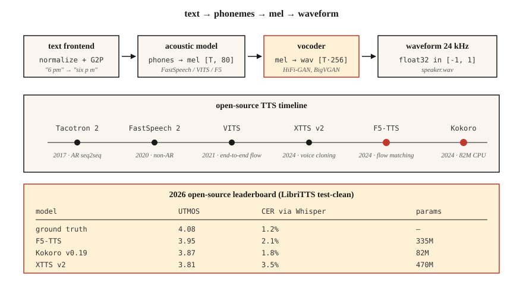

# 文本转语音（TTS）：从 Tacotron 到 F5 和 Kokoro

> ASR 把语音反转成文本；TTS 把文本反转成语音。2026 年的 stack 有三部分：text → tokens，tokens → mel，mel → waveform。每一部分都有一个能放进笔记本电脑的默认模型。

**Type:** Build
**Languages:** Python
**Prerequisites:** Phase 6 · 02 (Spectrograms & Mel), Phase 5 · 09 (Seq2Seq), Phase 7 · 05 (Full Transformer)
**Time:** ~75 minutes

## 问题

你有一个字符串："Please remind me to water the plants at 6 pm." 你需要一段 3 秒音频：听起来自然，有正确的 prosody（停顿、重音），把 "plants" 里的元音读对，并且能在 CPU 上 300 ms 内跑完，用于实时 voice assistant。你还需要切换 voices，处理 code-switched input（"remind me at 6 pm, daijoubu?"），并且在读人名时别出糗。

现代 TTS pipelines 长这样：

1. **Text frontend。** 规范化文本（日期、数字、email），转换成 phonemes 或 subword tokens，预测 prosody features。
2. **Acoustic model。** Text → mel spectrogram。Tacotron 2（2017）、FastSpeech 2（2020）、VITS（2021）、F5-TTS（2024）、Kokoro（2024）。
3. **Vocoder。** Mel → waveform。WaveNet（2016）、WaveRNN、HiFi-GAN（2020）、BigVGAN（2022）、2024+ 的 neural codec vocoders。

到 2026 年，acoustic + vocoder 的分界已经被 end-to-end diffusion 和 flow-matching models 模糊了。但三段式 mental model 仍然最适合 debug。

## 概念



**Tacotron 2（2017）。** Seq2seq：char-embedding → BiLSTM encoder → location-sensitive attention → autoregressive LSTM decoder 输出 mel frames。慢（AR），长文本上容易不稳。今天仍然会作为 baseline 被引用。

**FastSpeech 2（2020）。** 非自回归。Duration predictor 输出每个 phoneme 占多少 mel frames。1-pass，比 Tacotron 快 10×。会损失一些自然度（monotonic alignment），但到处都能上线。

**VITS（2021）。** 用 variational inference 把 encoder + flow-based duration + HiFi-GAN vocoder 端到端联合训练。高质量，单模型。2022-2024 年主导开源 TTS。变体包括 YourTTS（multi-speaker zero-shot）和 XTTS v2（2024，Coqui）。

**F5-TTS（2024）。** 基于 flow matching 的 diffusion transformer。自然 prosody，使用 5 秒 reference audio 就能 zero-shot voice cloning。位于 2026 开源 TTS leaderboards 前列。335M params。

**Kokoro（2024）。** 小模型（82M），CPU 可运行，实时英语 TTS 的同级最佳。Closed-vocabulary English-only，Apache 2.0。

**OpenAI TTS-1-HD、ElevenLabs v2.5、Google Chirp-3。** 商业 SOTA。ElevenLabs v2.5 的 emotion tags（"[whispered]"、"[laughing]"）和 character voices 在 2026 年主导 audiobook production。

### Vocoder evolution

| Era | Vocoder | Latency | Quality |
|-----|---------|---------|---------|
| 2016 | WaveNet | offline only | 发布时 SOTA |
| 2018 | WaveRNN | ~realtime | good |
| 2020 | HiFi-GAN | 100× realtime | near-human |
| 2022 | BigVGAN | 50× realtime | 跨 speakers / langs 泛化 |
| 2024 | SNAC, DAC (neural codecs) | integrated with AR models | discrete tokens, bit-efficient |

到 2026 年，大多数 "TTS" models 已经是 text-to-waveform 的 end-to-end 模型；mel spectrogram 成了内部表示。

### Evaluation

- **MOS（Mean Opinion Score）。** 1-5 scale，crowd-sourced。仍然是 gold standard；但慢得让人难受。
- **CMOS（Comparative MOS）。** A-vs-B preference。每次 annotation 的 confidence intervals 更紧。
- **UTMOS、DNSMOS。** Reference-free neural MOS predictors。用于 leaderboards。
- **CER（Character Error Rate）via ASR。** 把 TTS output 跑进 Whisper，计算相对 input text 的 CER。是 intelligibility 的 proxy。
- **SECS（Speaker Embedding Cosine Similarity）。** Voice-cloning quality。

LibriTTS test-clean 上的 2026 数字：

| Model | UTMOS | CER (via Whisper) | Size |
|-------|-------|-------------------|------|
| Ground truth | 4.08 | 1.2% | — |
| F5-TTS | 3.95 | 2.1% | 335M |
| XTTS v2 | 3.81 | 3.5% | 470M |
| VITS | 3.62 | 3.1% | 25M |
| Kokoro v0.19 | 3.87 | 1.8% | 82M |
| Parler-TTS Large | 3.76 | 2.8% | 2.3B |

## Build It

### Step 1：phonemize input

```python
from phonemizer import phonemize
ph = phonemize("Hello world", language="en-us", backend="espeak")
# 'həloʊ wɜːld'
```

Phonemes 是通用桥梁。不要把 raw text 直接喂给低于 VITS 级别质量的任何模型。

### Step 2：运行 Kokoro（2026 CPU default）

```python
from kokoro import KPipeline
tts = KPipeline(lang_code="a")  # "a" = American English
audio, sr = tts("Please remind me to water the plants at 6 pm.", voice="af_bella")
# audio: float32 tensor, sr=24000
```

离线运行，single file，82M params。

### Step 3：用 F5-TTS 做 voice cloning

```python
from f5_tts.api import F5TTS
tts = F5TTS()
wav = tts.infer(
    ref_file="my_voice_5s.wav",
    ref_text="The quick brown fox jumps over the lazy dog.",
    gen_text="Please remind me to water the plants.",
)
```

传入 5 秒 reference clip + 它的 transcript；F5 会 clone prosody 和 timbre。

### Step 4：从零实现 HiFi-GAN vocoder

太大，放不进一个 tutorial script，但形状是：

```python
class HiFiGAN(nn.Module):
    def __init__(self, mel_channels=80, upsample_rates=[8, 8, 2, 2]):
        super().__init__()
        # 4 upsample blocks, total 256x to go from mel-rate to audio-rate
        ...
    def forward(self, mel):
        return self.blocks(mel)  # -> waveform
```

Training：adversarial（discriminator 看 short windows）+ mel-spectrogram reconstruction loss + feature-matching loss。已经 commodity 化，请使用 `hifi-gan` repo 或 nvidia-NeMo 的 pretrained checkpoints。

### Step 5：完整 pipeline（pseudocode）

```python
text = "Please remind me at 6 pm."
phones = phonemize(text)
mel = acoustic_model(phones, speaker=alice)      # [T, 80]
wav = vocoder(mel)                                # [T * 256]
soundfile.write("out.wav", wav, 24000)
```

## Use It

2026 stack：

| Situation | Pick |
|-----------|------|
| Real-time English voice assistant | Kokoro (CPU) or XTTS v2 (GPU) |
| Voice cloning from 5 s reference | F5-TTS |
| Commercial character voices | ElevenLabs v2.5 |
| Audiobook narration | ElevenLabs v2.5 or XTTS v2 + fine-tune |
| Low-resource language | Train VITS on 5–20 h target-lang data |
| Expressive / emotion tags | ElevenLabs v2.5 or StyleTTS 2 fine-tune |

截至 2026 年的开源 leader：**F5-TTS 负责质量，Kokoro 负责效率**。除非你在做历史研究，否则不要伸手去拿 Tacotron。

## 坑

- **No text normalizer。** "Dr. Smith" 应该读成 "Doctor" 还是 "Drive"？"2026" 应该读成 "twenty twenty six" 还是 "two zero two six"？在 phonemizer 之前先 normalize。
- **OOV proper nouns。** "Ghumare" → "ghyu-mair"？为 unknown tokens 上线一个 fallback grapheme-to-phoneme model。
- **Clipping。** Vocoder output 很少 clip，但 inference 时 mel scaling mismatch 可能超过 ±1.0。始终 `np.clip(wav, -1, 1)`。
- **Sample-rate mismatch。** Kokoro 输出 24 kHz；你的 downstream pipeline 期待 16 kHz → resample，否则会 aliasing。

## Ship It

保存为 `outputs/skill-tts-designer.md`。为给定 voice、latency 和 language target 设计 TTS pipeline。

## 练习

1. **Easy。** 运行 `code/main.py`。它会从 toy vocab 构建 phoneme dictionary，估计每个 phoneme 的 duration，并打印一个假的 "mel" schedule。
2. **Medium。** 安装 Kokoro，用 voice `af_bella` 和 `am_adam` 合成同一个句子。比较 audio durations 和 subjective quality。
3. **Hard。** 录一段 5 秒自己的 reference clip。用 F5-TTS clone 它。报告 reference 和 cloned output 之间的 SECS。

## 关键术语

| Term | 人们通常怎么说 | 它实际是什么意思 |
|------|----------------|------------------|
| Phoneme | Sound unit | 抽象 sound class；英语中有 39 个（ARPABet）。 |
| Duration predictor | How long each phoneme lasts | 非自回归模型输出；每个 phoneme 对应的 integer frames。 |
| Vocoder | Mel → waveform | 把 mel-spec 映射到 raw samples 的神经网络。 |
| HiFi-GAN | Standard vocoder | GAN-based；2020-2024 年主导。 |
| MOS | Subjective quality | 来自 human raters 的 1-5 mean opinion score。 |
| SECS | Voice-clone metric | target 和 output speaker embedding 之间的 cosine similarity。 |
| F5-TTS | 2024 open-source SOTA | Flow-matching diffusion；zero-shot cloning。 |
| Kokoro | CPU English leader | 82M-param model，Apache 2.0。 |

## 延伸阅读

- [Shen et al. (2017). Tacotron 2](https://arxiv.org/abs/1712.05884) — seq2seq baseline。
- [Kim, Kong, Son (2021). VITS](https://arxiv.org/abs/2106.06103) — end-to-end flow-based。
- [Chen et al. (2024). F5-TTS](https://arxiv.org/abs/2410.06885) — 当前开源 SOTA。
- [Kong, Kim, Bae (2020). HiFi-GAN](https://arxiv.org/abs/2010.05646) — 2026 年仍在上线的 vocoder。
- [Kokoro-82M on HuggingFace](https://huggingface.co/hexgrad/Kokoro-82M) — 2024 年 CPU-friendly English TTS。
