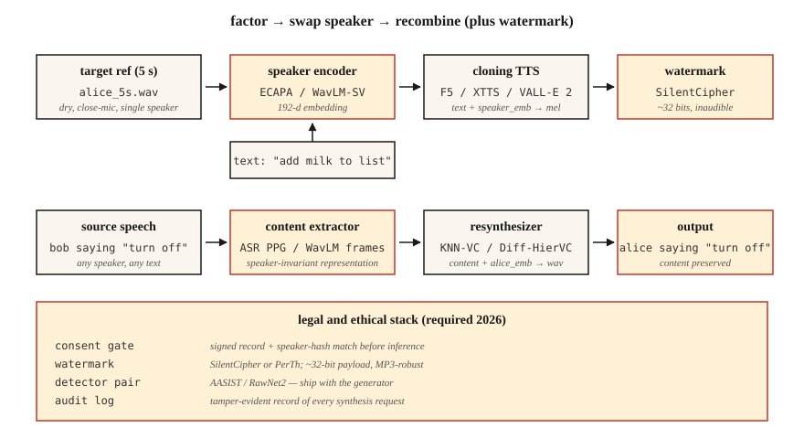

# 声音克隆与声音转换

> 声音克隆会用别人的声音读出你的文本。声音转换会把你的声音改写成别人的声音，同时保留你说的内容。两者都依赖同一个分解：把说话人身份与内容分开。

**Type:** Build
**Languages:** Python
**Prerequisites:** Phase 6 · 06 (Speaker Recognition), Phase 6 · 07 (TTS)
**Time:** ~75 minutes

## 问题

到 2026 年，一段 5 秒音频就足够在消费级 GPU 上生成任何人的高质量声音克隆。ElevenLabs、F5-TTS、OpenVoice v2、VoiceBox 都已经支持 zero-shot 或 few-shot 克隆。这项技术既是福音（无障碍 TTS、配音、辅助语音），也是武器（诈骗电话、政治深度伪造、IP 盗用）。

两个紧密相关的任务：

- **Voice cloning（声音克隆，TTS 侧）：** 文本 + 5 秒参考声音 → 用该声音说出的音频。
- **Voice conversion（声音转换，speech 侧）：** 源音频（A 说 X）+ B 的参考声音 → B 说 X 的音频。

两者都会把波形分解成（内容、说话人、韵律），再把一个来源的内容与另一个来源的说话人重新组合。

你在 2026 年交付时必须面对的关键约束是：**在欧盟（AI Act，2026 年 8 月起执行）和加州（AB 2905，2025 年生效），watermarking 和 consent gate 已经成为法律要求**。你的流水线必须生成不可听水印，并拒绝非自愿克隆。

## 概念



**Zero-shot cloning（零样本克隆）。** 把 5 秒音频片段传给一个已在数千名说话人上训练过的模型。Speaker encoder 会把这段音频映射为 speaker embedding；TTS decoder 会以该 embedding 和文本作为条件生成音频。

使用者：F5-TTS (2024)、YourTTS (2022)、XTTS v2 (2024)、OpenVoice v2 (2024)。

**Few-shot fine-tuning（少样本微调）。** 录制目标声音 5-30 分钟。对基础模型做一小时 LoRA fine-tune。质量会从“还行”跃迁到“难以分辨”。Coqui 和 ElevenLabs 都支持这种模式；社区也会把它用于 F5-TTS。

**Voice conversion（VC，声音转换）。** 两大家族：

- **Recognition-synthesis（识别-合成）。** 运行类似 ASR 的模型来提取内容表示（例如 soft phoneme posteriors、PPGs），然后用目标 speaker embedding 重新合成。对语言和口音更稳健。KNN-VC (2023)、Diff-HierVC (2023) 使用这一类方法。
- **Disentanglement（解耦）。** 训练一个 autoencoder，在瓶颈 latent space 中分离内容、说话人和韵律。推理时替换 speaker embedding。质量较低，但速度更快。AutoVC (2019)、VITS-VC 变体使用这一类方法。

**Neural codec-based cloning（基于神经 codec 的克隆，2024+）。** VALL-E、VALL-E 2、NaturalSpeech 3、VoiceBox 会把音频视为来自 SoundStream / EnCodec 的离散 token，并在 codec token 上训练大型 autoregressive 或 flow-matching 模型。短提示下的质量可与 ElevenLabs 相比。

### 伦理部分不是附加件

**Watermarking（水印）。** PerTh (Perth) 和 SilentCipher (2024) 会把约 16-32 bit ID 以不可感知的方式嵌入音频。它能经受重新编码、流式传输和常见编辑。已经是生产可用的开源方案。

**Consent gates（同意门控）。** 每个克隆输出都必须配对一条可验证的同意记录。“我，Rohit，于 2026-04-22，授权此声音用于 X 目的。” 把它存入防篡改日志。

**Detection（检测）。** AASIST、RawNet2、Wav2Vec2-AASIST 都提供检测器。ASVspoof 2025 challenge 发布的结果显示，最先进检测器对 ElevenLabs、VALL-E 2 和 Bark 输出的 EER 为 0.8-2.3%。

### 数字（2026）

| Model | Zero-shot? | SECS (target sim) | WER (intel.) | Params |
|-------|-----------|--------------------|--------------|--------|
| F5-TTS | Yes | 0.72 | 2.1% | 335M |
| XTTS v2 | Yes | 0.65 | 3.5% | 470M |
| OpenVoice v2 | Yes | 0.70 | 2.8% | 220M |
| VALL-E 2 | Yes | 0.77 | 2.4% | 370M |
| VoiceBox | Yes | 0.78 | 2.1% | 330M |

SECS > 0.70 时，对大多数听众来说通常已经难以和目标声音区分。

## 动手构建

### Step 1：用 recognition-synthesis 分解（`main.py` 中的纯代码 demo）

```python
def clone_pipeline(ref_audio, text, target_embedder, tts_model):
    speaker_emb = target_embedder.encode(ref_audio)
    mel = tts_model(text, speaker=speaker_emb)
    return vocoder(mel)
```

概念很简单；实现上的重量都在 `tts_model` 和 speaker encoder 里。

### Step 2：用 F5-TTS 做 zero-shot clone

```python
from f5_tts.api import F5TTS
tts = F5TTS()
wav = tts.infer(
    ref_file="rohit_5s.wav",
    ref_text="The quick brown fox jumps over the lazy dog.",
    gen_text="Please add milk and bread to my list.",
)
```

参考 transcript 必须与参考音频完全匹配；不匹配会破坏 alignment。

### Step 3：用 KNN-VC 做声音转换

```python
import torch
from knnvc import KNNVC  # 2023 model, https://github.com/bshall/knn-vc
vc = KNNVC.load("wavlm-base-plus")
out_wav = vc.convert(source="my_voice.wav", target_pool=["alice_1.wav", "alice_2.wav"])
```

KNN-VC 会运行 WavLM，为 source 和 target pool 提取逐帧 embedding，然后把每个 source frame 替换成 pool 中最近邻的 frame。它是非参数方法，用一分钟目标语音就能工作。

### Step 4：嵌入水印

```python
from silentcipher import SilentCipher
sc = SilentCipher(model="2024-06-01")
payload = b"consent_id:abc123;ts:1745353200"
watermarked = sc.embed(wav, sr=24000, message=payload)
detected = sc.detect(watermarked, sr=24000)   # returns payload bytes
```

约 32 bit payload，在 MP3 重新编码和轻微噪声后仍可检测。

### Step 5：consent gate

```python
def cloned_inference(text, ref_audio, consent_record):
    assert verify_signature(consent_record), "Signed consent required"
    assert consent_record["speaker_id"] == hash_speaker(ref_audio)
    wav = tts.infer(ref_file=ref_audio, gen_text=text)
    wav = watermark(wav, payload=consent_record["id"])
    return wav
```

## 使用它

2026 年的栈：

| Situation | Pick |
|-----------|------|
| 5 秒 zero-shot clone，开源 | F5-TTS 或 OpenVoice v2 |
| 商业生产级克隆 | ElevenLabs Instant Voice Clone v2.5 |
| 声音转换（rewriting） | KNN-VC 或 Diff-HierVC |
| 多说话人 fine-tune | StyleTTS 2 + speaker adapter |
| 跨语言克隆 | XTTS v2 或 VALL-E X |
| Deepfake 检测 | Wav2Vec2-AASIST |

## 常见陷阱

- **参考 transcript 不对齐。** F5-TTS 和类似模型要求参考文本与参考音频完全匹配，包括标点。
- **参考音频混响太重。** 回声会毁掉克隆。使用干声、近距离麦克风录制。
- **情绪不匹配。** 训练参考是“欢快”的，会让所有内容都被克隆成欢快语气。让参考情绪匹配目标用途。
- **语言泄漏。** 克隆英语说话人后让模型说法语，通常仍会带着原口音；使用跨语言模型（XTTS、VALL-E X）。
- **没有水印。** 2026 年 8 月起在欧盟无法合法交付。

## 交付它

保存为 `outputs/skill-voice-cloner.md`。设计一条带 consent gate、水印和质量目标的克隆或转换流水线。

## 练习

1. **Easy.** 运行 `code/main.py`。通过计算两个“说话人”在交换前后的 cosine，演示 speaker embedding swap。
2. **Medium.** 使用 OpenVoice v2 克隆你自己的声音。测量 reference 和 clone 之间的 SECS。通过 Whisper 测量 CER。
3. **Hard.** 对 20 个 clone 应用 SilentCipher 水印，把它们经过 128 kbps MP3 编码+解码，再检测 payload。报告 bit-accuracy。

## 关键术语

| Term | What people say | What it actually means |
|------|-----------------|-----------------------|
| Zero-shot clone | 5 秒就够 | 预训练模型 + speaker embedding；不需要训练。 |
| PPG | Phonetic posteriorgram | 用作语言无关内容表示的逐帧 ASR posterior。 |
| KNN-VC | 最近邻转换 | 用最近的 target-pool frame 替换每个 source frame。 |
| Neural codec TTS | VALL-E 风格 | 在 EnCodec/SoundStream token 上建模的 AR 模型。 |
| Watermark | 不可听签名 | 嵌入音频中的 bit，可经受重新编码。 |
| SECS | 克隆保真度 | 目标与克隆的 speaker embedding 之间的 cosine。 |
| AASIST | Deepfake detector | Anti-spoof 模型；检测合成语音。 |

## 延伸阅读

- [Chen et al. (2024). F5-TTS](https://arxiv.org/abs/2410.06885) — 开源 SOTA zero-shot cloning。
- [Baevski et al. / Microsoft (2023). VALL-E](https://arxiv.org/abs/2301.02111) and [VALL-E 2 (2024)](https://arxiv.org/abs/2406.05370) — neural-codec TTS。
- [Qian et al. (2019). AutoVC](https://arxiv.org/abs/1905.05879) — 基于 disentanglement 的 voice conversion。
- [Baas, Waubert de Puiseau, Kamper (2023). KNN-VC](https://arxiv.org/abs/2305.18975) — retrieval-based VC。
- [SilentCipher (2024) — Audio Watermarking](https://github.com/sony/silentcipher) — 生产可用的 32-bit audio watermark。
- [ASVspoof 2025 results](https://www.asvspoof.org/) — detector 与 synthesizer 的军备竞赛，2026 年更新。
