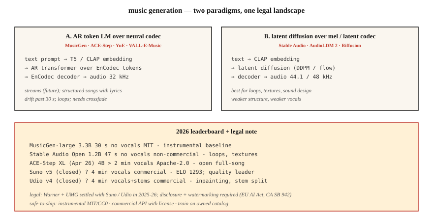

# 音乐生成：MusicGen、Stable Audio、Suno 与版权地震

> 2026 年的音乐生成：Suno v5 和 Udio v4 主导商业市场；MusicGen、Stable Audio Open 和 ACE-Step 领跑开源。技术问题基本解决了。法律问题（Warner Music 5 亿美元和解、UMG 和解）在 2025-2026 年重塑了这个领域。

**Type:** Build
**Languages:** Python
**Prerequisites:** Phase 6 · 02 (Spectrograms), Phase 4 · 10 (Diffusion Models)
**Time:** ~75 minutes

## 问题

Text -> 一段 30 秒到 4 分钟的音乐 clip，带 lyrics、vocals 和结构。这里有三个子问题：

1. **Instrumental generation。** 类似 "lo-fi hip-hop drums with warm keys" 的文本 -> audio。代表：MusicGen、Stable Audio、AudioLDM。
2. **Song generation（带 vocals + lyrics）。** "Country song about rainy Texas nights" -> 完整歌曲。代表：Suno、Udio、YuE、ACE-Step。
3. **Conditional / controllable。** 延长已有 clip、重新生成 bridge、替换 genre、stem-separate 或 inpaint。Udio 的 inpainting + stem separation 是 2026 年需要对标的功能。

## 概念



### Neural-codec tokens 上的 Token LM

Meta 的 **MusicGen**（2023，MIT）和许多衍生模型：以 text/melody embeddings 为条件，自回归预测 EnCodec tokens（32 kHz，4 codebooks），再用 EnCodec decode。参数规模 300M - 3.3B。它是强 baseline，但超过 30 秒后会吃力。

**ACE-Step**（开源，4B XL 于 2026 年 4 月发布）把这一路线扩展到 lyric-conditioned full-song generation。它是开源社区最接近 Suno 的东西。

### Mels 或 latents 上的 Diffusion

**Stable Audio (2023)** 和 **Stable Audio Open (2024)**：在 compressed audio 上做 latent diffusion。擅长 loops、sound design、ambient textures。不太擅长结构化完整歌曲。

**AudioLDM / AudioLDM2**：T2I-style latent diffusion 的 text-to-audio 版本，泛化到 music、sound effects、speech。

### Hybrid（production）：Suno、Udio、Lyria

闭源权重。大概率是 AR codec LM + diffusion-based vocoder，并配有专门的 voice / drum / melody heads。Suno v5（2026）是 ELO 1293 的质量领导者。Udio v4 增加了 inpainting + stem separation（bass、drums、vocals 可分离下载）。

### Evaluation

- **FAD（Fréchet Audio Distance）。** 使用 VGGish 或 PANNs features，计算 generated vs real audio distribution 的 embedding-level distance。越低越好。MusicGen small 在 MusicCaps 上是 4.5 FAD；SOTA 约 3.0。
- **Musicality（subjective）。** 人类偏好。Suno v5 以 ELO 1293 领先。
- **Text-audio alignment。** Prompt 和 output 之间的 CLAP score。
- **Musicality artifacts。** Off-beat transitions、vocal-phrase drift、30 秒后结构丢失。

## 2026 model map

| Model | Params | Length | Vocals | License |
|-------|--------|--------|--------|---------|
| MusicGen-large | 3.3B | 30 s | no | MIT |
| Stable Audio Open | 1.2B | 47 s | no | Stability non-commercial |
| ACE-Step XL (Apr 2026) | 4B | &gt; 2 min | yes | Apache-2.0 |
| YuE | 7B | &gt; 2 min | yes, multilingual | Apache-2.0 |
| Suno v5 (closed) | ? | 4 min | yes, ELO 1293 | commercial |
| Udio v4 (closed) | ? | 4 min | yes + stems | commercial |
| Google Lyria 3 (closed) | ? | real-time | yes | commercial |
| MiniMax Music 2.5 | ? | 4 min | yes | commercial API |

## 法律格局（2025-2026）

- **Warner Music vs Suno settlement。** 5 亿美元。WMG 现在对 Suno 上的 AI-likeness、music rights 和 user-generated tracks 拥有监督权。Udio 也有类似的 UMG settlement。
- **EU AI Act** + **California SB 942**：AI-generated music 必须 disclose。
- **Riffusion / MusicGen** 采用 MIT，没有 compliance baggage，但也没有 commercial vocals。

Safe-to-ship patterns：

1. 只生成 instrumental（MusicGen、Stable Audio Open、MIT/CC0 outputs）。
2. 使用 commercial APIs（Suno、Udio、ElevenLabs Music），并取得 per-generation license。
3. 在自有或已授权 catalog 上训练（多数 enterprises 最后都会走这条路）。
4. 给 generations 添加 watermarks + metadata。

## Build It

### Step 1：用 MusicGen 生成

```python
from audiocraft.models import MusicGen
import torchaudio

model = MusicGen.get_pretrained("facebook/musicgen-small")
model.set_generation_params(duration=10)
wav = model.generate(["upbeat synthwave with driving drums, 128 BPM"])
torchaudio.save("out.wav", wav[0].cpu(), 32000)
```

三个尺寸：`small`（300M，快）、`medium`（1.5B）、`large`（3.3B）。Small 足够判断 "does the idea land"。

### Step 2：Melody conditioning

```python
melody, sr = torchaudio.load("humming.wav")
wav = model.generate_with_chroma(
    ["jazz piano cover"],
    melody.squeeze(),
    sr,
)
```

MusicGen-melody 接收 chromagram，在替换 timbre 的同时保留旋律。适合 "give me this melody as a string quartet"。

### Step 3：FAD evaluation

```python
from frechet_audio_distance import FrechetAudioDistance
fad = FrechetAudioDistance()

fad.get_fad_score("generated_folder/", "reference_folder/")
```

计算 VGGish-embedding distance。它适合做 genre-level regression tests，但不能替代 human listeners。

### Step 4：加入 LLM-music workflow

结合 Lessons 7-8 的思路：

```python
prompt = "Write a 30-second jazz loop. Describe the drums, bass, and piano voicing."
description = llm.complete(prompt)
music = musicgen.generate([description], duration=30)
```

## Use It

| Goal | Stack |
|------|-------|
| Instrumental sound design | Stable Audio Open |
| Game / adaptive music | Google Lyria RealTime（closed） |
| Full songs with vocals（commercial） | Suno v5 或 Udio v4，带 explicit license |
| Full songs with vocals（open） | ACE-Step XL 或 YuE |
| Short ad jingle | MusicGen melody-conditioned on a hummed reference |
| Music-video background | MusicGen + Stable Video Diffusion |

## 2026 年仍然会上线的坑

- **Copyright-laundering prompts。** "Song in the style of Taylor Swift"。商业 Suno/Udio 现在会过滤这类请求，开源模型不会。需要加你自己的 filter list。
- **30 秒后的 repetition / drift。** AR models 会循环。可以 crossfade 多次 generations，或用 ACE-Step 追求 structural coherence。
- **Tempo drift。** 模型会偏离 BPM。在 prompt 中使用 BPM tags，并用 librosa 的 `beat_track` 做 post-filter。
- **Vocal intelligibility。** Suno 很优秀；开源模型的歌词经常糊。如果 lyrics 很重要，使用 commercial API 或 fine-tune。
- **Mono output。** 开源模型生成 mono 或 fake-stereo。用 proper stereo reconstruction 升级（ezst、Cartesia 的 stereo diffusion）。

## Ship It

保存为 `outputs/skill-music-designer.md`。为 music-gen deployment 选择 model、license strategy、length / structure plan 和 disclosure metadata。

## 练习

1. **Easy。** 运行 `code/main.py`。它会用 ASCII symbols 生成一个 "generative" chord progression + drum pattern，也就是一个 music-gen cartoon。如果愿意，可以用任意 MIDI renderer 播放。
2. **Medium。** 安装 `audiocraft`，用 MusicGen-small 按 4 个 genre prompts 生成 10 秒 clips，并对 reference genre set 测量 FAD。
3. **Hard。** 使用 ACE-Step（或 MusicGen-melody），用不同 timbre prompts 生成同一旋律的三个 variations。计算 prompt 的 CLAP similarity，验证 alignment。

## 关键术语

| Term | 大家常说 | 实际含义 |
|------|----------|----------|
| FAD | Audio FID | Real vs generated 的 embedding distributions 之间的 Fréchet distance。 |
| Chromagram | Melody as pitches | 每帧 12 维向量；melody conditioning 的输入。 |
| Stems | Instrument tracks | 分离出的 bass / drums / vocals / melody WAV。 |
| Inpainting | Regen a section | Mask 一个 time window；模型只重新生成那一段。 |
| CLAP | Text-audio CLIP | Contrastive audio-text embedding；评估 text-audio alignment。 |
| EnCodec | Music codec | Meta 的 neural codec，被 MusicGen 使用；32 kHz，4 codebooks。 |

## 延伸阅读

- [Copet et al. (2023). MusicGen](https://arxiv.org/abs/2306.05284) — 开源 autoregressive benchmark。
- [Evans et al. (2024). Stable Audio Open](https://arxiv.org/abs/2407.14358) — sound-design 默认选择。
- [ACE-Step](https://github.com/ace-step/ACE-Step) — 开源 4B full-song generator，2026 年 4 月。
- [Suno v5 platform docs](https://suno.com) — 商业质量领导者。
- [AudioLDM2](https://arxiv.org/abs/2308.05734) — music + sound effects 的 latent diffusion。
- [WMG-Suno settlement coverage](https://www.musicbusinessworldwide.com/suno-warner-music-settlement/) — 2025 年 11 月 precedent。
