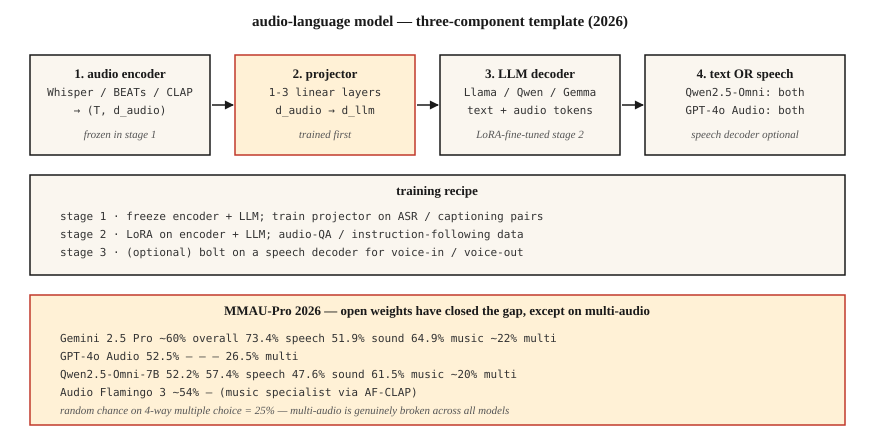

# 音频语言模型：Qwen2.5-Omni、Audio Flamingo、GPT-4o Audio

> 2026 年的音频语言模型可以同时理解 speech、environmental sound 和 music。Qwen2.5-Omni-7B 在 MMAU-Pro 上追平 GPT-4o Audio。Audio Flamingo Next 在 LongAudioBench 上超过 Gemini 2.5 Pro。开源与闭源之间的差距基本关闭了，除了 multi-audio 任务：所有模型都接近随机。

**Type:** Learn
**Languages:** Python
**Prerequisites:** Phase 6 · 04 (ASR), Phase 12 · 03 (Vision-Language Models), Phase 7 · 10 (Audio Transformers)
**Time:** ~45 minutes

## 问题

你有一段 5 秒音频：狗叫，有人喊 "stop!"，然后安静下来。有用的问题会跨越多个维度：

- **Transcription。** “说了什么？”——这是 ASR 的地盘。
- **Semantic reasoning。** “这个人有危险吗？”——需要联合理解狗叫、喊声和后续静默。
- **Music reasoning。** “哪些乐器在演奏旋律？”
- **Long-audio retrieval。** “这段 90 分钟讲座里，老师在哪里解释了 gradient descent？”

一个能用同一个 prompt 回答所有这些问题的模型，就是 **audio-language model**（LALM / ALM）。它不同于纯 ASR：LALM 输出自由形式的自然语言答案，而不只是 transcript。

## 概念



### 三组件模板

每个 2026 年的 LALM 都有相同骨架：

1. **Audio encoder。** Whisper encoder、BEATs、CLAP、WavLM，或各模型自己的 custom encoder。
2. **Projector。** Linear 或 MLP，把 audio-encoder features 桥接到 LLM 的 token embedding space。
3. **LLM。** 基于 Llama / Qwen / Gemma 的 decoder。接收交错的 text + audio tokens，并生成文本。

训练方式：

- **Stage 1。** 冻结 encoder + LLM，只在 ASR / captioning 数据上训练 projector。
- **Stage 2。** 在 instruction-following audio tasks 上做 full / LoRA fine-tune（QA、reasoning、music understanding）。
- **Stage 3（可选）。** Voice-in / voice-out 增加 speech decoder。Qwen2.5-Omni 和 AF3-Chat 都这样做。

### 2026 模型地图

| Model | Backbone | Audio encoder | Output modality | Access |
|-------|----------|---------------|-----------------|--------|
| Qwen2.5-Omni-7B | Qwen2.5-7B | Custom + Whisper | text + speech | Apache-2.0 |
| Qwen3-Omni | Qwen3 | Custom | text + speech | Apache-2.0 |
| Audio Flamingo 3 | Qwen2 | AF-CLAP | text | NVIDIA non-commercial |
| Audio Flamingo Next | Qwen2 | AF-CLAP v2 | text | NVIDIA non-commercial |
| SALMONN | Vicuna | Whisper + BEATs | text | Apache-2.0 |
| LTU / LTU-AS | Llama | CAV-MAE | text | Apache-2.0 |
| GAMA | Llama | AST + Q-Former | text | Apache-2.0 |
| Gemini 2.5 Flash/Pro (closed) | Gemini | proprietary | text + speech | API |
| GPT-4o Audio (closed) | GPT-4o | proprietary | text + speech | API |

### Benchmark reality check（2026）

**MMAU-Pro。** 1800 个 QA pairs，覆盖 speech / sound / music / mixed，并包含 multi-audio subset。

| Model | Overall | Speech | Sound | Music | Multi-audio |
|-------|---------|--------|-------|-------|-------------|
| Gemini 2.5 Pro | ~60% | 73.4% | 51.9% | 64.9% | ~22% |
| Gemini 2.5 Flash | ~57% | 73.4% | 50.5% | 64.9% | 21.2% |
| GPT-4o Audio | 52.5% | — | — | — | 26.5% |
| Qwen2.5-Omni-7B | 52.2% | 57.4% | 47.6% | 61.5% | ~20% |
| Audio Flamingo 3 | ~54% | — | — | — | — |
| Audio Flamingo Next | SOTA on LongAudioBench | — | — | — | — |

**multi-audio 这一列对所有模型都很刺眼。** 4 选 1 multiple choice 的随机水平是 25%；多数模型就在这个附近。LALM 仍然很难比较两段音频。

### 2026 年 LALM 有用的地方

- **Call-center recordings 的 compliance audit。** “坐席有没有提到必要披露？”
- **Accessibility。** 给 deaf users 描述声音事件（不只是 transcription）。
- **Content moderation。** 同时检测暴力语言、威胁性语气和背景上下文。
- **Podcast / meeting chaptering。** 做语义总结，而不只是 speaker turns。
- **Music catalog analysis。** “找出所有有 B-section key change 的曲目。”

### 它们还不适合的地方

- 细粒度 music theory（低于 chord-level）。
- 长对话中的 speaker-attributed reasoning（超过 10 分钟后退化）。
- Multi-audio comparison（22-26% 只是勉强高于随机）。
- Real-time streaming reasoning（多数仍是 offline batch inference）。

## Build It

### Step 1：query Qwen2.5-Omni

```python
from transformers import AutoModelForCausalLM, AutoProcessor

processor = AutoProcessor.from_pretrained("Qwen/Qwen2.5-Omni-7B")
model = AutoModelForCausalLM.from_pretrained("Qwen/Qwen2.5-Omni-7B", torch_dtype="auto")

audio, sr = load_wav("clip.wav", sr=16000)
messages = [{
    "role": "user",
    "content": [
        {"type": "audio", "audio": audio},
        {"type": "text", "text": "What sounds do you hear, and what's happening?"},
    ],
}]
inputs = processor.apply_chat_template(messages, tokenize=True, return_tensors="pt")
output = model.generate(**inputs, max_new_tokens=200)
print(processor.decode(output[0], skip_special_tokens=True))
```

### Step 2：projector pattern

```python
import torch.nn as nn

class AudioProjector(nn.Module):
    def __init__(self, audio_dim=1280, llm_dim=4096):
        super().__init__()
        self.down = nn.Linear(audio_dim, llm_dim)
        self.act = nn.GELU()
        self.up = nn.Linear(llm_dim, llm_dim)

    def forward(self, audio_features):
        return self.up(self.act(self.down(audio_features)))
```

就是这样。Projector 通常只有 1-3 层 linear layers。在 ASR pairs（audio -> transcript）上训练它，就是 Stage-1 pretext task。

### Step 3：benchmark MMAU / LongAudioBench

```python
from datasets import load_dataset
mmau = load_dataset("MMAU/MMAU-Pro")

correct = 0
for item in mmau["test"]:
    answer = call_model(item["audio"], item["question"], item["choices"])
    if answer == item["correct_choice"]:
        correct += 1
print(f"Accuracy: {correct / len(mmau['test']):.3f}")
```

分别报告 per-category（speech / sound / music / multi-audio）。总分会隐藏模型真正失败的位置。

## Use It

| Task | 2026 pick |
|------|-----------|
| Free-form audio QA (open) | Qwen2.5-Omni-7B |
| Best open on long audio | Audio Flamingo Next |
| Best closed | Gemini 2.5 Pro |
| Voice-in / voice-out agent | Qwen2.5-Omni or GPT-4o Audio |
| Music reasoning | Audio Flamingo 3 or 2（music-specialized AF-CLAP） |
| Call-center audit | Gemini 2.5 Pro via API，并对你的 policy docs 做 RAG |

## Pitfalls

- **过度相信 multi-audio。** 如果你的任务需要“哪段 clip 有 X”，接近随机水平的表现是真实存在的。
- **Long-audio degradation。** 超过 10 分钟后，多数模型的 speaker attribution 会崩。先 diarize（Lesson 6），再 summarize。
- **静音上的 hallucinations。** 这是使用 Whisper encoder 的 LALM 继承来的 Whisper-style 问题。使用 VAD-gate。
- **Benchmark cherry-picking。** Vendor blog posts 会强调最佳类别。你要自己跑 MMAU-Pro multi-audio subset。

## Ship It

保存为 `outputs/skill-alm-picker.md`。它要能针对给定 audio-understanding task，选择 LALM、benchmark subset 和 output-modality（text vs speech）。

## 练习

1. **Easy。** 运行 `code/main.py`，查看 toy projector pattern，以及假的 LALM routing：`(audio-embedding, text-tokens) -> output tokens`。
2. **Medium。** 在 100 个 MMAU-Pro speech items 上给 Qwen2.5-Omni-7B 打分。与论文报告数字比较。
3. **Hard。** 构建一个最小 audio-captioning baseline：BEATs encoder + 2-layer projector + frozen Llama-3.2-1B。只在 AudioCaps 上 fine-tune projector。与 SALMONN 在 Clotho-AQA 上比较。

## 关键术语

| 术语 | 常见说法 | 实际含义 |
|------|----------|----------|
| LALM | Audio ChatGPT | Audio encoder + projector + LLM decoder。 |
| Projector | Adapter | 把 audio features 映射到 LLM embedding space 的小型 MLP。 |
| MMAU | 那个 benchmark | 覆盖 speech、sound、music 的 10k audio-QA pairs。 |
| MMAU-Pro | 更难的 MMAU | 1800 个 multi-audio / reasoning-heavy questions。 |
| LongAudioBench | Long-form eval | 带 semantic queries 的多分钟 clips。 |
| Voice-in / voice-out | Speech-native | 模型直接吃 speech 并输出 speech，不经过文本绕路。 |

## 延伸阅读

- [Chu et al. (2024). Qwen2-Audio](https://arxiv.org/abs/2407.10759) — reference architecture。
- [Alibaba (2025). Qwen2.5-Omni](https://huggingface.co/Qwen/Qwen2.5-Omni-7B) — speech-in-speech-out。
- [NVIDIA (2025). Audio Flamingo 3](https://arxiv.org/abs/2507.08128) — open long-audio leader。
- [NVIDIA (2026). Audio Flamingo Next](https://arxiv.org/abs/2604.10905) — LongAudioBench SOTA。
- [Tang et al. (2023). SALMONN](https://arxiv.org/abs/2310.13289) — dual-encoder pioneer。
- [MMAU-Pro leaderboard](https://mmaubenchmark.github.io/) — 2026 live rankings。
