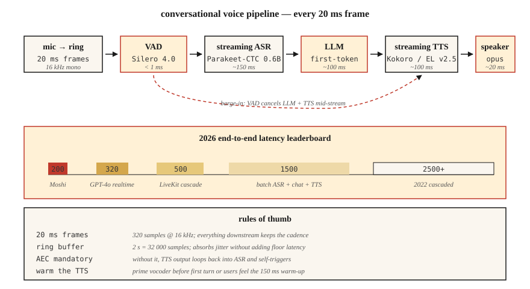

# 实时音频处理

> Batch pipelines 处理的是一个文件。Real-time pipelines 必须在下一段 20 毫秒到来之前处理完当前 20 毫秒。每个 conversational AI、broadcast studio 和 telephony bot 的生死都压在这个 latency budget 上。

**Type:** Build
**Languages:** Python
**Prerequisites:** Phase 6 · 02 (Spectrograms), Phase 6 · 04 (ASR), Phase 6 · 07 (TTS)
**Time:** ~75 minutes

## 问题

你想做一个感觉"活着"的 voice assistant。人类对话 turn-taking latency 约为 230 ms（从沉默到响应）。超过 500 ms 就会显得机械；超过 1500 ms 就会感觉坏了。2026 年，一个完整 **hear → understand → respond → speak** loop 的预算是：

| Stage | Budget |
|-------|--------|
| Mic → buffer | 20 ms |
| VAD | 10 ms |
| ASR (streaming) | 150 ms |
| LLM (first token) | 100 ms |
| TTS (first chunk) | 100 ms |
| Render → speaker | 20 ms |
| **Total** | **~400 ms** |

Moshi（Kyutai，2024）实现了 200 ms 的 full-duplex。GPT-4o-realtime（2024）约为 320 ms。2022 年上线的 cascaded pipelines 常常是 2500 ms。这个 10× 改进来自三件事：(1) everywhere streaming，(2) 用 partial results 做 asynchronous pipelining，(3) interruptible generation。

## 概念



**Frame / chunk / window。** 实时音频以固定大小的 blocks 流动。常见选择是 20 ms（16 kHz 下 320 samples）。下游所有组件都必须跟上这个节奏。

**Ring buffer。** 固定大小的 circular buffer。Producer thread 写入新 frames，consumer thread 读取。它能避免 hot path 中的 allocations。大小约等于 maximum-latency × sample-rate；一个 2 秒、16 kHz 的 ring = 32,000 samples。

**VAD（Voice Activity Detection）。** 当没人说话时，VAD 会 gate downstream work。Silero VAD 4.0（2024）在 CPU 上每个 30 ms frame 用时 <1 ms。`webrtcvad` 是更老的替代方案。

**Streaming ASR。** 随着音频到达就输出 partial transcripts 的模型。Streaming mode 下的 Parakeet-CTC-0.6B（NeMo，2024）可以在 320 ms latency 下达到 2-5% WER。Whisper-Streaming（Macháček et al., 2023）把 Whisper 切块，实现约 2 秒 latency 的 near-streaming。

**Interruption。** 当 assistant 正在说话而用户开口时，你必须：(a) detect barge-in，(b) stop TTS，(c) discard 剩余 LLM output。全部要在 100 ms 内完成，否则用户会觉得 assistant 听不见自己。

**WebRTC Opus transport。** 20 ms frames，48 kHz，自适应 bitrate 8-128 kbps。它是 browser 和 mobile 的标准。LiveKit、Daily.co、Pion 是 2026 年构建 voice apps 的 stack。

**Jitter buffer。** Network packets 会乱序或迟到。Jitter buffer 负责 reorder 和 smooth；太小会有 audible gaps，太大会增加 latency。典型值是 60-80 ms。

### 常见坑点

- **Thread contention。** Python 的 GIL + heavy models 可能饿死 audio thread。使用 C-callback audio library（sounddevice、PortAudio），并让 Python 远离 hot path。
- **Sample-rate conversion latency。** 在 pipeline 内 resampling 会增加 5-20 ms。要么 upfront resample，要么使用 zero-latency resampler（PolyPhase、`soxr_hq`）。
- **TTS priming。** 即使是 Kokoro 这样的 fast TTS，第一次请求也会有 100-200 ms warm-up。缓存 model，并在第一个真实 turn 前用 dummy run 预热。
- **Echo cancellation。** 没有 AEC 时，TTS output 会重新进入 mic，并触发 ASR 识别 bot 自己的声音。WebRTC AEC3 是 open-source 默认选择。

```figure
nyquist-aliasing
```

## Build It

### Step 1：ring buffer

```python
import collections

class RingBuffer:
    def __init__(self, capacity):
        self.buf = collections.deque(maxlen=capacity)
    def write(self, frame):
        self.buf.extend(frame)
    def read(self, n):
        return [self.buf.popleft() for _ in range(min(n, len(self.buf)))]
    def level(self):
        return len(self.buf)
```

Capacity 决定最大 buffering latency。32,000 samples at 16 kHz = 2 s。

### Step 2：VAD gate

```python
def simple_energy_vad(frame, threshold=0.01):
    return sum(x * x for x in frame) / len(frame) > threshold ** 2
```

Production 中替换为 Silero VAD：

```python
import torch
vad, _ = torch.hub.load("snakers4/silero-vad", "silero_vad")
is_speech = vad(torch.tensor(frame), 16000).item() > 0.5
```

### Step 3：streaming ASR

```python
# Parakeet-CTC-0.6B streaming via NeMo
from nemo.collections.asr.models import EncDecCTCModelBPE
asr = EncDecCTCModelBPE.from_pretrained("nvidia/parakeet-ctc-0.6b")
# chunk_ms=320 ms, look_ahead_ms=80 ms
for chunk in audio_stream():
    partial_text = asr.transcribe_streaming(chunk)
    print(partial_text, end="\r")
```

### Step 4：interruption handler

```python
class Dialog:
    def __init__(self):
        self.tts_task = None

    def on_user_speech(self, frame):
        if self.tts_task and not self.tts_task.done():
            self.tts_task.cancel()   # barge-in
        # then feed to streaming ASR

    def on_final_user_utterance(self, text):
        self.tts_task = asyncio.create_task(self.reply(text))

    async def reply(self, text):
        async for tts_chunk in llm_then_tts(text):
            speaker.write(tts_chunk)
```

关键在 async I/O 和 cancellable TTS streaming。WebRTC 中，对 audio track 调用 peerconnection.stop() 是 canonical way。

## Use It

2026 年的实际 stack：

| Layer | Pick |
|-------|------|
| Transport | LiveKit (WebRTC) or Pion (Go) |
| VAD | Silero VAD 4.0 |
| Streaming ASR | Parakeet-CTC-0.6B or Whisper-Streaming |
| LLM first-token | Groq, Cerebras, vLLM-streaming |
| Streaming TTS | Kokoro or ElevenLabs Turbo v2.5 |
| Echo cancel | WebRTC AEC3 |
| End-to-end native | OpenAI Realtime API or Moshi |

## 常见陷阱

- **Buffering 500 ms to be safe。** Buffer 本身就是你的 latency floor。缩小它。
- **Not pinning threads。** Audio callback 如果跑在比 UI thread 还低优先级的线程上，负载一高就会 glitch。
- **TTS chunks too small。** 小于 200 ms 的 chunks 会让 vocoder artifacts 变得可听。320 ms chunks 是 sweet spot。
- **No jitter buffer。** 真实网络一定有 jitter；没有 smoothing 就会出现 pops。
- **Single-shot error handling。** Audio pipelines 必须 crash-proof。一个 exception 就会杀掉整个 session。

## Ship It

保存为 `outputs/skill-realtime-designer.md`。为实时音频 pipeline 设计每个 stage 的具体 latency budgets。

## 练习

1. **Easy。** 运行 `code/main.py`。它会模拟 ring buffer + energy VAD，并为一个假的 10 秒 stream 打印各 stage latencies。
2. **Medium。** 使用 `sounddevice` 构建一个 passthrough loop，以 20 ms frames 处理你的麦克风，并在每个 frame 打印 VAD state。
3. **Hard。** 用 `aiortc` 构建 full duplex echo test：browser → WebRTC → Python → WebRTC → browser。用 1 kHz pulse 测量 glass-to-glass latency。

## 关键术语

| Term | 大家常说 | 实际含义 |
|------|----------|----------|
| Ring buffer | circular queue | 固定大小、lock-free（或 SPSC-locked）的 audio frames FIFO。 |
| VAD | Silence gate | 标记 speech vs non-speech 的模型或 heuristic。 |
| Streaming ASR | Real-time STT | 随音频到达输出 partial text；bounded lookahead。 |
| Jitter buffer | Network smoother | 对乱序 packets 做 queue reordering；典型值 60-80 ms。 |
| AEC | Echo cancellation | 减去 speaker-to-mic feedback path。 |
| Barge-in | User interrupt | 系统检测到用户在 TTS 中途说话；必须 cancel playback。 |
| Full duplex | Simultaneous both ways | 用户和 bot 可以同时说话；Moshi 是 full duplex。 |

## 延伸阅读

- [Macháček et al. (2023). Whisper-Streaming](https://arxiv.org/abs/2307.14743) — chunked near-streaming Whisper。
- [Kyutai (2024). Moshi](https://kyutai.org/Moshi.pdf) — full-duplex 200 ms latency。
- [LiveKit Agents framework (2024)](https://docs.livekit.io/agents/) — production audio agent orchestration。
- [Silero VAD repo](https://github.com/snakers4/silero-vad) — sub-1 ms VAD，Apache 2.0。
- [WebRTC AEC3 paper](https://webrtc.googlesource.com/src/+/main/modules/audio_processing/aec3/) — open source 下的 echo cancellation。
