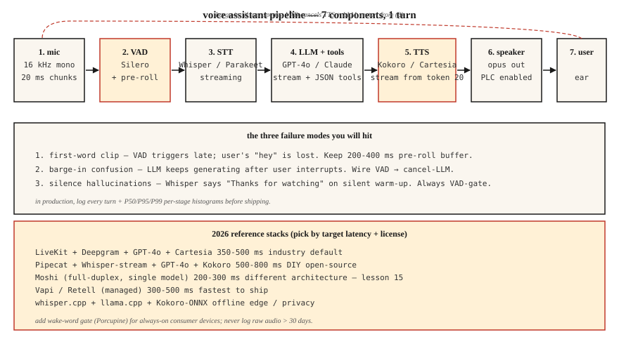

# 构建语音助手 Pipeline：Phase 6 Capstone

> 把 lessons 01-11 全部缝在一起。构建一个会听、会推理、会说回来的 voice assistant。到 2026 年，这已经是一个解决了的工程问题，不是研究问题，但集成细节决定它能不能上线。

**Type:** Build
**Languages:** Python
**Prerequisites:** Phase 6 · 04, 05, 06, 07, 11; Phase 11 · 09 (Function Calling); Phase 14 · 01 (Agent Loop)
**Time:** ~120 minutes

## 问题

构建一个 end-to-end assistant：

1. 捕获 mic input（16 kHz mono）。
2. 检测用户语音的 start/end。
3. 流式转写。
4. 把 transcript 传给可以 call tools 的 LLM（timer、weather、calendar）。
5. 把 LLM text 流式送进 TTS。
6. 把 audio 播放给用户。
7. 如果用户在回答中途打断，就停止。

Latency target：用户说完后 800 ms 内，在 laptop CPU 上拿到第一个 TTS audio byte。Quality target：不漏词，不在静音上 hallucinate subtitles，不泄漏 voice cloning，不让 prompt injection 成功。

## 概念



### 七个组件

1. **Audio capture。** Mic → 16 kHz mono → 20 ms chunks。Python 中通常用 `sounddevice`，production 里用 native AudioUnit/ALSA/WASAPI。
2. **VAD（Lesson 11）。** Silero VAD @ threshold 0.5，min speech 250 ms，silence hang-over 500 ms。发出 "start" 和 "end" signals。
3. **Streaming STT（Lesson 4-5）。** Whisper-streaming、Parakeet-TDT 或 Deepgram Nova-3（API）。输出 partial + final transcripts。
4. **LLM with tool calling。** GPT-4o / Claude 3.5 / Gemini 2.5 Flash。为 tools 定义 JSON schema。流式输出 tokens。
5. **Streaming TTS（Lesson 7）。** Kokoro-82M（最快 open model）或 Cartesia Sonic（commercial）。在 20 个 LLM tokens 后启动 TTS。
6. **Playback。** Speaker out；低带宽网络使用 opus-encode。
7. **Interruption handler。** 如果 VAD 在 TTS playback 时触发，就停止 playback、取消 LLM、重启 STT。

### 你一定会碰到的三种 failure modes

1. **First-word clip。** VAD 启动慢半拍，用户的 "hey" 丢了。Start threshold 用 0.3，不要用 0.5。
2. **Mid-response interrupt confusion。** 用户打断后 LLM 继续生成；assistant 和用户抢话。把 VAD → cancel-LLM 接起来。
3. **Silence hallucination。** Whisper 在 silent warm-up frames 上输出 "Thanks for watching"。始终 VAD-gate。

### 2026 production reference stacks

| Stack | Latency | License | Notes |
|-------|---------|---------|-------|
| LiveKit + Deepgram + GPT-4o + Cartesia | 350-500 ms | commercial API | 2026 industry default |
| Pipecat + Whisper-streaming + GPT-4o + Kokoro | 500-800 ms | mostly open | DIY-friendly |
| Moshi (full-duplex) | 200-300 ms | CC-BY 4.0 | Single-model；不同架构，lesson 15 |
| Vapi / Retell (managed) | 300-500 ms | commercial | 最快 launch；customization 有限 |
| Whisper.cpp + llama.cpp + Kokoro-ONNX | offline | open | Privacy / edge |

## Build It

### Step 1：带 chunking 的 mic capture（pseudocode）

```python
import sounddevice as sd

def mic_stream(chunk_ms=20, sr=16000):
    q = queue.Queue()
    def cb(indata, frames, time, status):
        q.put(indata.copy().flatten())
    with sd.InputStream(channels=1, samplerate=sr, blocksize=int(sr * chunk_ms/1000), callback=cb):
        while True:
            yield q.get()
```

### Step 2：VAD-gated turn capture

```python
def capture_turn(stream, vad, pre_roll_ms=300, silence_ms=500):
    buf, pre, triggered = [], collections.deque(maxlen=pre_roll_ms // 20), False
    silent = 0
    for chunk in stream:
        pre.append(chunk)
        if vad(chunk):
            if not triggered:
                buf = list(pre)
                triggered = True
            buf.append(chunk)
            silent = 0
        elif triggered:
            silent += 20
            buf.append(chunk)
            if silent >= silence_ms:
                return b"".join(buf)
```

### Step 3：streaming STT → LLM → TTS

```python
async def turn(audio_bytes):
    transcript = await stt.transcribe(audio_bytes)
    async for token in llm.stream(transcript):
        async for audio in tts.stream(token):
            await speaker.play(audio)
```

### Step 4：LLM loop 中的 tool calling

```python
tools = [
    {"name": "get_weather", "parameters": {"location": "string"}},
    {"name": "set_timer", "parameters": {"seconds": "int"}},
]

async for chunk in llm.stream(user_text, tools=tools):
    if chunk.type == "tool_call":
        result = dispatch(chunk.name, chunk.args)
        continue_streaming(result)
    if chunk.type == "text":
        await tts.stream(chunk.text)
```

### Step 5：interruption handling

```python
tts_task = asyncio.create_task(tts_loop())
while True:
    chunk = await mic.get()
    if vad(chunk):
        tts_task.cancel()
        await speaker.stop()
        await new_turn()
        break
```

## Use It

查看 `code/main.py`。它是一个 runnable simulation，用 stub models 把七个组件接起来，即使没有硬件也能看到 pipeline shape。真实实现时，把 stubs 换成：

- `silero-vad`（`pip install silero-vad`）
- `deepgram-sdk` 或 `openai-whisper`
- `openai`（`gpt-4o`）或 `anthropic`
- `kokoro` 或 `cartesia`
- `sounddevice` 做 I/O

## 坑

- **Logging PII forever。** Full-turn audio 在大多数司法辖区都属于 PII。30-day retention，encrypted at rest。
- **No barge-in。** 用户会打断。你的 assistant 必须停止说话。
- **TTS that blocks。** Synchronous TTS 会阻塞 event loop。使用 async 或单独 thread。
- **No tool-call error handling。** Tools 会失败。LLM 必须拿到 error、retry once，然后 graceful degrade。
- **Overzealous hallucination filters。** 过滤太多，assistant 会反复说 "I can't help with that." 过滤太少，它什么都敢说。在 held-out set 上校准。
- **No wake-word option。** Always-listening 是 privacy liability。加一个 wake-word gate（Porcupine 或 openWakeWord）。

## Ship It

保存为 `outputs/skill-voice-assistant-architect.md`。给定 budget + scale + language + compliance constraints，产出完整 stack spec。

## 练习

1. **Easy。** 运行 `code/main.py`。它会用 stub modules 模拟一个完整 turn，并打印每个 stage 的 latency。
2. **Medium。** 用真实 Whisper model 替换 STT stub，输入一段预录制 `.wav`。测量 WER 和 end-to-end latency。
3. **Hard。** 增加 tool calling：实现 `get_weather`（任意 API）和 `set_timer`。让 LLM 通过 tools 路由，并验证用户说 "set a 5 minute timer" 时触发正确函数，spoken reply 会确认。

## 关键术语

| Term | 人们通常怎么说 | 它实际是什么意思 |
|------|----------------|------------------|
| Turn | A user + assistant round-trip | 一个由 VAD 框住的 user speech + 一个 LLM-TTS response。 |
| Barge-in | Interruption | 用户在 assistant 说话时开口；assistant 停止。 |
| Wake word | "Hey assistant" | 短关键词检测器；Porcupine、Snowboy、openWakeWord。 |
| End-pointing | Turn ending | VAD + min-silence 判断用户已经说完。 |
| Pre-roll | Pre-speech buffer | 保留 VAD 触发前 200-400 ms audio，避免 first-word clip。 |
| Tool call | Function invocation | LLM 输出 JSON；runtime dispatch；result 回流到 loop。 |

## 延伸阅读

- [LiveKit — voice agent quickstart](https://docs.livekit.io/agents/) — production-grade reference。
- [Pipecat — voice agent examples](https://github.com/pipecat-ai/pipecat) — DIY-friendly framework。
- [OpenAI Realtime API](https://platform.openai.com/docs/guides/realtime) — managed voice-native path。
- [Kyutai Moshi](https://github.com/kyutai-labs/moshi) — full-duplex reference（Lesson 15）。
- [Porcupine wake-word](https://picovoice.ai/products/porcupine/) — wake-word gating。
- [Anthropic — tool use guide](https://docs.anthropic.com/en/docs/build-with-claude/tool-use) — LLM function calling。
