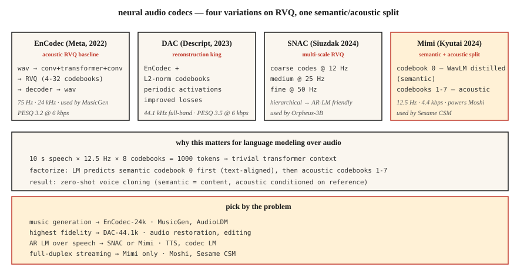

# 神经音频编解码器 — EnCodec、SNAC、Mimi、DAC 与语义-声学分离

> 2026 年的音频生成几乎全是 token。EnCodec、SNAC、Mimi 和 DAC 会把连续波形变成 transformer 可以预测的离散序列。semantic-vs-acoustic token split，也就是第一个 codebook 作为语义，其余 codebook 作为声学细节，是音频领域自 Transformer 以来最重要的架构转变。

**Type:** Learn
**Languages:** Python
**Prerequisites:** Phase 6 · 02 (Spectrograms), Phase 10 · 11 (Quantization), Phase 5 · 19 (Subword Tokenization)
**Time:** ~60 minutes

## 问题

语言模型处理离散 token。音频是连续信号。如果你想为语音或音乐构建 LLM 风格模型，例如 MusicGen、Moshi、Sesame CSM、VibeVoice、Orpheus，你首先需要一个 **neural audio codec（神经音频编解码器）**：一个学出来的 encoder，把音频离散化成小词表里的 token；以及一个匹配的 decoder，把 token 还原成波形。

现在已经形成两大家族：

1. **Reconstruction-first codecs（重建优先 codec）**：EnCodec、DAC。优化感知音频质量。Token 是“acoustic”的，会捕捉一切，包括说话人身份、音色、背景噪声。
2. **Semantic-first codecs（语义优先 codec）**：Mimi（Kyutai）、SpeechTokenizer。强制第一个 codebook 编码语言/音素内容（通常通过从 WavLM 蒸馏实现）。后续 codebook 负责声学细节。

2024-2026 年的关键洞察是：**当你试图从文本生成音频时，纯重建 codec 会带来模糊语音。** 覆盖 codec token 的 LLM 必须在同一个 codebook 中同时学习语言结构和声学结构，这无法良好扩展。把二者分开，也就是 semantic codebook 0、acoustic codebooks 1-N，正是 Moshi 和 Sesame CSM 能工作的原因。

## 概念



### 核心技巧：Residual Vector Quantization（RVQ）

现代音频 codec 不会使用一个巨大的 codebook，因为要获得好质量，那会需要几百万个 code。它们几乎都使用 **RVQ**：一串小 codebook 的级联。第一个 codebook 量化 encoder 输出；第二个 codebook 量化残差；以此类推。每个 codebook 有 1024 个 code。8 个 codebook 的有效词表大小就是 1024^8 = 10^24。

推理时，decoder 会把每一帧选中的所有 code 相加，用来重建波形。

### 2026 年最重要的四种 codec

**EnCodec（Meta，2022）。** 基线方案。直接在 waveform 上做 encoder-decoder，中间是 RVQ bottleneck。24 kHz，可用最多 32 个 codebook，默认 4 个 codebook @ 1.5 kbps。使用 `1D conv + transformer + 1D conv` 架构。MusicGen 使用它。

**DAC（Descript，2023）。** 使用 L2-normalized codebooks、periodic activation functions 和改进 loss 的 RVQ。它是开源 codec 中重建保真度最高的方案，有时 12 个 codebook 就能让重建语音与原始语音难以区分。44.1 kHz full-band。

**SNAC（Hubert Siuzdak，2024）。** Multi-scale RVQ：粗粒度 codebook 的帧率低于细粒度 codebook。它等价于用层级方式建模音频：约 12 Hz 的粗略“草图”，再加 50 Hz 的细节。Orpheus-3B 使用它，因为这种层级结构很适合映射到基于 LM 的生成。

**Mimi（Kyutai，2024）。** 2026 年的改变游戏规则者。12.5 Hz 帧率（极低）、8 个 codebook @ 4.4 kbps。Codebook 0 是 **从 WavLM 蒸馏来的**，训练目标是预测 WavLM 的 speech-content features。Codebooks 1-7 是 acoustic residuals。这种分离支撑了 Moshi（Lesson 15）和 Sesame CSM。

### 帧率对语言建模很重要

帧率越低 = 序列越短 = LM 越快。

| Codec | Frame rate | 1 s = N frames | Good for |
|-------|-----------|----------------|---------|
| EnCodec-24k | 75 Hz | 75 | music, general audio |
| DAC-44.1k | 86 Hz | 86 | high-fidelity music |
| SNAC-24k (coarse) | ~12 Hz | 12 | AR-LM efficient |
| Mimi | 12.5 Hz | 12.5 | streaming speech |

在 12.5 Hz 下，一段 10 秒话语只有 125 个 codec frame，transformer 可以轻松预测。

### 语义 token 与声学 token

```text
frame_t → [semantic_token_t, acoustic_token_0_t, acoustic_token_1_t, ..., acoustic_token_6_t]
```

- **Semantic token（Mimi 中的 codebook 0）。** 编码“说了什么”：音素、词、内容。通过辅助预测 loss 从 WavLM 蒸馏而来。
- **Acoustic tokens（codebooks 1-7）。** 编码音色、说话人身份、韵律、背景噪声和细节。

AR LM 会先预测 semantic token（以文本为条件），再预测 acoustic tokens（以 semantic + speaker reference 为条件）。这种因式分解解释了为什么现代 TTS 可以 zero-shot clone 声音：semantic model 处理内容，acoustic model 处理音色。

### 2026 年重建质量（bits per sec，码率越低越好）

| Codec | Bitrate | PESQ | ViSQOL |
|-------|---------|------|--------|
| Opus-20kbps | 20 kbps | 4.0 | 4.3 |
| EnCodec-6kbps | 6 kbps | 3.2 | 3.8 |
| DAC-6kbps | 6 kbps | 3.5 | 4.0 |
| SNAC-3kbps | 3 kbps | 3.3 | 3.8 |
| Mimi-4.4kbps | 4.4 kbps | 3.1 | 3.7 |

像 Opus 这样的传统 codec，在每 bit 感知质量上仍然胜出。神经 codec 胜在 **discrete tokens**（Opus 不产生这种 token）和 **generative-model quality**（LM 可以用这些 token 做什么）。

## 动手构建

### Step 1：用 EnCodec 编码

```python
from encodec import EncodecModel
import torch

model = EncodecModel.encodec_model_24khz()
model.set_target_bandwidth(6.0)  # kbps

wav = torch.randn(1, 1, 24000)
with torch.no_grad():
    encoded = model.encode(wav)
codes, scale = encoded[0]
# codes: (1, n_codebooks, n_frames), dtype=int64
```

6 kbps 下 `n_codebooks=8`。每个 code 的范围是 0-1023（10-bit）。

### Step 2：解码并测量重建误差

```python
with torch.no_grad():
    wav_recon = model.decode([(codes, scale)])

from torchaudio.functional import compute_deltas
import torch.nn.functional as F

mse = F.mse_loss(wav_recon[:, :, :wav.shape[-1]], wav).item()
```

### Step 3：semantic-acoustic split（Mimi 风格）

```python
from moshi.models import loaders
mimi = loaders.get_mimi()

with torch.no_grad():
    codes = mimi.encode(wav)  # shape (1, 8, frames@12.5Hz)

semantic = codes[:, 0]
acoustic = codes[:, 1:]
```

Semantic codebook 0 与 WavLM 对齐。你可以训练一个 text-to-semantic transformer，它的词表比 direct-to-audio 小得多。然后，一个单独的 acoustic-to-waveform decoder 会以 speaker reference 为条件生成波形。

### Step 4：为什么 codec token 上的 AR LM 有效

对一段 10 秒语音，Mimi 的帧率是 12.5 Hz，且有 8 个 codebook：

```text
N_tokens = 10 * 12.5 * 8 = 1000 tokens
```

1000 个 token 对 transformer 来说是很轻的上下文。现代 GPU 上，一个 256M 参数的 transformer 可以在毫秒级生成 10 秒语音。

## 使用它

把问题映射到 codec：

| Task | Codec |
|------|-------|
| 通用音乐生成 | EnCodec-24k |
| 最高保真重建 | DAC-44.1k |
| 语音上的 AR LM（TTS） | SNAC 或 Mimi |
| 流式全双工语音 | Mimi（12.5 Hz） |
| 带文本条件的音效库 | EnCodec + T5 condition |
| 细粒度音频编辑 | DAC + inpainting |

经验法则：**如果你在构建生成模型，从 Mimi 或 SNAC 开始。如果你在构建压缩流水线，用 Opus。**

## 常见陷阱

- **Codebook 太多。** 增加 codebook 会线性提高保真度，但也会线性增加 LM 序列长度。停在 8-12 个。
- **帧率不匹配。** 在 12.5 Hz Mimi 上训练 LM，然后在 50 Hz EnCodec 上 fine-tune，会静默失败。
- **假设所有 codebook 都等价。** 在 Mimi 中，codebook 0 承载内容；丢掉它会毁掉可懂度。丢掉 codebook 7 几乎听不出来。
- **把重建质量当作唯一指标。** 一个 codec 可以有很好的重建效果，但如果语义结构很差，对基于 LM 的生成仍然没用。

## 交付它

保存为 `outputs/skill-codec-picker.md`。为给定的生成或压缩任务选择 codec。

## 练习

1. **Easy.** 运行 `code/main.py`。它实现了一个 toy scalar + residual quantizer，并在增加 codebook 时测量重建误差。
2. **Medium.** 安装 `encodec`，在一段留出的语音片段上比较 1、4、8、32 个 codebook。绘制 PESQ 或 MSE vs bitrate。
3. **Hard.** 加载 Mimi。编码一段音频。把 codebook 0 替换成随机整数，然后解码。再用同样方式替换 codebook 7。比较两种破坏：codebook 0 的破坏应该摧毁可懂度；codebook 7 的破坏应该几乎不改变任何东西。

## 关键术语

| Term | What people say | What it actually means |
|------|-----------------|-----------------------|
| RVQ | 残差量化 | 一串小 codebook；每个都量化前一次的残差。 |
| Frame rate | Codec 速度 | 每秒多少 token-frame。越低 = LM 越快。 |
| Semantic codebook | Codebook 0（Mimi） | 从 SSL features 蒸馏来的 codebook；编码内容。 |
| Acoustic codebooks | 其余所有 codebook | 音色、韵律、噪声、细节。 |
| PESQ / ViSQOL | 感知质量 | 与 MOS 相关的客观指标。 |
| EnCodec | Meta codec | RVQ 基线；MusicGen 使用它。 |
| Mimi | Kyutai codec | 12.5 Hz 帧率；semantic-acoustic split；支撑 Moshi。 |

## 延伸阅读

- [Défossez et al. (2023). EnCodec](https://arxiv.org/abs/2210.13438) — RVQ 基线。
- [Kumar et al. (2023). Descript Audio Codec (DAC)](https://arxiv.org/abs/2306.06546) — 最高保真的开源 codec。
- [Siuzdak (2024). SNAC](https://arxiv.org/abs/2410.14411) — multi-scale RVQ。
- [Kyutai (2024). Mimi codec](https://kyutai.org/codec-explainer) — semantic-acoustic split，WavLM distillation。
- [Borsos et al. (2023). AudioLM](https://arxiv.org/abs/2209.03143) — 两阶段 semantic/acoustic 范式。
- [Zeghidour et al. (2021). SoundStream](https://arxiv.org/abs/2107.03312) — 最初的 streamable RVQ codec。
