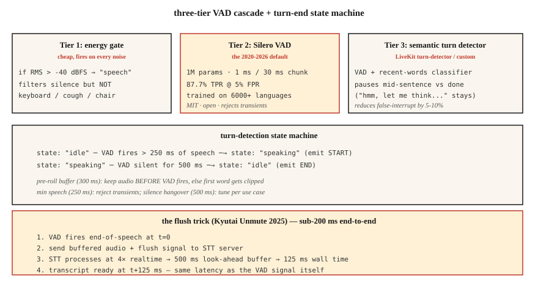

# 语音活动检测与轮次判断：Silero、Cobra 和 Flush Trick

> 每个 voice agent 的生死都取决于两个判断：用户现在是否在说话，以及用户说完了吗？VAD 回答第一个问题。Turn-detection（VAD + silence-hangover + semantic endpoint model）回答第二个问题。任意一个做错，assistant 要么打断用户，要么永远停不下来。

**Type:** Build
**Languages:** Python
**Prerequisites:** Phase 6 · 11 (Real-Time Audio), Phase 6 · 12 (Voice Assistant)
**Time:** ~45 minutes

## 问题

Voice agent 在每个 20 ms chunk 上都要做三个不同的判断：

1. **这一帧是 speech 吗？** VAD。Binary，per-frame。
2. **用户是否开始了新的 utterance？** Onset detection。
3. **用户是否说完了？** End-pointing（turn-end）。

朴素答案（energy threshold）在任何噪声下都会失败：交通、键盘、人群噪声。2026 年的答案是：Silero VAD（open、deep-learned）+ turn-detection model（semantic endpointing）+ 基于 VAD 校准的 silence hangover。

## 概念



### 三层 VAD cascade

**Tier 1：energy gate。** 最便宜。用 -40 dBFS threshold 判断 RMS。能过滤明显静音，但任何超过阈值的噪声都会触发。

**Tier 2：Silero VAD**（2020-2026，MIT）。1M 参数。在 6000+ languages 上训练。单 CPU 线程上，每 30 ms chunk 约 1 ms 跑完。5% FPR 下 TPR 为 87.7%。这是开源默认选择。

**Tier 3：semantic turn detector。** LiveKit 的 turn-detection model（2024-2026）或你自己的小 classifier。它区分 "pause mid-sentence" 和 "done talking"。用 linguistic context（intonation + recent words），而不只是 silence。

### 关键参数与默认值

- **Threshold。** Silero 输出一个 probability；在 &gt; 0.5（默认）或 &gt; 0.3（更敏感）时判为 speech。阈值越低，first-word clips 越少，false positives 越多。
- **Minimum speech duration。** 拒绝短于 250 ms 的 speech，通常是咳嗽或椅子噪声。
- **Silence hangover（end-pointing）。** VAD 回到 0 后，等待 500-800 ms 再宣布 end-of-turn。太短 -> 打断用户。太长 -> 感觉迟钝。
- **Pre-roll buffer。** 在 VAD 触发前保留 300-500 ms audio。防止 "hey" 被裁掉。

### Flush trick（Kyutai 2025）

Streaming STT models 有 look-ahead delay（Kyutai STT-1B 是 500 ms，STT-2.6B 是 2.5 s）。正常情况下，你会在 end-of-speech 后等待这么久才拿到 transcript。Flush trick：当 VAD 触发 end-of-speech 时，**给 STT 发送 flush signal**，强制立即输出。STT 以约 4x realtime 处理，所以 500 ms buffer 会在约 125 ms 内完成。

端到端：125 ms VAD + flush STT = conversational latency。

### 2026 VAD comparison

| VAD | TPR @ 5% FPR | Latency | License |
|-----|--------------|---------|---------|
| WebRTC VAD (Google, 2013) | 50.0% | 30 ms | BSD |
| Silero VAD (2020-2026) | 87.7% | ~1 ms | MIT |
| Cobra VAD (Picovoice) | 98.9% | ~1 ms | commercial |
| pyannote segmentation | 95% | ~10 ms | MIT-ish |

Silero 是正确默认值。Cobra 是 compliance / accuracy upgrade。Energy-only VAD 在 2026 年的 production 中没有位置。

## Build It

### Step 1：Energy gate

```python
def energy_vad(chunk, threshold_dbfs=-40.0):
    rms = (sum(x * x for x in chunk) / len(chunk)) ** 0.5
    dbfs = 20.0 * math.log10(max(rms, 1e-10))
    return dbfs > threshold_dbfs
```

### Step 2：Python 中的 Silero VAD

```python
from silero_vad import load_silero_vad, get_speech_timestamps

vad = load_silero_vad()
audio = torch.tensor(waveform_16k, dtype=torch.float32)
segments = get_speech_timestamps(
    audio, vad, sampling_rate=16000,
    threshold=0.5,
    min_speech_duration_ms=250,
    min_silence_duration_ms=500,
    speech_pad_ms=300,
)
for s in segments:
    print(f"{s['start']/16000:.2f}s - {s['end']/16000:.2f}s")
```

### Step 3：Turn-end state machine

```python
class TurnDetector:
    def __init__(self, silence_hangover_ms=500, min_speech_ms=250):
        self.state = "idle"
        self.speech_ms = 0
        self.silence_ms = 0
        self.silence_hangover_ms = silence_hangover_ms
        self.min_speech_ms = min_speech_ms

    def update(self, is_speech, chunk_ms=20):
        if is_speech:
            self.speech_ms += chunk_ms
            self.silence_ms = 0
            if self.state == "idle" and self.speech_ms >= self.min_speech_ms:
                self.state = "speaking"
                return "START"
        else:
            self.silence_ms += chunk_ms
            if self.state == "speaking" and self.silence_ms >= self.silence_hangover_ms:
                self.state = "idle"
                self.speech_ms = 0
                return "END"
        return None
```

### Step 4：Flush trick skeleton

```python
def flush_on_end(stt_client, audio_buffer):
    stt_client.send_audio(audio_buffer)
    stt_client.send_flush()
    return stt_client.recv_transcript(timeout_ms=150)
```

STT（Kyutai、Deepgram、AssemblyAI）必须支持 flush，这个技巧才有效。Whisper streaming 不支持，它是 block-based，总是要等 chunks。

## Use It

| Situation | VAD choice |
|-----------|-----------|
| Open, fast, general | Silero VAD |
| Commercial call center | Cobra VAD |
| On-device (phone) | Silero VAD ONNX |
| Research / diarization | pyannote segmentation |
| Zero-dependency fallback | WebRTC VAD (legacy) |
| Need turn-ending quality | Silero + LiveKit turn-detector layered |

经验法则：除非真的别无选择，否则永远不要上线 energy-only VAD。

## 坑

- **Fixed threshold。** 安静环境有效，嘈杂环境失败。要么在设备上校准，要么切到 Silero。
- **Silence hangover 太短。** Agent 会在句子中间打断用户。500-800 ms 是 conversational speech 的 sweet spot。
- **Hangover 太长。** 感觉迟钝。用目标用户做 A/B test。
- **没有 pre-roll buffer。** 用户音频最开始的 200-300 ms 会丢失。始终保留 rolling pre-roll。
- **忽略 semantic endpointing。** "Hmm, let me think..." 里面有长停顿。用户非常讨厌想法说到一半被打断。使用 LiveKit 的 turn-detector 或类似方案。

## Ship It

保存为 `outputs/skill-vad-tuner.md`。为一个 workload 选择 VAD model、threshold、hangover、pre-roll 和 turn-detection strategy。

## 练习

1. **Easy。** 运行 `code/main.py`。它会模拟 speech + silence + speech + coughs sequence，并测试三层 VAD。
2. **Medium。** 安装 `silero-vad`，处理 5 分钟录音，调整 threshold，让 first-word clips 和 false triggers 都尽量少。报告 precision/recall。
3. **Hard。** 构建一个 mini turn-detector：Silero VAD + 一个基于最近 10 个词 embeddings 的 3-layer MLP（使用 sentence-transformers）。在手工标注的 turn-end dataset 上训练。F1 比 Silero-only 提升 10%。

## 关键术语

| Term | 大家常说 | 实际含义 |
|------|----------|----------|
| VAD | Voice detector | Binary per-frame：这是 speech 吗？ |
| Turn detection | End-pointing | VAD + silence-hangover + semantic endpoint。 |
| Silence hangover | Wait-after-speech | 宣布 turn end 前等待的时间；500-800 ms。 |
| Pre-roll | Pre-speech buffer | 在 VAD 触发前保留 300-500 ms audio。 |
| Flush trick | Kyutai hack | VAD -> flush-STT -> 125 ms，而不是 500 ms 延迟。 |
| Semantic endpoint | "Did they mean to stop?" | 看 words 的 ML classifier，不只是看 silence。 |
| TPR @ FPR 5% | ROC point | 标准 VAD benchmark；Silero 87.7%，WebRTC 50%。 |

## 延伸阅读

- [Silero VAD](https://github.com/snakers4/silero-vad) — 开源 VAD 参考实现。
- [Picovoice Cobra VAD](https://picovoice.ai/products/cobra/) — 商业 accuracy leader。
- [Kyutai — Unmute + flush trick](https://kyutai.org/stt) — sub-200 ms engineering trick。
- [LiveKit — turn detection](https://docs.livekit.io/agents/logic/turns/) — production 中的 semantic endpointing。
- [WebRTC VAD](https://webrtc.googlesource.com/src/) — legacy baseline。
- [pyannote segmentation](https://github.com/pyannote/pyannote-audio) — diarization-grade segmentation。
