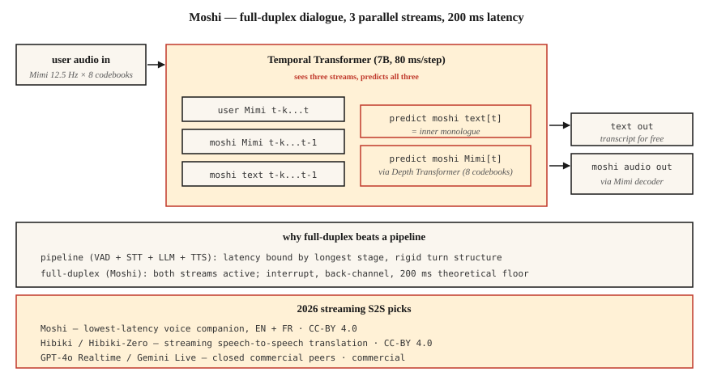

# 流式语音到语音：Moshi、Hibiki 与全双工对话

> 2024-2026 年重新定义了 voice AI。Moshi 用一个模型同时听和说，延迟 200 ms。Hibiki 逐 chunk 做 speech-to-speech translation。二者都放弃了 ASR → LLM → TTS pipeline，转向基于 Mimi codec tokens 的统一 full-duplex 架构。这是新的参考设计。

**Type:** Learn
**Languages:** Python
**Prerequisites:** Phase 6 · 13 (Neural Audio Codecs), Phase 6 · 11 (Real-Time Audio), Phase 7 · 05 (Full Transformer)
**Time:** ~75 minutes

## 问题

每个由 Lesson 11 + 12 构建的 voice agent 都有一个基础 latency floor，大约 300-500 ms：VAD 触发，STT 处理，LLM 推理，TTS 生成。每个 stage 都有自己的最小延迟。你可以调优和并行化，但 pipeline 形状本身会限制上限。

Moshi（Kyutai，2024-2026）问了另一个问题：如果根本没有 pipeline 呢？如果一个模型直接吃音频、直接吐音频，持续运行，而 text 只是中间的“inner monologue”，不是必需 stage 呢？

答案就是 **full-duplex speech-to-speech**。理论 latency 是 160 ms（80 ms Mimi frame + 80 ms acoustic delay）。单张 L4 GPU 上的实际 latency 是 200 ms。这大约是最佳 pipelined voice agent 的一半。

## 概念



### Moshi 架构

**Inputs。** 两条 Mimi codec streams，二者都是 12.5 Hz x 8 codebooks：

- Stream 1：用户音频（Mimi-encoded，持续到达）
- Stream 2：Moshi 自己的音频（由 Moshi 生成）

**The transformer。** 一个 7B 参数的 Temporal Transformer 同时处理两条 stream 和一条 text "inner monologue" stream。每个 80 ms step，它会：

1. 消费最新的 user Mimi tokens（8 个 codebooks）。
2. 消费最近的 Moshi Mimi tokens（8 个 codebooks，也就是已经生成出的部分）。
3. 生成下一个 Moshi text token（inner monologue）。
4. 通过一个小型 Depth Transformer 生成下一个 Moshi Mimi tokens（8 个 codebooks）。

三条 stream——user audio、Moshi audio、Moshi text——并行运行。Moshi 可以在说话时听用户；可以在用户打断时中断自己；也可以在不打断主句的情况下做 back-channel（"mhm"）。

**Depth transformer。** 在一个 frame 内，8 个 codebooks 不是并行预测的，因为它们之间有 inter-codebook dependencies。一个小型 2 层 "depth transformer" 会在 80 ms 内顺序预测它们。这是 AR codec LMs 的标准 factorization（VALL-E、VibeVoice 也使用）。

### 为什么 inner-monologue text 有帮助

如果没有显式 text，模型就必须在 acoustic stream 中隐式建模语言。Moshi 的洞察是：强制模型在输出音频的同时输出 text tokens。Text stream 本质上是 Moshi 正在说的话的 transcript。它会提升语义连贯性，让替换 language model head 更容易，并且免费给你 transcripts。

### Hibiki：流式语音到语音翻译

同样的架构，训练在 translation pairs 上。源语言音频进来，目标语言音频持续输出。Hibiki-Zero（2026 年 2 月）不再需要 word-level aligned training data，而是使用 sentence-level data + GRPO reinforcement learning 做 latency optimization。

初始支持 4 个 language pairs；用约 1000 小时数据可以适配到新语言。

### 更大的 Kyutai stack（2026）

- **Moshi** — full-duplex dialogue（French first，English well-supported）
- **Hibiki / Hibiki-Zero** — simultaneous speech translation
- **Kyutai STT** — streaming ASR（500 ms 或 2.5 s look-ahead）
- **Kyutai Pocket TTS** — 100M-param TTS，可在 CPU 上运行（2026 年 1 月）
- **Unmute** — 在 public servers 上组合这些能力的完整 pipeline

L40S GPU 上的 throughput：64 个并发 sessions，3x real-time。

### Sesame CSM：近亲

Sesame CSM（2025）使用类似思路：Llama-3 backbone + Mimi codec head。但 CSM 是单向的（输入 context + text，输出 speech），而不是 full-duplex。它是市场上最好的 "voice presence" TTS；但和 Moshi 的 full-duplex capability 不是同一类东西。

### 2026 性能数字

| Model | Latency | Use case | License |
|-------|---------|----------|---------|
| Moshi | 200 ms (L4) | full-duplex English / French dialogue | CC-BY 4.0 |
| Hibiki | 12.5 Hz framerate | French ↔ English streaming translation | CC-BY 4.0 |
| Hibiki-Zero | same | 5 language-pairs, no aligned data | CC-BY 4.0 |
| Sesame CSM-1B | 200 ms TTFA | context-conditioned TTS | Apache-2.0 |
| GPT-4o Realtime | ~300 ms | closed, OpenAI API | commercial |
| Gemini 2.5 Live | ~350 ms | closed, Google API | commercial |

## Build It

### Step 1：interface

Moshi 暴露一个 WebSocket server：接收 80 ms chunks 的 Mimi-encoded audio，并返回 80 ms chunks 的 Mimi-encoded audio。双向都是这样，持续不断。

```python
import asyncio
import websockets
from moshi.client_utils import encode_audio_mimi, decode_audio_mimi

async def moshi_chat():
    async with websockets.connect("ws://localhost:8998/api/chat") as ws:
        mic_task = asyncio.create_task(stream_mic_to(ws))
        spk_task = asyncio.create_task(stream_from_to_speaker(ws))
        await asyncio.gather(mic_task, spk_task)
```

### Step 2：full-duplex loop

```python
async def stream_mic_to(ws):
    async for chunk_80ms in mic_stream_at_12_5_hz():
        mimi_tokens = encode_audio_mimi(chunk_80ms)
        await ws.send(serialize(mimi_tokens))

async def stream_from_to_speaker(ws):
    async for msg in ws:
        mimi_tokens, text_token = deserialize(msg)
        audio = decode_audio_mimi(mimi_tokens)
        await play(audio)
```

两个方向同时运行。Python asyncio 或 Rust futures 是标准 transport。

### Step 3：training objective（概念）

对每个 80 ms frame `t`：

- Input：`user_mimi[0..t]`、`moshi_mimi[0..t-1]`、`moshi_text[0..t-1]`
- Predict：`moshi_text[t]`，然后是 `moshi_mimi[t, codebook_0..7]`

Text 在 audio 前预测（inner monologue）；audio 在 depth transformer 中按 codebook 顺序预测。

### Step 4：Moshi 赢在哪里，哪里不赢

Moshi 赢在：

- 便宜硬件上 sub-250 ms end-to-end。
- 自然的 back-channels 和 interruptions。
- 不需要 pipeline glue code。

Moshi 不赢在：

- Tool calling（没有针对它训练；需要单独的 LLM path）。
- Long reasoning（Moshi 是 8B-ish dialogue model，不是 Claude/GPT-4）。
- 小众主题上的 factual accuracy。
- 多数 production enterprise use cases（2026 年仍然使用 pipelines）。

## Use It

| Situation | Pick |
|-----------|------|
| Lowest-latency voice companion | Moshi |
| Live translation call | Hibiki |
| Voice demo / research | Moshi, CSM |
| Enterprise agent with tools | Pipeline（Lesson 12），不是 Moshi |
| Custom-voice TTS in context | Sesame CSM |
| Speech-to-speech, any languages | GPT-4o Realtime or Gemini 2.5 Live（commercial） |

## Pitfalls

- **Limited tool calling。** Moshi 是 dialogue model，不是 agent framework。需要工具时和 pipeline 组合。
- **Specific-voice conditioning。** Moshi 使用一个训练好的 persona；voice cloning 是单独的训练任务。
- **Language coverage。** French + English 很强；其他语言有限。Hibiki-Zero 有帮助，但你仍然需要训练数据。
- **Resource cost。** 一个完整 Moshi session 会占用一个 GPU slot；不是便宜的 shared-tenant deploy pattern。

## Ship It

保存为 `outputs/skill-duplex-pipeline.md`。它要能为 voice-agent workload 选择 pipeline 或 full-duplex architecture，并给出理由。

## 练习

1. **Easy。** 运行 `code/main.py`。它会用符号方式模拟 two-stream + inner-monologue 架构。
2. **Medium。** 从 HuggingFace 拉取 Moshi，运行 server，测试一轮对话。测量从用户说话结束到 Moshi 开始响应的 wall-clock latency。
3. **Hard。** 拿你的 Lesson 12 pipeline agent，与 Moshi 在 20 条匹配 test utterances 上比较 P50 latency。写清楚 pipeline 在什么情况下仍然会从架构上胜出。

## 关键术语

| 术语 | 常见说法 | 实际含义 |
|------|----------|----------|
| Full-duplex | 边听边说 | 同一个模型上同时激活两条 audio streams。 |
| Inner monologue | 模型的 text stream | Moshi 在输出 audio 的同时输出 text tokens。 |
| Depth transformer | Inter-codebook predictor | 在一个 80 ms frame 内预测 8 个 codebooks 的小型 transformer。 |
| Mimi | Kyutai 的 codec | 12.5 Hz x 8 codebooks；semantic+acoustic；驱动 Moshi。 |
| Streaming S2S | 实时 audio -> audio | 逐 chunk 翻译/对话，没有 pipeline stages。 |
| Back-channeling | "Mhm" 反应 | Moshi 可以发出短确认声，而不打断自己的 turn。 |

## 延伸阅读

- [Défossez et al. (2024). Moshi — speech-text foundation model](https://arxiv.org/html/2410.00037v2) — 论文。
- [Kyutai Labs (2026). Hibiki-Zero](https://arxiv.org/abs/2602.12345) — 没有 aligned data 的 streaming translation。
- [Sesame (2025). Crossing the uncanny valley of voice](https://www.sesame.com/research/crossing_the_uncanny_valley_of_voice) — CSM spec。
- [Kyutai — Moshi repo](https://github.com/kyutai-labs/moshi) — 安装与 server。
- [OpenAI — Realtime API](https://platform.openai.com/docs/guides/realtime) — closed commercial peer。
- [Kyutai — Delayed Streams Modeling](https://github.com/kyutai-labs/delayed-streams-modeling) — 底层 STT/TTS framework。
