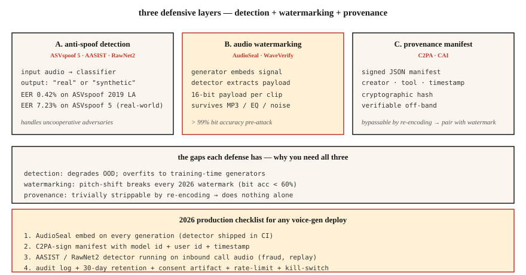

# 语音反欺骗与音频水印 — ASVspoof 5、AudioSeal、WaveVerify

> Voice cloning 上线得比防御更快。2026 年的 production voice systems 需要两样东西：一个 detector（AASIST、RawNet2），用来判断语音是真还是假；一个 watermark（AudioSeal），能撑过压缩和编辑。两者都上，否则就不要上线 voice cloning。

**Type:** Build
**Languages:** Python
**Prerequisites:** Phase 6 · 06 (Speaker Recognition), Phase 6 · 08 (Voice Cloning)
**Time:** ~75 minutes

## 问题

三种相关防御：

1. **Anti-spoofing / deepfake detection。** 给定一段音频，它是 synthetic 还是 real？ASVspoof benchmarks（ASVspoof 2019 → 2021 → 5）是 gold standard。
2. **Audio watermarking。** 在生成音频中嵌入不可感知的信号，之后 detector 可以提取出来。AudioSeal（Meta）和 WavMark 是开放选项。
3. **Authenticated provenance。** 对音频文件和 metadata 做 cryptographic signing。C2PA / Content Authenticity Initiative。

Detection 应对不配合的 adversaries。Watermarking 应对 compliance：AI-generated audio 应当能被识别为 AI 生成。2026 年两者都需要。

## 概念



### ASVspoof 5 — 2024-2025 benchmark

相比以往版本，最大的变化：

- **Crowdsourced data**（不是 studio clean）——更贴近真实条件。
- **约 2000 speakers**（之前约 100）。
- **32 attack algorithms。** TTS + voice conversion + adversarial perturbation。
- **Two tracks。** Countermeasure（CM）standalone detection；Spoofing-robust ASV（SASV）用于 biometric systems。

ASVspoof 5 上的 state-of-the-art：约 7.23% EER。较老的 ASVspoof 2019 LA 上是 0.42% EER。真实世界部署时：in-the-wild clips 上预期 5-10% EER。

### AASIST 和 RawNet2 — detection model families

**AASIST**（2021，持续更新到 2026）。对 spectral features 做 graph-attention。目前是 ASVspoof 5 countermeasure task 的 SOTA。

**RawNet2。** Raw waveform 上的 convolutional front-end + TDNN backbone。更简单的 baseline；fine-tuning 后仍有竞争力。

**NeXt-TDNN + SSL features。** 2025 变体：ECAPA-style + WavLM features + focal loss。在 ASVspoof 2019 LA 上达到 0.42% EER。

### AudioSeal — 2024 年默认水印方案

Meta 的 **AudioSeal**（2024 年 1 月，v0.2 于 2024 年 12 月发布）。关键设计：

- **Localized。** 以 16 kHz sample resolution（1/16000 s）逐 frame 检测 watermark。
- **Generator + detector jointly trained。** Generator 学习嵌入不可听信号；detector 学习在 augmentations 后找到它。
- **Robust。** 能撑过 MP3 / AAC compression、EQ、speed-shift ±10%、noise mix +10 dB SNR。
- **Fast。** Detector 以 485× realtime 运行；比 WavMark 快 1000×。
- **Capacity。** 每条 utterance 可嵌入 16-bit payload（可编码 model ID、generation timestamp、user ID）。

### WavMark

AudioSeal 之前的开放 baseline。Invertible neural network，32 bits/sec。问题：

- Synchronization brute-force 很慢。
- Gaussian noise 或 MP3 compression 可以移除它。
- 不适合 real-time。

### WaveVerify（2025 年 7 月）

针对 AudioSeal 的弱点，尤其是 temporal manipulations（reversal、speed）。它使用 FiLM-based generator + Mixture-of-Experts detector。在标准 attacks 上与 AudioSeal 有竞争力；还能处理 temporal edits。

### Adversaries 会利用的缺口

来自 AudioMarkBench："under pitch shift, all watermarks show Bit Recovery Accuracy below 0.6, indicating near-complete removal." **Pitch-shift 是通用攻击。** 2026 年没有任何 watermark 能完全抵抗 aggressive pitch modification。这就是为什么你需要在 watermarking 之外再加 detection（AASIST）。

### C2PA / Content Authenticity Initiative

这不是 ML 技术，而是一种 manifest format。Audio files 会携带关于 creation tool、author、date 的 cryptographically signed metadata。Audobox / Seamless 会用它。它适合 provenance；但如果 bad actor 重新编码并剥离 metadata，它就无能为力。

## Build It

### Step 1：简单 spectral-feature detector（toy）

```python
def spectral_rolloff(spec, percentile=0.85):
    cum = 0
    total = sum(spec)
    if total == 0:
        return 0
    threshold = total * percentile
    for k, v in enumerate(spec):
        cum += v
        if cum >= threshold:
            return k
    return len(spec) - 1

def is_suspicious(audio):
    spec = magnitude_spectrum(audio)
    rolloff = spectral_rolloff(spec)
    return rolloff / len(spec) > 0.92
```

Synthetic speech 往往有异常平坦的 high-frequency energy。Production detectors 用的是 AASIST，不是这个 toy detector。但这个直觉是成立的。

### Step 2：AudioSeal embed + detect

```python
from audioseal import AudioSeal
import torch

generator = AudioSeal.load_generator("audioseal_wm_16bits")
detector = AudioSeal.load_detector("audioseal_detector_16bits")

audio = load_wav("generated.wav", sr=16000)[None, None, :]
payload = torch.tensor([[1, 0, 1, 1, 0, 1, 0, 0, 1, 1, 0, 1, 0, 1, 1, 0]])
watermark = generator.get_watermark(audio, sample_rate=16000, message=payload)
watermarked = audio + watermark

result, decoded_payload = detector.detect_watermark(watermarked, sample_rate=16000)
# result: float in [0, 1] — probability of watermark presence
# decoded_payload: 16 bits; match against embedded payload
```

### Step 3：evaluation — EER

```python
def eer(real_scores, fake_scores):
    thresholds = sorted(set(real_scores + fake_scores))
    best = (1.0, 0.0)
    for t in thresholds:
        far = sum(1 for s in fake_scores if s >= t) / len(fake_scores)
        frr = sum(1 for s in real_scores if s < t) / len(real_scores)
        if abs(far - frr) < best[0]:
            best = (abs(far - frr), (far + frr) / 2)
    return best[1]
```

### Step 4：production integration

```python
def safe_tts(text, voice, clone_reference=None):
    if clone_reference is not None:
        verify_consent(user_id, clone_reference)
    audio = tts_model.synthesize(text, voice)
    audio_with_wm = audioseal_embed(audio, payload=build_payload(user_id, model_id))
    manifest = c2pa_sign(audio_with_wm, user_id, timestamp=now())
    return audio_with_wm, manifest
```

每次 generation 都必须带上：(1) watermark，(2) signed manifest，(3) 符合 retention policy 的 audit log。

## Use It

| Use case | Defense |
|----------|---------|
| Shipping TTS / voice cloning | 每个 output 都做 AudioSeal embed（non-negotiable） |
| Biometric voice unlock | AASIST + ECAPA ensemble；liveness challenge |
| Call-center fraud detection | 对 incoming calls 的 20% sample 跑 AASIST |
| Podcast authenticity | 上传时做 C2PA signing；AI-generated 时加 AudioSeal |
| Research / training detectors | ASVspoof 5 train/dev/eval sets |

## 常见陷阱

- **Watermark without detector ever running。** 没意义。把 detector 放进你的 CI。
- **Detection without calibration。** 在 ASVspoof LA 上训练的 AASIST 会 overfit；真实世界 accuracy 会下降。要在你的 domain 上 calibrate。
- **Pitch-shift gap。** Aggressive pitch shift 会移除大多数 watermarks。准备 detection fallback。
- **Metadata strip-and-rehost。** C2PA 很容易被重新编码绕过。始终把 cryptographic defense 和 perceptual defense（watermark）一起上。
- **Liveness as detection。** 让用户说一句随机短语。它能防 replay attacks，但防不住 real-time cloning。

## Ship It

保存为 `outputs/skill-spoof-defender.md`。为 voice-gen deployment 选择 detection model、watermark、provenance manifest 和 operational playbook。

## 练习

1. **Easy。** 运行 `code/main.py`。在 synthetic audio 上跑 toy detector + toy watermark embed/detect。
2. **Medium。** 安装 `audioseal`，在一个 TTS output 中嵌入 16-bit payload，再解码。用 noise 破坏音频并测量 Bit Recovery Accuracy。
3. **Hard。** 在 ASVspoof 2019 LA 上 fine-tune RawNet2 或 AASIST。测量 EER。在 held-out 的 F5-TTS-generated clips 上测试，观察 OOD detection 如何退化。

## 关键术语

| Term | 大家常说 | 实际含义 |
|------|----------|----------|
| ASVspoof | benchmark | 两年一次的 challenge；2024 = ASVspoof 5。 |
| CM (countermeasure) | Detector | Classifier：real speech vs synthetic / converted。 |
| SASV | Speaker verif + CM | 集成 biometric + spoof detection。 |
| AudioSeal | Meta watermark | Localized、16-bit payload，比 WavMark 快 485×。 |
| Bit Recovery Accuracy | Watermark survival | Attack 后恢复出的 payload bits 比例。 |
| C2PA | Provenance manifest | 关于 creation / authorship 的 cryptographic metadata。 |
| AASIST | Detector family | 基于 graph-attention 的 anti-spoofing SOTA。 |

## 延伸阅读

- [Todisco et al. (2024). ASVspoof 5](https://dl.acm.org/doi/10.1016/j.csl.2025.101825) — 当前 benchmark。
- [Defossez et al. (2024). AudioSeal](https://arxiv.org/abs/2401.17264) — 默认 watermark 方案。
- [Chen et al. (2025). WaveVerify](https://arxiv.org/abs/2507.21150) — 用于 temporal attacks 的 MoE detector。
- [Jung et al. (2022). AASIST](https://arxiv.org/abs/2110.01200) — SOTA detection backbone。
- [AudioMarkBench (2024)](https://proceedings.neurips.cc/paper_files/paper/2024/file/5d9b7775296a641a1913ab6b4425d5e8-Paper-Datasets_and_Benchmarks_Track.pdf) — robustness evaluation。
- [C2PA specification](https://c2pa.org/specifications/specifications/) — provenance manifest format。
