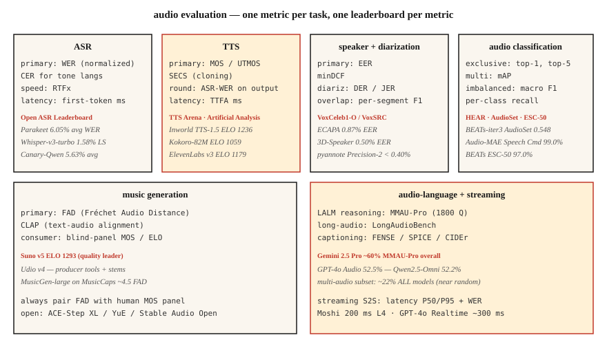

# 音频评估：WER、MOS、UTMOS、MMAU、FAD 与开放榜单

> 不能衡量，就不能上线。本课命名 2026 年每个音频任务的 metrics：ASR（WER、CER、RTFx）、TTS（MOS、UTMOS、SECS、WER-on-ASR-round-trip）、audio-language（MMAU、LongAudioBench）、music（FAD、CLAP）和 speaker（EER）。再加上你该去哪里比较的 leaderboards。

**Type:** Learn
**Languages:** Python
**Prerequisites:** Phase 6 · 04, 06, 07, 09, 10; Phase 2 · 09 (Model Evaluation)
**Time:** ~60 minutes

## 问题

每个音频任务都有多个 metrics，每个 metric 衡量不同轴。用错 metric，就会把一个 dashboard 上看起来很好、production 里很糟糕的模型上线。2026 年的 canonical list：

| Task | Primary | Secondary |
|------|---------|-----------|
| ASR | WER | CER · RTFx · first-token latency |
| TTS | MOS / UTMOS | SECS · WER-on-ASR-round-trip · CER · TTFA |
| Voice cloning | SECS (ECAPA cosine) | MOS · CER |
| Speaker verification | EER | minDCF · FAR / FRR at operating point |
| Diarization | DER | JER · speaker confusion |
| Audio classification | top-1 · mAP | macro F1 · per-class recall |
| Music generation | FAD | CLAP · listening panel MOS |
| Audio language model | MMAU-Pro | LongAudioBench · AudioCaps FENSE |
| Streaming S2S | latency P50/P95 | WER · MOS |

## 概念



### ASR metrics

**WER（Word Error Rate）。** `(S + D + I) / N`。Scoring 前先 lowercase、strip punctuation、normalize numbers。使用 `jiwer` 或 OpenAI 的 `whisper_normalizer`。低于 5% = human-parity read speech。

**CER（Character Error Rate）。** 同一个公式，但在 character-level 计算。用于 Mandarin、Cantonese 这类 word segmentation ambiguous 的 tone languages。

**RTFx（inverse real-time factor）。** 每个 wall-clock second 能处理多少 audio seconds。越高越好。Parakeet-TDT 达到 3380×。Whisper-large-v3 约 30×。

**First-token latency。** 从 audio input 到第一个 transcript token 的 wall-clock 时间。Streaming 中很关键。Deepgram Nova-3：约 150 ms。

### TTS metrics

**MOS（Mean Opinion Score）。** 1-5 human rating。Gold standard，但很慢。每个 sample 收集 20+ listeners，每个 model 100+ samples。

**UTMOS（2022-2026）。** 学出来的 MOS predictor。在标准 benchmark 上和 human MOS 相关性约 0.9。F5-TTS：UTMOS 3.95；ground truth：4.08。

**SECS（Speaker Encoder Cosine Similarity）。** 用于 voice cloning。Reference 和 cloned output 的 ECAPA embedding cosine。大于 0.75 = recognizable clone。

**WER-on-ASR-round-trip。** 把 TTS output 送进 Whisper，计算相对 input text 的 WER。能抓到 intelligibility regressions。2026 SOTA：低于 2% CER。

**TTFA（time-to-first-audio）。** Wall-clock latency。Kokoro-82M：约 100 ms；F5-TTS：约 1 s。

### Voice-cloning-specific

**SECS + MOS + CER** 三件套。SECS 高但 MOS 低，说明 timbre 对但不自然；反过来则说明声音自然但 speaker 错了。

### Speaker verification

**EER（Equal Error Rate）。** False Accept Rate 等于 False Reject Rate 时的 threshold。VoxCeleb1-O 上的 ECAPA：0.87%。

**minDCF（min Detection Cost）。** 选定 operating point（通常 FAR=0.01）下的 weighted cost。比 EER 更贴近 production。

### Diarization

**DER（Diarization Error Rate）。** `(FA + Miss + Confusion) / total_speaker_time`。Missed speech + false-alarm speech + speaker-confusion，各自作为 fraction。AMI meetings：DER ~10-20% 是现实水平。pyannote 3.1 + Precision-2 commercial 在录音良好的音频上可低于 10% DER。

**JER（Jaccard Error Rate）。** DER 的替代指标，对 short-segment bias 更稳健。

### Audio classification

Multi-label：所有 classes 上的 **mAP（mean Average Precision）**。AudioSet：BEATs-iter3 为 0.548 mAP。

Multi-class exclusive：**top-1、top-5 accuracy**。Speech Commands v2：Audio-MAE 达到 99.0% top-1。

Imbalanced：**macro F1** + **per-class recall**。报告 per-class，aggregate accuracy 会隐藏哪些 classes 失败。

### Music generation

**FAD（Fréchet Audio Distance）。** Real audio 和 generated audio 的 VGGish-embedding distributions 之间的距离。MusicGen-small on MusicCaps：4.5。MusicLM：4.0。越低越好。

**CLAP Score。** 使用 CLAP embeddings 的 text-audio alignment score。大于 0.3 = reasonable alignment。

**Listening panel MOS。** 对 consumer-grade music 来说仍然是最终裁判。Suno v5 在 TTS Arena 上的 ELO 是 1293（来自 paired human preferences）。

### Audio-language benchmarks

**MMAU（Massive Multi-Audio Understanding）。** 10k audio-QA pairs。

**MMAU-Pro。** 1800 个 hard items，四类：speech / sound / music / multi-audio。4-way random chance 为 25%。Gemini 2.5 Pro overall 约 60%；所有模型在 multi-audio 上约 22%。

**LongAudioBench。** Multi-minute clips + semantic queries。Audio Flamingo Next 超过 Gemini 2.5 Pro。

**AudioCaps / Clotho。** Captioning benchmarks。SPICE、CIDEr、FENSE metrics。

### Streaming speech-to-speech

**Latency P50 / P95 / P99。** 从 end-of-user-speech 到 first audible response 的 wall-clock。Moshi：200 ms；GPT-4o Realtime：300 ms。

**WER / MOS** on the output。

**Barge-in responsiveness。** 从用户打断到 assistant 静音的时间。Target 小于 150 ms。

### 2026 leaderboards

| Leaderboard | Tracks | URL |
|------------|--------|-----|
| Open ASR Leaderboard (HF) | English + multilingual + long-form | `huggingface.co/spaces/hf-audio/open_asr_leaderboard` |
| TTS Arena (HF) | English TTS | `huggingface.co/spaces/TTS-AGI/TTS-Arena` |
| Artificial Analysis Speech | TTS + STT, ELO from paired votes | `artificialanalysis.ai/speech` |
| MMAU-Pro | LALM reasoning | `mmaubenchmark.github.io` |
| SpeakerBench / VoxSRC | Speaker recognition | `voxsrc.github.io` |
| MMAU music subset | Music LALM | (within MMAU) |
| HEAR benchmark | Self-supervised audio | `hearbenchmark.com` |

## Build It

### Step 1：带 normalization 的 WER

```python
from jiwer import wer, Compose, ToLowerCase, RemovePunctuation, Strip

transform = Compose([ToLowerCase(), RemovePunctuation(), Strip()])
score = wer(
    truth="Please turn on the lights.",
    hypothesis="please turn on the light",
    truth_transform=transform,
    hypothesis_transform=transform,
)
# ~0.17
```

### Step 2：TTS round-trip WER

```python
def ttr_wer(tts_model, asr_model, texts):
    errors = []
    for txt in texts:
        audio = tts_model.synthesize(txt)
        recog = asr_model.transcribe(audio)
        errors.append(wer(truth=txt, hypothesis=recog))
    return sum(errors) / len(errors)
```

### Step 3：voice cloning 的 SECS

```python
from speechbrain.inference.speaker import EncoderClassifier
sv = EncoderClassifier.from_hparams("speechbrain/spkrec-ecapa-voxceleb")

emb_ref = sv.encode_batch(load_wav("reference.wav"))
emb_clone = sv.encode_batch(load_wav("cloned.wav"))
secs = torch.nn.functional.cosine_similarity(emb_ref, emb_clone, dim=-1).item()
```

### Step 4：music generation 的 FAD

```python
from frechet_audio_distance import FrechetAudioDistance
fad = FrechetAudioDistance()
score = fad.get_fad_score("generated_folder/", "reference_folder/")
```

### Step 5：speaker verification 的 EER（同 Lesson 6 代码）

```python
def eer(same_scores, diff_scores):
    thresholds = sorted(set(same_scores + diff_scores))
    best = (1.0, 0.0)
    for t in thresholds:
        far = sum(1 for s in diff_scores if s >= t) / len(diff_scores)
        frr = sum(1 for s in same_scores if s < t) / len(same_scores)
        if abs(far - frr) < best[0]:
            best = (abs(far - frr), (far + frr) / 2)
    return best[1]
```

## Use It

每次 deploy 都配一个固定 eval harness，并且在每次 model update 上运行。三条核心规则：

1. **Normalize before scoring。** Lowercase、punctuation-strip、number-expand。报告 normalization rule。
2. **Report distributions, not averages。** Latency 报 P50/P95/P99。Classification 报 per-class recall。MMAU 报 per-category。
3. **Run one canonical public benchmark。** 即使 production data 不同，报告 Open ASR / TTS Arena / MMAU 能让 reviewers apples-to-apples 比较。

## 坑

- **UTMOS extrapolation。** 它是在 VCTK-style clean speech 上训练的；对 noisy / cloned / emotional audio 打分很差。
- **MOS panel bias。** 20 个 Amazon Mechanical Turk workers 不等于 20 个 target users。高风险场景请付费找 domain panel。
- **FAD depends on reference set。** 跨模型比较时必须使用同一个 reference distribution。
- **Aggregate WER。** Overall 5% WER 可能隐藏 accented speech 上的 30% WER。按 demographic slice 报告。
- **Public benchmark saturation。** 大多数 frontier models 已接近标准 benchmark 的天花板。构建一个反映你真实 traffic 的 in-house held-out set。

## Ship It

保存为 `outputs/skill-audio-evaluator.md`。为任何 audio model release 选择 metrics、benchmarks 和 reporting format。

## 练习

1. **Easy。** 运行 `code/main.py`。在 toy inputs 上计算 WER / CER / EER / SECS / FAD-ish / MMAU-ish。
2. **Medium。** 构建一个 TTS round-trip WER harness。把你的 Kokoro 或 F5-TTS output 跑进 Whisper。对 50 个 prompts 计算 WER。标记 WER 大于 10% 的 prompts。
3. **Hard。** 在 MMAU-Pro speech + multi-audio subsets（各 50 items）上评估你在 Lesson 10 选择的 LALM。报告 per-category accuracy，并和 published number 比较。

## 关键术语

| Term | 人们通常怎么说 | 它实际是什么意思 |
|------|----------------|------------------|
| WER | ASR score | Normalization 后 word level 的 `(S+D+I)/N`。 |
| CER | Character WER | 用于 tone languages 或 char-level systems。 |
| MOS | Human opinion | 1-5 rating；20+ listeners × 100 samples。 |
| UTMOS | ML MOS predictor | Learned model；和 human MOS 相关性约 0.9。 |
| SECS | Voice-clone similarity | Reference 和 clone 之间的 ECAPA cosine。 |
| EER | Speaker verif score | FAR = FRR 时的 threshold。 |
| DER | Diarization score | (FA + Miss + Confusion) / total。 |
| FAD | Music-gen quality | VGGish embeddings 上的 Fréchet distance。 |
| RTFx | Throughput | 每个 wall-clock second 处理的 audio seconds。 |

## 延伸阅读

- [jiwer](https://github.com/jitsi/jiwer) — 带 normalization utilities 的 WER/CER library。
- [UTMOS (Saeki et al. 2022)](https://arxiv.org/abs/2204.02152) — learned MOS predictor。
- [Fréchet Audio Distance (Kilgour et al. 2019)](https://arxiv.org/abs/1812.08466) — music-gen standard。
- [Open ASR Leaderboard](https://huggingface.co/spaces/hf-audio/open_asr_leaderboard) — 2026 live rankings。
- [TTS Arena](https://huggingface.co/spaces/TTS-AGI/TTS-Arena) — human-vote TTS leaderboard。
- [MMAU-Pro benchmark](https://mmaubenchmark.github.io/) — LALM reasoning leaderboard。
- [HEAR benchmark](https://hearbenchmark.com/) — audio SSL benchmarks。
