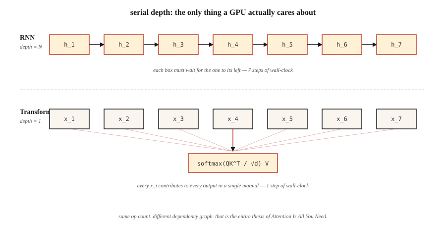

# 为什么是 Transformer — RNN 的问题

> RNN 一次处理一个 token。Transformer 一次处理所有 token。这个单一的架构押注，改变了 2017 年之后深度学习里的每条 scaling curve。

**Type:** Learn
**Languages:** Python
**Prerequisites:** Phase 3 (Deep Learning Core), Phase 5 · 09 (Sequence-to-Sequence), Phase 5 · 10 (Attention Mechanism)
**Time:** ~45 minutes

## 问题

2017 年之前，地球上每个最先进的序列模型，无论是语言、翻译还是语音，都是 recurrent neural network。LSTM 和 GRU 在相当于 ImageNet 地位的翻译基准上赢了半个十年。它们是当时唯一可用的工具。

它们有三个致命弱点。Sequential computation 意味着你无法沿时间轴并行：token `t+1` 需要 token `t` 的 hidden state。一个 1,024-token 序列意味着 GPU 上必须执行 1,024 个串行步骤，而 GPU 每个周期可以做 1,000,000 次浮点运算。训练 wall-clock time 会随序列长度线性增长，而硬件本来是为并行设计的。

Vanishing gradients 意味着 50 个 token 之前的信息，已经被压过 50 层非线性。Gated recurrent units（LSTM、GRU）缓解了这种挤压，但从未消除它。Long-range dependencies，比如 “the book I read last summer on a plane to Kyoto was…” 这类结构，经常失败。

Fixed-width hidden states 意味着 encoder 必须先把整个源序列挤进一个向量，decoder 才能看到它。不管源序列是 5 个 token 还是 500 个 token，瓶颈都是同一个形状。

2017 年论文 “Attention Is All You Need” 提出了一个激进想法：完全丢掉 recurrence。让每个位置并行地 attend to 每个其它位置。用一次大的矩阵乘法训练，而不是 1,024 次串行计算。

到 2026 年，这个结果已经统治所有模态。语言（GPT-5、Claude 4、Llama 4）、视觉（ViT、DINOv2、SAM 3）、音频（Whisper）、生物学（AlphaFold 3）、机器人（RT-2）。同一个 block，不同输入。

## 概念



**Recurrence as a bottleneck（循环作为瓶颈）。** RNN 计算 `h_t = f(h_{t-1}, x_t)`。每一步都依赖前一步。你不能在 `h_4` 之前计算 `h_5`。在拥有 10,000+ 并行核心的现代 GPU 上，长序列会浪费 99% 的硅片。

**Attention as a broadcast（attention 作为广播）。** Self-attention 会为每一对 `(i, j)` 同时计算 `output_i = sum_j(a_ij * v_j)`。整个 N×N attention matrix 在一次 batched matmul 中填满。没有一步依赖另一步。GPU 喜欢这种形状。

**加速不是一个常数。** 它是 `O(N)` serial depth 与 `O(1)` serial depth 的差异。实践中，在 N=512 且硬件相同的情况下，transformer 每个 epoch 的训练速度通常快 5-10 倍；随着序列长度增长，这个差距会继续扩大，直到你撞上 attention 的 `O(N²)` memory wall（后来 Flash Attention 修补了这个问题，见 Lesson 12）。

**Transformer 的代价。** Attention memory 按 `O(N²)` 缩放。2K context 没问题。128K context 就需要 sliding windows、RoPE extrapolation、Flash Attention tiling，或者 linear attention 变体。Recurrence 在时间和内存上都是 `O(N)`；transformer 用内存换时间，再通过并行把时间赢回来。

**Inductive bias shift（归纳偏置转变）。** RNN 假设 locality 和 recency。Transformer 什么都不假设，每一对位置都可能产生 attention。这就是为什么 transformer 需要更多数据才能训好，但一旦有足够数据就能扩得更远。Chinchilla (2022) 将这一点形式化：给定足够 token，同参数量 transformer 总会击败 RNN。

## 动手构建

这里没有神经网络。我们用数值方式模拟核心瓶颈，让你在自己的笔记本上感受到差距。

### Step 1：测量 serial depth

见 `code/main.py`。我们构建两个函数。一个把序列编码为加法链（串行，像 RNN）。另一个把序列编码为并行 reduction（广播，像 attention）。数学相同，dependency graph 不同。

```python
def rnn_style(xs):
    h = 0.0
    for x in xs:
        h = 0.9 * h + x   # can't parallelize: h depends on previous h
    return h

def attention_style(xs):
    return sum(xs) / len(xs)  # every x is independent
```

我们会在最高 100,000 个元素的序列上计时。RNN 版本是 O(N)，而且跑在单个 CPU pipeline 上。即使在纯 Python 中，attention-style reduction 也会在长度 ≥ 1,000 时胜出，因为 Python 的 `sum()` 用 C 实现，迭代时不会在每一步都付出解释器开销。

### Step 2：计算理论操作数

两个算法都做 N 次加法。差异在于 *dependency depth*：下一个操作开始之前，必须顺序完成多少操作。RNN depth = N。Attention depth = 使用 tree reduction 时的 log(N)，或者使用 parallel scan 时的 1。决定 GPU 时间的是 depth，而不是 op count。

### Step 3：长序列上的经验缩放

我们会打印一个 timing table，让 O(N) 差距可见。在 2026 年的 Mac 笔记本上，1,000 个元素以下的序列太快，很难测量。100,000 级别的序列会显示清晰的线性扫描。把它扩展到一个 16,384-token transformer，再对比 12-layer LSTM 等价物，你就会看到为什么训练 wall-clock 在 2016 年是阻塞点。

## 使用它

2026 年什么时候仍然选择 RNN：

| Situation | Pick |
|-----------|------|
| 流式推理，一次一个 token，常量内存 | RNN 或 state-space model（Mamba、RWKV） |
| 超长序列（>1M tokens），attention memory 爆炸 | Linear attention、Mamba 2、Hyena |
| 没有 matmul accelerator 的边缘设备 | Depthwise-separable RNN 在 FLOPs/watt 上仍然胜出 |
| 其它所有情况（训练、batched inference、最高 128K context） | Transformer |

Mamba 这样的 state-space models（SSMs）本质上是带结构化参数化的 RNN，同时获得两边优点：`O(N)` scan memory，以及通过 selective scan 实现并行训练。它们以更好的 long-context scaling 恢复了 transformer 质量的 90%。到 2026 年，大多数前沿实验室都在训练 hybrid SSM+transformer models（例如 Jamba、Samba）——recurrence 没有死，它变成了一个组件。

## 交付它

见 `outputs/skill-architecture-picker.md`。这个 skill 会根据长度、吞吐量和训练预算约束，为新的序列问题选择架构。对于超过 1B tokens 的训练运行，它必须始终拒绝推荐纯 RNN，除非明确说明取舍。

## 练习

1. **Easy.** 取 `code/main.py` 中的 `rnn_style`，把标量 hidden state 替换成长度为 64 的 hidden-state 向量。重新测量。串行开销会随着 hidden-state dimension 增长多少？
2. **Medium.** 用纯 Python 实现 parallel prefix-sum（Hillis-Steele scan）。验证它在长度 1024 时产生的数值输出与 serial scan 相同。计算 depth。
3. **Hard.** 把 attention-style reduction 移植到 GPU 上的 PyTorch。扫描序列长度 64 到 65,536，计时两者。绘制并解释曲线形状。

## 关键术语

| Term | What people say | What it actually means |
|------|-----------------|-----------------------|
| Recurrence | “RNN 是串行的” | step `t` 依赖 step `t-1` 的计算，迫使时间轴上串行执行。 |
| Serial depth | “计算图有多深” | 最长依赖操作链；即使硬件无限，也会限制 wall-clock。 |
| Attention | “让 token 彼此查看” | 加权和 `sum_j a_ij v_j`，其中 `a_ij` 来自位置 i 和 j 之间的相似度分数。 |
| Context window | “模型能看到多少” | attention layer 能接受的 position 数量；二次内存成本沿这里缩放。 |
| Inductive bias | “架构里内置的假设” | 关于数据形态的先验；CNN 假设平移不变性，RNN 假设近因性。 |
| State-space model | “背后有代数的 RNN” | 通过结构化 state-space matrices 参数化 recurrence，以支持并行训练。 |
| Quadratic bottleneck | “为什么 context 这么贵” | Attention memory = 序列长度上的 `O(N²)`；Flash Attention 隐藏常数，不改变缩放。 |

## 延伸阅读

- [Vaswani et al. (2017). Attention Is All You Need](https://arxiv.org/abs/1706.03762) — 让主流 NLP 放弃 recurrence 的论文。
- [Bahdanau, Cho, Bengio (2014). Neural MT by Jointly Learning to Align and Translate](https://arxiv.org/abs/1409.0473) — attention 诞生之处，当时还外挂在 RNN 上。
- [Hochreiter, Schmidhuber (1997). Long Short-Term Memory](https://www.bioinf.jku.at/publications/older/2604.pdf) — 原始 LSTM 论文，留作记录。
- [Gu, Dao (2023). Mamba: Linear-Time Sequence Modeling with Selective State Spaces](https://arxiv.org/abs/2312.00752) — 面向 transformer 的现代 recurrent 回答。
