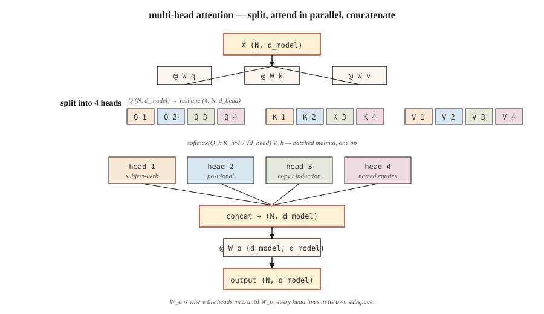

# 多头注意力

> 一个 attention head 一次学习一种关系。八个 heads 就能学习八种。Heads 很便宜，多用一些。

**Type:** Build
**Languages:** Python
**Prerequisites:** Phase 7 · 02 (Self-Attention from Scratch)
**Time:** ~75 minutes

## 问题

单个 self-attention head 会计算一个 attention matrix。这个矩阵捕捉一种关系，通常是训练信号下最能降低 loss 的那一种。如果你的数据里 subject-verb agreement、co-reference、long-range discourse 和 syntactic chunking 全部缠在一起，单个 head 会把它们揉进一个 softmax distribution，丢掉一半信号。

2017 年 Vaswani 论文给出的修复方式是：并行运行多个 attention functions，每个都有自己的 Q、K、V projections，然后把输出 concatenate。每个 head 都在一个更小的子空间里工作，维度是 `d_model / n_heads`。总参数量保持不变，表达能力上升。

Multi-head attention 是 2026 年每个 transformer 的默认组件。争论只剩两个：到底用多少 heads，以及 keys 和 values 是否共享 projections（Grouped-Query Attention、Multi-Query Attention、Multi-head Latent Attention）。

## 概念



**Split。** 取 shape 为 `(N, d_model)` 的 `X`。分别投影到 Q、K、V，每个 shape 都是 `(N, d_model)`。Reshape 成 `(N, n_heads, d_head)`，其中 `d_head = d_model / n_heads`。再 transpose 成 `(n_heads, N, d_head)`。

**并行 attend。** 在每个 head 内运行 scaled dot-product attention。每个 head 产生 `(N, d_head)`。这些 heads 在 embedding 的不同子空间上工作，在 attention computation 本身内部互不沟通。

**Concatenate and project。** 把 heads 堆回 `(N, d_model)`，再乘以一个 learned output matrix `W_o`，shape 为 `(d_model, d_model)`。`W_o` 是 heads 彼此混合的位置。

**为什么有效。** 每个 head 可以专门化，而不必和其他 heads 争抢 representation budget。2019-2024 年的 probing studies 显示出不同 head roles：positional heads、attend to previous token 的 heads、copy heads、named-entity heads、induction heads（in-context learning 的基础）。

**2026 年变体谱系：**

| Variant | Q heads | K/V heads | Used by |
|---------|---------|-----------|---------|
| Multi-head (MHA) | N | N | GPT-2, BERT, T5 |
| Multi-query (MQA) | N | 1 | PaLM, Falcon |
| Grouped-query (GQA) | N | G (e.g. N/8) | Llama 2 70B, Llama 3+, Qwen 2+, Mistral |
| Multi-head latent (MLA) | N | compressed to low-rank | DeepSeek-V2, V3 |

GQA 是现代默认选择，因为它能把 KV-cache memory 减少 `N/G` 倍，同时几乎保留完整质量。MLA 走得更远：先把 K/V 压缩进 latent space，再在计算时投影回来。它多花 FLOPs，但节省更多 memory。

```figure
multihead-split
```

## Build It

### Step 1：从已有 single-head attention 拆分 heads

拿 Lesson 02 里的 `SelfAttention`，用 split/concat 包起来。`code/main.py` 里有 numpy 实现；核心逻辑是：

```python
def split_heads(X, n_heads):
    n, d = X.shape
    d_head = d // n_heads
    return X.reshape(n, n_heads, d_head).transpose(1, 0, 2)  # (heads, n, d_head)

def combine_heads(H):
    h, n, d_head = H.shape
    return H.transpose(1, 0, 2).reshape(n, h * d_head)
```

一个 reshape，一个 transpose。没有 loop。这正是 PyTorch 在 `nn.MultiheadAttention` 内部做的事。

### Step 2：每个 head 运行 scaled-dot-product attention

每个 head 都拿到自己的 Q、K、V slice。Attention 变成 batched matmul：

```python
def mha_forward(X, W_q, W_k, W_v, W_o, n_heads):
    Q = X @ W_q
    K = X @ W_k
    V = X @ W_v
    Qh = split_heads(Q, n_heads)         # (heads, n, d_head)
    Kh = split_heads(K, n_heads)
    Vh = split_heads(V, n_heads)
    scores = Qh @ Kh.transpose(0, 2, 1) / np.sqrt(Qh.shape[-1])
    weights = softmax(scores, axis=-1)
    out = weights @ Vh                    # (heads, n, d_head)
    concat = combine_heads(out)
    return concat @ W_o, weights
```

在真实硬件上，`Qh @ Kh.transpose(...)` 是一次 `bmm`。GPU 看到的是一个 batched matmul，shape 为 `(heads, N, d_head) x (heads, d_head, N) -> (heads, N, N)`。增加 heads 几乎是免费的。

### Step 3：Grouped-Query Attention 变体

只有 key 和 value projections 会变化。Q 得到 `n_heads` 组；K 和 V 得到 `n_kv_heads < n_heads` 组，然后重复到和 Q 匹配：

```python
def gqa_project(X, W, n_kv_heads, n_heads):
    kv = split_heads(X @ W, n_kv_heads)       # (kv_heads, n, d_head)
    repeat = n_heads // n_kv_heads
    return np.repeat(kv, repeat, axis=0)      # (n_heads, n, d_head)
```

Inference 时这会节省 memory，因为 KV cache 中只保存 `n_kv_heads` 份，而不是 `n_heads` 份。Llama 3 70B 使用 64 个 query heads 和 8 个 KV heads，也就是 8x cache shrink。

### Step 4：probe 每个 head 学到了什么

在一个短句上运行 4-head MHA。对每个 head，打印 `(N, N)` attention matrix。即使是 random initialization，你也会看到不同 heads 选择不同结构：这部分是信号，部分来自子空间中的 rotational symmetry。

## Use It

PyTorch 中的一行版本：

```python
import torch.nn as nn

mha = nn.MultiheadAttention(embed_dim=512, num_heads=8, batch_first=True)
```

PyTorch 2.5+ 中的 GQA：

```python
from torch.nn.functional import scaled_dot_product_attention

# scaled_dot_product_attention auto-dispatches Flash Attention on CUDA.
# For GQA, pass Q of shape (B, n_heads, N, d_head) and K,V of shape
# (B, n_kv_heads, N, d_head). PyTorch handles the repeat.
out = scaled_dot_product_attention(q, k, v, is_causal=True, enable_gqa=True)
```

**多少 heads 合适？** 2026 年 production models 的经验法则：

| Model size | d_model | n_heads | d_head |
|------------|---------|---------|--------|
| Small (~125M) | 768 | 12 | 64 |
| Base (~350M) | 1024 | 16 | 64 |
| Large (~1B) | 2048 | 16 | 128 |
| Frontier (~70B) | 8192 | 64 | 128 |

`d_head` 几乎总是落在 64 或 128。它表示一个 head 能“看到”多少信息。低于 32 时，heads 会开始和 scaling factor `sqrt(d_head)` 打架；高于 256 时，你会失去“许多小专家”的好处。

## Ship It

见 `outputs/skill-mha-configurator.md`。这个 skill 会基于 parameter budget、sequence length 和 deployment target，为新的 transformer 推荐 head count、kv-head count 和 projection strategy。

## 练习

1. **Easy。** 取 `code/main.py` 中的 MHA，在固定 `d_model=64` 的情况下把 `n_heads` 从 1 改到 16。画出一个 tiny one-layer model 在 synthetic copy task 上的 loss。更多 heads 是有帮助、进入平台，还是有害？
2. **Medium。** 实现 MQA（所有 query heads 共享一个 KV head）。测量相对 full MHA，parameter count 降了多少。计算 inference 时 N=2048 下 KV-cache size 缩小多少。
3. **Hard。** 实现一个 tiny 版 Multi-head Latent Attention：把 K,V 压缩到 rank-`r` latent，把 latent 存进 KV cache，在 attention time 解压。`r` 到多少时，cache memory 低于 full MHA 的 1/8，同时质量仍保持在 validation ppl 的 1 bit 以内？

## 关键术语

| 术语 | 常见说法 | 实际含义 |
|------|----------|----------|
| Head | “一个 attention circuit” | 一个维度为 `d_head = d_model / n_heads` 的 Q/K/V projection，并拥有自己的 attention matrix。 |
| d_head | “Head dimension” | 每个 head 的 hidden width；production 中几乎总是 64 或 128。 |
| Split / combine | “Reshape tricks” | attention 前后围绕 `(N, d_model) <-> (n_heads, N, d_head)` 做 reshape+transpose。 |
| W_o | “Output projection” | concatenate heads 后应用的 `(d_model, d_model)` 矩阵；heads 在这里混合。 |
| MQA | “One KV head” | Multi-Query Attention：单个共享 K/V projection。KV cache 最小，但有一些质量损失。 |
| GQA | “Llama 2 之后的默认选择” | Grouped-Query Attention，满足 `n_kv_heads < n_heads`，并重复到和 Q 匹配。 |
| MLA | “DeepSeek 的技巧” | Multi-head Latent Attention：K,V 压缩到 low-rank latent，attend 时再解压。 |
| Induction head | “in-context learning 背后的 circuit” | 一对 heads：检测前文重复出现的位置，并复制其后续内容。 |

## 延伸阅读

- [Vaswani et al. (2017). Attention Is All You Need §3.2.2](https://arxiv.org/abs/1706.03762) — 原始 multi-head spec。
- [Shazeer (2019). Fast Transformer Decoding: One Write-Head is All You Need](https://arxiv.org/abs/1911.02150) — MQA 论文。
- [Ainslie et al. (2023). GQA: Training Generalized Multi-Query Transformer Models from Multi-Head Checkpoints](https://arxiv.org/abs/2305.13245) — 如何在训练后把 MHA 转成 GQA。
- [DeepSeek-AI (2024). DeepSeek-V2 Technical Report](https://arxiv.org/abs/2405.04434) — MLA，以及为什么它在 cache memory 上优于 MHA/GQA。
- [Olsson et al. (2022). In-context Learning and Induction Heads](https://transformer-circuits.pub/2022/in-context-learning-and-induction-heads/index.html) — mechanistic 视角下 heads 实际在做什么。
