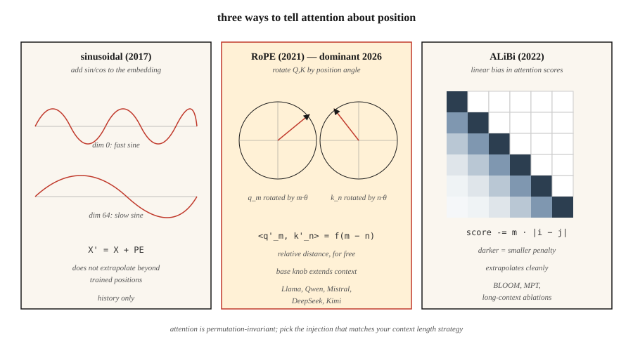

# 位置编码：Sinusoidal、RoPE、ALiBi

> Attention 对排列不敏感。如果没有位置信号，"The cat sat on the mat" 和 "mat the on sat cat the" 会产生相同输出。三个算法修复这个问题，每个算法都对“位置”到底意味着什么下注不同。

**Type:** Build
**Languages:** Python
**Prerequisites:** Phase 7 · 02 (Self-Attention), Phase 7 · 03 (Multi-Head Attention)
**Time:** ~45 minutes

## 问题

Scaled dot-product attention 是 order-blind 的。Attention matrix `softmax(Q K^T / √d) V` 来自 pairwise similarities。把 `X` 的 rows 打乱，输出的 rows 也会以同样方式被打乱。Attention 内部没有任何东西关心 position。

这在 bag-of-words model 里不是 bug。但对 language、code、audio、video，也就是任何 order 携带意义的东西来说，这是致命的。

修复办法是以某种方式把 position 注入 embeddings。三个时代的答案：

1. **Absolute sinusoidal**（Vaswani 2017）。把 position 的 `sin/cos` 加到 embedding 上。简单、无需学习参数，但超出训练长度后的 extrapolation 很差。
2. **RoPE — Rotary Position Embeddings**（Su 2021）。按与 position 成比例的角度旋转 Q 和 K vectors。在 dot product 中直接编码*相对*位置。2026 年的主流。
3. **ALiBi — Attention with Linear Biases**（Press 2022）。完全跳过 embeddings；根据距离给 attention scores 加 per-head linear penalty。Length extrapolation 很强。

截至 2026 年，几乎所有 frontier open model 都使用 RoPE：Llama 2/3/4、Qwen 2/3、Mistral、Mixtral、DeepSeek-V3、Kimi。少数 long-context models 使用 ALiBi 或它的现代变体。Absolute sinusoidal 已经是历史方案。

## 概念



### Absolute sinusoidal

预先计算一个形状为 `(max_len, d_model)` 的固定矩阵 `PE`：

```text
PE[pos, 2i]   = sin(pos / 10000^(2i / d_model))
PE[pos, 2i+1] = cos(pos / 10000^(2i / d_model))
```

然后在 attention 前执行 `X' = X + PE[:N]`。每个维度都是不同频率的 sinusoid。模型学习从 phase pattern 中读出 position。它在 `max_len` 之外会失败：如果模型只见过 positions 0-2047，就没有任何东西告诉它 position 2048 会发生什么。

### RoPE

旋转 Q 和 K vectors（不是 embeddings）。对于一对维度 `(2i, 2i+1)`：

```text
[q'_2i    ]   [ cos(pos·θ_i)  -sin(pos·θ_i) ] [q_2i   ]
[q'_2i+1  ] = [ sin(pos·θ_i)   cos(pos·θ_i) ] [q_2i+1 ]

θ_i = base^(-2i / d_head),  base = 10000 by default
```

对 position 为 `pos_k` 的 keys 应用同样的旋转。Dot product `q'_m · k'_n` 会变成只关于 `(m - n)` 的函数。也就是说：**attention score 只依赖相对距离**，虽然旋转本身是由 absolute positions keyed 的。漂亮的技巧。

扩展 RoPE：可以缩放 `base`（NTK-aware、YaRN、LongRoPE），在不重新训练的情况下 extrapolate 到更长 contexts。Llama 3 就是用这种方式从 8K 扩展到 128K context。

### ALiBi

跳过 embedding 技巧，直接 bias attention scores：

```text
attn_score[i, j] = (q_i · k_j) / √d  -  m_h · |i - j|
```

其中 `m_h` 是 head-specific slope（例如 `1 / 2^(8·h/H)`）。更近的 tokens 被 boost，更远的 tokens 被 penalize。没有训练时成本。论文显示它的 length extrapolation 超过 sinusoidal，并且在原训练长度上与 RoPE 持平。

### 2026 年该选什么

| Variant | Extrapolation | Training cost | Used by |
|---------|---------------|---------------|---------|
| Absolute sinusoidal | poor | free | original transformer, early BERT |
| Learned absolute | none | tiny | GPT-2, GPT-3 |
| RoPE | good with scaling | free | Llama 2/3/4, Qwen 2/3, Mistral, DeepSeek-V3, Kimi |
| RoPE + YaRN | excellent | fine-tune stage | Qwen2-1M, Llama 3.1 128K |
| ALiBi | excellent | free | BLOOM, MPT, Baichuan |

RoPE 胜出，因为它能塞进 attention 而不改变 architecture，能编码 relative position，而且它的 `base` hyperparameter 给 long-context fine-tuning 留了一个干净的旋钮。

```figure
rope-explorer
```

## Build It

### Step 1：Sinusoidal encoding

见 `code/main.py`。4 行核心计算：

```python
def sinusoidal(N, d):
    pe = [[0.0] * d for _ in range(N)]
    for pos in range(N):
        for i in range(d // 2):
            theta = pos / (10000 ** (2 * i / d))
            pe[pos][2 * i]     = math.sin(theta)
            pe[pos][2 * i + 1] = math.cos(theta)
    return pe
```

在第一个 attention layer 前，把它加到 embedding matrix 上。

### Step 2：把 RoPE 应用到 Q、K

RoPE 会原地作用在 Q 和 K 上。对每一对 dims：

```python
def apply_rope(x, pos, base=10000):
    d = len(x)
    out = list(x)
    for i in range(d // 2):
        theta = pos / (base ** (2 * i / d))
        c, s = math.cos(theta), math.sin(theta)
        a, b = x[2 * i], x[2 * i + 1]
        out[2 * i]     = a * c - b * s
        out[2 * i + 1] = a * s + b * c
    return out
```

关键点：对 position `m` 的 Q 和 position `n` 的 K 应用同一个函数。它们的 dot product 会在每个 coordinate pair 上获得一个 `cos((m-n)·θ_i)` factor。Attention 免费学到 relative position。

### Step 3：ALiBi slopes 和 bias

```python
def alibi_bias(n_heads, seq_len):
    # slope_h = 2 ** (-8 * h / n_heads) for h = 1..n_heads
    slopes = [2 ** (-8 * (h + 1) / n_heads) for h in range(n_heads)]
    bias = []
    for m in slopes:
        row = [[-m * abs(i - j) for j in range(seq_len)] for i in range(seq_len)]
        bias.append(row)
    return bias  # add to attention scores before softmax
```

把 `bias[h]` 加到 head `h` 的 `(seq_len, seq_len)` attention score matrix 上，然后 softmax。

### Step 4：验证 RoPE 的 relative-distance property

选两个随机 vectors `a, b`。分别按 `(pos_a, pos_b)` 旋转，再按 `(pos_a + k, pos_b + k)` 旋转。两个 dot products 必须在 floating-point error 范围内相同。这个 property 就是 RoPE 的全部意义：它对 absolute offset 不变，只关心 relative gap。

## Use It

PyTorch 2.5+ 在 `torch.nn.functional` 中提供 RoPE utilities。多数 production code 使用 `flash_attn` 或 `xformers`，RoPE 会在 attention kernel 内应用。

```python
from transformers import AutoModel
model = AutoModel.from_pretrained("meta-llama/Llama-3.2-3B")
# model.config.rope_scaling → {"type": "yarn", "factor": 32.0, "original_max_position_embeddings": 8192}
```

**2026 年的 long-context tricks：**

- **NTK-aware interpolation。** 从 4K 扩展到 16K+ 时，把 `base` rescale 到 `base * (scale_factor)^(d/(d-2))`。
- **YaRN。** 更聪明的 interpolation，可以在 long contexts 上保留 attention entropy。Llama 3.1 128K 使用它。
- **LongRoPE。** Microsoft 2024 年的方法，用 evolutionary search 选择 per-dimension scale factors。Phi-3-Long 使用它。
- **Position interpolation + fine-tuning。** 直接按 extension factor 缩小 positions，然后 fine-tune 1-5B tokens。效果出人意料地好。

## Ship It

见 `outputs/skill-positional-encoding-picker.md`。这个 skill 会根据 target context length、extrapolation needs 和 training budget，为新模型选择 encoding strategy。

## 练习

1. **Easy。** 把 `max_len=512, d=128` 的 sinusoidal `PE` matrix 画成 heatmap。确认 "stripes get wider as dimension index grows" 的模式。
2. **Medium。** 实现 NTK-aware RoPE scaling。在长度 256 的 sequences 上训练一个 tiny LM，然后在长度 1024 上测试有无 scaling 的差异。测量 perplexity。
3. **Hard。** 在同一个 attention module 中实现 ALiBi 和 RoPE。用长度 512 的 sequences 在 copy task 上训练一个 4-layer transformer。测试时 extrapolate 到 2048。比较 degradation。

## 关键术语

| Term | 大家常说 | 实际含义 |
|------|----------|----------|
| Positional encoding | "Tells attention about order" | 添加到 embeddings 或 attention 中、用于编码 position 的任何信号。 |
| Sinusoidal | "The original one" | 按 geometric frequencies 的 `sin/cos` 加到 embeddings；不能 extrapolate。 |
| RoPE | "Rotary embeddings" | 按 position-dependent angle 旋转 Q、K；dot product 编码 relative distance。 |
| ALiBi | "Linear bias trick" | 给 attention scores 加 `-m·\|i-j\|`；无需 embedding，extrapolation 很强。 |
| base | "RoPE's knob" | RoPE 中的 frequency scaler；推理时增大它可扩展 context。 |
| NTK-aware | "A RoPE scaling trick" | Rescale `base`，避免 context 扩展时 high-frequency dims 被挤压。 |
| YaRN | "The fancy one" | Per-dimension interpolation+extrapolation，用来保留 attention entropy。 |
| Extrapolation | "Works beyond trained length" | Position scheme 能否在训练见过的 `max_len` 之外继续给出正确输出？ |

## 延伸阅读

- [Vaswani et al. (2017). Attention Is All You Need §3.5](https://arxiv.org/abs/1706.03762) — 原始 sinusoidal。
- [Su et al. (2021). RoFormer: Enhanced Transformer with Rotary Position Embedding](https://arxiv.org/abs/2104.09864) — RoPE 论文。
- [Press, Smith, Lewis (2021). Train Short, Test Long: Attention with Linear Biases Enables Input Length Extrapolation](https://arxiv.org/abs/2108.12409) — ALiBi。
- [Peng et al. (2023). YaRN: Efficient Context Window Extension of Large Language Models](https://arxiv.org/abs/2309.00071) — SOTA RoPE scaling。
- [Chen et al. (2023). Extending Context Window of Large Language Models via Positional Interpolation](https://arxiv.org/abs/2306.15595) — Meta 的 Llama 2 long-context paper。
- [Ding et al. (2024). LongRoPE: Extending LLM Context Window Beyond 2 Million Tokens](https://arxiv.org/abs/2402.13753) — Microsoft 方法，被 Phi-3-Long 使用，并在 Use It section 中引用。
- [HuggingFace Transformers — `modeling_rope_utils.py`](https://github.com/huggingface/transformers/blob/main/src/transformers/modeling_rope_utils.py) — 各种 RoPE scaling schemes（default、linear、dynamic、YaRN、LongRoPE、Llama-3）的 production-grade implementations。
