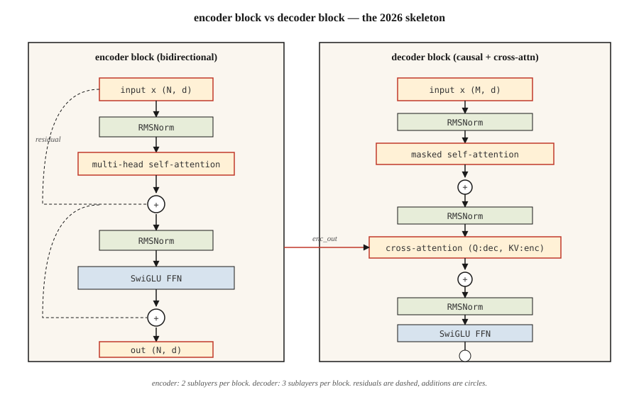

# 完整 Transformer：Encoder + Decoder

> Attention 是主角。其他东西：residuals、normalization、feed-forward、cross-attention，都是让你能把它堆深的脚手架。

**Type:** Build
**Languages:** Python
**Prerequisites:** Phase 7 · 02 (Self-Attention), Phase 7 · 03 (Multi-Head Attention), Phase 7 · 04 (Positional Encoding)
**Time:** ~75 minutes

## 问题

单个 attention layer 是 feature extractor，不是完整模型。每层一个 matmul 不足以承载语言建模能力。你需要 depth，而没有正确 plumbing 的 depth 会崩。

2017 年 Vaswani paper 把六个设计决策打包在一起，把一个 attention layer 变成了可堆叠的 block。之后每个 transformer：encoder-only（BERT）、decoder-only（GPT）、encoder-decoder（T5），都继承了同一个 skeleton。到 2026 年，这些 blocks 已被改良（RMSNorm、SwiGLU、pre-norm、RoPE），但 skeleton 完全相同。

本课讲 skeleton。后面的课会专门化它：06 讲 encoders，07 讲 decoders，08 讲 encoder-decoder。

## 概念



### 六个 pieces

1. **Embedding + positional signal。** Tokens → vectors。Position 通过 RoPE（modern）或 sinusoidal（classic）注入。
2. **Self-attention。** 每个 position attend 到所有其他 positions。Decoder 中会 masked。
3. **Feed-forward network（FFN）。** Position-wise 两层 MLP：`W_2 · activation(W_1 · x)`。默认 expansion ratio 是 4×。
4. **Residual connection。** `x + sublayer(x)`。没有它，超过约 6 层后 gradients 会 vanish。
5. **Layer normalization。** `LayerNorm` 或 `RMSNorm`（modern）。稳定 residual stream。
6. **Cross-attention（decoder only）。** Queries 来自 decoder，keys 和 values 来自 encoder output。

观察一个 vector 流过一个 block：attention 在 positions 之间混合信息，residual 把它向前携带，FFN 转换它，norm 让 stream 保持稳定。

```figure
transformer-block
```

### Encoder block（BERT、T5 encoder 使用）

```text
x → LN → MHA(self) → + → LN → FFN → + → out
                     ^              ^
                     |              |
                     └── residual ──┘
```

Encoder 是 bidirectional。没有 masking。所有 positions 都能看到所有 positions。

### Decoder block（GPT、T5 decoder 使用）

```text
x → LN → MHA(masked self) → + → LN → MHA(cross to encoder) → + → LN → FFN → + → out
```

Decoder 每个 block 有三个 sublayers。中间那个 cross-attention 是信息从 encoder 流向 decoder 的唯一位置。在纯 decoder-only 架构（GPT）中，cross-attention 被省略，只保留 masked self-attention + FFN。

### Pre-norm vs post-norm

Original paper：`x + sublayer(LN(x))` vs `LN(x + sublayer(x))`。Post-norm 在 2019 年左右失宠，因为没有仔细 warmup 时很难训练得很深。Pre-norm（`LN` 在 sublayer *之前*）是 2026 default：Llama、Qwen、GPT-3+、Mistral 都用它。

### 2026 modernized block

Vaswani 2017 使用 LayerNorm + ReLU。Modern stacks 把二者都换掉了。Production blocks 实际长这样：

| Component | 2017 | 2026 |
|-----------|------|------|
| Normalization | LayerNorm | RMSNorm |
| FFN activation | ReLU | SwiGLU |
| FFN expansion | 4× | 2.6×（SwiGLU 使用三个矩阵，总参数量相当） |
| Position | Sinusoidal absolute | RoPE |
| Attention | Full MHA | GQA（或 MLA） |
| Bias terms | Yes | No |

RMSNorm 去掉了 LayerNorm 的 mean-centering（少一次 subtraction），节省 compute，并且经验上至少同样稳定。SwiGLU（`Swish(W1 x) ⊙ W3 x`）在 Llama、PaLM 和 Qwen papers 中稳定比 ReLU/GELU FFN 好约 0.5 point ppl。

### Parameter count

对于一个 `d_model = d`、FFN expansion 为 `r` 的 block：

- MHA：`4 · d²`（Q、K、V、O projections）
- FFN（SwiGLU）：`3 · d · (r · d)` ≈ `3rd²`
- Norms：可忽略

在 `d = 4096, r = 2.6, layers = 32`（大致是 Llama 3 8B）时，总量级为：`32 · (4·4096² + 3·2.6·4096²)`，再加 embeddings 和 head，和公开参数量同阶。

## Build It

### Step 1：building blocks

使用 Lesson 03 中的小 `Matrix` class（为了独立性复制到本文件）：

- `layer_norm(x, eps=1e-5)`：减去 mean，除以 std。
- `rms_norm(x, eps=1e-6)`：除以 RMS。不减 mean。
- `gelu(x)` 和 `silu(x) * W3 x`（SwiGLU）。
- `ffn_swiglu(x, W1, W2, W3)`。
- `encoder_block(x, params)` 和 `decoder_block(x, enc_out, params)`。

完整 wiring 见 `code/main.py`。

### Step 2：接一个 2-layer encoder 和一个 2-layer decoder

把它们 stack 起来。把 encoder output 传入每一个 decoder cross-attention。在 output projection 前加 final LN。

```python
def encode(tokens, params):
    x = embed(tokens, params.emb) + sinusoidal(len(tokens), params.d)
    for block in params.encoder_blocks:
        x = encoder_block(x, block)
    return x

def decode(target_tokens, encoder_out, params):
    x = embed(target_tokens, params.emb) + sinusoidal(len(target_tokens), params.d)
    for block in params.decoder_blocks:
        x = decoder_block(x, encoder_out, block)
    return x
```

### Step 3：在 toy example 上跑 forward

喂入一个 6-token source 和一个 5-token target。验证 output shape 是 `(5, vocab)`。不训练，本课关注 architecture，不关注 loss。

### Step 4：换成 RMSNorm + SwiGLU

用 RMSNorm 和 SwiGLU 替换 LayerNorm 和 ReLU-FFN。确认 shapes 仍然匹配。这就是 2026 modernization，只需要替换一个函数。

## Use It

PyTorch/TF reference implementations：`nn.TransformerEncoderLayer`、`nn.TransformerDecoderLayer`。但大多数 2026 production code 会自己写 block，因为：

- Flash Attention 在 attention 内部调用，而不是通过 `nn.MultiheadAttention`。
- GQA / MLA 不在 stdlib reference 中。
- RoPE、RMSNorm、SwiGLU 不是 PyTorch defaults。

HF `transformers` 有干净的 reference blocks 值得阅读：`modeling_llama.py` 是 canonical 2026 decoder-only block。它大约 500 行，值得完整走读一次。

**Encoder vs decoder vs encoder-decoder：什么时候选哪个：**

| Need | Pick | Example |
|------|------|---------|
| Classification, embeddings, QA over text | Encoder-only | BERT, DeBERTa, ModernBERT |
| Text generation, chat, code, reasoning | Decoder-only | GPT, Llama, Claude, Qwen |
| Structured input → structured output (translation, summarization) | Encoder-decoder | T5, BART, Whisper |

Decoder-only 赢下 language，是因为它最容易 cleanly scale，并且同时处理 comprehension 和 generation。Encoder-decoder 在 input 有清晰 "source sequence" 身份时仍然最好（translation、speech recognition、structured tasks）。

## Ship It

查看 `outputs/skill-transformer-block-reviewer.md`。这个 skill 会按 2026 defaults review 一个新的 transformer block implementation，并标记缺失 pieces（pre-norm、RoPE、RMSNorm、GQA、FFN expansion ratio）。

## 练习

1. **Easy。** 在 `d_model=512, n_heads=8, ffn_expansion=4, swiglu=True` 时计算你的 `encoder_block` 参数量。实现 block 并用 `sum(p.numel() for p in block.parameters())` 验证。
2. **Medium。** 从 post-norm 切换到 pre-norm。初始化两者，并在 random input 上测量 stacked 12 layers 后的 activation norm。Post-norm 的 activations 应该 explode；pre-norm 应该保持 bounded。
3. **Hard。** 在 toy copy task（把 `x` 反向 copy）上实现一个 4-layer encoder-decoder。训练 100 steps。报告 loss。换成 RMSNorm + SwiGLU + RoPE，loss 会下降吗？

## 关键术语

| Term | 人们通常怎么说 | 它实际是什么意思 |
|------|----------------|------------------|
| Block | "One transformer layer" | 一组 norm + attention + norm + FFN，并用 residual connections 包起来。 |
| Residual | "Skip connection" | `x + f(x)` output；让 gradient 能穿过深层 stack。 |
| Pre-norm | "Normalize before, not after" | Modern：`x + sublayer(LN(x))`。不靠 warmup gymnastics 也能训练更深。 |
| RMSNorm | "LayerNorm without the mean" | 除以 RMS；少一个 op，经验稳定性相同。 |
| SwiGLU | "The FFN everyone switched to" | `Swish(W1 x) ⊙ W3 x → W2`。在 LM ppl 上胜过 ReLU/GELU。 |
| Cross-attention | "How the decoder sees the encoder" | Q 来自 decoder、K/V 来自 encoder outputs 的 MHA。 |
| FFN expansion | "How wide the middle MLP is" | Hidden-size 和 d_model 的比值，通常是 4（LayerNorm）或 2.6（SwiGLU）。 |
| Bias-free | "Drop the +b terms" | Modern stacks 省略 linear layers 中的 biases；ppl 略有改善，模型更小。 |

## 延伸阅读

- [Vaswani et al. (2017). Attention Is All You Need](https://arxiv.org/abs/1706.03762) — 原始 block spec。
- [Xiong et al. (2020). On Layer Normalization in the Transformer Architecture](https://arxiv.org/abs/2002.04745) — 为什么深层里 pre-norm 胜过 post-norm。
- [Zhang, Sennrich (2019). Root Mean Square Layer Normalization](https://arxiv.org/abs/1910.07467) — RMSNorm。
- [Shazeer (2020). GLU Variants Improve Transformer](https://arxiv.org/abs/2002.05202) — SwiGLU paper。
- [HuggingFace `modeling_llama.py`](https://github.com/huggingface/transformers/blob/main/src/transformers/models/llama/modeling_llama.py) — canonical 2026 decoder-only block。
