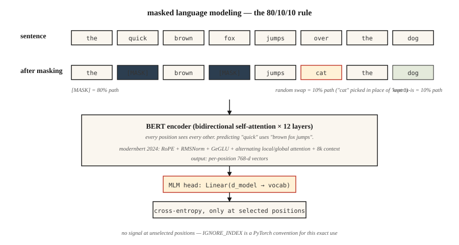

# BERT — Masked Language Modeling

> GPT 预测下一个词。BERT 预测缺失的词。只差一句话，却开启了半个十年的 embedding 时代。

**Type:** Build
**Languages:** Python
**Prerequisites:** Phase 7 · 05 (Full Transformer), Phase 5 · 02 (Text Representation)
**Time:** ~45 minutes

## 问题

2018 年，每个 NLP 任务，情感分析、NER、问答、蕴含判断，都要在自己的标注数据上从零训练自己的模型。还没有一个预训练好的“理解英语”checkpoint 可以拿来 fine-tune。ELMo (2018) 证明了你可以用 bidirectional LSTM 预训练 contextual embeddings；它有帮助，但泛化能力仍然有限。

BERT（Devlin et al. 2018）问了一个问题：如果我们拿一个 transformer encoder，在互联网上的每个句子上训练，并强迫它从两侧上下文预测缺失词，会怎样？然后，你只需要为下游任务 fine-tune 一个 head。参数效率带来的提升令人震惊。

结果是：18 个月内，BERT 及其变体（RoBERTa、ALBERT、ELECTRA）统治了当时存在的每个 NLP leaderboard。到 2020 年，地球上的每个搜索引擎、内容审核流水线和语义搜索系统，内部都有一个 BERT。

到 2026 年，encoder-only models 仍然是分类、检索和结构化抽取的正确工具。它们每个 token 的运行速度比 decoder 快 5-10 倍，而且它们的 embedding 是每个现代检索栈的骨干。ModernBERT（2024 年 12 月）用 Flash Attention + RoPE + GeGLU 把这个架构推到了 8K context。

## 概念



### 训练信号

取一个句子：`the quick brown fox jumps over the lazy dog`。

随机 mask 15% 的 token：

```text
input:  the [MASK] brown fox jumps [MASK] the lazy dog
target: the  quick brown fox jumps  over  the lazy dog
```

训练模型在 masked positions 上预测原始 token。因为 encoder 是 bidirectional，预测位置 1 的 `[MASK]` 时可以使用位置 2+ 的 `brown fox jumps`。这正是 GPT 做不到的事情。

### BERT 的 mask 规则

在被选中用于预测的 15% token 中：

- 80% 被替换为 `[MASK]`。
- 10% 被替换为随机 token。
- 10% 保持不变。

为什么不是全部替换成 `[MASK]`？因为 `[MASK]` 在 inference 时不会出现。如果训练时 100% masked positions 都是 `[MASK]`，模型就会在 pretraining 和 fine-tuning 之间遇到 distribution shift。10% random + 10% unchanged 会让模型保持诚实。

### Next Sentence Prediction（NSP），以及为什么后来被丢弃

原始 BERT 还训练 NSP：给定两个句子 A 和 B，预测 B 是否紧跟 A。RoBERTa (2019) 做了 ablation，证明 NSP 不但没帮助，反而有害。现代 encoder 会跳过它。

### 2026 年的变化：ModernBERT

2024 年 ModernBERT 论文用 2026 年的基础组件重建了这个 block：

| Component | Original BERT (2018) | ModernBERT (2024) |
|-----------|----------------------|-------------------|
| Positional | Learned absolute | RoPE |
| Activation | GELU | GeGLU |
| Normalization | LayerNorm | Pre-norm RMSNorm |
| Attention | Full dense | Alternating local (128) + global |
| Context length | 512 | 8192 |
| Tokenizer | WordPiece | BPE |

而且不同于 2018 年的栈，它原生适配 Flash Attention。在 8K 序列长度下，ModernBERT 的 inference 比 DeBERTa-v3 快 2-3 倍，同时 GLUE 分数更好。

### 2026 年仍然选择 encoder 的用例

| Task | Why encoder beats decoder |
|------|---------------------------|
| Retrieval / semantic search embeddings | 双向上下文 = 每个 token 更好的 embedding 质量 |
| Classification（sentiment、intent、toxicity） | 一次 forward pass；没有 generation overhead |
| NER / token labeling | 每个位置输出，天然 bidirectional |
| Zero-shot entailment (NLI) | encoder 顶部接 classifier head |
| RAG reranker | Cross-encoder scoring，比 LLM reranker 快 10 倍 |

```figure
transformer-residual
```

## 动手构建

### Step 1：masking logic

见 `code/main.py`。函数 `create_mlm_batch` 接收一组 token ID、词表大小和 mask probability。返回 input IDs（已经应用 mask）和 labels（只在 masked positions 上有标签，其它位置是 -100，也就是 PyTorch 的 ignore index 约定）。

```python
def create_mlm_batch(tokens, vocab_size, mask_prob=0.15, rng=None):
    input_ids = list(tokens)
    labels = [-100] * len(tokens)
    for i, t in enumerate(tokens):
        if rng.random() < mask_prob:
            labels[i] = t
            r = rng.random()
            if r < 0.8:
                input_ids[i] = MASK_ID
            elif r < 0.9:
                input_ids[i] = rng.randrange(vocab_size)
            # else: keep original
    return input_ids, labels
```

### Step 2：在小语料上运行 MLM prediction

在一个包含 20 个词、200 个句子的词表上训练 2-layer encoder + MLM head。这里不做 gradient，只做 forward-pass sanity checks。完整训练需要 PyTorch。

### Step 3：比较 mask types

展示三分规则如何让模型在没有 `[MASK]` 时仍然可用。在未 mask 的句子和已 mask 的句子上分别预测。两者都应该产生合理的 token distribution，因为模型在训练时见过这两种模式。

### Step 4：fine-tune head

在一个 toy sentiment dataset 上，把 MLM head 替换成 classification head。只训练 head；encoder 冻结。这就是每个 BERT 应用都遵循的模式。

## 使用它

```python
from transformers import AutoModel, AutoTokenizer

tok = AutoTokenizer.from_pretrained("answerdotai/ModernBERT-base")
model = AutoModel.from_pretrained("answerdotai/ModernBERT-base")

text = "Attention is all you need."
inputs = tok(text, return_tensors="pt")
out = model(**inputs).last_hidden_state   # (1, N, 768)
```

**Embedding models 本质上是 fine-tuned BERT。** `sentence-transformers` 中的 `all-MiniLM-L6-v2` 这类模型，是用 contrastive loss 训练的 BERT。Encoder 是同一个，loss 变了。

**Cross-encoder rerankers 也是 fine-tuned BERT。** 在 `[CLS] query [SEP] doc [SEP]` 上做 pair-classification。Query 和 doc 之间的 bidirectional attention，正是 cross-encoder 相比 biencoder 的质量优势来源。

**2026 年什么时候不选 BERT。** 任何 generative 任务。Encoder 没有合理方式 autoregressively 生成 token。还有：任何低于 1B 参数、且小 decoder 能以更高灵活性匹配质量的任务（Phi-3-Mini、Qwen2-1.5B）。

## 交付它

见 `outputs/skill-bert-finetuner.md`。这个 skill 会为新的分类或抽取任务规划一次 BERT fine-tune：backbone 选择、head 规格、数据、评估和停止条件。

## 练习

1. **Easy.** 运行 `code/main.py`，打印 10,000 个 token 上的 mask distribution。确认约 15% 被选中，其中约 80% 变成 `[MASK]`。
2. **Medium.** 实现 whole-word masking：如果一个词被 tokenize 成 subwords，就一起 mask 所有 subwords，或者全部不 mask。在 500 句语料上测量这是否提升 MLM accuracy。
3. **Hard.** 在一个公开数据集的 10,000 个句子上训练一个 tiny（2-layer，d=64）BERT。用 `[CLS]` token fine-tune SST-2 sentiment。与参数量匹配的 decoder-only baseline 比较，谁赢？

## 关键术语

| Term | What people say | What it actually means |
|------|-----------------|-----------------------|
| MLM | “Masked language modeling” | 训练信号：随机把 15% token 替换为 `[MASK]`，预测原始 token。 |
| Bidirectional | “双向看” | Encoder attention 没有 causal mask，每个位置都能看到每个其它位置。 |
| `[CLS]` | “Pooler token” | 放在每个序列开头的特殊 token；它的最终 embedding 用作句子级表示。 |
| `[SEP]` | “Segment separator” | 分隔成对序列，例如 query/doc、sentence A/B。 |
| NSP | “Next sentence prediction” | BERT 的第二个预训练任务；RoBERTa 证明它没用，2019 年后被丢弃。 |
| Fine-tuning | “适配任务” | 基本冻结 encoder；在顶部训练一个小 head 来处理下游任务。 |
| Cross-encoder | “Reranker” | 同时接收 query 和 doc 作为输入，并输出相关性分数的 BERT。 |
| ModernBERT | “2024 refresh” | 用 RoPE、RMSNorm、GeGLU、交替 local/global attention 和 8K context 重建的 encoder。 |

## 延伸阅读

- [Devlin et al. (2018). BERT: Pre-training of Deep Bidirectional Transformers for Language Understanding](https://arxiv.org/abs/1810.04805) — 原始论文。
- [Liu et al. (2019). RoBERTa: A Robustly Optimized BERT Pretraining Approach](https://arxiv.org/abs/1907.11692) — 如何正确训练 BERT；证明 NSP 无用。
- [Clark et al. (2020). ELECTRA: Pre-training Text Encoders as Discriminators Rather Than Generators](https://arxiv.org/abs/2003.10555) — 在相同计算量下，replaced-token detection 优于 MLM。
- [Warner et al. (2024). Smarter, Better, Faster, Longer: A Modern Bidirectional Encoder](https://arxiv.org/abs/2412.13663) — ModernBERT 论文。
- [HuggingFace `modeling_bert.py`](https://github.com/huggingface/transformers/blob/main/src/transformers/models/bert/modeling_bert.py) — 经典 encoder 参考实现。
