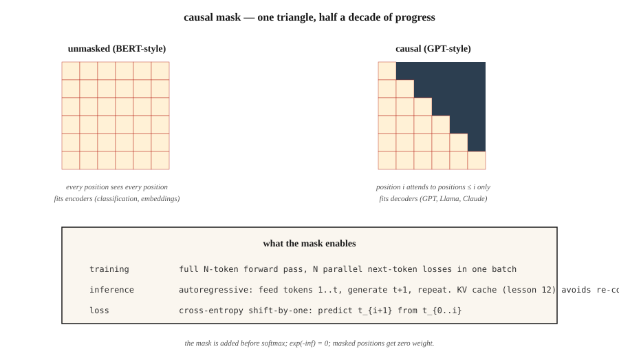

# GPT：因果语言建模

> BERT 能看到两边。GPT 只能看到过去。Triangle mask 是现代 AI 中影响最深远的一行代码。

**Type:** Build
**Languages:** Python
**Prerequisites:** Phase 7 · 02 (Self-Attention), Phase 7 · 05 (Full Transformer), Phase 7 · 06 (BERT)
**Time:** ~75 minutes

## 问题

语言模型回答一个问题：给定前 `t-1` 个 tokens，第 `t` 个 token 的 probability distribution 是什么？用这个信号训练，也就是 next-token prediction，你就会得到一个能一次生成一个 token、进而生成任意文本的模型。

为了在整段 sequence 上并行做端到端训练，你需要让每个位置的 prediction 只依赖更早的位置。否则模型会直接偷看答案，训练目标就变得毫无意义。

Causal mask 做的就是这件事。它是一个 upper-triangular matrix，其中未来位置填 `-inf`，并在 softmax 前加到 attention scores 上。softmax 之后，这些位置会变成 0。每个位置只能 attend to 自己和更早的位置。因为你对整段 sequence 一次性应用它，所以一次 forward pass 就能得到 N 个并行 next-token predictions。

GPT-1（2018）、GPT-2（2019）、GPT-3（2020）、GPT-4（2023）、GPT-5（2024）、Claude、Llama、Qwen、Mistral、DeepSeek、Kimi，全都是 decoder-only causal transformers，核心 loop 相同。只是更大、更好的数据，以及更好的 RLHF。

## 概念



### Mask

给定长度为 `N` 的 sequence，构建一个 `N × N` matrix：

```text
M[i, j] = 0       if j <= i
M[i, j] = -inf    if j > i
```

在 softmax 前把 `M` 加到 raw attention scores 上。`exp(-inf) = 0`，因此 masked positions 贡献的 weight 为零。Attention matrix 的每一行都只是在 previous positions 上的 probability distribution。

实现成本：一次 `torch.tril()` 调用。计算时间：纳秒级。对整个领域的影响：全部。

### Parallel training，serial inference

Training：对完整 `(N, d_model)` sequence 做一次 forward pass，计算 N 个 cross-entropy losses（每个位置一个），求和，然后 backprop。沿 sequence 维度并行。这就是 GPT training 能扩展的原因：你可以在一次 GPU pass 中处理 batch 里的 1M tokens。

Inference：你必须逐 token 生成。输入 `[t1, t2, t3]`，得到 `t4`。输入 `[t1, t2, t3, t4]`，得到 `t5`。输入 `[t1, t2, t3, t4, t5]`，得到 `t6`。KV cache（Lesson 12）会保存 `t1…tn` 的 hidden states，避免每一步重新计算它们。但 inference 的 serial depth = output length。这就是 autoregressive tax，也是每个 LLM 的 decoding 都成为 latency bottleneck 的原因。

### Loss：shift-by-one

给定 tokens `[t1, t2, t3, t4]`：

- Input: `[t1, t2, t3]`
- Targets: `[t2, t3, t4]`

对每个位置 `i`，计算 `-log P(target_i | inputs[:i+1])`。然后求和。这就是整段 sequence 的 cross-entropy。

你听说过的每个 transformer LM 都用这个 loss 训练。Pre-training、fine-tuning、SFT，全都是同一个 loss，只是数据不同。

### Decoding strategies

训练之后，sampling choices 比很多人想象得更重要。

| Method | What it does | When to use |
|--------|--------------|-------------|
| Greedy | 每一步取 argmax | Deterministic tasks、code completion |
| Temperature | 用 T 除 logits 后采样 | Creative tasks；更高 T = 更多 diversity |
| Top-k | 只从 top-k tokens 中采样 | 去掉 low-probability tails |
| Top-p (nucleus) | 从累计概率 ≥ p 的最小 token 集合采样 | 2020+ 默认；适配 distribution shape |
| Min-p | 保留 `p > min_p * max_p` 的 tokens | 2024+；比 top-p 更擅长拒绝 long tails |
| Speculative decoding | Draft model 提出 N 个 tokens，big model 验证 | 质量不变，latency 降低 2-3× |

到 2026 年，对 open-weights models 来说，min-p + temperature 0.7 是一个合理默认值。对任何 production inference stack 来说，speculative decoding 都已经是基本配置。

### 是什么让 "GPT recipe" 生效

1. **Decoder-only。** 没有 encoder overhead。每层只做一次 attention + FFN。
2. **Scaling。** 124M → 1.5B → 175B → trillions。Chinchilla scaling laws（Lesson 13）会告诉你如何花 compute。
3. **In-context learning。** 大约在 6B-13B 规模出现。模型能在不 fine-tuning 的情况下跟随 few-shot examples。
4. **RLHF。** 在 human preferences 上做 post-training，把 raw pretrained text 转成 chat assistants。
5. **Pre-norm + RoPE + SwiGLU。** 支撑大规模稳定训练。

从 GPT-2 开始，核心架构没有太大变化。真正有趣的事情都发生在 data、scale 和 post-training 上。

```figure
causal-mask
```

## Build It

### Step 1：causal mask

见 `code/main.py`。一行代码：

```python
def causal_mask(n):
    return [[0.0 if j <= i else float("-inf") for j in range(n)] for i in range(n)]
```

在 softmax 前把它加到 attention scores 上。这就是整个机制。

### Step 2：一个 2-layer GPT-ish model

堆叠两个 decoder blocks（masked self-attention + FFN，没有 cross-attention）。加上 token embedding、positional encoding，以及 unembedding（和 token embedding matrix 共享权重，这是 GPT-2 以来的标准技巧）。

### Step 3：next-token prediction，端到端

在一个 20-token toy vocab 上，为每个位置产生 logits。对 shift-by-one target 计算 cross-entropy loss。没有 gradient，这只是一次 forward-pass sanity check。

### Step 4：sampling

实现 greedy、temperature、top-k、top-p、min-p。用固定 prompt 跑每一种方法，并比较输出。一个 sampling function 只需要 10 行。

## Use It

PyTorch，2026 idiom：

```python
from transformers import AutoModelForCausalLM, AutoTokenizer
model = AutoModelForCausalLM.from_pretrained("meta-llama/Llama-3.2-3B-Instruct")
tok = AutoTokenizer.from_pretrained("meta-llama/Llama-3.2-3B-Instruct")

prompt = "Attention is all you need because"
inputs = tok(prompt, return_tensors="pt")
out = model.generate(
    **inputs,
    max_new_tokens=64,
    temperature=0.7,
    top_p=0.9,
    do_sample=True,
)
print(tok.decode(out[0]))
```

在底层，`generate()` 会运行 forward pass，取 final-position logits，采样下一个 token，把它 append 回输入，然后重复。每个 production LLM inference stack（vLLM、TensorRT-LLM、llama.cpp、Ollama、MLX）都实现了同一个 loop，只是做了大量优化：batched prefill、continuous batching、KV cache paging、speculative decoding。

**GPT vs BERT，各用一句话：** GPT 预测 `P(x_t | x_{<t})`。BERT 预测 `P(x_masked | x_unmasked)`。Loss 决定模型是否能生成。

## Ship It

见 `outputs/skill-sampling-tuner.md`。这个 skill 会为新的 generation task 选择 sampling parameters，并标记什么时候必须使用 deterministic decoding。

## 练习

1. **Easy。** 运行 `code/main.py`，验证 softmax 后的 causal attention matrix 是 lower-triangular。Spot-check：row 3 应该只在 columns 0-3 上有 weights。
2. **Medium。** 实现 width 4 的 beam search。比较 beam-4 和 greedy 在 10 个 short prompts 上的 perplexity。Beam 总是赢吗？（提示：通常在 translation 中是，但在 open-ended chat 中不是。）
3. **Hard。** 实现 speculative decoding：用一个 tiny 2-layer model 做 draft，用一个 6-layer model 做 verifier。在长度 64 的 100 次 completions 上测量 wall-clock speedup。确认输出匹配 verifier 的 greedy 输出。

## 关键术语

| Term | 大家常说 | 实际含义 |
|------|----------|----------|
| Causal mask | "triangle" | 加到 attention scores 上的 upper-triangular `-inf` matrix，让位置 `i` 只能看到位置 `≤ i`。 |
| Next-token prediction | "loss" | 每个位置上，模型 distribution 对真实 next token 的 cross-entropy。 |
| Autoregressive | "一次生成一个" | 把输出反馈成输入；parallelism 只存在于训练，不存在于生成。 |
| Logits | "pre-softmax scores" | LM head 在 softmax 前的 raw output；sampling 发生在这些值上。 |
| Temperature | "creativity knob" | 用 T 除 logits；T→0 = greedy，T→∞ = uniform。 |
| Top-p | "nucleus sampling" | 把 distribution 截断到累计概率 ≥p 的最小集合，并从剩余 token 中采样。 |
| Min-p | "better than top-p" | 保留 `p ≥ min_p × max_p` 的 tokens；cutoff 会适配 distribution 的 sharpness。 |
| Speculative decoding | "draft + verify" | 便宜模型提出 N 个 tokens；大模型并行验证。 |
| Teacher forcing | "training trick" | 训练时喂入真实 previous token，而不是模型自己的 prediction。每个 seq2seq LM 的标准做法。 |

## 延伸阅读

- [Radford et al. (2018). Improving Language Understanding by Generative Pre-Training](https://cdn.openai.com/research-covers/language-unsupervised/language_understanding_paper.pdf) - GPT-1。
- [Radford et al. (2019). Language Models are Unsupervised Multitask Learners](https://cdn.openai.com/better-language-models/language_models_are_unsupervised_multitask_learners.pdf) - GPT-2。
- [Brown et al. (2020). Language Models are Few-Shot Learners](https://arxiv.org/abs/2005.14165) - GPT-3 和 in-context learning。
- [Leviathan, Kalman, Matias (2023). Fast Inference from Transformers via Speculative Decoding](https://arxiv.org/abs/2211.17192) - speculative decoding 论文。
- [HuggingFace `modeling_llama.py`](https://github.com/huggingface/transformers/blob/main/src/transformers/models/llama/modeling_llama.py) - canonical causal-LM reference code。
