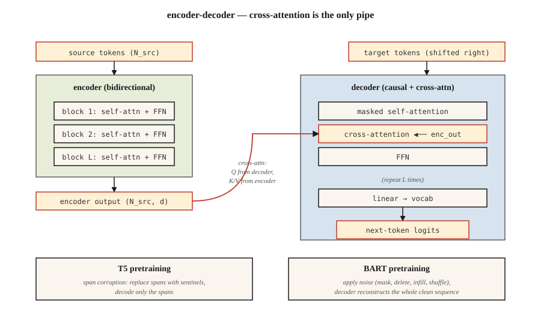

# T5、BART：Encoder-Decoder 模型

> Encoders 负责理解。Decoders 负责生成。把它们重新组合起来，你就得到一个天然适合 input → output 任务的模型：translate、summarize、rewrite、transcribe。

**Type:** Learn
**Languages:** Python
**Prerequisites:** Phase 7 · 05 (Full Transformer), Phase 7 · 06 (BERT), Phase 7 · 07 (GPT)
**Time:** ~45 minutes

## 问题

Decoder-only GPT 和 encoder-only BERT 都是为了不同目标而简化 2017 年原始架构。但很多任务天然就是 input-output：

- Translation：English → French。
- Summarization：5,000-token article → 200-token summary。
- Speech recognition：audio tokens → text tokens。
- Structured extraction：prose → JSON。

对这些任务来说，encoder-decoder 是最干净的匹配。Encoder 产生 source 的 dense representation。Decoder 生成 output，并且在每一步都 cross-attend 到这个 representation。训练时在 output 侧做 shift-by-one。Loss 和 GPT 一样，只是条件变成 encoder output。

两篇论文定义了现代做法：

1. **T5**（Raffel et al. 2019）。"Text-to-Text Transfer Transformer." 把每个 NLP task 都重写成 text-in、text-out。单一 architecture、单一 vocabulary、单一 loss。Pretraining 使用 masked span prediction（corrupt 输入中的 spans，在输出中 decode 它们）。
2. **BART**（Lewis et al. 2019）。"Bidirectional and Auto-Regressive Transformer." Denoising autoencoder：用多种方式破坏 input（shuffle、mask、delete、rotate），让 decoder 重建原文。

到 2026 年，encoder-decoder 格式仍然活在 input structure 很重要的地方：

- Whisper（speech → text）。
- Google 的 translation stack。
- 一些有明确 context-and-edit 结构的 code-completion / repair models。
- Flan-T5 及其变体，用于 structured reasoning tasks。

Decoder-only 赢得了聚光灯，但 encoder-decoder 从未消失。

## 概念



### Forward loop

```text
source tokens ─▶ encoder ─▶ (N_src, d_model)  ──┐
                                                 │
target tokens ─▶ decoder block                   │
                 ├─▶ masked self-attention       │
                 ├─▶ cross-attention ◀───────────┘
                 └─▶ FFN
                ↓
              next-token logits
```

关键点：encoder 对每个 input 只运行一次。Decoder 是 autoregressive 的，但每一步都 cross-attend 到同一个 encoder output。对长输入来说，缓存 encoder output 是免费的加速。

### T5 pretraining：span corruption

随机选择 input 中的 spans（平均长度 3 tokens，总计 15%）。把每个 span 替换成一个唯一 sentinel：`<extra_id_0>`、`<extra_id_1>` 等。Decoder 只输出被 corrupt 的 spans，并带上对应 sentinel prefix：

```text
source: The quick <extra_id_0> fox jumps <extra_id_1> dog
target: <extra_id_0> brown <extra_id_1> over the lazy
```

这比预测整个 sequence 更便宜。T5 论文中的 ablation 显示，它能和 MLM（BERT）以及 prefix-LM（UniLM）竞争。

### BART pretraining：multi-noise denoising

BART 尝试了五种 noising functions：

1. Token masking。
2. Token deletion。
3. Text infilling（mask 一个 span，decoder 插入正确长度）。
4. Sentence permutation。
5. Document rotation。

Text infilling + sentence permutation 的组合给出了最好的 downstream numbers。Decoder 总是重建原文。BART 的 output 是完整 sequence，而不只是被 corrupt 的 spans，所以 pretraining compute 高于 T5。

### Inference

和 GPT 一样使用 autoregressive generation。Greedy / beam / top-p sampling 都适用。Translation 和 summarization 通常使用 beam search（width 4-5），因为 output distribution 比 chat 更窄。

### 2026 年什么时候选哪种变体

| Task | Encoder-decoder? | Why |
|------|------------------|-----|
| Translation | Yes, usually | Clear source sequence; fixed output distribution; beam search works |
| Speech-to-text | Yes (Whisper) | Input modality differs from output; encoder shapes audio features |
| Chat / reasoning | No, decoder-only | No persistent "input" — the conversation is the sequence |
| Code completion | Usually no | Decoder-only with long context wins; code models like Qwen 2.5 Coder are decoder-only |
| Summarization | Either works | BART, PEGASUS beat earlier decoder-only baselines; modern decoder-only LLMs match them |
| Structured extraction | Either | T5 is clean because "text → text" absorbs any output format |

自 2022 年左右以来的趋势是：decoder-only 接管了许多曾由 encoder-decoder 主导的任务，因为 (a) instruction-tuned decoder-only LLMs 可以通过 prompting 泛化到任何任务，(b) 单一 architecture 比两套 stack 更容易 scale，(c) RLHF 假设的是 decoder。Encoder-decoder 则保留在 input modality 不同（speech、images）或 beam search quality 很重要的地方。

## Build It

见 `code/main.py`。我们会为一个 toy corpus 实现 T5-style span corruption。这是本课最有用的单个组件，因为之后几乎每个 encoder-decoder pretraining recipe 都会出现它。

### Step 1：span corruption

```python
def corrupt_spans(tokens, mask_rate=0.15, mean_span=3.0, rng=None):
    """Pick spans summing to ~mask_rate of tokens. Return (corrupted_input, target)."""
    n = len(tokens)
    n_mask = max(1, int(n * mask_rate))
    n_spans = max(1, int(round(n_mask / mean_span)))
    ...
```

Target format 使用 T5 convention：`<sent0> span0 <sent1> span1 ...`。Corrupted input 会把 unchanged tokens 和 span 位置上的 sentinel tokens 交错起来。

### Step 2：verify round-trip

给定 corrupted input 和 target，重建原始句子。如果 corruption 是可逆的，forward pass 就定义清楚了。这是 sanity check；真实训练不会这样做，但这个测试很便宜，并且能抓住 span bookkeeping 里的 off-by-one bugs。

### Step 3：BART noising

五个函数：`token_mask`、`token_delete`、`text_infill`、`sentence_permute`、`document_rotate`。组合其中两个并展示结果。

## Use It

HuggingFace reference：

```python
from transformers import T5ForConditionalGeneration, T5Tokenizer
tok = T5Tokenizer.from_pretrained("google/flan-t5-base")
model = T5ForConditionalGeneration.from_pretrained("google/flan-t5-base")

inputs = tok("translate English to French: Attention is all you need.", return_tensors="pt")
out = model.generate(**inputs, max_new_tokens=32)
print(tok.decode(out[0], skip_special_tokens=True))
```

T5 的技巧：把 task name 放进 input text。同一个模型能处理几十种任务，因为每个任务都是 text-in、text-out。到 2026 年，这个模式已经被 instruction-tuned decoder-only models 泛化了，但最早是 T5 把它系统化。

## Ship It

见 `outputs/skill-seq2seq-picker.md`。这个 skill 会基于 input-output structure、latency 和 quality targets，为新任务选择 encoder-decoder 或 decoder-only。

## 练习

1. **Easy。** 运行 `code/main.py`，对一个 30-token sentence 应用 span corruption，并验证把 non-sentinel source tokens 和 decoded target spans 连接起来能还原原文。
2. **Medium。** 实现 BART 的 `text_infill` noise：用单个 `<mask>` token 替换 random spans，decoder 必须推断正确 span length 和内容。展示一个例子。
3. **Hard。** 在一个 tiny English → pig-Latin corpus（200 pairs）上 fine-tune `flan-t5-small`。在 held-out 50-pair set 上测 BLEU。再用同样数据和同样 compute fine-tune `Llama-3.2-1B`，比较结果。

## 关键术语

| 术语 | 常见说法 | 实际含义 |
|------|----------|----------|
| Encoder-decoder | "Seq2seq transformer" | 两个 stacks：input 用 bidirectional encoder，output 用带 cross-attention 的 causal decoder。 |
| Cross-attention | "Where source talks to target" | Decoder 的 Q x encoder 的 K/V。Encoder 信息进入 decoder 的唯一位置。 |
| Span corruption | "T5's pretraining trick" | 用 sentinel tokens 替换 random spans；decoder 输出这些 spans。 |
| Denoising objective | "BART's game" | 对 input 应用 noise function，训练 decoder 重建 clean sequence。 |
| Sentinel token | "The `<extra_id_N>` placeholder" | 在 source 中标记 corrupted spans，并在 target 中重新标记它们的 special tokens。 |
| Flan | "Instruction-tuned T5" | 在 1,800+ tasks 上 fine-tuned 的 T5；让 encoder-decoder 在 instruction-following 上保持竞争力。 |
| Beam search | "Decoding strategy" | 每一步保留 top-k partial sequences；translation/summarization 的标准做法。 |
| Teacher forcing | "Training-time input" | 训练时喂给 decoder 真实前一个 output token，而不是 sampled one。 |

## 延伸阅读

- [Raffel et al. (2019). Exploring the Limits of Transfer Learning with a Unified Text-to-Text Transformer](https://arxiv.org/abs/1910.10683) — T5。
- [Lewis et al. (2019). BART: Denoising Sequence-to-Sequence Pre-training for Natural Language Generation, Translation, and Comprehension](https://arxiv.org/abs/1910.13461) — BART。
- [Chung et al. (2022). Scaling Instruction-Finetuned Language Models](https://arxiv.org/abs/2210.11416) — Flan-T5。
- [Radford et al. (2022). Robust Speech Recognition via Large-Scale Weak Supervision](https://arxiv.org/abs/2212.04356) — Whisper，2026 年 canonical encoder-decoder。
- [HuggingFace `modeling_t5.py`](https://github.com/huggingface/transformers/blob/main/src/transformers/models/t5/modeling_t5.py) — reference implementation。
