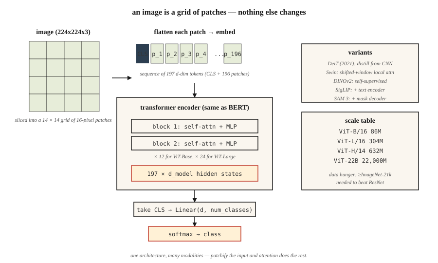

# Vision Transformers（ViT）

> 图像是一张 patches 网格。句子是一张 tokens 网格。同一个 transformer 可以吃下两者。

**Type:** Build
**Languages:** Python
**Prerequisites:** Phase 7 · 05 (Full Transformer), Phase 4 · 03 (CNNs), Phase 4 · 14 (Vision Transformers intro)
**Time:** ~45 minutes

## 问题

2020 年以前，computer vision 基本意味着 convolutions。ImageNet、COCO 和 detection benchmarks 上的每个 SOTA 都使用 CNN backbone。Transformers 属于 language。

Dosovitskiy et al. (2020) 的 "An Image is Worth 16x16 Words" 证明你可以完全丢掉 convolutions。把图像切成固定大小的 patches，把每个 patch 线性投影成 embedding，再把这个 sequence 喂给 vanilla transformer encoder。在足够规模下（ImageNet-21k pretraining 或更大），ViT 可以匹配或超过 ResNet-based models。

ViT 是 2026 年更大模式的起点：一个 architecture，多种 modalities。Whisper tokenize audio。ViT tokenize images。Robotics 使用 action tokens。Video 使用 pixel tokens。Transformer 不在乎，给它 sequence，它就学习。

到 2026 年，ViT 及其后代（DeiT、Swin、DINOv2、ViT-22B、SAM 3）已经占据大多数 vision 场景。CNNs 在 edge devices 和 latency-sensitive tasks 上仍然获胜。其他地方的 stack 里基本都有某种 ViT。

## 概念



### Step 1：Patchify

把一张 `H × W × C` 图像切成一个 `N × (P·P·C)` 的 flat patches sequence。典型设置：`224 × 224` 图像，`16 × 16` patches -> 196 个 patches，每个 patch 有 768 个值。

```text
image (224, 224, 3) -> 14 × 14 grid of 16x16x3 patches -> 196 vectors of length 768
```

Patch size 是主要杠杆。更小的 patches = 更多 tokens、更好的 resolution、更高的 quadratic attention cost。更大的 patches = 更粗、更便宜。

### Step 2：Linear embedding

一个 learned matrix 把每个 flat patch 投影到 `d_model`。这等价于一个 kernel size 为 `P`、stride 为 `P` 的 convolution。在 PyTorch 中它字面上就是 `nn.Conv2d(C, d_model, kernel_size=P, stride=P)`，两行就能实现。

### Step 3：Prepend `[CLS]` token，add positional embeddings

- 前置一个 learnable `[CLS]` token。它最终的 hidden state 会作为 classification 的 image representation。
- 添加 learnable positional embeddings（ViT-original）或 sinusoidal 2D（后续变体）。
- 2024+ 年，RoPE 被扩展到 2D position，有时甚至不需要 explicit embeddings。

### Step 4：Standard transformer encoder

堆叠 L 个 `LayerNorm -> Self-Attention -> + -> LayerNorm -> MLP -> +` blocks。它与 BERT 相同，没有 vision-specific layers。这是论文最有教学意义的 punchline。

### Step 5：Head

对于 classification：取 `[CLS]` hidden state -> linear -> softmax。对于 DINOv2 或 SAM，丢弃 `[CLS]`，直接使用 patch embeddings。

### 重要变体

| Model | Year | Change |
|-------|------|--------|
| ViT | 2020 | 原始模型。固定 patch size，完整 global attention。 |
| DeiT | 2021 | Distillation；只用 ImageNet-1k 也能训练。 |
| Swin | 2021 | Hierarchical with shifted windows。修复 sub-quadratic cost。 |
| DINOv2 | 2023 | Self-supervised（无 labels）。最佳通用 vision features。 |
| ViT-22B | 2023 | 22B params；scaling laws 适用。 |
| SigLIP | 2023 | ViT + language pair，sigmoid contrastive loss。 |
| SAM 3 | 2025 | Segment anything；ViT-Large + promptable mask decoder。 |

### 为什么它花了一段时间才成熟

ViT 需要*大量*数据才能匹配 CNNs，因为它没有 CNN 的 inductive biases（translation invariance、locality）。没有 >100M labeled images 或强 self-supervised pretraining 时，在同等 compute 下 CNNs 仍然会赢。DeiT 在 2021 年用 distillation tricks 修复了这一点；DINOv2 在 2023 年用 self-supervision 永久修复了这一点。

## Build It

见 `code/main.py`。Pure-stdlib patchify + linear embedding + sanity checks。不训练，因为任何现实规模的 ViT 都需要 PyTorch 和数小时 GPU time。

### Step 1：Fake image

一张 24 × 24 RGB 图像，用 rows of `(R, G, B)` tuples 表示。我们使用 6×6 patches -> 16 patches，每个 patch 是 108-d embedding vector。

### Step 2：Patchify

```python
def patchify(image, P):
    H = len(image)
    W = len(image[0])
    patches = []
    for i in range(0, H, P):
        for j in range(0, W, P):
            patch = []
            for di in range(P):
                for dj in range(P):
                    patch.extend(image[i + di][j + dj])
            patches.append(patch)
    return patches
```

Raster order：按 grid 的 row-major 顺序。每个 ViT 都使用这个顺序。

### Step 3：Linear embed

把每个 flat patch 乘上一个随机 `(patch_flat_size, d_model)` matrix。前置 `[CLS]` 后，验证输出 shape 是 `(N_patches + 1, d_model)`。

### Step 4：计算 realistic ViT 的参数量

打印 ViT-Base 的参数量：12 layers、12 heads、d=768、patch=16。与 ResNet-50（约 25M）比较。ViT-Base 约 86M。ViT-Large 约 307M。ViT-Huge 约 632M。

## Use It

```python
from transformers import ViTImageProcessor, ViTModel
import torch
from PIL import Image

processor = ViTImageProcessor.from_pretrained("google/vit-base-patch16-224-in21k")
model = ViTModel.from_pretrained("google/vit-base-patch16-224-in21k")

img = Image.open("cat.jpg")
inputs = processor(img, return_tensors="pt")
out = model(**inputs).last_hidden_state   # (1, 197, 768): [CLS] + 196 patches
cls_emb = out[:, 0]                       # image representation
```

**DINOv2 embeddings 是 2026 年 image features 的默认选择。** Freeze backbone，训练一个 tiny head。它适用于 classification、retrieval、detection、captioning。Meta 的 DINOv2 checkpoints 在每个非文本 vision task 上都超过 CLIP。

**Patch-size picking。** Small models 使用 16×16（ViT-B/16）。Dense prediction（segmentation）使用 8×8 或 14×14（SAM、DINOv2）。Very large models 使用 14×14。

## Ship It

见 `outputs/skill-vit-configurator.md`。这个 skill 会根据 dataset size、resolution 和 compute budget，为新的 vision task 选择 ViT variant 和 patch size。

## 练习

1. **Easy。** 运行 `code/main.py`。验证 patches 数量等于 `(H/P) * (W/P)`，flat patch dimension 等于 `P*P*C`。
2. **Medium。** 实现 2D sinusoidal positional embeddings：为每个 patch 的 `row` 和 `col` 分别构造独立 sinusoidal codes，然后 concatenate。把它们喂给 tiny PyTorch ViT，并在 CIFAR-10 上比较与 learnable positional embeddings 的 accuracy。
3. **Hard。** 构建一个 3-layer ViT（PyTorch），用 4×4 patches 在 1,000 张 MNIST images 上训练。测量 test accuracy。然后在同样 1,000 张 images 上加入 DINOv2 pretraining（简化版：只训练 encoder 从 masked patches 预测 patch embeddings）。Accuracy 是否提升？

## 关键术语

| Term | 大家常说 | 实际含义 |
|------|----------|----------|
| Patch | "The vision-transformer token" | 图像中一个 `P × P × C` 区域的 pixel values flat vector。 |
| Patchify | "Chop + flatten" | 把图像切成 non-overlapping patches，并把每个 patch flatten 成 vector。 |
| `[CLS]` token | "The image summary" | 前置 learnable token；它的最终 embedding 是 image representation。 |
| Inductive bias | "What the model assumes" | ViT 的 priors 比 CNNs 少；需要更多数据弥补差距。 |
| DINOv2 | "Self-supervised ViT" | 用 image augmentation + momentum teacher 训练，无需 labels。2026 年最佳通用 image features。 |
| SigLIP | "CLIP's successor" | ViT + text encoder，用 sigmoid contrastive loss 训练；同等 compute 下优于 CLIP。 |
| Swin | "Windowed ViT" | Hierarchical ViT，使用 local attention + shifted windows；sub-quadratic。 |
| Register tokens | "2023 trick" | 额外几个 learnable tokens，用来吸收 attention sinks；改善 DINOv2 features。 |

## 延伸阅读

- [Dosovitskiy et al. (2020). An Image is Worth 16x16 Words: Transformers for Image Recognition at Scale](https://arxiv.org/abs/2010.11929) — ViT 论文。
- [Touvron et al. (2021). Training data-efficient image transformers & distillation through attention](https://arxiv.org/abs/2012.12877) — DeiT。
- [Liu et al. (2021). Swin Transformer: Hierarchical Vision Transformer using Shifted Windows](https://arxiv.org/abs/2103.14030) — Swin。
- [Oquab et al. (2023). DINOv2: Learning Robust Visual Features without Supervision](https://arxiv.org/abs/2304.07193) — DINOv2。
- [Darcet et al. (2023). Vision Transformers Need Registers](https://arxiv.org/abs/2309.16588) — DINOv2 的 register-token fix。
