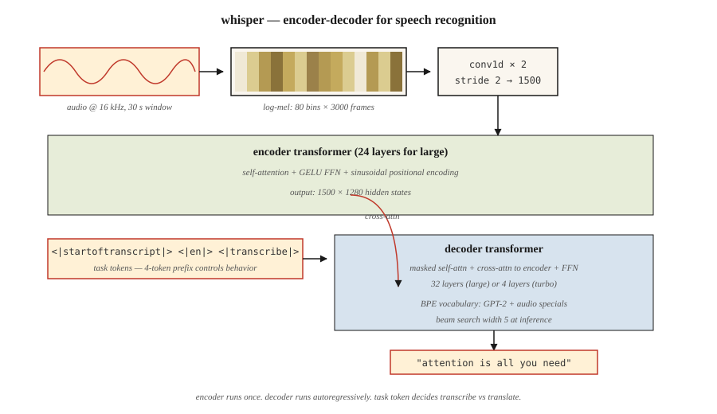

# 音频 Transformers：Whisper 架构

> 音频是一张“频率随时间变化”的图像。Whisper 是一个吃 mel spectrograms、再说回文本的 ViT。

**Type:** Learn
**Languages:** Python
**Prerequisites:** Phase 7 · 05 (Full Transformer), Phase 7 · 08 (Encoder-Decoder), Phase 7 · 09 (ViT)
**Time:** ~45 minutes

## 问题

在 Whisper（OpenAI，Radford et al. 2022）之前，state-of-the-art automatic speech recognition（ASR）意味着 wav2vec 2.0 和 HuBERT：self-supervised feature extractors 加一个 fine-tuned head。质量高，但数据 pipeline 昂贵，domain-brittle。Multilingual speech recognition 往往需要按 language family 分模型。

Whisper 下了三个赌注：

1. **Train on everything。** 680,000 小时 weakly-labeled audio，来自互联网，覆盖 97 种语言。没有干净 academic corpus。没有 phoneme labels。
2. **Multi-task single model。** 一个 decoder 通过 task tokens 联合训练 transcription、translation、voice activity detection、language ID 和 timestamping。
3. **Standard encoder-decoder transformer。** Encoder 消费 log-mel spectrograms。Decoder 自回归生成 text tokens。没有 vocoder，没有 CTC，没有 HMM。

结果：Whisper large-v3 对 accents、noise 和没有干净标注数据的语言都很 robust。到 2026 年，它是每个开源 voice assistant 和大多数商业 voice assistant 的默认 speech front-end。

## 概念



### Step 1：resample + window

Audio 采样率 16 kHz。Clip/pad 到 30 秒。计算 log-mel spectrogram：80 个 mel bins，10 ms stride → 约 3,000 frames × 80 features。这就是 Whisper 看到的 "input image"。

### Step 2：convolutional stem

两层 Conv1D，kernel 3，stride 2，把 3,000 frames 降到 1,500。序列长度减半，几乎不增加多少参数。

### Step 3：encoder

一个 24-layer（large 版本）transformer encoder，处理 1,500 timesteps。Sinusoidal positional encoding、self-attention、GELU FFN。输出 1,500 × 1,280 hidden states。

### Step 4：decoder

一个 24-layer transformer decoder。它自回归生成 tokens，使用一个 BPE vocabulary：它是 GPT-2 vocab 的 superset，并加了一些 audio-specific special tokens。

### Step 5：task tokens

Decoder prompt 会以 control tokens 开头，告诉模型要做什么：

```text
<|startoftranscript|>  <|en|>  <|transcribe|>  <|0.00|>
```

或者：

```text
<|startoftranscript|>  <|fr|>  <|translate|>   <|0.00|>
```

模型就是按这个 convention 训练的。你通过 prefix 控制 task。这是 2026 年版的 instruction-tuning，只是应用到了 speech。

### Step 6：output

Beam search（width 5）+ log-prob threshold。当 `<|notimestamps|>` token 不存在时，timestamps 每 0.02 秒 audio 预测一次。

### Whisper sizes

| Model | Params | Layers | d_model | Heads | VRAM (fp16) |
|-------|--------|--------|---------|-------|-------------|
| Tiny | 39M | 4 | 384 | 6 | ~1 GB |
| Base | 74M | 6 | 512 | 8 | ~1 GB |
| Small | 244M | 12 | 768 | 12 | ~2 GB |
| Medium | 769M | 24 | 1024 | 16 | ~5 GB |
| Large | 1550M | 32 | 1280 | 20 | ~10 GB |
| Large-v3 | 1550M | 32 | 1280 | 20 | ~10 GB |
| Large-v3-turbo | 809M | 32 | 1280 | 20 | ~6 GB（4-layer decoder） |

Large-v3-turbo（2024）把 decoder 从 32 层裁到 4 层。解码快 8×，WER regression 小于 1 point。这个 decode speed unlock 是 Whisper-turbo 在 2026 年成为 real-time voice agents 默认选择的原因。

### Whisper 不做什么

- 不做 diarization（谁在说话）。需要和 pyannote 搭配。
- 不原生支持 real-time streaming，30 秒窗口是固定的。Modern wrappers（`faster-whisper`、`WhisperX`）通过 VAD + overlap 补上 streaming。
- 没有外部 chunking 时，不支持超过 30 s 的 long-form context。实践中效果仍然很好，因为人类语音的转写通常不需要很长的 long-range context。

### 2026 landscape

| Task | Model | Notes |
|------|-------|-------|
| English ASR | Whisper-turbo, Moonshine | Moonshine 在 edge 上快 4× |
| Multilingual ASR | Whisper-large-v3 | 97 languages |
| Streaming ASR | faster-whisper + VAD | 可达到 150 ms latency targets |
| TTS | Piper, XTTS-v2, Kokoro | Encoder-decoder pattern，但 Whisper-shaped |
| Audio + language | AudioLM, SeamlessM4T | Text tokens + audio tokens in one transformer |

## Build It

查看 `code/main.py`。我们不训练 Whisper，而是构建 log-mel spectrogram pipeline + task-token prompt formatter。这些才是 production 中你实际会碰的部分。

### Step 1：synthesize audio

生成一个 1 秒、440 Hz 的 sine wave，采样率 16 kHz。共 16,000 samples。

### Step 2：log-mel spectrogram（简化版）

完整 mel spectrogram 需要 FFT。这里做一个简化版 framing + per-frame energy，展示 pipeline，同时不依赖 `librosa`：

```python
def frame_signal(x, frame_size=400, hop=160):
    frames = []
    for start in range(0, len(x) - frame_size + 1, hop):
        frames.append(x[start:start + frame_size])
    return frames
```

Frame = 25 ms，hop = 10 ms。匹配 Whisper 的 windowing。为了教学，per-frame energy 代替 mel bins。

### Step 3：pad 到 30 s

Whisper 永远处理 30-second chunks。把 spectrogram pad（或 clip）到 3,000 frames。

### Step 4：构建 prompt tokens

```python
def whisper_prompt(lang="en", task="transcribe", timestamps=True):
    tokens = ["<|startoftranscript|>", f"<|{lang}|>", f"<|{task}|>"]
    if not timestamps:
        tokens.append("<|notimestamps|>")
    return tokens
```

这就是全部 task-control surface。一个 4-token prefix。

## Use It

```python
import whisper
model = whisper.load_model("large-v3-turbo")
result = model.transcribe("meeting.wav", language="en", task="transcribe")
print(result["text"])
print(result["segments"][0]["start"], result["segments"][0]["end"])
```

更快、OpenAI-compatible：

```python
from faster_whisper import WhisperModel
model = WhisperModel("large-v3-turbo", compute_type="int8_float16")
segments, info = model.transcribe("meeting.wav", vad_filter=True)
for s in segments:
    print(f"{s.start:.2f} - {s.end:.2f}: {s.text}")
```

**2026 年什么时候选 Whisper：**

- 用一个模型做 multilingual ASR。
- 对 noisy、diverse audio 做 robust transcription。
- Research / prototype ASR：最快起点。

**什么时候选别的：**

- Edge 上 ultra-low latency streaming：同等质量下 Moonshine 胜过 Whisper。
- 需要 <200 ms 的 real-time conversational AI：用专门的 streaming ASR。
- Speaker diarization：Whisper 不做这件事；接上 pyannote。

## Ship It

查看 `outputs/skill-asr-configurator.md`。这个 skill 会为新的 speech application 选择 ASR model、decoding parameters 和 preprocessing pipeline。

## 练习

1. **Easy。** 运行 `code/main.py`。确认 16 kHz、10 ms hop 的 1-second signal frame count 约为 100。30 秒约为 3,000 frames。
2. **Medium。** 使用 `numpy.fft` 构建完整 log-mel spectrogram。验证 80 mel bins 和 `librosa.feature.melspectrogram(n_mels=80)` 在 numerical error 内匹配。
3. **Hard。** 实现 streaming inference：把 audio 切成 10 s windows，2 s overlap，在每个 chunk 上运行 Whisper，merge transcripts。在 5-minute podcast sample 上测量相对 single-pass 的 word-error rate。

## 关键术语

| Term | 人们通常怎么说 | 它实际是什么意思 |
|------|----------------|------------------|
| Mel spectrogram | "Audio image" | 2D representation：一个轴是 frequency bins，另一个轴是 time frames；每个 cell 是 log-scaled energy。 |
| Log-mel | "What Whisper sees" | 经过 log 的 mel spectrogram；近似人类对 loudness 的感知。 |
| Frame | "One time slice" | 一个 25 ms sample window；以 10 ms stride overlap。 |
| Task token | "Prompt prefix for speech" | Decoder prompt 中的 `<\|transcribe\|>` / `<\|translate\|>` 这类 special tokens。 |
| Voice activity detection (VAD) | "Find the speech" | ASR 前移除 silence 的 gate；大幅降低 cost。 |
| CTC | "Connectionist Temporal Classification" | Alignment-free training 的经典 ASR loss；Whisper 不使用它。 |
| Whisper-turbo | "Small decoder, full encoder" | large-v3 encoder + 4-layer decoder；解码快 8×。 |
| Faster-whisper | "The production wrapper" | CTranslate2 reimplementation；int8 quantization；比 OpenAI reference 快 4×。 |

## 延伸阅读

- [Radford et al. (2022). Robust Speech Recognition via Large-Scale Weak Supervision](https://arxiv.org/abs/2212.04356) — Whisper paper。
- [OpenAI Whisper repo](https://github.com/openai/whisper) — reference code + model weights。读 `whisper/model.py` 可以看到 Conv1D stem + encoder + decoder，从头到尾约 400 行。
- [OpenAI Whisper — `whisper/decoding.py`](https://github.com/openai/whisper/blob/main/whisper/decoding.py) — Steps 5-6 描述的 beam-search + task-token logic 在这里；500 行，完全可读。
- [Baevski et al. (2020). wav2vec 2.0: A Framework for Self-Supervised Learning of Speech Representations](https://arxiv.org/abs/2006.11477) — 前身；在一些场景中仍然是 SOTA features。
- [SYSTRAN/faster-whisper](https://github.com/SYSTRAN/faster-whisper) — production wrapper，比 reference 快 4×。
- [Jia et al. (2024). Moonshine: Speech Recognition for Live Transcription and Voice Commands](https://arxiv.org/abs/2410.15608) — 2024 edge-friendly ASR，Whisper-shaped 但更小。
- [HuggingFace blog — "Fine-Tune Whisper For Multilingual ASR with 🤗 Transformers"](https://huggingface.co/blog/fine-tune-whisper) — canonical fine-tuning recipe，包含 mel spectrogram preprocessor 和 token-timestamp handling。
- [HuggingFace `modeling_whisper.py`](https://github.com/huggingface/transformers/blob/main/src/transformers/models/whisper/modeling_whisper.py) — 完整实现（encoder、decoder、cross-attention、generation），对应本课 architecture diagram。
