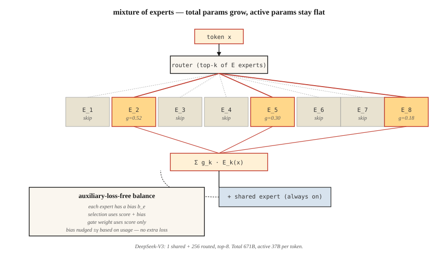

# Mixture of Experts（MoE）

> 一个 dense 70B transformer 会为每个 token 激活所有参数。一个 671B MoE 每个 token 只激活 37B 参数，却在每个 benchmark 上击败它。稀疏性是这个十年最重要的 scaling idea。

**Type:** Build
**Languages:** Python
**Prerequisites:** Phase 7 · 05 (Full Transformer), Phase 7 · 07 (GPT)
**Time:** ~45 minutes

## 问题

Dense transformer 在 inference 时的 FLOPs 约等于它的参数量（forward pass 乘以 2）。扩大 dense model 时，每个 token 都要支付完整账单。到 2024 年，前沿模型已经撞上 compute wall：想要明显更聪明，就需要每个 token 指数级更多 FLOPs。

Mixture of Experts 打断了这个链接。把每个 FFN 替换成 `E` 个独立 expert，再加一个为每个 token 选择 `k` 个 expert 的 router。总参数量 = `E × FFN_size`。每个 token 的 active parameters = `k × FFN_size`。2026 年典型配置是 `E=256`、`k=8`。存储随 `E` 缩放，计算随 `k` 缩放。

2026 年的前沿几乎全是 MoE：DeepSeek-V3（671B total / 37B active）、Mixtral 8×22B、Qwen2.5-MoE、Llama 4、Kimi K2、gpt-oss。在 Artificial Analysis 的独立 leaderboard 上，排名前 10 的开源模型全是 MoE。

## 概念



### FFN 替换

Dense transformer block：

```text
h = x + attn(norm(x))
h = h + FFN(norm(h))
```

MoE block：

```text
h = x + attn(norm(x))
scores = router(norm(h))              # (N_tokens, E)
top_k = argmax_k(scores)              # pick k of E per token
h = h + sum_{e in top_k}(
        gate(scores[e]) * Expert_e(norm(h))
    )
```

每个 expert 都是一个独立 FFN（通常是 SwiGLU）。Router 是一个单独的线性层。每个 token 都会选择自己的 `k` 个 expert，并得到它们输出的 gated mixture。

### Load-balancing 问题

如果 router 把 90% 的 token 都送进 expert 3，其它 expert 就会饿死。人们尝试过三种修复：

1. **Auxiliary load-balancing loss**（Switch Transformer、Mixtral）。加入一个与 expert usage 方差成比例的惩罚。有效，但会增加一个超参数和第二个梯度信号。
2. **Expert capacity + token dropping**（早期 Switch）。每个 expert 最多处理 `C × N/E` 个 token；溢出的 token 跳过该层。会损伤质量。
3. **Auxiliary-loss-free balancing**（DeepSeek-V3）。加入一个可学习的 per-expert bias，移动 router 的 top-k selection。Bias 在训练 loss 之外更新。主目标上没有惩罚。2024 年的重要突破。

DeepSeek-V3 的做法是：每个训练 step 之后，对每个 expert 检查它的使用率高于还是低于目标值。用 `±γ` 轻推 bias。Selection 使用 `scores + bias`。用于 gating 的 expert probabilities 仍然使用未改动的原始 `scores`。这把 routing 和 expression 解耦了。

### Shared experts

DeepSeek-V2/V3 也把 expert 分成 *shared* 和 *routed*。每个 token 都会经过所有 shared experts。Routed experts 通过 top-k 选择。Shared experts 捕捉通用知识；routed experts 负责专门化。V3 运行 1 个 shared expert，再从 256 个 routed expert 中选择 top-8。

### Fine-grained experts

经典 MoE（GShard、Switch）：每个 expert 和完整 FFN 一样宽。`E` 较小（8-64），`k` 较小（1-2）。

现代 fine-grained MoE（DeepSeek-V3、Qwen-MoE）：每个 expert 更窄（1/8 FFN size）。`E` 很大（256+），`k` 也更大（8+）。总参数量相同，但组合数量增长快得多。`C(256, 8) = 400 trillion` 个可能的“expert”组合可以服务每个 token。质量上升，延迟保持平稳。

### 成本画像

每个 token、每层：

| Config | Active params / token | Total params |
|--------|-----------------------|--------------|
| Mixtral 8×22B | ~39B | 141B |
| Llama 3 70B (dense) | 70B | 70B |
| DeepSeek-V3 | 37B | 671B |
| Kimi K2 (MoE) | ~32B | 1T |

DeepSeek-V3 在几乎每个 benchmark 上都击败 Llama 3 70B（dense），同时 **每个 token 的 active FLOPs 更少**。更多参数 = 更多知识。更多 active FLOPs = 每个 token 更多计算。MoE 把两者解耦。

### 代价：内存

不管哪些 expert 被激活，所有 expert 都必须常驻 GPU。一个 671B 模型用 fp16 权重需要约 1.3 TB VRAM。前沿 MoE 部署需要 expert parallelism：把 expert 分片到多块 GPU 上，并在网络中路由 token。延迟主要由 all-to-all communication 主导，而不是 matmul。

## 动手构建

见 `code/main.py`。这是一个纯 stdlib 的紧凑 MoE layer，包含：

- `n_experts=8` 个 SwiGLU-ish experts（为了演示，每个 expert 只有一个线性层）
- top-k=2 routing
- softmax-normalized gating weights
- 通过 per-expert bias 实现的 auxiliary-loss-free balancing

### Step 1：router

```python
def route(hidden, W_router, top_k, bias):
    scores = [sum(h * w for h, w in zip(hidden, W_router[e])) for e in range(len(W_router))]
    biased = [s + b for s, b in zip(scores, bias)]
    top_idx = sorted(range(len(biased)), key=lambda i: -biased[i])[:top_k]
    # softmax over ORIGINAL scores of the chosen experts
    chosen = [scores[i] for i in top_idx]
    m = max(chosen)
    exps = [math.exp(c - m) for c in chosen]
    s = sum(exps)
    gates = [e / s for e in exps]
    return top_idx, gates
```

Bias 影响 selection，不影响 gate weight。这就是 DeepSeek-V3 的技巧：bias 修正 load imbalance，但不直接牵引模型预测。

### Step 2：让 100 个 token 通过 router

跟踪每个 expert 被触发的次数。没有 bias 时，usage 会偏斜。有了 bias update loop（over-used experts 用 `-γ`，under-used experts 用 `+γ`），usage 会在几次迭代后收敛到接近均匀分布。

### Step 3：参数量比较

打印一个 MoE 配置的“dense equivalent”。DeepSeek-V3 形状：256 routed + 1 shared，8 active，d_model=7168。总参数量大得惊人。Active count 则只有 dense Llama 3 70B 的七分之一。

## 使用它

HuggingFace 加载：

```python
from transformers import AutoModelForCausalLM, AutoTokenizer
model = AutoModelForCausalLM.from_pretrained("mistralai/Mixtral-8x22B-v0.1")
```

2026 年生产 inference：vLLM 原生支持 MoE routing。SGLang 拥有最快的 expert-parallel 路径。两者都会自动处理 top-k selection 和 expert parallelism。

**什么时候选 MoE：**

- 你想以更低的每 token inference cost 获得前沿质量。
- 你有足够 VRAM / expert-parallel 基础设施。
- 你的 workload 是 token-heavy（chat、code），不是 context-heavy（长文档）。

**什么时候不要选 MoE：**

- 边缘部署：为了任何 active FLOP，你都要支付完整存储。
- 对延迟极敏感的单用户 serving：expert routing 会增加开销。
- 小模型（<7B）：MoE 的质量优势只会在某个计算阈值以上出现（约 6B active params）。

## 交付它

见 `outputs/skill-moe-configurator.md`。这个 skill 会在给定 parameter budget、training tokens 和 deployment target 时，为新的 MoE 选择 E、k 和 shared-expert layout。

## 练习

1. **Easy.** 运行 `code/main.py`。观察 auxiliary-loss-free bias update 如何在 50 次迭代中拉平 expert usage。
2. **Medium.** 把 learned router 替换成 hash-based router（确定性、无学习）。比较 quality 和 balance。为什么 learned router 更好？
3. **Hard.** 实现 GRPO-style “rollout-matched routing”（DeepSeek-V3.2 trick）：记录 inference 时哪些 expert 被触发，并在 gradient computation 时强制使用同样 routing。在一个 toy policy-gradient setup 上测量效果。

## 关键术语

| Term | What people say | What it actually means |
|------|-----------------|-----------------------|
| Expert | “许多 FFN 中的一个” | 一个独立 feed-forward network；参数专门服务 FFN 计算中的稀疏切片。 |
| Router | “Gate” | 一个很小的线性层，为每个 token 对每个 expert 打分；做 top-k selection。 |
| Top-k routing | “每个 token 有 k 个 active experts” | 每个 token 的 FFN 计算正好经过 k 个 expert，并由 gate 加权。 |
| Auxiliary loss | “Load-balance penalty” | 额外 loss 项，用来惩罚偏斜的 expert usage。 |
| Auxiliary-loss-free | “DeepSeek-V3 的技巧” | 只通过 router selection 上的 per-expert bias 做平衡；没有额外梯度。 |
| Shared expert | “Always on” | 每个 token 都经过的额外 expert；捕捉通用知识。 |
| Expert parallelism | “按 expert 分片” | 把不同 expert 分布到不同 GPU，并跨网络路由 token。 |
| Sparsity | “Active params < total params” | 比例 `k × expert_size / (E × expert_size)`；DeepSeek-V3 约为 37/671 ≈ 5.5%。 |

## 延伸阅读

- [Shazeer et al. (2017). Outrageously Large Neural Networks: The Sparsely-Gated Mixture-of-Experts Layer](https://arxiv.org/abs/1701.06538) — 这个想法的源头。
- [Fedus, Zoph, Shazeer (2022). Switch Transformer: Scaling to Trillion Parameter Models with Simple and Efficient Sparsity](https://arxiv.org/abs/2101.03961) — Switch，经典 MoE。
- [Jiang et al. (2024). Mixtral of Experts](https://arxiv.org/abs/2401.04088) — Mixtral 8×7B。
- [DeepSeek-AI (2024). DeepSeek-V3 Technical Report](https://arxiv.org/abs/2412.19437) — MLA + auxiliary-loss-free MoE + MTP。
- [Wang et al. (2024). Auxiliary-Loss-Free Load Balancing Strategy for Mixture-of-Experts](https://arxiv.org/abs/2408.15664) — 基于 bias 的 balancing 论文。
- [Dai et al. (2024). DeepSeekMoE: Towards Ultimate Expert Specialization in Mixture-of-Experts Language Models](https://arxiv.org/abs/2401.06066) — 本课 router 使用的 fine-grained + shared-expert split。
- [Kim et al. (2022). DeepSpeed-MoE: Advancing Mixture-of-Experts Inference and Training](https://arxiv.org/abs/2201.05596) — 原始 shared-expert 论文。
