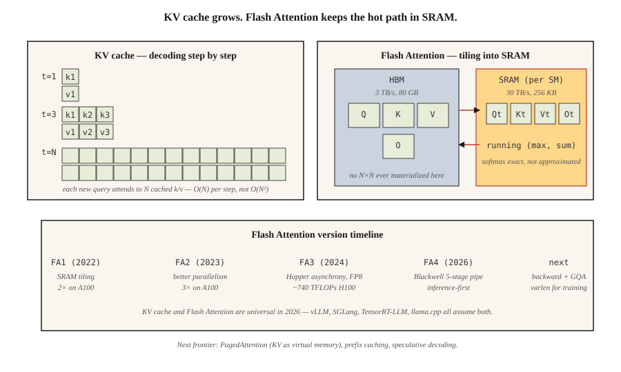

# KV Cache、Flash Attention 与推理优化

> 训练是 parallel 且 FLOP-bound。推理是 serial 且 memory-bound。瓶颈不同，技巧也不同。

**Type:** Build
**Languages:** Python
**Prerequisites:** Phase 7 · 02 (Self-Attention), Phase 7 · 05 (Full Transformer), Phase 7 · 07 (GPT)
**Time:** ~75 minutes

## 问题

一个 naive autoregressive decoder 生成 `N` 个 tokens 时会做 `O(N²)` 工作：每一步都重新在完整 prefix 上计算 attention。对于 4K-token response，这就是 16M 次 attention operations，其中大多数都是重复的。Prefix token 的每个 hidden state 一旦算出来就是 deterministic 的；你只需要让新 token 的 query 去看之前所有 token 的 cached keys 和 values。

除此之外，attention 本身会搬运大量数据。标准 attention 会 materialize 一个 N×N score matrix、N×d softmax output、N×d final output，对 HBM 的读写太多。N≥2K 时，attention 会先变成 memory-bound，而不是 FLOP-bound。经典 attention kernels 对现代 GPUs 的利用率会低 4-10×。

两个优化，都来自 Dao et al.，把 frontier inference 从"慢"推到了"快"：

1. **KV cache。** 存储每个 prefix token 的 K 和 V vectors。每个新 token 的 attention 只是一条 query 对 cached keys 的查询。Inference 从每个 generation step 的 `O(N²)` 降到 `O(N)`。
2. **Flash Attention。** 对 attention computation 做 tiling，让完整 N×N matrix 永远不进入 HBM。Softmax + matmul 全都在 SRAM 中完成。在 A100 上 wall-clock speedup 为 2-4×；在 FP8 H100 上为 5-10×。

到 2026 年，两者都是通用配置。每个 production inference stack（vLLM、TensorRT-LLM、SGLang、llama.cpp）都默认假设它们存在。每个 frontier model 都会启用 Flash Attention。

## 概念



### KV cache math

每个 decoder layer、每个 token、每个 head：

```text
bytes_per_token_per_layer = 2 * d_head * dtype_size
                          ^
                          K and V
```

对于一个 7B model，32 layers、32 heads、d_head=128、fp16：

```text
per token per layer = 2 * 128 * 2 = 512 bytes
per token (32 layers) = 16 KB
per 32K context = 512 MB
```

对于 Llama 3 70B（80 layers、d_head=128、GQA with 8 KV heads）：

```text
per token per layer = 2 * 8 * 128 * 2 = 4096 bytes (4 KB)
per 32K context = 10.4 GB
```

这 10 GB 就是为什么 Llama 3 70B 在 128K context、batch size 1 时，光 KV cache 就需要占掉 40 GB A100 的大部分显存。

**GQA 是 KV-cache win。** 如果用 64 heads 的 MHA，会是 32 GB。MLA 还能进一步压缩。

拖动 dimensions，观察 cache size 如何变化。把 sequence length 或 batch 推大，你会看到它多快超过单张 GPU：

```figure
kv-cache-sizer
```

### Flash Attention：tiling trick

标准 attention：

```text
S = Q @ K^T          (HBM read, N×N, HBM write)
P = softmax(S)       (HBM read, HBM write)
O = P @ V            (HBM read, HBM write)
```

三次 HBM round trips。H100 上，HBM bandwidth 是 3 TB/s；SRAM 是 30 TB/s。每次 HBM trip 相比把数据留在 chip 上，都是 10× 级别的拖慢。

Flash Attention：

```text
for each block of Q (tile size ~128 × 128):
    load Q_tile into SRAM
    for each block of K, V:
        load K_tile, V_tile into SRAM
        compute S_tile = Q_tile @ K_tile^T     (SRAM)
        running softmax aggregation             (SRAM)
        accumulate into O_tile                  (SRAM)
    write O_tile to HBM
```

每个 tile 只做一次 HBM trip。总 memory footprint 从 `O(N²)` 降到 `O(N)`。Backward pass 会从 forward pass 重新计算一部分值，而不是存下来，这又省了一次 memory。

**Numerical trick。** Running softmax 会跨 tiles 维护 `(max, sum)`，因此最终 normalization 是精确的。这不是 approximation：Flash Attention 计算的是和 standard attention bit-identical 的输出（除了 fp16 non-associativity）。

**版本演进：**

| Version | Year | Key change | Speedup on reference hardware |
|---------|------|------------|-------------------------------|
| Flash 1 | 2022 | Tiled SRAM kernel | 2× on A100 |
| Flash 2 | 2023 | Better parallelism, causal-first ordering | 3× on A100 |
| Flash 3 | 2024 | Hopper asynchrony, FP8 | 1.5-2× on H100 (~740 TFLOPs FP16) |
| Flash 4 | 2026 | Blackwell 5-stage pipeline, software exp2 | Inference-first (forward only initially) |

Flash 4 发布时只支持 forward-pass。Training 仍然使用 Flash 3。Flash 4 的 GQA 和 varlen support 仍在推进中（2026 年中）。

### Speculative decoding：另一个 latency win

Cheap model 提出 N 个 tokens。Big model 并行验证全部 N 个。如果 verification 接受了 k 个 tokens，你就用 1 次 big-model forward pass 完成了 k 次 generation。代码和 prose 中典型 k=3-5。

2026 默认配置：

- **EAGLE 2 / Medusa。** Integrated draft heads，共享 verifier 的 hidden states。无质量损失，2-3× speedup。
- **Speculative decoding with draft model。** 在 consumer hardware 上 2-4× speedup。
- **Lookahead decoding。** Jacobi iteration；不需要 draft model。小众但免费。

### Continuous batching

Classic batched inference：等最慢的 sequence 结束，再开始新 batch。短 responses 提前结束时，GPU 会被浪费。

Continuous batching（最早在 Orca 中上线，现在在 vLLM、TensorRT-LLM、SGLang 中）：旧请求一完成，就把新请求换进 batch。对典型 chat workloads，throughput gain 为 5-10×。

### PagedAttention：把 KV cache 当成 virtual memory

vLLM 的 headline feature。KV cache 按 16-token blocks 分配；page table 把 logical positions 映射到 physical blocks。这样你可以在 parallel samples（beam search、parallel sampling）之间共享 KV，给 prompt caching 热插拔 prefixes，并对 memory 做 defragment。相比 naive contiguous allocation，throughput 提升 4×。

```figure
flash-attention-memory
```

## Build It

见 `code/main.py`。我们实现：

1. 一个 naive `O(N²)` incremental decoder。
2. 一个 `O(N)` KV-cached decoder。
3. 一个 tiled softmax，用来模拟 Flash Attention 的 running-max algorithm。

### Step 1：KV cache

```python
class KVCache:
    def __init__(self, n_layers, n_heads, d_head):
        self.K = [[[] for _ in range(n_heads)] for _ in range(n_layers)]
        self.V = [[[] for _ in range(n_heads)] for _ in range(n_layers)]

    def append(self, layer, head, k, v):
        self.K[layer][head].append(k)
        self.V[layer][head].append(v)

    def read(self, layer, head):
        return self.K[layer][head], self.V[layer][head]
```

很简单：在 per-layer、per-head lists 中不断追加 per-token K、V vectors。

### Step 2：tiled softmax

```python
def tiled_softmax_dot(q, K, V, tile=4):
    """Flash-attention-style softmax(qK^T)V with running max/sum."""
    m = float("-inf")
    s = 0.0
    out = [0.0] * len(V[0])
    for start in range(0, len(K), tile):
        k_block = K[start:start + tile]
        v_block = V[start:start + tile]
        scores = [sum(qi * ki for qi, ki in zip(q, k)) for k in k_block]
        new_m = max(m, *scores)
        exp_old = math.exp(m - new_m) if m != float("-inf") else 0.0
        exp_new = [math.exp(sc - new_m) for sc in scores]
        s = s * exp_old + sum(exp_new)
        for j in range(len(out)):
            out[j] = out[j] * exp_old + sum(e * v[j] for e, v in zip(exp_new, v_block))
        m = new_m
    return [o / s for o in out]
```

它和一次性计算 `softmax(qK) V` 的输出 bit-identical，但任意时刻的 working set 都是一个 `tile × d_head` block，而不是完整的 `N × d_head`。

### Step 3：比较 naive vs cached decoding 的 100-token generation

统计 attention operations。Naive：`O(N²)` = 5050。Cached：`O(N)` = 100。代码会打印两者。

## Use It

```python
# HuggingFace transformers auto-enables KV cache on decoder-only generate().
from transformers import AutoModelForCausalLM
model = AutoModelForCausalLM.from_pretrained(
    "meta-llama/Llama-3.2-3B",
    attn_implementation="flash_attention_2",  # use FA3 if Hopper
    torch_dtype="bfloat16",
)
# generate() uses KV cache automatically
```

vLLM production：

```bash
pip install vllm
vllm serve meta-llama/Llama-3.1-70B-Instruct \
    --tensor-parallel-size 4 \
    --max-model-len 32768 \
    --enable-prefix-caching \
    --kv-cache-dtype fp8
```

跨请求的 prefix caching 是 2026 年的大收益点：同一个 system prompt、few-shot examples 或 long context document 可以在不同 calls 之间复用 KV。对带有重复 tool prompts 的 agent workloads，prefix caching 经常能带来 5× throughput gain。

## Ship It

见 `outputs/skill-inference-optimizer.md`。这个 skill 会为新的 inference deployment 选择 attention implementation、KV cache strategy、quantization 和 speculative decoding。

## 练习

1. **Easy。** 运行 `code/main.py`。确认 naive 和 cached decoders 产生相同输出；记录 op-count difference。
2. **Medium。** 实现 prefix caching：给定一个 prompt P 和多个 completions，先对 P 做一次 forward pass 填充 KV cache，然后按 completion 分支。测量相比每次都重新 encoding P 的 speedup。
3. **Hard。** 实现一个 toy PagedAttention：KV cache 使用固定 16-token blocks 和 free-list。当一个 sequence 结束时，把它的 blocks 还给 pool。模拟 1,000 个长度不同的 chat completions。比较它和 contiguous allocation 的 memory fragmentation。

## 关键术语

| Term | 大家常说 | 实际含义 |
|------|----------|----------|
| KV cache | "让 decoding 变快的技巧" | 存下每个 prefix token 的 K 和 V；新的 queries 直接 attend to 它们，而不是重新计算。 |
| HBM | "GPU main memory" | High Bandwidth Memory；H100 上 80 GB，B200 上 192 GB。带宽约 3 TB/s。 |
| SRAM | "On-chip memory" | 每个 SM 的 fast memory，H100 上每个 SM 约 256 KB。带宽约 30 TB/s。 |
| Flash Attention | "Tiled attention kernel" | 不在 HBM 中 materialize N×N，就完成 attention。 |
| Continuous batching | "No-wait batching" | 不清空整个 batch；finished sequences 换出，新 sequences 换入。 |
| PagedAttention | "vLLM 的 headline" | KV cache 按固定 blocks 分配，并用 page table 管理；消除 fragmentation。 |
| Prefix caching | "复用 long prompts" | 在请求之间缓存 shared prefix 的 KV；对 agents 来说是主要成本削减。 |
| Speculative decoding | "Draft + verify" | 便宜 draft model 提出 tokens；大模型一次验证 k 个。 |

## 延伸阅读

- [Dao et al. (2022). FlashAttention: Fast and Memory-Efficient Exact Attention with IO-Awareness](https://arxiv.org/abs/2205.14135) — Flash 1。
- [Dao (2023). FlashAttention-2: Faster Attention with Better Parallelism and Work Partitioning](https://arxiv.org/abs/2307.08691) — Flash 2。
- [Shah et al. (2024). FlashAttention-3: Fast and Accurate Attention with Asynchrony and Low-precision](https://arxiv.org/abs/2407.08608) — Flash 3。
- [FlashAttention-4 release notes (Dao-AILab, 2026)](https://github.com/Dao-AILab/flash-attention) — Blackwell 5-stage pipeline 和 software-exp2 trick；阅读 repo README，了解本课提到的 forward-only launch caveats。
- [Kwon et al. (2023). Efficient Memory Management for Large Language Model Serving with PagedAttention](https://arxiv.org/abs/2309.06180) — vLLM paper。
- [Leviathan et al. (2023). Fast Inference from Transformers via Speculative Decoding](https://arxiv.org/abs/2211.17192) — spec decoding。
- [Li et al. (2024). EAGLE: Speculative Sampling Requires Rethinking Feature Uncertainty](https://arxiv.org/abs/2401.15077) — EAGLE-1/2 paper，解释本课引用的 integrated-draft approach。
- [Cai et al. (2024). Medusa: Simple LLM Inference Acceleration Framework with Multiple Decoding Heads](https://arxiv.org/abs/2401.10774) — 与 EAGLE 一起提到的 Medusa approach。
- [vLLM docs — PagedAttention](https://docs.vllm.ai/en/latest/design/kernel/paged_attention.html) — 关于 16-token block 和 page-table design 的 canonical deep dive。
