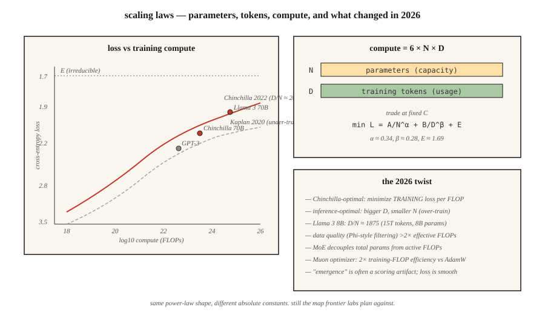

# Scaling Laws

> 2020 年 Kaplan 论文说：模型越大，loss 越低。2022 年 Hoffmann 论文说：你们训练得不够。Compute 会进入两个桶：parameters 和 tokens，而这个分配并不直观。

**Type:** Learn
**Languages:** Python
**Prerequisites:** Phase 7 · 05 (Full Transformer), Phase 7 · 07 (GPT)
**Time:** ~45 minutes

## 问题

当你有 `C` FLOPs 的训练 compute，并想得到最佳模型时，你面前有两个旋钮：

1. **多少参数（N）？** 模型越大，capacity 越高。
2. **多少训练 tokens（D）？** 数据越多，capacity 利用越充分。

FLOPs 近似按 `6 × N × D` 缩放。你可以把 N 推高、D 降低，也可以把 D 推高、N 降低。哪个更好？

2022 年以前，答案是“大力推 N”。GPT-3（2020）有 175B 参数，用约 300B tokens 训练。比例大约是每个参数 1.7 个 tokens。Kaplan scaling laws 支持这种选择。

Hoffmann et al.（2022）训练了一组叫 Chinchilla 的小模型，发现了不同结论：最优比例更接近 **每个参数 20 个 tokens**。GPT-3 训练不足 10 倍。Chinchilla（70B params，1.4T tokens）在每个 benchmark 上都打败 GPT-3（175B，300B tokens），同时 inference cost 低 2.5 倍。

2026 年是 Chinchilla 的世界，但有一个重要转折。Llama 3 8B 在 15 trillion tokens 上训练，比例是每个参数 1,875 个 tokens。比 Chinchilla-optimal 高 94 倍。对会大规模使用的模型来说，inference cost 比 training cost 更重要，所以为了更小、更易部署的 footprint 而 over-training（超过 Chinchilla）是 2026 年默认选择。

## 概念



### Hoffmann law

来自 Chinchilla 论文，loss 遵循：

```text
L(N, D) = A / N^α + B / D^β + E
```

- `N` = parameters（non-embedding）。
- `D` = training tokens。
- `α ≈ 0.34`，`β ≈ 0.28`（大致对称）。
- `E ≈ 1.69`，irreducible loss ceiling。
- `A ≈ 406`，`B ≈ 411`。

随着规模扩大，两个项相互 trade off。在固定 compute（C = 6ND）下对 `N` 求导并求解：

```text
N_opt ≈ 0.6 × (C/6)^0.5
D_opt ≈ 0.6 × (C/6)^0.5
D_opt / N_opt ≈ 20
```

Compute-optimal：每个参数 20 个 tokens。

### 为什么仍然 over-training

Chinchilla-optimal 最小化的是每个 training FLOP 带来的 training loss。但 training cost 只付一次；inference cost 会一直付。

对一个每月服务一万亿 tokens 的 chatbot 来说，inference 主导总成本。Llama 的方式是：train smaller, longer。8B 在 15T tokens 上训练，是深度 inference-optimized：

- 能放进 consumer GPUs。
- Latency 只是 70B Chinchilla-optimal 的一小部分。
- 质量对多数任务来说足够接近。

DeepMind 2024 年论文（"Over-training is the new optimal"）形式化了这一点。对 inference-dominated workloads，正确比例会更接近每个参数 100-500 个 tokens，具体取决于 serving volume。

### Emergence vs smoothness

一种说法是：某些能力（arithmetic、multi-step reasoning、chain-of-thought following）会在某个 scale 上突然“emerge”。

Schaeffer et al.（2023）认为这是 measurement artifact：emergent metrics 使用不连续 scoring（exact match、accuracy at threshold），隐藏了底层 logits 的平滑提升。Continuous metrics（cross-entropy）显示的是平滑曲线。

2026 年的共识是：通过 continuous loss 做预测是可靠的。Benchmark jumps 经常是 scorer artifacts。预算规划应基于 continuous metrics。

### 2026 年图景

Scaling laws 仍然有效，但：

| Factor | Changed how |
|--------|-------------|
| Data quality | Curating "good" tokens（Phi-style）会让曲线移动，等效 compute 提升 >2x |
| MoE | Total params 与 active FLOPs 解耦；scaling laws 按 per-active-FLOP 看 |
| Post-training | 一些能力（instruction following、code）受 SFT+RLHF 影响超过 pretraining |
| Multimodality | Image + text tokens 一起 scale；每种 modality 有单独曲线 |
| Synthetic data | Models 生成 training data；effective compute 可以复利 |

Muon optimizer（Kimi Moonlight，2024）在 matched data 下相对 AdamW 展示了约 2x effective-compute gain。一些 2026 年训练运行默认使用 Muon。它改变 scaling law 的绝对常数，不改变曲线形状。

```figure
scaling-laws
```

## Build It

见 `code/main.py`。我们会实现 Chinchilla loss equation，并在多个 compute budgets 下求解 compute-optimal `(N, D)`。

### Step 1：Chinchilla loss

```python
def chinchilla_loss(N, D, A=406.4, B=410.7, alpha=0.34, beta=0.28, E=1.69):
    return A / N ** alpha + B / D ** beta + E
```

在固定 `C = 6ND` 下，把 `L` 画成 `(N, D)` 上的 contour。找到最小值。

### Step 2：compute-optimal frontier

对从 `1e17` 到 `1e25` FLOPs 的 compute budgets，找到在 `6ND = C` 约束下最小化 loss 的 `(N, D)`。验证比例 `D/N ≈ 20`。

### Step 3：over-training cost

计算训练一个小 10 倍的模型（optimal N 的 1/10，optimal D 的 10 倍）会多付多少 loss。报告换来的 inference FLOP savings（与 N 成正比）。

### Step 4：和真实模型比较

填入 GPT-3、Chinchilla、Llama 3 8B、DeepSeek-V3（active params）等已知 `(N, D)` pairs，比较 predicted loss 和 reported loss。

## Use It

你大概率不会自己训练 frontier model。但 scaling laws 会告诉你：

1. **你的 fine-tune 数据是否足够。** 如果你的 task-specific data 低于 base model 每个参数 20 个 tokens，预期会在某个 loss floor 饱和。
2. **是否该选择更大的 base model。** 如果你的预算主要花在 inference 上，优先选择更小、训练更久的模型。
3. **收益在哪里递减。** 超过 Chinchilla-optimal 的 1000x 后，log-loss 变化会接近噪声。

**2026 年研究轨迹：**

- **Data-constrained regime。** Web 上高质量 tokens 是有限的（过滤后英文约 5-10 trillion）。Frontier pretraining 正在接近这个上限。Synthetic data、multilingual、multimodal 和 RLHF-scaled fine-tuning 是下一批杠杆。
- **Compute-multiplier tricks。** Muon optimizer、MoE、更好的 data curation：每一个都会移动绝对常数，而不是改变 asymptote。
- **Scaling laws for RL。** 仍是开放问题。早期证据显示 RL samples 中也有 power-law，但 exponents 和 pretraining 很不一样。

## Ship It

见 `outputs/skill-training-budget-estimator.md`。这个 skill 会基于 compute budget、deployment constraints 和 target loss，为新的 training run 选择 `(N, D, hours, GPU)`。

## 练习

1. **Easy。** 运行 `code/main.py`。打印 compute budgets `1e20`、`1e22`、`1e24` 对应的 Chinchilla-optimal `(N, D)`。和真实模型表比较。
2. **Medium。** 实现 Hoffmann loss-as-function-of-compute curve。对 compute-optimal frontier 画 loss vs `log10(C)`。找出 scaling law 预测为了让 cross-entropy 再降低 0.1，需要 `>10^28` FLOPs 的位置。
3. **Hard。** 在同一数据集上训练 5 个 tiny models（100K 到 10M params），拟合你自己的 scaling law。估计 `α` 和 `E`。你的 exponents 和已发表结果匹配得如何？

## 关键术语

| 术语 | 常见说法 | 实际含义 |
|------|----------|----------|
| Parameters (N) | "Model size" | Non-embedding weight count；决定 capacity。 |
| Tokens (D) | "Training data" | 训练中看到的 tokens 数量；决定 parameters 被利用得多充分。 |
| Compute (C) | "FLOPs spent" | 对标准 transformer，近似为 `6 × N × D`。 |
| Chinchilla-optimal | "D/N ≈ 20" | 最小化每个 pretraining FLOP loss 的比例。 |
| Over-training | "Past Chinchilla" | 多花 training FLOPs 来节省 inference FLOPs；D/N >> 20。 |
| Irreducible loss | "The floor" | Scaling law 中的 `E` 项；数据本身的 entropy。 |
| Emergent capability | "Sudden jumps at scale" | 经常是 scorer artifact；continuous loss 是平滑的。 |
| Effective compute | "Training-efficiency multiplier" | 更好的 data / optimizer / architecture 会让每个 FLOP 走得更远。 |

## 延伸阅读

- [Kaplan et al. (2020). Scaling Laws for Neural Language Models](https://arxiv.org/abs/2001.08361) — 第一篇 scaling law 论文；undertrained。
- [Hoffmann et al. (2022). Training Compute-Optimal Large Language Models](https://arxiv.org/abs/2203.15556) — Chinchilla。
- [Schaeffer et al. (2023). Are Emergent Abilities of Large Language Models a Mirage?](https://arxiv.org/abs/2304.15004) — emergence as measurement artifact。
- [Sardana, Frankle (2024). Beyond Chinchilla-Optimal: Accounting for Inference in Language Model Scaling Laws](https://arxiv.org/abs/2401.00448) — 为什么 Llama 的 over-training 对它的 workload 是正确选择。
- [Jordan et al. (2024). Muon: An optimizer for hidden layers in neural networks](https://kellerjordan.github.io/posts/muon/) — 2x compute multiplier。
