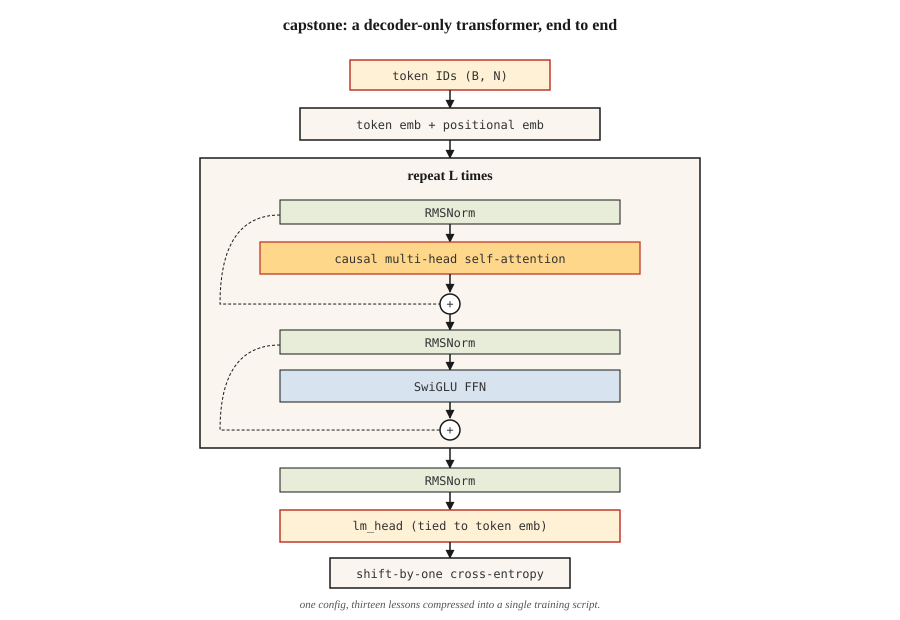

# 从零构建 Transformer：Capstone

> 十三课。一个模型。不走捷径。

**Type:** Build
**Languages:** Python
**Prerequisites:** Phase 7 · 01 through 13. Don't skip.
**Time:** ~120 minutes

## 问题

你已经读过每篇 paper。你实现过 attention、multi-head splits、positional encodings、encoder 和 decoder blocks、BERT 和 GPT losses、MoE、KV cache。现在让它们在一个真实任务上协同工作。

Capstone：在 character-level language modeling task 上 end-to-end 训练一个小型 decoder-only transformer。它读 Shakespeare。它生成新的 Shakespeare。它小到能在笔记本上 10 分钟内训练完。它也足够正确：换成更大的 dataset 和更长训练，你就能得到一个真正的 LM。

这是本课程的 "nanoGPT"。它不是原创形状；Karpathy 2023 年的 nanoGPT tutorial 是每个学生至少会写一次的 reference implementation。我们借用它的 shape，并围绕本阶段已经覆盖的内容重新整理。

## 概念



带注释的 architecture：

```text
input tokens (B, N)
   │
   ▼
token embedding + positional embedding  ◀── Lesson 04 (RoPE option)
   │
   ▼
┌──── block × L ────────────────────┐
│  RMSNorm                          │  ◀── Lesson 05
│  MultiHeadAttention (causal)      │  ◀── Lesson 03 + 07 (causal mask)
│  residual                         │
│  RMSNorm                          │
│  SwiGLU FFN                       │  ◀── Lesson 05
│  residual                         │
└────────────────────────────────── ┘
   │
   ▼
final RMSNorm
   │
   ▼
lm_head (tied to token embedding)
   │
   ▼
logits (B, N, V)
   │
   ▼
shift-by-one cross-entropy            ◀── Lesson 07
```

### 我们 ship 什么

- `GPTConfig`：集中配置所有 hyperparameters。
- `MultiHeadAttention`：causal、batched，并带 optional Flash-style pathway（PyTorch 的 `scaled_dot_product_attention`）。
- `SwiGLUFFN`：modern FFN。
- `Block`：pre-norm，用 residual 包住 attention + FFN。
- `GPT`：embeddings、stacked blocks、LM head、`generate()`。
- 使用 AdamW、cosine LR、gradient clipping 的 training loop。
- Shakespeare text 上的 char-level tokenizer。

### 我们不 ship 什么

- RoPE：Lesson 04 已从概念上实现。这里为了简单使用 learned positional embeddings。练习会让你换成 RoPE。
- Generation 时的 KV cache：每个 generation step 都会在完整 prefix 上重新计算 attention。更慢，但更简单。练习会让你加入 KV cache。
- Flash Attention：如果 inputs 匹配，PyTorch 2.0+ 会自动 dispatch；我们使用 `F.scaled_dot_product_attention`。
- MoE：每个 block 一个单独 FFN。Lesson 11 已经讲过 MoE。

### Target metrics

在 Mac M2 laptop 上，一个 4-layer、4-head、d_model=128 的 GPT，在 `tinyshakespeare.txt` 上训练 2,000 steps：

- Training loss 约从 4.2（random）收敛到 1.5，耗时约 6 分钟。
- Sampled output 看起来像 Shakespeare：古风词、换行、"ROMEO:" 这样的 proper names 会出现。
- Val loss（held-out final 10% text）紧跟 training loss；在这个 size/budget 下没有 overfitting。

## Build It

本课使用 PyTorch。安装 `torch`（CPU build 就可以）。见 `code/main.py`。脚本会处理：

- 如果缺失则下载 `tinyshakespeare.txt`（或读取本地 copy）。
- Byte-level char tokenizer。
- 90/10 train/val split。
- 支持硬件上的 bf16 autocast training loop。
- 训练结束后的 sampling。

### Step 1：data

```python
text = open("tinyshakespeare.txt").read()
chars = sorted(set(text))
stoi = {c: i for i, c in enumerate(chars)}
itos = {i: c for c, i in stoi.items()}
encode = lambda s: [stoi[c] for c in s]
decode = lambda xs: "".join(itos[x] for x in xs)
```

65 个 unique characters。Tiny vocabulary。适合 4-byte vocab_size。没有 BPE，没有 tokenizer drama。

### Step 2：model

见 `code/main.py`。Block 是 Lesson 05 的 textbook 版本：pre-norm、RMSNorm、SwiGLU、causal MHA。4/4/128 的参数量约 800K。

### Step 3：training loop

取一个 random batch，每条是长度 256 的 token windows。Forward。Shift-by-one cross-entropy。Backward。AdamW step。Log。重复。

```python
for step in range(max_steps):
    x, y = get_batch("train")
    logits = model(x)
    loss = F.cross_entropy(logits.view(-1, vocab_size), y.view(-1))
    loss.backward()
    torch.nn.utils.clip_grad_norm_(model.parameters(), 1.0)
    opt.step()
    opt.zero_grad()
```

### Step 4：sample

给定 prompt，反复 forward，从 top-p logits 中 sample，append，然后继续。500 tokens 后停止。

### Step 5：read the output

2,000 steps 后：

```text
ROMEO:
Away and mild will not thy friend, that thou shalt wit:
The chief that well shame and hath been his friends,
...
```

它不是 Shakespeare。但它已经有 Shakespeare-shaped。对于约 800K parameters 和笔记本 6 分钟训练来说，这是清楚的胜利。

## Use It

这个 capstone 是一个 reference architecture。要把它推进到真实东西，有三个 extensions：

1. **Swap the tokenizer。** 使用 BPE（例如 `tiktoken.get_encoding("cl100k_base")`）。Vocab size 会从 65 跳到约 50,000。Model capacity 需要同步扩大来补偿。
2. **Train on a bigger corpus。** 使用 `OpenWebText` 或 `fineweb-edu`（HuggingFace）。在单张 A100 上用 10B tokens 训练一个 125M-param GPT，大约需要 24 小时。
3. **Add RoPE + KV cache + Flash Attention。** 下面的 exercises 会逐个带你做。

最终你会得到一个能生成流畅英文的 125M-parameter GPT。它不是 frontier model。但同一条 code path，只是放大规模，就是 Karpathy、EleutherAI 和 Allen Institute 在 2026 年训练 research checkpoints 的方式。

## Ship It

见 `outputs/skill-transformer-review.md`。这个 skill 会 review 一个 from-scratch transformer implementation，检查它在前 13 课覆盖的 correctness。

## 练习

1. **Easy。** 运行 `code/main.py`。验证你训练出的模型 final-step validation loss 低于 2.0。把 `max_steps` 从 2,000 改成 5,000，val loss 还会继续改善吗？
2. **Medium。** 用 RoPE 替换 learned positional embeddings。在 `MultiHeadAttention` 内对 Q 和 K 应用 rotation。训练并验证 val loss 至少同样低。
3. **Medium。** 在 sampling loop 中实现 KV cache。分别用 cache 和不用 cache 生成 500 tokens。Laptop 上 wall-clock 应该提升 5-20×。
4. **Hard。** 给模型增加第二个 head，用来预测 next-plus-one token（MTP，DeepSeek-V3 的 Multi-Token Prediction）。联合训练。它有帮助吗？
5. **Hard。** 用 4-expert MoE 替换每个 block 中的单 FFN。Router + top-2 routing。在 matched active parameters 下观察 val loss 怎么变化。

## 关键术语

| Term | 人们通常怎么说 | 它实际是什么意思 |
|------|----------------|------------------|
| nanoGPT | "Karpathy's tutorial repo" | Minimal decoder-only transformer training code，约 300 LOC；canonical reference。 |
| tinyshakespeare | "The standard toy corpus" | 约 1.1 MB text；2015 年以来几乎每个 character-LM tutorial 都用它。 |
| Tied embeddings | "Share input/output matrix" | LM head weight = token embedding matrix 的 transpose；节省参数并提升质量。 |
| bf16 autocast | "Training precision trick" | Forward/back 用 bf16，optimizer state 保持 fp32；2021 年以来的标准做法。 |
| Gradient clipping | "Stops spikes" | 把 global grad norm cap 到 1.0；防止 training blowups。 |
| Cosine LR schedule | "The 2020+ default" | LR 先 linear warmup，再按 cosine shape 衰减到 peak 的 10%。 |
| MFU | "Model FLOP Utilization" | Achieved FLOPs / theoretical peak；2026 年 dense 40%、MoE 30% 已经很强。 |
| Val loss | "Held-out loss" | 模型从未见过的数据上的 cross-entropy；overfit detector。 |

## 延伸阅读

- [The Annotated Transformer (Harvard NLP)](https://nlp.seas.harvard.edu/annotated-transformer/) — 经典 annotated implementation。
