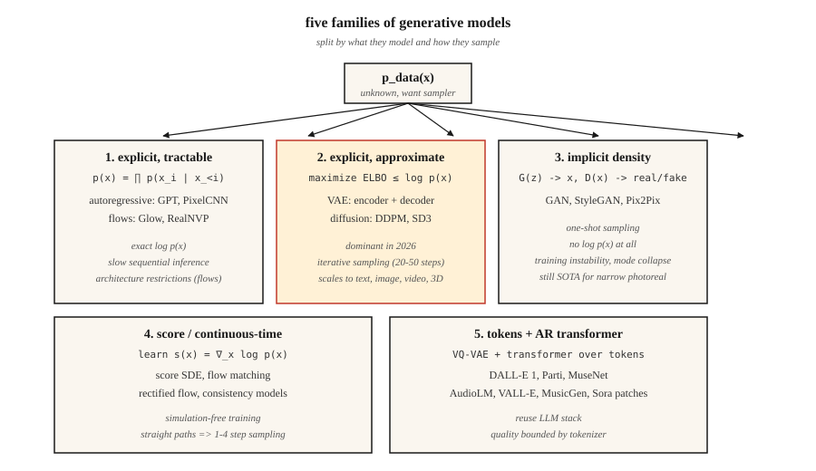

# 生成式模型：分类法与历史

> 每个图像模型、文本模型、视频模型和 3D 模型，都能归入五个桶中的一个。选错桶，你会和数学纠缠好几周；选对桶，过去十二年的进展就会在脑子里整齐堆起来。

**Type:** Learn
**Languages:** Python
**Prerequisites:** Phase 2（ML Fundamentals），Phase 3（Deep Learning Core），Phase 7 · 14（Transformers）
**Time:** ~45 minutes

## 问题

生成式模型只做一件事：给定从某个未知分布 `p_data(x)` 中抽取的训练样本，输出看起来也来自同一分布的新样本。人脸、句子、MIDI 文件、蛋白质结构，如果眯起眼看，都是同一个问题。

麻烦在于，`p_data` 位于一个有数百万维的空间中（512x512 的 RGB 图像约有 786k 维），样本只落在这个空间内部一张很薄的流形上，而你手里可能只有 10M 个例子。暴力估计密度没有希望。每个生成式模型都是一种折中：把一个很难的问题换成另一个稍微没那么难的问题。

过去十二年里，有五大家族活了下来。知道每个家族做了哪种折中，就能解释为什么它在某些任务上胜出，又为什么会在另一些任务上崩掉。

## 概念



**1. 显式密度，可精确计算。** 把 `log p(x)` 写成一个真的可以求值的和。自回归模型（PixelCNN、WaveNet、GPT）把 `p(x)` 分解为 `p(x) = ∏ p(x_i | x_<i)`。归一化流（RealNVP、Glow）把 `p(x)` 构造成一个简单基础分布经过可逆变换后的结果。优点：精确 likelihood，训练损失清晰。缺点：自回归推理是顺序执行的（长序列很慢），flow 需要可逆架构（架构限制很强）。

**2. 显式密度，近似优化。** 从下方界定 `log p(x)`（ELBO），然后优化这个下界。VAE（Kingma 2013）使用带 variational posterior 的 encoder-decoder。扩散模型（DDPM，Ho 2020）训练一个 denoiser，隐式优化加权 ELBO。到 2026 年，diffusion 仍是图像、视频和 3D 的主干。

**3. 隐式密度。** 完全跳过密度；学习一个生成器 `G(z)` 来产生样本，再学习一个判别器 `D(x)` 来区分真假。也就是 GAN（Goodfellow 2014）。推理很快（一次 forward pass），但训练出了名地不稳定。即使在 2026 年，StyleGAN 1/2/3 在固定领域 photorealism（人脸、卧室）上仍然是 state of the art。

**4. Score-based / 连续时间。** 直接学习 log-density 的梯度 `∇_x log p(x)`（也就是 score）。Song & Ermon（2019）证明了 score matching 可以把 diffusion 泛化为一个 SDE。Flow matching（Lipman 2023）是 2024-2026 年的热门方向：无需仿真的训练、更直的路径、比 DDPM 快 4-10 倍的 sampling。Stable Diffusion 3、Flux、AudioCraft 2 都使用 flow matching。

**5. 基于 token 的离散码自回归。** 用 VQ-VAE 或 residual quantizer 把高维数据压缩成较短的离散 token 序列，再用 Transformer 建模这个 token 序列。Parti、MuseNet、AudioLM、VALL-E、Sora 的 patch tokenizer 都属于这一类。这本质上是桶 1 加上一个学出来的 tokenizer。

## 简史

| Year | Model | Why it mattered |
|------|-------|-----------------|
| 2013 | VAE (Kingma) | 第一个拥有可用训练损失的 deep generative model。 |
| 2014 | GAN (Goodfellow) | 隐式密度、没有 likelihood，却能生成惊人锐利的样本。 |
| 2015 | DRAW, PixelCNN | 顺序图像生成。 |
| 2017 | Glow, RealNVP | 可逆 flows；用深度换来精确 likelihood。 |
| 2017 | Progressive GAN | 第一个 megapixel faces。 |
| 2019 | StyleGAN / StyleGAN2 | 在人脸这个单一领域中，photorealistic faces 仍然很难被击败。 |
| 2020 | DDPM (Ho) | Diffusion 变得实用。 |
| 2021 | CLIP, DALL-E 1, VQGAN | Text-to-image 进入主流视野。 |
| 2022 | Imagen, Stable Diffusion 1, DALL-E 2 | Latent diffusion + text conditioning 变成 commodity。 |
| 2022 | ControlNet, LoRA | 对 pretrained diffusion 进行精细控制。 |
| 2023 | SDXL, Midjourney v5, Flow matching | Scale + 更好的训练动态。 |
| 2024 | Sora, Stable Diffusion 3, Flux.1 | Video diffusion；flow matching 胜出。 |
| 2025 | Veo 2, Kling 1.5, Runway Gen-3, Nano Banana | 生产级视频。 |
| 2026 | Consistency + Rectified Flow | 从 diffusion backbones 进行一步采样。 |

## 五问分诊

当一篇新的生成式模型论文出现时，在读 method section 之前先回答这五个问题。

1. **建模的是什么？** Pixels、latents、离散 tokens、3D Gaussians、meshes、waveforms？
2. **密度是显式还是隐式？** 他们有没有写出 `log p(x)`？
3. **Sampling 是一次完成还是迭代完成？** 迭代通常意味着推理更慢；一次完成通常意味着 adversarial 或 distilled。
4. **Conditioning 是什么？Unconditional、class、text、image、pose？** 这会决定 loss 和 architecture scaffolding。
5. **Evaluation 用什么？FID、CLIP score、IS、human preference、task accuracy？** 每个指标都有已知 failure modes（见 Lesson 14）。

本阶段后续每一课，你都会重新回答这五个问题。到最后，它们会变成条件反射。

## Build It

本课代码是一个轻量可视化：从样本中拟合一个 1-D Gaussian mixture，并用三个玩具方法（kernel density、离散 histogram、nearest-sample 的 “GAN-ish” generator）展示 explicit density 和 implicit density 在一个能打印到单屏里的问题上有什么差别。

运行 `code/main.py`。它会从一个双峰 Gaussian mixture 抽取 2000 个样本，然后打印：

```console
explicit density (histogram): p(x in [-0.5, 0.5]) ≈ 0.38
approximate density (KDE):     p(x in [-0.5, 0.5]) ≈ 0.41
implicit (nearest-sample gen): 20 new samples printed, no p(x)
```

注意：前两个方法允许你问“这个点有多可能？”第三个不行。这就是 **explicit vs implicit** 的区别，它会影响之后每一课。

## Use It

2026 年，什么任务该用哪个家族？

| Task | Best family | Why |
|------|-------------|-----|
| Photoreal faces, narrow domain | StyleGAN 2/3 | 仍然最锐利，推理最快。 |
| General text-to-image | Latent diffusion + flow matching | SD3、Flux.1、DALL-E 3。 |
| Fast text-to-image | Rectified flow + distillation | SDXL-Turbo、SD3-Turbo、LCM。 |
| Text-to-video | Diffusion Transformer + flow matching | Sora、Veo 2、Kling。 |
| Speech + music | Token-based AR（AudioLM、VALL-E、MusicGen）或 flow matching（AudioCraft 2） | 离散 tokens 的 scale 成本低。 |
| 3D scenes | Gaussian Splatting fit, diffusion prior | 3D-GS 用于 reconstruction，diffusion 用于 novel-view。 |
| Density estimation (no sampling) | Flows | 唯一拥有精确 `log p(x)` 的家族。 |
| Simulation / physics | Flow matching, score SDE | 直线路径，平滑 vector fields。 |

## Ship It

保存为 `outputs/skill-model-chooser.md`。

这个 skill 接收一个任务描述，并输出：(1) 该使用哪个家族，(2) 三个开源选项和三个托管选项的排序列表，(3) 你应该留意的可能 failure mode，(4) compute/time budget。

## 练习

1. **Easy.** 对下面五个产品分别识别其 family 和 backbone：ChatGPT image、Midjourney v7、Sora、Runway Gen-3、ElevenLabs。证据应来自公开技术报告。
2. **Medium.** 你明天要读的论文声称 sampling 比 diffusion 快 100 倍。写下三个问题，用来检查这个 speedup 在 conditioning 和 high resolution 下是否仍然成立。
3. **Hard.** 选择一个你关心的领域（例如 protein structure、CAD、molecules、trajectories）。对该领域当前 SOTA 模型回答五问分诊，并画出一个更好的模型会改变什么。

## 关键术语

| Term | What people say | What it actually means |
|------|-----------------|-----------------------|
| Generative model | “它会生成新东西” | 学习 `p_data(x)` 的 sampler，也可以选择暴露 `log p(x)`。 |
| Explicit density | “你能评估它” | 模型提供 closed-form 或 tractable 的 `log p(x)`。 |
| Implicit density | “GAN-style” | 只有 sampler，无法评估某个给定点的 `p(x)`。 |
| ELBO | “Evidence lower bound” | `log p(x)` 的 tractable lower bound；VAE 和 diffusion 都优化它。 |
| Score | “Log-density 的梯度” | `∇_x log p(x)`；diffusion 和 SDE 模型学习这个场。 |
| Manifold hypothesis | “数据生活在一个表面上” | 高维数据集中在低维 manifold 上；这解释了为什么 dimensionality reduction 有效。 |
| Autoregressive | “预测下一个片段” | 把 joint factorize 为 conditionals 的乘积。 |
| Latent | “压缩后的 code” | decoder 可以用来重建输入的低维表示。 |

## 生产备注：五大家族，五种推理形状

每个家族都对应一种不同的 inference-server 成本曲线。Production-inference 文献把 LLM inference 拆成 prefill + decode；同样的拆法也适用于这里：

- **Autoregressive（桶 1 和 5）。** 顺序 decode 主导 latency；KV-cache、continuous batching、speculative decoding 都可以直接套用。
- **VAE / diffusion / flow-matching（桶 2 和 4）。** 这里没有 LLM 意义上的 decode。成本 = `num_steps × step_cost`，而 `step_cost` 是在完整 latent resolution 上执行的一次 transformer 或 U-Net forward。生产侧 knobs 是 step count（DDIM / DPM-Solver / distillation）、batch size 和 precision（bf16 / fp8 / int4）。
- **GAN（桶 3）。** 一次 forward pass。没有 schedule，没有 KV-cache。TTFT ≈ total latency。这就是为什么 StyleGAN 在 narrow-domain UX 中仍然胜出的原因。

当你在论文摘要里看到 “faster than diffusion”，把它翻译成 “更少 steps × 相同步成本”，或 “相同 steps × 更便宜步成本”。除此之外都是 marketing。

## 延伸阅读

- [Goodfellow et al. (2014). Generative Adversarial Nets](https://arxiv.org/abs/1406.2661) — GAN 论文。
- [Kingma & Welling (2013). Auto-Encoding Variational Bayes](https://arxiv.org/abs/1312.6114) — VAE 论文。
- [Ho, Jain, Abbeel (2020). Denoising Diffusion Probabilistic Models](https://arxiv.org/abs/2006.11239) — DDPM 论文。
- [Song et al. (2021). Score-Based Generative Modeling through SDEs](https://arxiv.org/abs/2011.13456) — 把 diffusion 视作 SDE。
- [Lipman et al. (2023). Flow Matching for Generative Modeling](https://arxiv.org/abs/2210.02747) — flow matching 论文。
- [Esser et al. (2024). Scaling Rectified Flow Transformers for High-Resolution Image Synthesis](https://arxiv.org/abs/2403.03206) — Stable Diffusion 3。
