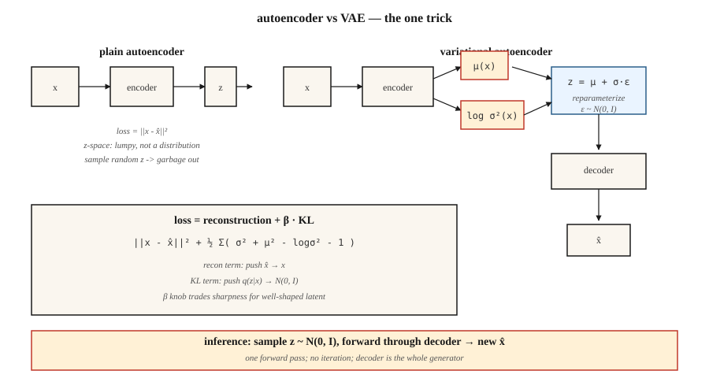

# 自编码器与变分自编码器（VAE）

> 普通自编码器先压缩再重建。它会记忆，但不会生成。加一个技巧：强迫编码看起来像高斯分布，你就得到一个采样器。这个技巧就是 `z = μ + σ·ε` 的重参数化；也正因为它，到 2026 年你使用的每个 latent-diffusion 和 flow-matching 图像模型，输入端几乎都有一个 VAE。

**Type:** Build
**Languages:** Python
**Prerequisites:** Phase 3 · 02 (Backprop), Phase 3 · 07 (CNNs), Phase 8 · 01 (Taxonomy)
**Time:** ~75 minutes

## 问题

把一个 784 像素的 MNIST 数字压缩成 16 个数，再重建出来。普通自编码器可以把 reconstruction MSE 做得很好，但它的 code space 会是一团凹凸不平的混乱结构。从 code space 里随机挑一个点，送进 decoder，通常只会得到噪声。它没有采样器，只是披着生成模型外衣的压缩模型。

你真正想要的是三件事：(a) code space 是一个干净、平滑、可采样的分布，例如各向同性高斯 `N(0, I)`；(b) 解码任意样本都能得到一个合理的数字；(c) encoder 和 decoder 仍然能很好地压缩。三个目标，一个架构，一个 loss。

Kingma 在 2013 年提出的 VAE 用这种方式解决它：让 encoder 输出一个 *分布* `q(z|x) = N(μ(x), σ(x)²)`，用 KL penalty 把这个分布拉向 prior `N(0, I)`，然后在解码前从 `q(z|x)` 采样 `z`。推理时，丢掉 encoder，直接采样 `z ~ N(0, I)`，再 decode。KL penalty 正是让 code space 变得有结构的东西。

到 2026 年，VAE 很少单独作为产品级生成模型发布，因为纯图像质量已经被 diffusion 超过。但它们仍然是每个 latent-diffusion 模型的首选 encoder：SD 1/2/XL/3、Flux、AudioCraft。学会 VAE，你就学会了每条图像生成流水线里那个看不见的第一层。

## 概念



**自编码器。** `z = encoder(x)`，`x̂ = decoder(z)`，loss = `||x - x̂||²`。Code space 没有结构。

**VAE encoder。** 输出两个向量：`μ(x)` 和 `log σ²(x)`。它们定义 `q(z|x) = N(μ, diag(σ²))`。

**重参数化技巧。** 从 `q(z|x)` 采样不可微。把样本改写为 `z = μ + σ·ε`，其中 `ε ~ N(0, I)`。现在 `z` 是 `(μ, σ)` 加上一份非参数噪声后的确定性函数，梯度可以穿过 `μ` 和 `σ`。

**Loss。** Evidence Lower BOund（ELBO），两个部分：

```text
loss = reconstruction + β · KL[q(z|x) || N(0, I)]
     = ||x - x̂||²  + β · Σ_i ( σ_i² + μ_i² - log σ_i² - 1 ) / 2
```

Reconstruction 把 `x̂` 推向 `x`。KL 把 `q(z|x)` 推向 prior。二者互相拉扯。小 β（<1）= 样本更锐利，code space 不那么高斯。大 β（>1）= code space 更干净，样本更模糊。β-VAE（Higgins 2017）让这个旋钮出名，并开启了 disentanglement 研究。

**采样。** 推理时：抽样 `z ~ N(0, I)`，前向通过 decoder。一次前向传播，不像 diffusion 那样需要迭代采样。

```figure
vae-latent-grid
```

## 动手构建

`code/main.py` 实现了一个不依赖 numpy 或 torch 的小型 VAE。输入是从 8 维、2-component Gaussian mixture 采样出的合成数据。Encoder 和 decoder 都是单隐层 MLP。我们会实现 tanh activation、forward pass、loss，以及手写 backward pass。它不是生产代码，而是教学代码。

### Step 1：encoder forward

```python
def encode(x, enc):
    h = tanh(add(matmul(enc["W1"], x), enc["b1"]))
    mu = add(matmul(enc["W_mu"], h), enc["b_mu"])
    log_sigma2 = add(matmul(enc["W_sig"], h), enc["b_sig"])
    return mu, log_sigma2
```

输出 `log σ²` 而不是 `σ`，这样网络输出可以不受约束（对 σ 做 softplus 是个坑，σ ≈ 0 时梯度会死）。

### Step 2：重参数化并解码

```python
def reparameterize(mu, log_sigma2, rng):
    eps = [rng.gauss(0, 1) for _ in mu]
    sigma = [math.exp(0.5 * lv) for lv in log_sigma2]
    return [m + s * e for m, s, e in zip(mu, sigma, eps)]

def decode(z, dec):
    h = tanh(add(matmul(dec["W1"], z), dec["b1"]))
    return add(matmul(dec["W_out"], h), dec["b_out"])
```

### Step 3：ELBO

```python
def elbo(x, x_hat, mu, log_sigma2, beta=1.0):
    recon = sum((a - b) ** 2 for a, b in zip(x, x_hat))
    kl = 0.5 * sum(math.exp(lv) + m * m - lv - 1 for m, lv in zip(mu, log_sigma2))
    return recon + beta * kl, recon, kl
```

这里可以写出精确的 closed-form KL，因为两个分布都是 Gaussian。不要数值积分。到 2026 年仍然有人在代码里用 monte-carlo 估计 KL，这会慢 3 倍，而且没有收益。

### Step 4：生成

```python
def sample(dec, z_dim, rng):
    z = [rng.gauss(0, 1) for _ in range(z_dim)]
    return decode(z, dec)
```

这就是 generative model。五行。

## 常见陷阱

- **Posterior collapse。** KL term 太强，把 `q(z|x) → N(0, I)`，导致 `z` 不再携带 `x` 的信息。修复方式：β-annealing（从 β=0 开始，逐步升到 1）、free bits，或对 inactive dimensions 跳过 KL。
- **样本模糊。** Gaussian decoder likelihood 对应 MSE reconstruction，而 MSE 对 L2 的 Bayes-optimal 解是均值；一组合理数字的均值就是一个模糊数字。修复方式：discrete decoder（VQ-VAE、NVAE），或只把 VAE 当 encoder，再在 latents 上叠 diffusion（Stable Diffusion 就是这样做的）。
- **β 太大、太早。** 见 posterior collapse。先从 β≈0.01 开始，再逐步升高。
- **Latent dim 太小。** 16-D 适合 MNIST，256-D 适合 ImageNet 256²，2048-D 适合 ImageNet 1024²。Stable Diffusion 的 VAE 会把 `512×512×3` 压缩成 `64×64×4`（空间面积 32 倍下采样，channel 也是 32 倍）。

## 使用它

2026 年的 VAE 技术栈：

| Situation | Pick |
|-----------|------|
| Diffusion 的 image-latent encoder | Stable Diffusion VAE (`sd-vae-ft-ema`) 或 Flux VAE |
| Audio-latent encoder | Encodec（Meta）、SoundStream，或 DAC（Descript） |
| Video latents | Sora 的 spatiotemporal patches、Latte VAE、WAN VAE |
| Disentangled representation learning | β-VAE、FactorVAE、TCVAE |
| Discrete latents（用于 transformer modelling） | VQ-VAE、RVQ（ResidualVQ） |
| 用 continuous latents 做生成 | Plain VAE，然后在 latent space 中条件化 flow/diffusion model |

Latent-diffusion model 就是一个 VAE，中间住着一个 diffusion model。VAE 做粗压缩，diffusion model 做重活。视频也是同一个模式（VAE + video-diffusion DiT），音频也是（Encodec + MusicGen transformer）。

## 交付它

保存 `outputs/skill-vae-trainer.md`。

这个 skill 接收：dataset profile + latent-dim target + downstream use（reconstruction、sampling，或 latent-diffusion input），输出：architecture choice（plain/β/VQ/RVQ）、β schedule、latent dim、decoder likelihood（Gaussian vs categorical），以及 evaluation plan（recon MSE、KL per dim、`q(z|x)` 与 `N(0, I)` 之间的 Fréchet distance）。

## 练习

1. **Easy.** 把 `code/main.py` 中的 `β` 改成 `0.01`、`0.1`、`1.0`、`5.0`。记录最终 reconstruction MSE 和 KL。哪个 β 对你的合成数据是 Pareto-best？
2. **Medium.** 用 Bernoulli likelihood（cross-entropy loss）替换 Gaussian decoder likelihood。在同一份合成数据的 binarized 版本上比较 sample quality。
3. **Hard.** 把 `code/main.py` 扩展成一个 mini VQ-VAE：把 continuous `z` 替换成 K=32 个 codebook entries 中的 nearest-neighbour lookup。比较 reconstruction MSE，并报告有多少 codebook entries 被使用（codebook collapse 是真实存在的）。

## 关键术语

| Term | What people say | What it actually means |
|------|-----------------|-----------------------|
| Autoencoder | 编码-解码网络 | `x → z → x̂`，学习 MSE。不是生成模型。 |
| VAE | 带采样器的 AE | Encoder 输出一个分布，KL penalty 塑造 code space。 |
| ELBO | Evidence lower bound | `log p(x) ≥ recon - KL[q(z\|x) \|\| p(z)]`；当 `q = p(z\|x)` 时变紧。 |
| Reparameterization | `z = μ + σ·ε` | 把随机节点重写成 deterministic + pure noise。让采样可以参与反向传播。 |
| Prior | `p(z)` | latent 的目标分布，通常是 `N(0, I)`。 |
| Posterior collapse | “KL term 赢了” | Encoder 忽略 `x`，直接输出 prior；decoder 只能幻觉式生成。 |
| β-VAE | 可调 KL 权重 | `loss = recon + β·KL`。β 越高，越 disentangled，但越模糊。 |
| VQ-VAE | 离散 latent | 把 continuous `z` 替换成最近的 codebook vector；支持 transformer modelling。 |

## 生产备注：VAE 是 diffusion server 里最热的路径

在 Stable Diffusion / Flux / SD3 pipeline 中，VAE 每个请求会被调用两次：一次用于 encode（如果做 img2img / inpainting），一次用于 decode。在 1024² 下，decoder pass 通常是整条 pipeline 中 activation-memory peak 最大的单步，因为它会把 `128×128×16` latents 上采样回 `1024×1024×3`。这带来两个实际后果：

- **Slice 或 tile decode。** `diffusers` 暴露了 `pipe.vae.enable_slicing()` 和 `pipe.vae.enable_tiling()`。Tiling 会用少量 tile seam artifact 换取 `O(tile²)` memory，而不是 `O(H·W)`。这对消费级 GPU 上的 1024²+ 生成很关键。
- **bf16 decoder，最终 resize 使用 fp32 numerics。** SD 1.x VAE 最初以 fp32 发布，在 1024²+ 时如果 cast 到 fp16，会 *悄悄产生 NaNs*。SDXL 发布了 `madebyollin/sdxl-vae-fp16-fix`；始终优先使用 fp16-fix variant，或者改用 bf16。

## 延伸阅读

- [Kingma & Welling (2013). Auto-Encoding Variational Bayes](https://arxiv.org/abs/1312.6114) — VAE 论文。
- [Higgins et al. (2017). β-VAE: Learning Basic Visual Concepts with a Constrained Variational Framework](https://openreview.net/forum?id=Sy2fzU9gl) — disentangled β-VAE。
- [van den Oord et al. (2017). Neural Discrete Representation Learning](https://arxiv.org/abs/1711.00937) — VQ-VAE。
- [Vahdat & Kautz (2021). NVAE: A Deep Hierarchical Variational Autoencoder](https://arxiv.org/abs/2007.03898) — state-of-the-art image VAE。
- [Rombach et al. (2022). High-Resolution Image Synthesis with Latent Diffusion Models](https://arxiv.org/abs/2112.10752) — Stable Diffusion；VAE 作为 encoder。
- [Défossez et al. (2022). High Fidelity Neural Audio Compression](https://arxiv.org/abs/2210.13438) — Encodec，音频 VAE 标准。
