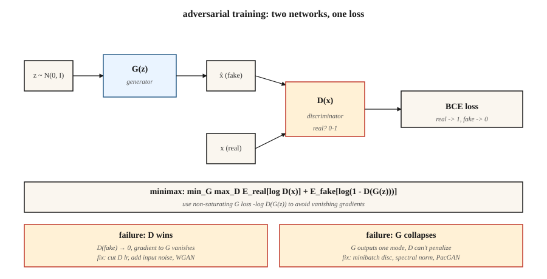

# GANs：生成器 vs 判别器

> Goodfellow 在 2014 年的巧思，是完全绕开显式密度估计。两个网络。一个制造假样本。一个识破假样本。它们互相对抗，直到假样本和真实样本难以区分。它看起来不该有效，很多时候也确实不稳定。但一旦有效，在窄域任务上，GAN 生成的样本至今仍然是文献里最锐利的一类。

**Type:** Build
**Languages:** Python
**Prerequisites:** Phase 3 · 02（Backprop），Phase 3 · 08（Optimizers），Phase 8 · 02（VAE）
**Time:** ~75 minutes

## 问题

VAE 生成的样本容易模糊，因为它的 MSE decoder loss 对“平均图像”是贝叶斯最优的，而许多可能数字的平均值就是一个模糊数字。你想要的是奖励“可信度”的 loss，而不是奖励和某个目标在像素级接近。可信度没有闭式公式，只能学习出来。

Goodfellow 的想法是：训练一个分类器 `D(x)` 来区分真实图像和假图像；再训练一个生成器 `G(z)` 去骗过 `D`。`G` 的 loss 信号来自 `D` 当前认为“像真的”的东西。随着 `G` 变强，这个信号也会更新，目标一直在移动。如果两个网络都收敛，`G` 就在从未写下 `log p(x)` 的情况下学到了数据分布。

这就是对抗训练。数学上，它是一个 minimax game：

```text
min_G max_D  E_real[log D(x)] + E_fake[log(1 - D(G(z)))]
```

到 2026 年，GAN 已经不再是 SOTA 生成器（diffusion 和 flow matching 抢走了王冠）。但 StyleGAN 2/3 仍然是已经落地的人脸模型里最锐利的一批；GAN discriminator 会在 diffusion training 中作为 *perceptual loss* 使用；对抗训练也支撑着快速 1-step distillation（SDXL-Turbo、SD3-Turbo、LCM），让实时 diffusion 可以上线。

## 概念



**生成器 `G(z)`。** 把噪声向量 `z ~ N(0, I)` 映射为样本 `x̂`。它通常是 decoder 形状的网络（dense 或 transposed conv）。

**判别器 `D(x)`。** 把一个样本映射为一个标量概率（或 score）。真实 → 1，伪造 → 0。

**Loss。** 两个交替更新：

- **训练 `D`：** `loss_D = -[ log D(x) + log(1 - D(G(z))) ]`。对 real=1、fake=0 做 binary cross-entropy。
- **训练 `G`：** `loss_G = -log D(G(z))`。这是 Goodfellow 使用的 *non-saturating* 形式（原始的 `log(1 - D(G(z)))` 会在 `D` 很自信时饱和并杀死梯度）。

**训练循环。** 一步 `D`，一步 `G`，反复执行。

**为什么有效。** 如果 `G` 完美匹配了 `p_data`，那么 `D` 最多只能随机猜测，并且在所有地方输出 0.5；`G` 也不会再得到梯度。这就是 equilibrium。

**为什么会坏。** Mode collapse（`G` 找到一个 `D` 分不出来的 mode，然后永远生产它）、vanishing gradient（`D` 学得太快，`log D` 饱和）、training instability（learning rate、batch size，几乎任何东西都会影响）。

## 让 GAN 真正有效的变体

| 年份 | 创新 | 修复点 |
|------|------|--------|
| 2015 | DCGAN | Conv/deconv、batch norm、LeakyReLU：第一个稳定架构。 |
| 2017 | WGAN, WGAN-GP | 用 Wasserstein distance + gradient penalty 替代 BCE，缓解 vanishing gradient。 |
| 2017 | Spectral normalization | 给 discriminator 加 Lipschitz bound。到 2026 年仍在 discriminator 中使用。 |
| 2018 | Progressive GAN | 先训练低分辨率，再逐步添加层。首次得到 megapixel 结果。 |
| 2019 | StyleGAN / StyleGAN2 | Mapping network + adaptive instance norm。固定领域 photorealism 的 SOTA。 |
| 2021 | StyleGAN3 | Alias-free、translation-equivariant：到 2026 年仍是人脸生成金标准。 |
| 2022 | StyleGAN-XL | Conditional、class-aware、更大规模。 |
| 2024 | R3GAN | 用更强 regularization 重新包装；无需技巧即可在 1024² 上工作。 |

```figure
gan-minimax
```

## Build It

`code/main.py` 会在 1-D 数据上训练一个小 GAN：两个 Gaussian 的 mixture。Generator 和 discriminator 都是单隐藏层 MLP。我们会手写 forward、backward 和 minimax loop。目标是亲眼看到两个关键 failure modes（mode collapse + vanishing gradient）如何发生。

### Step 1：non-saturating loss

原始 Goodfellow loss `log(1 - D(G(z)))` 会在 D 以高置信度把 G 的 fake 判为 fake 时趋近 0。此时 G 的梯度基本为 0，无法继续改进。Non-saturating 形式 `-log D(G(z))` 有相反的渐近行为：当 D 很自信时它会变大，给 G 一个强信号。

```python
def g_loss(d_fake):
    # maximize log D(G(z))  <=>  minimize -log D(G(z))
    return -sum(math.log(max(p, 1e-8)) for p in d_fake) / len(d_fake)
```

### Step 2：每一步 generator 对应一步 discriminator

```python
for step in range(steps):
    # train D
    real_batch = sample_real(batch_size)
    fake_batch = [G(z) for z in sample_noise(batch_size)]
    update_D(real_batch, fake_batch)

    # train G
    fake_batch = [G(z) for z in sample_noise(batch_size)]  # fresh fakes
    update_G(fake_batch)
```

训练 G 时要重新生成 fresh fakes，否则梯度就是 stale 的。

### Step 3：观察 mode collapse

```python
if step % 200 == 0:
    samples = [G(z) for z in sample_noise(500)]
    mode_a = sum(1 for s in samples if s < 0)
    mode_b = 500 - mode_a
    if min(mode_a, mode_b) < 50:
        print("  [!] mode collapse: one mode is starved")
```

典型症状是：两个 real modes 中有一个不再被生成。Discriminator 也停止纠正它，因为这个区域从来没有作为 fake 出现过。

## 常见陷阱

- **Discriminator 太强。** 把 D 的 learning rate 降低 2-5 倍，或者加 instance/layer noise。如果 D 的 accuracy 到了 >95%，G 基本就死了。
- **Generator 记住了一个 mode。** 给 D 输入加噪声，使用 minibatch-discriminator layer，或者切换到 WGAN-GP。
- **Batch norm 泄漏统计量。** Real batch + fake batch 经过同一个 BN layer 时，会混合它们的统计量。改用 instance norm 或 spectral norm。
- **Inception-score gaming。** FID 和 IS 在低样本数量下噪声很大。评估时使用 ≥10k samples。
- **对 conditional tasks 来说，one-shot sampling 是假象。** 你仍然需要 CFG scales、truncation tricks 和 re-sampling，才能得到可用输出。

## Use It

2026 年的 GAN stack：

| 场景 | 选择 |
|------|------|
| Photoreal human faces，固定姿态 | StyleGAN3（最锐利、最小） |
| Anime / stylized faces | StyleGAN-XL 或 Stable Diffusion LoRA |
| Image-to-image translation | Pix2Pix / CycleGAN（Phase 8 · 04）或 ControlNet（Phase 8 · 08） |
| 快速 1-step text-to-image | Diffusion 的 adversarial distillation（SDXL-Turbo、SD3-Turbo） |
| Diffusion trainer 内部的 perceptual loss | 针对 image crops 的小型 GAN discriminator |
| 任何 multi-modal、open-ended 任务 | 不要用 GAN；改用 diffusion 或 flow matching |

GAN 很锐利，但很窄。一旦你的 domain 打开了，例如照片、任意文本提示、视频，就切换到 diffusion。对抗技巧会作为组件继续存在（perceptual losses、distillation），而不是作为独立生成器。

## Ship It

保存 `outputs/skill-gan-debugger.md`。这个 skill 接收一次失败的 GAN run（loss curves、sample grid、dataset size），输出最可能原因的排序列表、单行修复建议和 rerun protocol。

## 练习

1. **Easy.** 用默认设置运行 `code/main.py`。然后设置 `D_LR = 5 * G_LR` 并重新运行。G 的 loss 多快会塌缩成一个常数？
2. **Medium.** 把 Goodfellow BCE loss 替换为 WGAN loss：`loss_D = E[D(fake)] - E[D(real)]`，`loss_G = -E[D(fake)]`，并把 D 的权重裁剪到 `[-0.01, 0.01]`。训练是否更稳定？比较 wall-clock convergence。
3. **Hard.** 把 1-D 例子扩展为 2-D 数据（圆环上 8 个 Gaussian 的 mixture）。记录 generator 在 step 1k、5k、10k 分别捕获了 8 个 modes 中的多少个。实现 minibatch discrimination 并重新测量。

## 关键术语

| 术语 | 大家常说 | 实际含义 |
|------|----------|----------|
| Generator | “G” | 噪声到样本的网络，`G: z → x̂`。 |
| Discriminator | “D” | 分类器 `D: x → [0, 1]`，区分 real 和 fake。 |
| Minimax | “The game” | 对联合目标做 `min_G max_D`。 |
| Non-saturating loss | “The fix” | 对 G 使用 `-log D(G(z))`，而不是 `log(1 - D(G(z)))`。 |
| Mode collapse | “G memorized one thing” | 尽管数据很多样，generator 只产生少数几种不同输出。 |
| WGAN | “Wasserstein” | 用 Earth-Mover distance + gradient penalty 替代 BCE；梯度更平滑。 |
| Spectral norm | “Lipschitz trick” | 约束 D 的权重范数以限制斜率；稳定训练。 |
| StyleGAN | “The one that works” | Mapping network + AdaIN；人脸生成的一流方法，到 2026 年仍然如此。 |

## Production note：one-shot inference 是 GAN 留下来的长期优势

GAN 在 open-domain generation 的 sample quality 上已经不再领先，但它仍然在 inference cost 上胜出。按照 production-inference 文献的词汇，一个 GAN 有：

- **没有 prefill，也没有 decode stages。** 一次 `G(z)` forward pass。TTFT ≈ total latency。
- **没有 KV-cache pressure。** 唯一状态是 weights。Batch size 受 activation memory 限制，而不是 cache 限制。
- **几乎平凡的 continuous batching。** 因为每个 request 都消耗同样固定的 FLOPs，所以在服务器目标占用率下使用 static batch 通常最优。不需要 in-flight scheduler。

这就是为什么 GAN distillation（SDXL-Turbo、SD3-Turbo、ADD、LCM）是 2026 年快速 text-to-image 的主流技术：它把 20-50 步 diffusion pipeline 压缩成 1-4 次 GAN 风格的 forward pass，同时保留 diffusion base 的分布。Adversarial loss 作为训练时旋钮继续存在，用来把慢生成器变成快生成器。

## 延伸阅读

- [Goodfellow et al. (2014). Generative Adversarial Nets](https://arxiv.org/abs/1406.2661)：原始 GAN 论文。
- [Radford et al. (2015). Unsupervised Representation Learning with DCGAN](https://arxiv.org/abs/1511.06434)：第一个稳定架构。
- [Arjovsky, Chintala, Bottou (2017). Wasserstein GAN](https://arxiv.org/abs/1701.07875)：WGAN。
- [Miyato et al. (2018). Spectral Normalization for GANs](https://arxiv.org/abs/1802.05957)：SN。
- [Karras et al. (2020). Analyzing and Improving the Image Quality of StyleGAN](https://arxiv.org/abs/1912.04958)：StyleGAN2。
- [Karras et al. (2021). Alias-Free Generative Adversarial Networks](https://arxiv.org/abs/2106.12423)：StyleGAN3。
- [Sauer et al. (2023). Adversarial Diffusion Distillation](https://arxiv.org/abs/2311.17042)：SDXL-Turbo。
