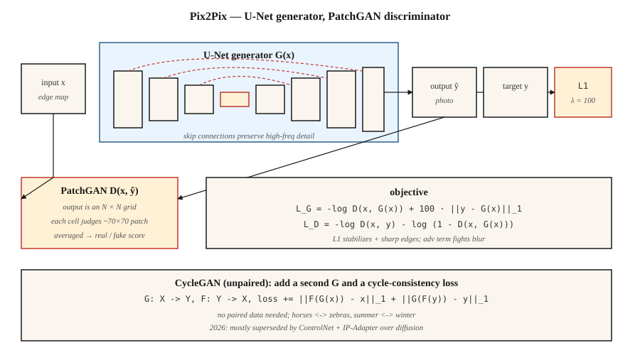

# 条件 GAN 与 Pix2Pix

> 2014-2017 年间，GAN 的第一个大突破是：控制它生成什么。接上标签、图像或句子。Pix2Pix 做的是图像版本；在窄域 image-to-image 任务上，它到今天仍然能击败很多通用 text-to-image 模型。

**Type:** Build
**Languages:** Python
**Prerequisites:** Phase 8 · 03 (GANs), Phase 4 · 06 (U-Net), Phase 3 · 07 (CNNs)
**Time:** ~75 minutes

## 问题

无条件 GAN 会随机采样人脸。做 demo 很有用，放进生产环境却不够用。你真正想要的是：*把草图映射成照片*、*把地图映射成航拍图*、*把白天场景变成夜晚*、*给灰度图上色*。这些任务里，输入图像 `x` 已经给定，你必须输出一个与它有语义对应关系的 `y`。同一个 `x` 往往有许多合理的 `y`。均方误差会把这些可能性压平成糊状平均值。对抗损失不会，因为“看起来真实”是一个很尖锐的信号。

Conditional GAN（Mirza & Osindero，2014）把条件 `c` 同时作为 `G` 和 `D` 的输入。Pix2Pix（Isola et al.，2017）把这个思路专门用于图像：条件是一整张输入图，生成器是 U-Net，判别器是一个 *patch-based* 分类器（PatchGAN），loss 是 adversarial + L1。即使到了 2026 年，这个配方在窄域 image-to-image 任务上仍然能超过从零训练的 text-to-image 模型，因为它使用的是 *成对数据*，也就是你刚好拥有任务所需的监督信号。

## 概念



**Conditional G。** `G(x, z) → y`。在 Pix2Pix 中，`z` 是 G 内部的 dropout（没有输入噪声，Isola 发现显式噪声会被模型忽略）。

**Conditional D。** `D(x, y) → [0, 1]`。输入是这对数据（条件、输出）。关键区别在这里：D 必须判断 `y` 是否与 `x` 一致，而不只是判断 `y` 看起来是否真实。

**U-Net 生成器。** 带 bottleneck 跨层 skip connections 的 encoder-decoder。对于输入和输出共享底层结构的任务（边缘、轮廓、布局），它非常关键。没有 skips，高频细节会消失。

**PatchGAN 判别器。** D 不输出单个 real/fake 分数，而是输出一个 `N×N` 网格，每个 cell 判断大约 `70×70` 像素 receptive field 的真假，然后取平均。这相当于一个 Markov random field 假设：真实感主要是局部的。它训练更快、参数更少，输出更锐利。

**Loss。**

```text
loss_G = -log D(x, G(x)) + λ · ||y - G(x)||_1
loss_D = -log D(x, y) - log (1 - D(x, G(x)))
```

L1 项稳定训练，并把 G 推向已知目标。L1 比 L2 产生更锐利的边缘（中位数，而不是均值）。`λ = 100` 是 Pix2Pix 的默认设置。

## CycleGAN：当你没有成对数据时

Pix2Pix 需要成对的 `(x, y)` 数据。CycleGAN（Zhu et al.，2017）用一个额外的 loss 换掉了这个要求：*cycle consistency* loss。两个生成器 `G: X → Y` 和 `F: Y → X`。训练目标是让 `F(G(x)) ≈ x`，同时让 `G(F(y)) ≈ y`。这样，即使没有成对样本，你也可以把马变成斑马，把夏天变成冬天。

到 2026 年，未配对 image-to-image 大多由 diffusion 完成（ControlNet、IP-Adapter），而不是 CycleGAN。但 cycle-consistency 这个想法，仍然存在于几乎所有未配对 domain adaptation 论文里。

## 动手构建

`code/main.py` 在 1-D 数据上实现了一个小型 conditional GAN。条件 `c` 是类别标签（0 或 1）。任务是：针对给定类别，从对应的条件分布中生成样本。

### Step 1：把条件附加到 G 和 D 的输入上

```python
def G(z, c, params):
    return mlp(concat([z, one_hot(c)]), params)

def D(x, c, params):
    return mlp(concat([x, one_hot(c)]), params)
```

One-hot encoding 是最简单的方式。更大的模型会使用 learned embeddings、FiLM modulation，或 cross-attention。

### Step 2：条件化训练

```python
for step in range(steps):
    x, c = sample_real_conditional()
    noise = sample_noise()
    update_D(x_real=x, x_fake=G(noise, c), c=c)
    update_G(noise, c)
```

生成器必须匹配 *给定条件下* 的真实分布，而不是匹配边缘分布。

### Step 3：逐类别验证输出

```python
for c in [0, 1]:
    samples = [G(noise, c) for noise in batch]
    mean_c = mean(samples)
    assert_near(mean_c, real_mean_for_class_c)
```

## 常见陷阱

- **条件被忽略。** G 学会了边缘化条件，D 又没有惩罚它，因为条件信号太弱。修复方式：更强地条件化 D（放在早期层，而不是只放在后期），或使用 projection discriminator（Miyato & Koyama 2018）。
- **L1 权重太低。** G 漂向任意“看起来真实”的输出，而不是忠实于输入的输出。Pix2Pix 风格任务可以从 λ≈100 开始。
- **L1 权重太高。** G 产生模糊输出，因为 L1 归根结底仍然是一个 L_p norm。训练稳定后可以逐步退火。
- **D 里泄漏 ground truth。** D 的输入应该拼接 `(x, y)`，而不是只输入 `y`。否则 D 无法检查一致性。
- **逐类别 mode collapse。** 每个类别都可能独立 collapse。要运行 class-conditional diversity checks。

## 使用它

2026 年的 image-to-image 任务状态：

| Task | Best approach |
|------|---------------|
| 草图 → 照片，同一领域，成对数据 | Pix2Pix / Pix2PixHD（仍然快速、仍然锐利） |
| 草图 → 照片，未配对 | ControlNet with a Scribble conditioning model |
| Semantic seg → photo | SPADE / GauGAN2 or SD + ControlNet-Seg |
| Style transfer | Diffusion with IP-Adapter or LoRA；GAN methods are legacy |
| Depth → photo | ControlNet-Depth over Stable Diffusion |
| Super-resolution | Real-ESRGAN (GAN), ESRGAN-Plus, or SD-Upscale (diffusion) |
| Colorization | ColTran, diffusion-based colorizers, or Pix2Pix-color |
| 白天 → 夜晚、季节、天气 | CycleGAN or ControlNet-based |

当满足这三点时，Pix2Pix 仍然是正确工具：(a) 你有数千个成对样本，(b) 任务窄且可重复，(c) 你需要快速推理。对于通用 open-domain 任务，diffusion 胜出。

## 交付它

保存 `outputs/skill-img2img-chooser.md`。这个 skill 接收任务描述、数据可用性（paired vs unpaired，样本数 N）以及 latency/quality budget，然后输出：方案（Pix2Pix、CycleGAN、ControlNet 变体、SDXL + IP-Adapter）、训练数据要求、推理成本，以及评估协议（LPIPS、FID、task-specific）。

## 练习

1. **Easy.** 修改 `code/main.py`，加入第三个类别。确认 G 仍然能把每个类别的噪声映射到正确 mode。
2. **Medium.** 在 1-D 设置中，把 L1 替换成 perceptual-style loss（例如用一个小型 frozen D 作为 feature extractor）。它会改变条件分布的 sharpness 吗？
3. **Hard.** 在 1-D 设置中草拟一个 CycleGAN：两个分布、两个生成器、cycle loss。展示它如何在没有成对数据的情况下学会二者之间的映射。

## 关键术语

| Term | What people say | What it actually means |
|------|-----------------|-----------------------|
| Conditional GAN | “带标签的 GAN” | `G(z, c)`、`D(x, c)`。两个网络都能看到条件。 |
| Pix2Pix | “Image-to-image GAN” | 成对 cGAN，使用 U-Net G、PatchGAN D 和 L1 loss。 |
| U-Net | “带 skips 的 encoder-decoder” | 对称卷积网络；skips 保留高频信息。 |
| PatchGAN | “局部真实感分类器” | D 输出逐 patch 分数，而不是全局分数。 |
| CycleGAN | “未配对图像翻译” | 两个 G 加 cycle-consistency loss；不需要成对数据。 |
| SPADE | “GauGAN” | 用 semantic map 对中间 activations 做 normalization；segmentation-to-image。 |
| FiLM | “Feature-wise linear modulation” | 条件产生逐 feature 的 affine transform；便宜的 conditioning。 |

## 生产备注：Pix2Pix 作为 latency-bound baseline

当你有成对数据，而且任务很窄（sketch → render、semantic map → photo、day → night），Pix2Pix 的一次性推理在 latency 上可以比 diffusion 快一个数量级。生产比较通常是：

| Path | Steps | Typical latency at 512² on a single L4 |
|------|-------|----------------------------------------|
| Pix2Pix（U-Net forward） | 1 | ~30 ms |
| SD-Inpaint or SD-Img2Img | 20 | ~1.2 s |
| SDXL-Turbo Img2Img | 1-4 | ~0.15-0.35 s |
| ControlNet + SDXL base | 20-30 | ~3-5 s |

Pix2Pix 在静态批处理吞吐上胜出（每个请求都是相同 FLOPs）。Diffusion 在质量和泛化上胜出。现代做法通常是：为窄任务发布一个 Pix2Pix-style distilled model，同时为长尾输入保留 diffusion fallback。

## 延伸阅读

- [Mirza & Osindero (2014). Conditional Generative Adversarial Nets](https://arxiv.org/abs/1411.1784)：cGAN 论文。
- [Isola et al. (2017). Image-to-Image Translation with Conditional Adversarial Networks](https://arxiv.org/abs/1611.07004)：Pix2Pix。
- [Zhu et al. (2017). Unpaired Image-to-Image Translation using Cycle-Consistent Adversarial Networks](https://arxiv.org/abs/1703.10593)：CycleGAN。
- [Wang et al. (2018). High-Resolution Image Synthesis with Conditional GANs](https://arxiv.org/abs/1711.11585)：Pix2PixHD。
- [Park et al. (2019). Semantic Image Synthesis with Spatially-Adaptive Normalization](https://arxiv.org/abs/1903.07291)：SPADE / GauGAN。
- [Miyato & Koyama (2018). cGANs with Projection Discriminator](https://arxiv.org/abs/1802.05637)：projection D。
