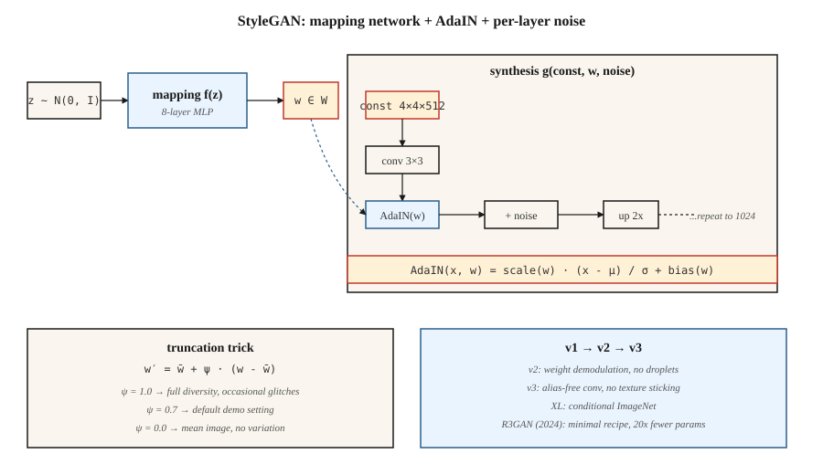

# StyleGAN

> 大多数 generator 会把 `z` 一次性搅进每一层。StyleGAN 把它拆开了：先把 `z` 映射到中间空间 `w`，再通过 AdaIN 在每个 resolution level 注入 `w`。就是这个改动，把 latent space 解缠了，并让 photorealistic faces 在接下来七年里几乎变成一个已解决的问题。

**Type:** Build
**Languages:** Python
**Prerequisites:** Phase 8 · 03 (GANs), Phase 4 · 08 (Normalization), Phase 3 · 07 (CNNs)
**Time:** ~45 minutes

## 问题

DCGAN 会通过一叠 transposed convolutions 把 `z` 映射成图像。问题在于：`z` 控制一切，姿态、光照、身份、背景全都纠缠在一起。沿着 `z` 的某个轴移动，这四件事会一起变化。你无法要求模型“同一个人，换一个姿态”，因为表示本身没有这样分解。

Karras 等人（2019，NVIDIA）的提议是：停止把 `z` 直接喂给 conv layers。把一个常量 `4×4×512` tensor 作为网络输入。学习一个 8 层 MLP，把 `z ∈ Z → w ∈ W`。再通过 *adaptive instance normalization*（AdaIN）在每个 resolution 注入 `w`：先 normalize 每个 conv feature map，然后用 `w` 的 affine projection 去 scale 和 shift。再给每层加入 noise，用来控制随机细节（皮肤毛孔、发丝）。

结果是：`W` 对“高层 style”（姿态、身份）和“细粒度 style”（光照、颜色）形成了大致正交的轴。你可以把图像 A 的 `w` 用在低分辨率层，把图像 B 的 `w` 用在高分辨率层，从而交换 style。这打开了 editing、cross-domain stylization，以及整条 “StyleGAN-inversion” 研究线。

## 概念



**Mapping network.** `f: Z → W`，一个 8 层 MLP。`Z = N(0, I)^512`。`W` 不再被强迫成 Gaussian，它会学出适配数据的形状。

**Synthesis network.** 从一个可学习常量 `4×4×512` 开始。每个 resolution block 是：`upsample → conv → AdaIN(w_i) → noise → conv → AdaIN(w_i) → noise`。Resolution 依次翻倍：4、8、16、32、64、128、256、512、1024。

**AdaIN.**

```text
AdaIN(x, y) = y_scale · (x - mean(x)) / std(x) + y_bias
```

其中 `y_scale` 和 `y_bias` 来自 `w` 的 affine projections。先对每个 feature map 做 normalize，再重新施加 style。这里的 “style” 指的是 feature map 的一阶和二阶统计量。

**Per-layer noise.** 给每个 feature map 加入 single-channel Gaussian noise，并用一个可学习的 per-channel factor 缩放。它控制随机细节，但不改变全局结构。

**Truncation trick.** 推理时先 sample `z`，计算 `w = mapping(z)`，再计算 `w' = ŵ + ψ·(w - ŵ)`，其中 `ŵ` 是大量样本上的 mean `w`。`ψ < 1` 用多样性换质量。几乎每个 StyleGAN demo 都会用 `ψ ≈ 0.7`。

## StyleGAN 1 → 2 → 3

| Version | Year | Innovation |
|---------|------|------------|
| StyleGAN | 2019 | Mapping network + AdaIN + noise + progressive growing。 |
| StyleGAN2 | 2020 | 用 weight demodulation 替代 AdaIN（修复 droplet artifacts）；skip/residual architecture；path-length regularization。 |
| StyleGAN3 | 2021 | Alias-free convolution + equivariant kernels；消除 texture sticking to pixel grid。 |
| StyleGAN-XL | 2022 | Class-conditional、1024²、ImageNet。 |
| R3GAN | 2024 | 用更强 regularization 重新包装 GAN；在 FFHQ-1024 上用少 20 倍参数接近 diffusion。 |

到 2026 年，StyleGAN3 仍然是这些场景的默认选择：(a) 高 FPS 的窄领域 photorealism，(b) few-shot domain adaptation（用 100 张新数据训练，冻结 mapping），(c) inversion-based editing（找到能重建真实照片的 `w`，再编辑这个 `w`）。对于开放域 text-to-image，它不是合适工具，diffusion 才是。

## 动手构建

`code/main.py` 实现了一个玩具版 1-D “style-GAN lite”：一个 mapping MLP，一个 synthesis function，它接收 learned constant vector，并用 `w` 派生出的 scale/bias 来调制它，还有 per-layer noise。它展示了通过 affine-modulation 注入 `w`，可以匹配甚至超过把 `z` 拼接进 generator input 的做法。

### Step 1：mapping network

```python
def mapping(z, M):
    h = z
    for i in range(num_layers):
        h = leaky_relu(add(matmul(M[f"W{i}"], h), M[f"b{i}"]))
    return h
```

### Step 2：adaptive instance normalization

```python
def adain(x, w_scale, w_bias):
    mu = mean(x)
    sd = std(x)
    x_norm = [(xi - mu) / (sd + 1e-8) for xi in x]
    return [w_scale * xi + w_bias for xi in x_norm]
```

Per-feature-map scale 和 bias 通过 linear projection 从 `w` 得到。

### Step 3：per-layer noise

```python
def add_noise(x, sigma, rng):
    return [xi + sigma * rng.gauss(0, 1) for xi in x]
```

Sigma 是 per-channel learnable 的。

## 常见陷阱

- **Droplet artifacts.** StyleGAN 1 会在 feature maps 里产生团状 droplet，因为 AdaIN 会把 mean 归零。StyleGAN 2 的 weight demodulation 通过缩放 convolution weights 修复了它。
- **Texture sticking.** StyleGAN 1 和 2 的纹理跟随 pixel coordinates，而不是 object coordinates（插值时尤其明显）。StyleGAN 3 用 alias-free convolutions 和 windowed sinc filters 修复这个问题。
- **Mode coverage.** Truncation `ψ < 0.7` 看起来干净，但其实只从一个很窄的锥形区域采样；如果你需要 diversity，用 `ψ = 1.0`。
- **Inversion is lossy.** 把真实照片 invert 到 `W` 通常要靠 optimization 或 encoder（e4e、ReStyle、HyperStyle）。迭代太多时结果会漂移。

## 使用它

| Use case | Approach |
|----------|----------|
| Photoreal human faces（anime、product、narrow） | StyleGAN3 FFHQ / custom fine-tune |
| 从照片做 face editing | e4e inversion + StyleSpace / InterFaceGAN directions |
| Face swap / reenactment | StyleGAN + encoder + blending |
| Avatar pipelines | StyleGAN3 w/ ADA for low-data fine-tune |
| 少量图像的 domain adaptation | Freeze mapping network，fine-tune synthesis |
| Multi-modal 或 text-conditioned generation | 不要用它，使用 diffusion |

对于答案就是“一个人的人脸照片”的产品级 demo，StyleGAN 在 inference cost（一次 forward pass，在 4090 上 <10ms）和相同质量门槛下的 sharpness 上都胜过 diffusion。

## 交付它

保存 `outputs/skill-stylegan-inversion.md`。这个 skill 接收一张真实照片，并输出：inversion method（e4e / ReStyle / HyperStyle）、预期 latent loss、editing budget（在 artifact 出现前你可以在 `W` 里移动多远），以及一组已知可用的 editing directions（年龄、表情、姿态）。

## 练习

1. **Easy.** 用 `adain_on=True` 和 `adain_on=False` 分别运行 `code/main.py`。比较固定 latent 与扰动 latent 下输出的 spread。
2. **Medium.** 实现 mixing regularization：对一个 training batch，计算 `w_a`、`w_b`，在 synthesis 前半段使用 `w_a`，后半段使用 `w_b`。Decoder 会学到 disentangled styles 吗？
3. **Hard.** 拿一个 pretrained StyleGAN3 FFHQ model（`ffhq-1024.pkl`）。通过在 labeled samples 上训练 SVM，找出控制 “smile” 的 `w` direction；报告在 identity drift 前能推多远。

## 关键术语

| Term | What people say | What it actually means |
|------|-----------------|-----------------------|
| Mapping network | “那个 MLP” | `f: Z → W`，8 层，把 latent geometry 与 data statistics 解耦。 |
| W space | “Style space” | Mapping network 的输出；大致 disentangled。 |
| AdaIN | “Adaptive instance norm” | Normalize feature map，然后用 `w` projection 做 scale + shift。 |
| Truncation trick | “Psi” | `w = mean + ψ·(w - mean)`，ψ<1 用多样性换质量。 |
| Path-length regularization | “PL reg” | 惩罚 `w` 单位变化导致的图像大幅变化，让 `W` 更平滑。 |
| Weight demodulation | “StyleGAN2 fix” | Normalize activations 改成 normalize conv weights；消除 droplet artifacts。 |
| Alias-free | “StyleGAN3 的 trick” | Windowed sinc filters；消除 texture sticking to pixel grid。 |
| Inversion | “给真实图像找 w” | Optimize 或 encode `x → w`，使 `G(w) ≈ x`。 |

## 生产备注：为什么 StyleGAN 在 2026 年仍然能上线

StyleGAN3 在 4090 上生成一张 1024² FFHQ face 不到 10 ms：`num_steps = 1`，没有 VAE decode，也没有 cross-attention pass。按生产推理的口径看，这是 image generator 的地板 latency。同分辨率下，一个 50-step SDXL + VAE-decode pipeline 大约需要 3 秒。这是 **300× gap**，而在窄领域产品（avatar services、ID document pipelines、stock face generation）里，它会赢在 TCO。

两个运维后果：

- **No scheduler, no batcher.** 按目标 occupancy 设置 static batch 就是最优。Continuous batching（对 LLMs 和 diffusion 很关键）没有收益，因为每个请求消耗完全相同的 FLOPs。
- **Truncation `ψ` 是 safety knob.** `ψ < 0.7` 会从 mapping network range 的窄锥区域采样。这是 serving layer 控制 sample variance 的唯一杠杆。高峰负载下降低 `ψ`，premium users 则提高它。

## 延伸阅读

- [Karras et al. (2019). A Style-Based Generator Architecture for GANs](https://arxiv.org/abs/1812.04948) — StyleGAN。
- [Karras et al. (2020). Analyzing and Improving the Image Quality of StyleGAN](https://arxiv.org/abs/1912.04958) — StyleGAN2。
- [Karras et al. (2021). Alias-Free Generative Adversarial Networks](https://arxiv.org/abs/2106.12423) — StyleGAN3。
- [Tov et al. (2021). Designing an Encoder for StyleGAN Image Manipulation](https://arxiv.org/abs/2102.02766) — e4e inversion。
- [Sauer et al. (2022). StyleGAN-XL: Scaling StyleGAN to Large Diverse Datasets](https://arxiv.org/abs/2202.00273) — StyleGAN-XL。
- [Huang et al. (2024). R3GAN: The GAN is dead; long live the GAN!](https://arxiv.org/abs/2501.05441) — modern minimal GAN recipe。
