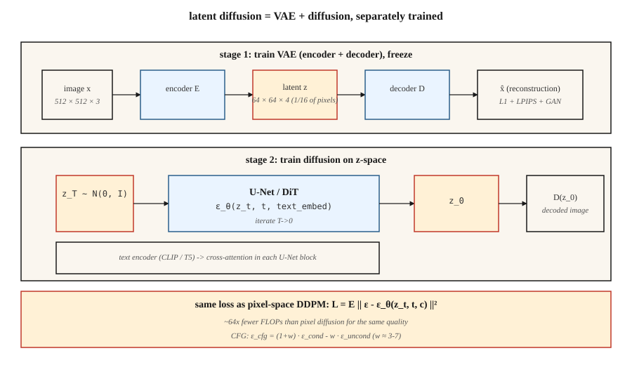

# Latent Diffusion 与 Stable Diffusion

> 在 512×512 图像的 pixel space 里跑 diffusion，计算上近乎犯罪。Rombach et al. (2022) 注意到：生成一张图不需要全部 786k 个维度；你只需要足够捕捉语义结构的表示，再用一个单独的 decoder 还原细节。把 diffusion 放进 VAE 的 latent space 里运行。这一个想法，就是 Stable Diffusion。

**Type:** Build
**Languages:** Python
**Prerequisites:** Phase 8 · 02（VAE），Phase 8 · 06（DDPM），Phase 7 · 09（ViT）
**Time:** ~75 minutes

## 问题

在 512² 的 pixel space 里做 diffusion，意味着 U-Net 要处理形状为 `[B, 3, 512, 512]` 的张量。对一个 500M 参数的 U-Net 来说，每个 sampling step 大约是 100 GFLOPS。50 步就是每张图 5 TFLOPS。在十亿张图上训练，计算账单会荒谬到离谱。

这些 FLOPs 大多花在把感知上不重要的细节推过网络：那些高频纹理本来可以被一个有损 VAE 压掉。Rombach 的想法是：先训练一次 VAE（*first stage*），冻结它，然后完全在 4-channel、64×64 的 latent space（*second stage*）里运行 diffusion。同样的 U-Net。1/16 的像素数。质量相近时 FLOPs 大约少 64 倍。

这就是 Stable Diffusion recipe。SD 1.x / 2.x 使用一个 860M U-Net 处理 `64×64×4` latents；SDXL 使用一个 2.6B U-Net 处理 `128×128×4`；SD3 把 U-Net 换成带 flow matching 的 Diffusion Transformer（DiT）。Flux.1-dev（Black Forest Labs，2024）发布了一个 12B 参数的 DiT-MMDiT。它们都运行在同一个两阶段底座上。

## 概念



**两个阶段，分别训练。**

1. **Stage 1 — VAE。** Encoder `E(x) → z`，decoder `D(z) → x`。目标压缩率：每个空间轴下采样 8×，再调整 channels，让总 latent size 大约是 pixel count 的 1/16。Loss = reconstruction（L1 + LPIPS perceptual）+ KL（小权重，让 `z` 不必被强行压成太 Gaussian，因为我们并不需要从 `z` 精确采样）。通常还会用 adversarial loss，让 decoded images 更锐利。

2. **Stage 2 — 在 `z` 上做 diffusion。** 把 `z = E(x_real)` 当作数据。训练一个 U-Net（或 DiT）去 denoise `z_t`。推理时：通过 diffusion sample 出 `z_0`，再用 `x = D(z_0)` 解码。

**Text conditioning。** 还需要两个额外组件。一个冻结的 text encoder（SD 1.x 用 CLIP-L，SD 2/XL 用 CLIP-L+OpenCLIP-G，SD3 和 Flux 用 T5-XXL）。一个 cross-attention 注入：每个 U-Net block 接收 `[Q = image features, K = V = text tokens]` 并把它们混合进去。Tokens 是文本影响图像的唯一通道。

**Loss function 和 Lesson 06 完全相同。** 仍然是同一个 DDPM / flow matching 的 noise MSE。你只是换了 data domain。

## 架构变体

| 模型 | 年份 | Backbone | Latent shape | Text encoder | Params |
|------|------|----------|--------------|--------------|--------|
| SD 1.5 | 2022 | U-Net | 64×64×4 | CLIP-L（77 tokens） | 860M |
| SD 2.1 | 2022 | U-Net | 64×64×4 | OpenCLIP-H | 865M |
| SDXL | 2023 | U-Net + refiner | 128×128×4 | CLIP-L + OpenCLIP-G | 2.6B + 6.6B |
| SDXL-Turbo | 2023 | Distilled | 128×128×4 | same | 1-4 step sampling |
| SD3 | 2024 | MMDiT（multimodal DiT） | 128×128×16 | T5-XXL + CLIP-L + CLIP-G | 2B / 8B |
| Flux.1-dev | 2024 | MMDiT | 128×128×16 | T5-XXL + CLIP-L | 12B |
| Flux.1-schnell | 2024 | MMDiT distilled | 128×128×16 | T5-XXL + CLIP-L | 12B，1-4 step |

趋势是：用 DiT（latent patches 上的 transformer）替代 U-Net，扩大 text encoder（T5 比 CLIP 更能遵循 prompt），增加 latent channels（4 → 16 给细节留下更多余量）。

```figure
noise-schedule
```

## Build It

`code/main.py` 把一个玩具 1-D “VAE”（identity encoder + decoder，仅用于演示；真实 VAE 会是 conv net）叠在 Lesson 06 的 DDPM 上，并加入带 classifier-free guidance 的 class conditioning。它展示了同一个 diffusion loss 可以在 raw 1-D values 上运行，也可以在 encoded values 上运行；这就是关键洞见。

### Step 1：encoder/decoder

```python
def encode(x):    return x * 0.5          # toy "compression" to smaller scale
def decode(z):    return z * 2.0
```

真实 VAE 有训练出来的 weights。为了教学，这个线性映射已经足够说明 diffusion 在 `z` 上工作，而不关心原始数据空间。

### Step 2：在 `z`-space 中做 diffusion

和 Lesson 06 一样的 DDPM。网络看到的数据是 `z = E(x)`。Sample 得到 `z_0` 之后，用 `D(z_0)` 解码。

### Step 3：classifier-free guidance

训练时，10% 的时间丢弃 class label（替换为 null token）。推理时，同时计算 `ε_cond` 和 `ε_uncond`，然后：

```python
eps_cfg = (1 + w) * eps_cond - w * eps_uncond
```

`w = 0` = 无 guidance（完整 diversity），`w = 3` = 默认，`w = 7+` = 饱和 / 过锐化。

### Step 4：text conditioning（概念，不写代码）

把 class label 换成冻结 text encoder 的输出。通过 cross-attention 把 text embedding 输入 U-Net：

```python
h = h + CrossAttention(Q=h, K=text_embed, V=text_embed)
```

这就是 class-conditional diffusion model 和 Stable Diffusion 之间唯一实质性的差异。

## 常见陷阱

- **VAE-scale mismatch。** SD 1.x 的 VAE 在 encoding 后会应用一个 scaling constant（`scaling_factor ≈ 0.18215`）。忘记它会让 U-Net 在 variance 完全错误的 latents 上训练。每个 checkpoint 都会带这个值。
- **Text encoder 静悄悄地错了。** SD3 需要 T5-XXL，并且 token 数要 >=128；fallback 到 CLIP-only 会损失信息。始终检查 `use_t5=True`，否则 prompt fidelity 会塌。
- **混用 latent spaces。** SDXL、SD3、Flux 都使用不同的 VAE。在 SDXL latents 上训练的 LoRA 不能用于 SD3。Hugging Face diffusers 0.30+ 会拒绝加载不匹配的 checkpoints。
- **CFG 太高。** `w > 10` 会产生饱和、油腻的图像，并且用 diversity 换取对 prompt 的过拟合。甜点区间是 `w = 3-7`。
- **Negative prompts 泄漏。** 空 negative prompt 会变成 null token；填过内容的 negative prompt 会变成 `ε_uncond`。它们不是同一回事；有些 pipeline 会静默默认使用 null。

## Use It

2026 年的生产 stack：

| Target | Recommended backbone |
|--------|----------------------|
| 窄域、paired data、从零训练模型 | SDXL fine-tune（LoRA / full）：最快上线 |
| Open-domain text-to-image，open weights | Flux.1-dev（12B，Apache / non-commercial）或 SD3.5-Large |
| 最快 inference，open weights | Flux.1-schnell（1-4 step，Apache）或 SDXL-Lightning |
| 最佳 prompt adherence，hosted | GPT-Image / DALL-E 3（仍然强）、Midjourney v7、Imagen 4 |
| Edit workflows | Flux.1-Kontext（2024 年 12 月）：原生接受 image + text |
| Research baseline | SD 1.5：老，但研究充分 |

## Ship It

保存 `outputs/skill-sd-prompter.md`。这个 skill 接收 text prompt + target style，并输出：model + checkpoint、CFG scale、sampler、negative prompt、resolution、可选 ControlNet/IP-Adapter 组合，以及逐步 QA checklist。

## 练习

1. **Easy.** 使用 guidance `w ∈ {0, 1, 3, 7, 15}` 运行 `code/main.py`。记录每个 class 的 mean sample。到哪个 `w` 时，class means 会超过真实数据的 means？
2. **Medium.** 把玩具线性 encoder 换成一个 tanh-MLP encoder/decoder pair，并使用 reconstruction loss。重新在新的 latents 上训练 diffusion。Sample quality 有变化吗？
3. **Hard.** 用 diffusers 搭建一个真实 Stable Diffusion inference：加载 `sdxl-base`，用 CFG=7 跑 30 个 Euler steps 并计时。然后切换到 `sdxl-turbo`，用 4 steps 和 CFG=0。相同 subject，不同 quality：描述发生了什么变化以及为什么。

## 关键术语

| 术语 | 大家常说 | 实际含义 |
|------|----------|----------|
| First stage | “The VAE” | 训练好的 encoder/decoder pair；把 512² 压缩成 64²。 |
| Second stage | “The U-Net” | Latent space 上的 diffusion model。 |
| CFG | “Guidance scale” | `(1+w)·ε_cond - w·ε_uncond`；调节 conditioning strength。 |
| Null token | “Empty prompt embed” | 用于 `ε_uncond` 的 unconditional embed。 |
| Cross-attention | “How text gets in” | 每个 U-Net block 都把 text tokens 当作 K 和 V 去 attend。 |
| DiT | “Diffusion Transformer” | 用 latent patches 上的 transformer 替代 U-Net；scale 更好。 |
| MMDiT | “Multi-modal DiT” | SD3 的架构：text 和 image streams 通过 joint attention 混合。 |
| VAE scaling factor | “Magic number” | 把 latents 除以约 5.4，让 diffusion 在 unit-variance space 中运行。 |

## Production note：在 8GB 消费级 GPU 上运行 Flux-12B

Reference Flux integration 是经典的“我只有消费级 GPU，能上线吗？”配方。技巧和生产 inference 文献里对 diffusion DiT 列出的三旋钮 recipe 一样：

1. **Staggered loading。** Flux 有三个网络，它们不需要同时存在于 VRAM：T5-XXL text encoder（fp32 下约 10 GB）、CLIP-L（较小）、12B MMDiT，以及 VAE。先 encode prompt，*删除* encoders，加载 DiT，denoise，*删除* DiT，加载 VAE，decode。消费级 8GB GPU 一次只装得下一个阶段。
2. **通过 bitsandbytes 做 4-bit quantization。** 对 T5 encoder 和 DiT 都使用 `BitsAndBytesConfig(load_in_4bit=True, bnb_4bit_compute_dtype=torch.bfloat16)`。内存减少 8 倍；按 Aritra 的 benchmarks（notebook 中链接），text-to-image 的质量下降几乎不可察觉。
3. **CPU offload。** `pipe.enable_model_cpu_offload()` 会随着每次 forward pass 前进，自动在 CPU 和 GPU 之间交换 modules。它会增加 10-20% latency，但能让 pipeline 跑起来。

内存账是：`10 GB T5 / 8 = 1.25 GB` quantized，`12 B params × 0.5 bytes = ~6 GB` quantized DiT，再加 activations。用 stas00 的说法，这是 TP=1 inference 的极端版本：没有 model parallelism，最大化 quantization。生产环境会在 H100 上跑 TP=2 或 TP=4；但对一台开发者笔记本来说，这就是可行 recipe。

## 延伸阅读

- [Rombach et al. (2022). High-Resolution Image Synthesis with Latent Diffusion Models](https://arxiv.org/abs/2112.10752)：Stable Diffusion。
- [Podell et al. (2023). SDXL: Improving Latent Diffusion Models for High-Resolution Image Synthesis](https://arxiv.org/abs/2307.01952)：SDXL。
- [Peebles & Xie (2023). Scalable Diffusion Models with Transformers (DiT)](https://arxiv.org/abs/2212.09748)：DiT。
- [Esser et al. (2024). Scaling Rectified Flow Transformers for High-Resolution Image Synthesis](https://arxiv.org/abs/2403.03206)：SD3、MMDiT。
- [Ho & Salimans (2022). Classifier-Free Diffusion Guidance](https://arxiv.org/abs/2207.12598)：CFG。
- [Labs (2024). Flux.1 — Black Forest Labs announcement](https://blackforestlabs.ai/announcing-black-forest-labs/)：Flux.1 family。
- [Hugging Face Diffusers docs](https://huggingface.co/docs/diffusers/index)：上面所有 checkpoint 的 reference implementation。
